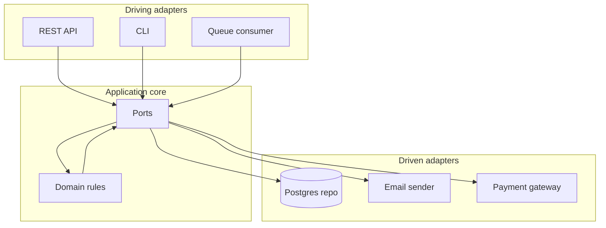
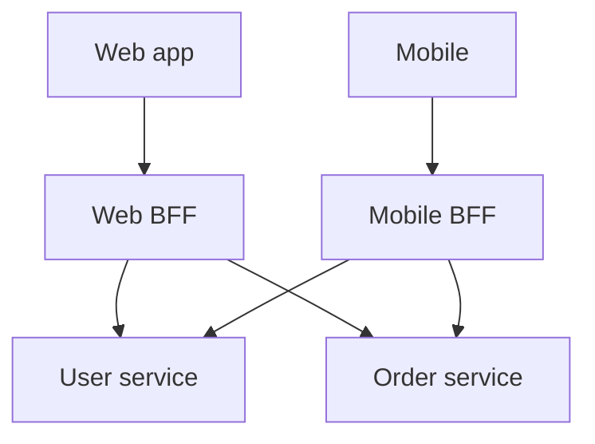
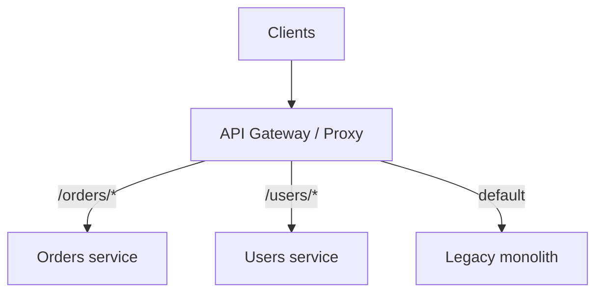
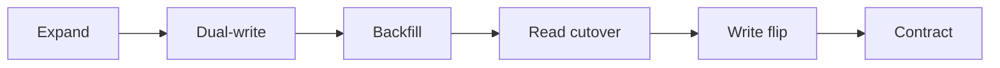
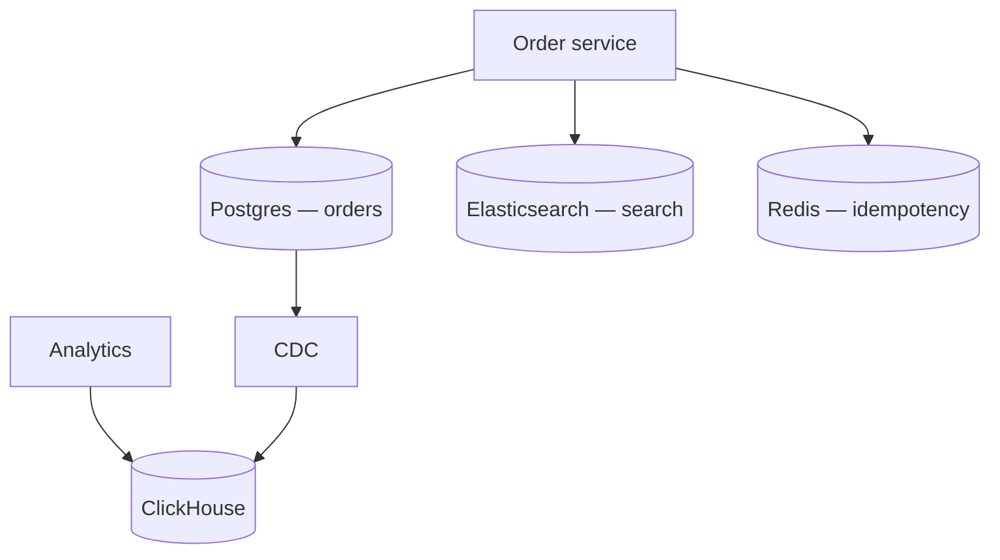
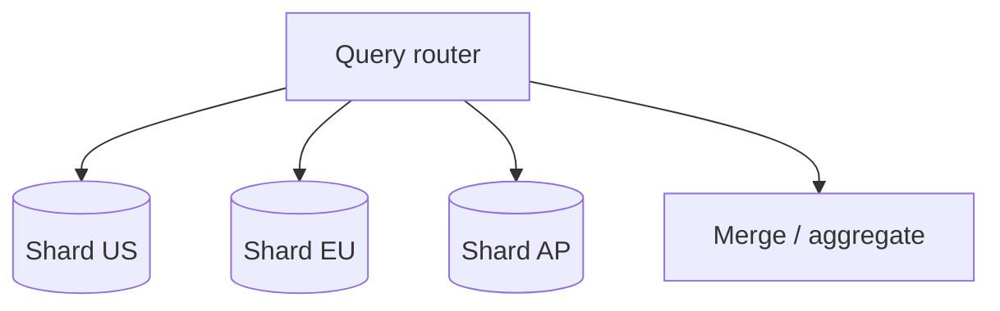
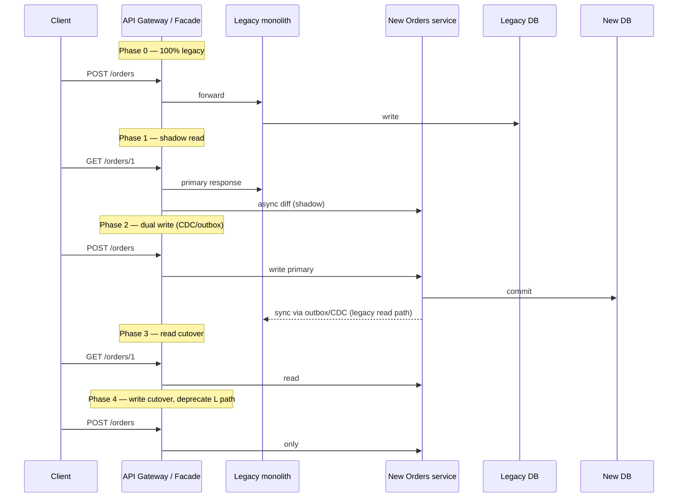

# Architectural Patterns: Hexagonal, BFF, Strangler, Zero Downtime, Polyglot, Federation

> Patterns for **evolving systems** without big-bang rewrites—and for **choosing the right store** per job.

---

## Hexagonal architecture (ports and adapters)

### Problem

Business logic tangled with framework, database, and HTTP details—hard to test and swap infrastructure.

> Put the **domain at the center**; everything external plugs in through **ports** (interfaces) and **adapters** (implementations).



```typescript
// Port
interface OrderRepository {
  save(order: Order): Promise<void>;
  findById(id: OrderId): Promise<Order | null>;
}

// Adapter
class PgOrderRepository implements OrderRepository {
  constructor(private pool: Pool) {}
  async save(order: Order) {
    await this.pool.query(
      'INSERT INTO orders (id, total_cents) VALUES ($1, $2)',
      [order.id, order.totalCents]
    );
  }
}

// Domain (no imports from express or pg)
class PlaceOrder {
  constructor(private repo: OrderRepository) {}
  async execute(cmd: PlaceOrderCommand): Promise<Order> {
    const order = Order.create(cmd);
    await this.repo.save(order);
    return order;
  }
}
```

**Benefit in migrations:** swap `PgOrderRepository` for `ShardedOrderRepository` behind the same port.

---

## Backend for frontend (BFF)

### Problem

One generic API forces mobile to over-fetch and web to under-fetch; `if (platform === 'mobile')` spreads everywhere.

> Each client experience gets a **dedicated backend** that shapes data for that UI.



| Client | BFF returns |
|--------|-------------|
| Web | Rich graph for one page load |
| Mobile | Minimal DTO + pagination |
| Partner | Versioned contract |

```typescript
// Mobile BFF — aggregate + trim fields
app.get('/v1/home', async (req, res) => {
  const [user, orders] = await Promise.all([
    userSvc.summary(req.userId),
    orderSvc.recent(req.userId, limit: 5),
  ]);
  res.json({ user: pick(user, ['name', 'avatarUrl']), orders });
});
```

**Caution:** BFFs can become mini-monoliths—keep them **thin orchestration**, not second domains.

---

## Strangler fig pattern

### Problem

Replace legacy incrementally; big-bang rewrite is too risky.

> Route traffic through a **facade**; migrate feature by feature until the monolith can be retired.



### Steps

1. Pick **bounded context** with clear edges
2. Implement new service + **dual write / CDC** (migration track)
3. **Shadow** then shift reads
4. Cut writes; delete legacy path

Aligns with migration **phase ladder** in `migration-planning.md`.

---

## Zero-downtime migration

### Pillars

| Pillar | Technique |
|--------|-----------|
| Expand/contract schema | Nullable columns, dual-write |
| Traffic shift | Sticky cohorts, not random % |
| Backward-compatible deploys | Two code versions tolerate two data states |
| Verification | Shadow diff + reconciliation |
| Rollback | Reverse sync + fenced flip |



**Zero downtime ≠ zero risk**—it means users keep using the product while you earn confidence.

---

## Polyglot persistence

### Idea

Use **different databases for different shapes** of data—not one hammer for every nail.

| Store type | Sweet spot |
|------------|------------|
| Relational | Transactions, joins, reporting |
| Document | Flexible schema, nested JSON |
| Key-value | Session, cache, simple lookups |
| Columnar | Analytics, scans |
| Graph | Relationship-heavy queries |
| Time-series | Metrics, IoT |



### Rules

1. **One service owns** each write path (no dual writes across teams without pipeline)
2. **Eventual consistency** between stores—outbox/CDC
3. Operational cost scales with **N databases**

```typescript
// Anti-pattern: two sources of truth without sync
await postgres.insert(order);
await mongo.insert(order); // who wins on conflict?
```

---

## Database federation

### Problem

Data lives in **multiple autonomous databases** (per tenant, per acquired company, per region)—queries must span them.

### Patterns

| Pattern | Description |
|---------|-------------|
| **Query federation** | Engine pushes predicates to shards (Presto/Trino, Vitess) |
| **Application federation** | Router fans out, merges in app |
| **Global catalog** | Registry of shard → connection + key range |



| Concern | Approach |
|---------|----------|
| Cross-shard joins | Avoid; denormalize or async materialize |
| Global uniqueness | UUID / snowflake; not auto-increment |
| Transactions | Saga; or limited 2PC where supported |
| Migration | **Don't slice** across federation boundary without plan |

**Vitess / Citus / Spanner** embody different tradeoffs (MySQL compat vs Postgres vs global SQL).

---

## Pattern selection

| Situation | Pattern |
|-----------|---------|
| Testability + swap infra | Hexagonal |
| Multiple client shapes | BFF |
| Legacy replacement | Strangler + migration ladder |
| Live platform move | Zero-downtime expand/contract |
| Different access patterns | Polyglot persistence |
| Many shards, one logical DB | Federation |

---

## Key takeaways

1. **Hexagonal** keeps domain pure—adapters change during migrations.
2. **BFF** optimizes per client; don't duplicate business rules.
3. **Strangler** is the macro story; migration chapters are the micro mechanics.
4. **Zero downtime** is engineered via phases, fences, and verification.
5. **Polyglot** and **federation** multiply power and **operational** cost—slice boundaries deliberately.

---

## Production deep dives (extended)

### Strangler fig: route-by-route migration sequence



| Phase | Traffic | Data risk | Rollback |
|-------|---------|-----------|----------|
| 0 Baseline | All legacy | None | n/a |
| 1 Shadow read | Legacy serves | Compare metrics | Disable shadow |
| 2 Dual write | Legacy or new primary | Drift | Stop sync job |
| 3 Read cutover | New reads | Stale cache | Flip GW weights |
| 4 Write cutover | New only | Orphan legacy rows | Reverse sync + fence |

```yaml
# Kong / NGINX-style weighted route (illustrative)
routes:
  - path: /api/v2/orders
    service: orders-new
  - path: /api/v1/orders
    service: orders-legacy
    plugins:
      - name: traffic-split
        config:
          rules:
            - upstream: orders-new
              weight: 10
            - upstream: orders-legacy
              weight: 90
```

### Zero-downtime: expand/contract with feature flags

```sql
-- Expand: add nullable column
ALTER TABLE orders ADD COLUMN total_cents BIGINT;
-- Dual-write app writes both total and total_cents
-- Backfill: UPDATE orders SET total_cents = total * 100 WHERE total_cents IS NULL;
-- Contract (after flip): ALTER TABLE orders DROP COLUMN total;
```

### Hexagonal: testing with in-memory adapters

```typescript
class InMemoryOrderRepo implements OrderRepository {
  private store = new Map<string, Order>();
  async save(o: Order) { this.store.set(o.id, o); }
  async findById(id: string) { return this.store.get(id) ?? null; }
}

// Domain tests — no Docker, no HTTP
test("place order rejects negative total", async () => {
  const uc = new PlaceOrder(new InMemoryOrderRepo());
  await expect(uc.execute({ totalCents: -1 })).rejects.toThrow();
});
```

### BFF: anti-patterns in production

| Smell | Fix |
|-------|-----|
| BFF owns business rules | Push to domain services |
| BFF calls 15 services per page | GraphQL federation or materialized view |
| Duplicate BFF per team per client | Shared **composition** library, thin BFF |
| BFF stores session state | Regional Redis with stickiness |

### Database federation: Vitess-style routing (conceptual)

```yaml
# Vitess VSchema snippet — hash sharded orders
sharded_tables:
  orders:
    column_vindexes:
      - name: hash
        columns: [tenant_id]
```

### Polyglot: CDC glue (Terraform sketch)

```hcl
resource "aws_dms_replication_task" "pg_to_redshift" {
  replication_task_id       = "orders-cdc"
  migration_type            = "cdc"
  source_endpoint_arn       = aws_dms_endpoint.pg.arn
  target_endpoint_arn       = aws_dms_endpoint.redshift.arn
  table_mappings            = file("table_mappings.json")
}
```

---

## Interview Q&A

### Q: Hexagonal vs layered architecture — what changes in a migration?

**A:** Hexagonal forces **ports** at domain boundary — swapping Postgres for Cassandra is an **adapter** change, not a rewrite of `PlaceOrder`. Layered often leaks SQL into “service” layer. Migration win: run **dual adapters** (old + new repo) behind port for shadow verification.

### Q: When is a BFF an anti-pattern?

**A:** When it becomes a **second monolith** with domain logic, long-lived state, and divergent rules from backend services. BFF should **aggregate and shape**, not own invariants. If web and mobile need different rules, fix **domain API** or use separate bounded contexts, not `if (mobile)` in BFF forever.

### Q: Strangler fig — what do you migrate first?

**A:** Pick a **bounded context** with clear API surface, low cross-monolith coupling, and tolerable dual-write period — often **notifications** or **catalog read** before **payments**. High-coupling core ledger last. Always define **done** (legacy route removed, data reconciled).

### Q: Zero downtime — can you skip the expand phase?

**A:** Only if new schema is **additive-only** and old code ignores new columns. Destructive changes (rename, type change) need **expand → migrate → contract**. Skipping expand forces downtime or risky big-bang ALTER.

### Q: Polyglot persistence — how many databases is too many?

**A:** When operational cost (backup, on-call runbooks, security patches) exceeds team capacity — rule of thumb: **one primary store per service** plus **derived** stores fed by CDC. Two writable sources of truth for same entity without pipeline is **always** too many.

### Q: Federation vs sharding middleware vs application routing?

**A:** **Vitess/Citus** push predicate to shards — less app code, ops complexity in cluster. **App federation** fans out in code — flexible, easy to get N+1 queries wrong. **Query engines** (Trino) for analytics across silos — not OLTP path.

### Q: How does strangler relate to API versioning?

**A:** Strangler often introduces **new routes** (`/v2`) on new stack while `/v1` maps to legacy — versioning is the **facade’s routing table**, not just URL aesthetics. Deprecate v1 when metrics show near-zero traffic and data reconciled.

---

## Decision matrix: client integration

| Situation | BFF | GraphQL gateway | Direct microservice calls |
|-----------|-----|-----------------|---------------------------|
| 2 clients, simple APIs | Optional | Overkill | **OK** |
| Mobile bandwidth sensitive | **BFF** | Possible | Poor |
| Many teams, many clients | Per-experience BFF | **Federation** | Chaos |
| Public third-party API | Versioned API gateway | Rare | **Stable REST** |

---

## Decision matrix: legacy migration

| Constraint | Big bang | Strangler | Parallel run + cut |
|------------|----------|-----------|---------------------|
| Regulated audit | Risky | **Preferred** | Common |
| Small codebase | Maybe | Overkill | OK |
| 24/7 revenue | No | **Yes** | Yes |
| Team < 5 engineers | Costly | **Phased** | Phased |

---

## Senior Pitfalls

| Mistake | Impact | Fix |
|---------|--------|-----|
| BFF + strangler without deletion criteria | Permanent dual stack | Traffic and code deletion milestones in ADR |
| Zero-downtime migration without backfill verification | Silent data gaps after cutover | Row counts, checksums, shadow reads |
| Polyglot persistence without federation strategy | Joins in app; inconsistent aggregates | API composition; event-carried state; single writer |
| Hexagonal ceremony on CRUD-only service | Slow delivery | Patterns where change frequency and test pain justify ports |
| Database federation as default | Distributed query latency | Shard by bounded context; avoid cross-shard OLTP |
| Ignoring org chart in pattern choice | Conway’s law defeats diagram | Align service boundaries with team ownership |

---

## Production-grade Practice

1. **Build:** Document strangler route map for one legacy module: read shadow, write dual, cutover, delete.
2. **Debug:** Run federation query across two DBs; measure p99 and failure partial results—decide denormalization.
3. **Measure:** Deploy frequency and lead time before/after extracting one hexagon-boundary service.
4. **Capacity plan:** Storage and egress for polyglot stack (OLTP + search + warehouse) at 3-year data growth.

---

## Decision matrix: persistence per access pattern

| Access pattern | Primary store | Derived |
|----------------|---------------|---------|
| OLTP transactions | **Postgres** | — |
| Full-text search | Postgres (limited) | **Elasticsearch** |
| Session / rate limit | **Redis** | — |
| Ad-hoc analytics | — | **ClickHouse / warehouse** |
| Graph traversals | — | **Neo4j** (if justified) |
| Time-series metrics | — | **Prometheus / TSDB** |
