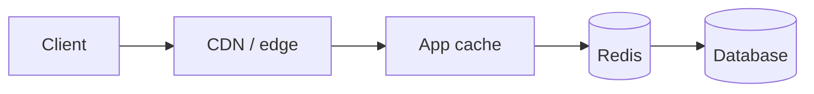
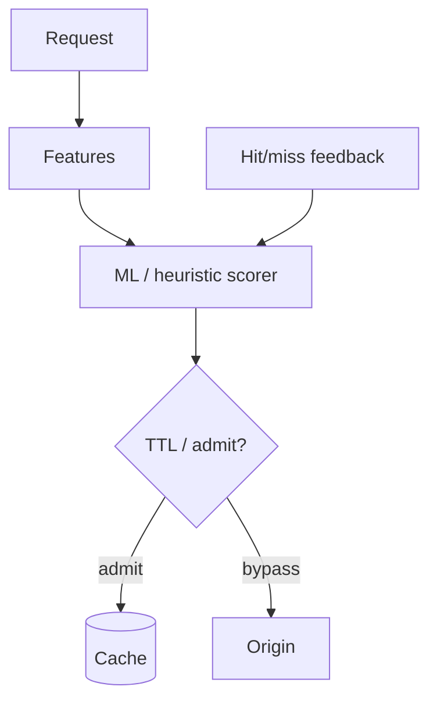
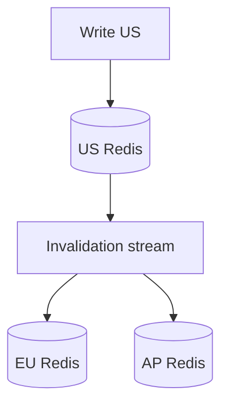
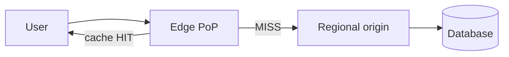
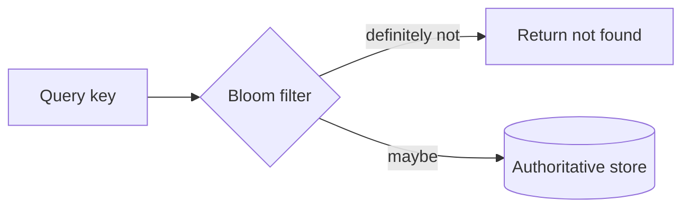
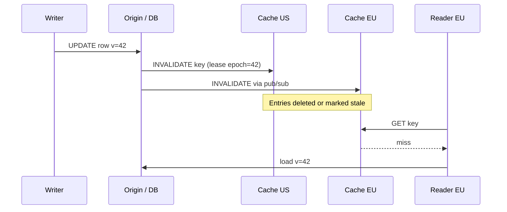
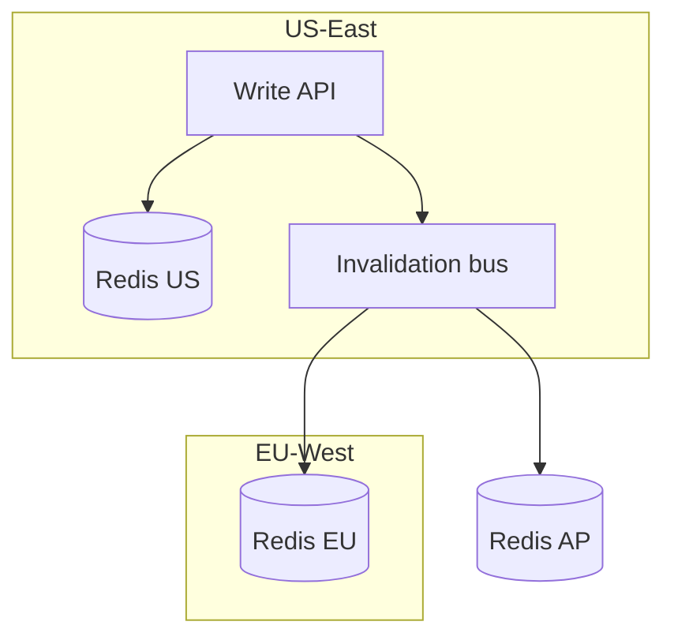

# Caching and Edge: Adaptive Caching, Coherence, Edge, Bloom Filters

> How to make reads fast **without** serving stale lies across regions—and how probabilistic structures save gigabytes.

---

## Caching fundamentals



| Layer | Latency | Consistency |
|-------|---------|-------------|
| Browser / CDN | ms | TTL-based |
| In-process | μs | Per instance |
| Distributed (Redis) | sub-ms | Configurable |
| DB buffer pool | μs | Strong per node |

**Cache-aside (lazy):**

```python
def get_user(user_id: str) -> User:
    key = f"user:{user_id}"
    if (cached := redis.get(key)):
        return deserialize(cached)
    user = db.query("SELECT * FROM users WHERE id = %s", user_id)
    redis.setex(key, 300, serialize(user))
    return user
```

| Pattern | When |
|---------|------|
| Cache-aside | General purpose |
| Read-through | Centralize load logic |
| Write-through | Strong consistency with cache |
| Write-behind | Write amplification, risk on crash |

---

## Adaptive caching (ML-informed)

### Problem

Static TTLs waste memory on cold keys and serve stale hot keys too long.

### Idea

Treat cache as a **decision system**: predict **reuse probability** or **optimal TTL** from features (key class, time of day, recent hit rate, object size).



| Approach | Complexity | Win |
|----------|------------|-----|
| LRU + per-class TTL | Low | Good baseline |
| Bandit per segment | Medium | Adapts to drift |
| Learned admission (e.g. MLCache-style) | High | Better hit rate / memory |

**Production guardrails:**

- Fall back to LRU if model unhealthy
- Cap max TTL; never infinite on user-specific data
- **Do not** cache without keying migration **phase** during cutovers

```python
# Simple adaptive TTL from recent hit rate (illustrative)
def ttl_for(key: str) -> int:
    hits, misses = stats(key, window_sec=3600)
    if hits + misses < 100:
        return 300  # cold: default
    hit_rate = hits / (hits + misses)
    return int(60 + hit_rate * 540)  # 60s .. 600s
```

---

## Cache coherence in multi-region

### Problem

Users in Tokyo and Virginia see **different Redis clusters**; writes in one region must become visible (or intentionally stale) in others.

| Strategy | Consistency | Complexity |
|----------|-------------|------------|
| **TTL only** | Eventual | Low |
| **Active-active replication** | Eventual + conflicts | Medium |
| **Single home region** | Strong per key | Routing needed |
| **Invalidation bus** | Near-strong | Pub/sub lag |



**Rules:**

1. **Invalidate, don't update** remote caches for complex objects (avoid partial updates).
2. Version stamps in cached blob: `{"v": 42, "data": ...}`—reject stale writes.
3. **Session stickiness** reduces cross-region coherence needs for user state.

| Pitfall | Mitigation |
|---------|------------|
| Thundering herd on expiry | Jitter TTL; single-flight refresh |
| Cache stampede after deploy | Warm critical keys; phased rollout |

---

## Edge computing and edge caching

### What runs at the edge?

| Workload | Edge fit |
|----------|----------|
| Static assets | Excellent (CDN) |
| Auth JWT verify | Good |
| A/B routing, WAF | Good |
| Personalization API | Hard (data gravity) |
| Writes to primary DB | Usually **no** |



**Edge caching patterns:**

- **Cache key** includes `Accept-Language`, device tier, **not** raw cookies with PII
- **Stale-while-revalidate** for semi-static JSON
- **Geo routing** to nearest healthy region

```http
Cache-Control: public, max-age=60, stale-while-revalidate=300
```

During migrations: edge may hold **old-shaped** payloads—version keys or shorten TTL through cutover window.

---

## Bloom filters

### Problem

“Have we seen this URL / email / id before?” on **billions** of keys—memory matters.

> A **Bloom filter** is a compact bit array + hash functions: **no false negatives** (if it says “no”, definitely no); **tunable false positives** (if it says “yes”, maybe).

### Math (intuition)

For *n* elements, *m* bits, *k* hash functions, false positive rate ≈ \((1 - e^{-kn/m})^k\).

| n | Target FP rate | m (bits) ≈ | k (hashes) ≈ |
|---|----------------|------------|--------------|
| 1B | 1% | ~9.6 GB | 7 |
| 1B | 0.1% | ~14.4 GB | 10 |

```python
import mmh3

class BloomFilter:
    def __init__(self, m: int, k: int):
        self.m, self.k = m, k
        self.bits = bytearray((m + 7) // 8)

    def _indexes(self, item: bytes):
        for i in range(self.k):
            yield mmh3.hash(item, i) % self.m

    def add(self, item: bytes):
        for idx in self._indexes(item):
            self.bits[idx // 8] |= 1 << (idx % 8)

    def __contains__(self, item: bytes) -> bool:
        return all(
            self.bits[idx // 8] & (1 << (idx % 8))
            for idx in self._indexes(item)
        )
```

### Uses

| Use | Why Bloom |
|-----|-----------|
| CDN “seen URL” dedup | Saves disk |
| DB **negative lookup** avoid | Skip disk if “definitely not in set” |
| Spam / abuse pre-filter | Cheap first gate |
| Cassandra / HBase **SSTable** checks | Skip IO |

### Limitations

| Cannot | Workaround |
|--------|------------|
| Delete single item | Counting Bloom / tombstone generation |
| List members | Only membership test |
| False positives | Confirm with authoritative store |



---

## Design checklist

| Question | Action |
|----------|--------|
| What is the SLO for staleness? | Pick TTL / invalidation strategy |
| Multi-region writes? | Home region or conflict resolution |
| Cutover in flight? | Phase-aware cache keys |
| Billion-key membership? | Bloom + confirm on positive |

---

## Key takeaways

1. **Adaptive caching** tunes TTL/admission from traffic—keep safe fallbacks.
2. **Multi-region** needs explicit invalidation or acceptance of staleness.
3. **Edge** excels at cacheable, read-heavy, latency-sensitive work—not primary writes.
4. **Bloom filters** trade tiny false positives for huge memory savings on membership tests.
5. Caches are **second copies of old** during migrations—plan TTL and key versioning.

---

## Production deep dives (extended)

### Lease-based invalidation protocol

When multiple app instances cache the same key, **broadcast invalidation** can race with in-flight writes. A **lease** ties cache entries to a **version token** issued by the origin (or primary DB).



| Phase | Behavior |
|-------|----------|
| **Read** | Return cached blob only if `blob.lease_epoch >= origin.epoch` for that key |
| **Write** | Commit DB → bump epoch → publish invalidation |
| **In-flight read after write** | Stale lease rejected at compare |

```python
# Cache entry with lease epoch (illustrative)
def set_cached(key: str, data: dict, epoch: int, ttl: int):
    redis.setex(key, ttl, json.dumps({"epoch": epoch, "data": data}))

def get_cached(key: str, min_epoch: int) -> dict | None:
    raw = redis.get(key)
    if not raw:
        return None
    blob = json.loads(raw)
    if blob["epoch"] < min_epoch:
        redis.delete(key)
        return None
    return blob["data"]
```

**Compared to TTL-only:** leases give **bounded staleness** after writes without waiting for TTL expiry; cost is **extra round-trip** to origin on epoch mismatch or metadata store for current epoch per key.

### Cross-region cache sync

| Pattern | Mechanism | Consistency | Pitfalls |
|---------|-----------|-------------|----------|
| **Pub/sub fan-out** | Redis/Kafka invalidation topic | Near-real-time | Missed messages if subscriber down — need **reconciliation** |
| **Active-active replication** | Redis CRDB, Global Datastore | Eventual | **Write conflicts** on same key |
| **Home region** | Route writes to owner region | Strong per key | Routing layer required |
| **Versioned blobs only** | No sync; readers accept staleness | Eventual | UX must tolerate |



**Production rules:**

1. **Invalidate, never PATCH** remote cache entries for composite objects.
2. Run **nightly reconcile**: sample keys, compare origin vs cache epoch histogram.
3. During **migration**, include `schema_phase` in cache key: `user:{id}:v2`.

### Bloom filter sizing (production formulas)

For `n` elements, false positive rate `p`:

- `m = -n * ln(p) / (ln 2)^2` bits
- `k = (m/n) * ln 2` hash functions

```python
import math

def bloom_params(n: int, p: float) -> tuple[int, int]:
    m = math.ceil(-n * math.log(p) / (math.log(2) ** 2))
    k = max(1, round((m / n) * math.log(2)))
    return m, k

# 100M URLs, 0.1% FP → m ≈ 1.44e9 bits (~180 MB), k ≈ 10
m, k = bloom_params(100_000_000, 0.001)
```

| n | p | Approx size | k |
|---|-----|-------------|---|
| 10M | 1% | ~12 MB | 7 |
| 100M | 0.1% | ~180 MB | 10 |
| 1B | 1% | ~1.2 GB | 7 |

**Scaling Bloom filters:** partition by prefix (`bf:shard:{hash%256}`) so rebuild is parallel; **double-buffer** rotate on rebuild to avoid false negatives during resize (build new, atomic swap pointer).

### Edge: Workers + KV for auth at PoP (sketch)

```javascript
// Cloudflare Workers-style — verify JWT at edge, cache JWKS
export default {
  async fetch(request, env) {
    const token = request.headers.get("Authorization")?.slice(7);
    if (!token) return new Response("Unauthorized", { status: 401 });
    let jwks = await env.KV.get("jwks", "json");
    if (!jwks) {
      jwks = await fetch(env.JWKS_URL).then((r) => r.json());
      await env.KV.put("jwks", JSON.stringify(jwks), { expirationTtl: 3600 });
    }
    // verify(token, jwks) ...
    return fetch(request);
  },
};
```

### Adaptive caching in production (guardrails expanded)

| Signal | Action |
|--------|--------|
| Hit rate drop after deploy | Roll back model weights; fall back to LRU |
| Object size p99 spike | Admission control — reject objects > threshold |
| Origin error rate high | **Negative caching** short TTL for 404 only |

---

## Interview Q&A

### Q: Cache-aside vs write-through — which prevents stale reads after write?

**A:** **Write-through** (or write-behind with careful ordering) updates cache on write. **Cache-aside** invalidates or updates in app code — race if read repopulates stale value between DB commit and invalidation. Fix with **transactional ordering** (delete cache after commit), **versioned entries**, or **short TTL** on hot keys. Write-through adds latency to writes but simplifies read path consistency.

### Q: How does single-flight differ from locking the database?

**A:** Single-flight **coalesces** concurrent cache misses for the same key into one origin load; others await the same future. It does not serialize all DB traffic — only per-key thundering herd. Still combine with **jittered TTL** so expiry times do not align across clients.

### Q: Explain false negatives vs false positives in Bloom filters.

**A:** Standard Bloom filters have **no false negatives** for inserted keys (if added, membership test always yes). **False positives** occur: test says “maybe” for keys never added. Hence the pattern: Bloom → on “maybe”, confirm with authoritative store. **Never** treat Bloom “no” as proof key was deleted if you need deletions — use counting Bloom or generation rotation.

### Q: Multi-region: why is “update remote cache” dangerous?

**A:** Partial updates to denormalized objects (user + permissions + subscription) leave **inconsistent cross-field** state if messages arrive out of order. **Delete/invalidate** forces reload of full object. Also, concurrent writers in two regions without home-key routing create **last-writer-wins** ghosts.

### Q: When should personalization run at the edge?

**A:** When data is **cacheable per cohort** (not per user), JWT claims suffice, or edge KV holds **non-sensitive** segments. Avoid edge calls to **primary OLTP** — latency and connection limits kill PoP economics. Personalization needing fresh user graph → **regional origin** with short TTL + stickiness.

### Q: What is stale-while-revalidate (SWR) tradeoff?

**A:** CDN serves **stale** object while one async revalidation runs — great for semi-static JSON and config. Users may see **old content for one request** after deploy. Unacceptable for **price/inventory** unless keys versioned or TTL near zero for those fields.

### Q: How do leases differ from TTL?

**A:** TTL expires on **wall clock** regardless of writes. Leases expire on **logical epoch** bump at write time — readers can hold entries until invalidation without arbitrary staleness window. TTL is simpler; leases need **invalidation plumbing** but give tighter correctness after updates.

---

## Decision matrix: cache patterns

| Goal | Cache-aside | Read-through | Write-through | Write-behind |
|------|-------------|--------------|---------------|--------------|
| Read latency | Good | Good | Good | Good |
| Write consistency | App-managed | Centralized | **Stronger** | Weakest |
| Implementation | **Simplest** | Medium | Medium | Hardest |
| Crash risk | Low | Low | Low | **Data loss risk** |

---

## Senior Pitfalls

| Mistake | Impact | Fix |
|---------|--------|-----|
| Cache-aside without stampede protection | DB meltdown on hot key expiry | Single-flight, jittered TTL, early refresh |
| Same TTL for all keys | Thundering herd on synchronized expiry | Per-key jitter; SWR at CDN |
| Multi-region cache without invalidation story | Stale prices or permissions for minutes | Pub/sub invalidation, version stamps, short TTL on sensitive keys |
| ML adaptive cache with no fallback | Cold-start worse than LRU | Hybrid: LRU baseline + ML overlay; monitor hit rate |
| Edge logic duplicating origin authorization | Security bypass at PoP | Validate tokens at edge; sensitive at origin |
| Bloom filter sized for “eventually” | False positives cause unnecessary DB hits | Size for target FPR; monitor filter effectiveness |

---

## Production-grade Practice

1. **Build:** Implement cache-aside with single-flight on one hot key; load-test expiry moment with and without protection.
2. **Debug:** Trace cross-region stale read; add version header and invalidation path; verify convergence time.
3. **Measure:** Hit rate, origin QPS, and p99 at CDN vs origin-only for representative traffic mix.
4. **Capacity plan:** Redis memory for working set + 30% headroom; edge PoP egress for global launch scenario.

---

## Decision matrix: multi-region coherence

| SLO staleness | Recommended pattern |
|---------------|---------------------|
| < 1s after write | Home region + global router |
| 1–60s | Invalidation bus + lease epoch |
| Minutes OK | TTL + jitter |
| Read-only global | CDN + SWR |
