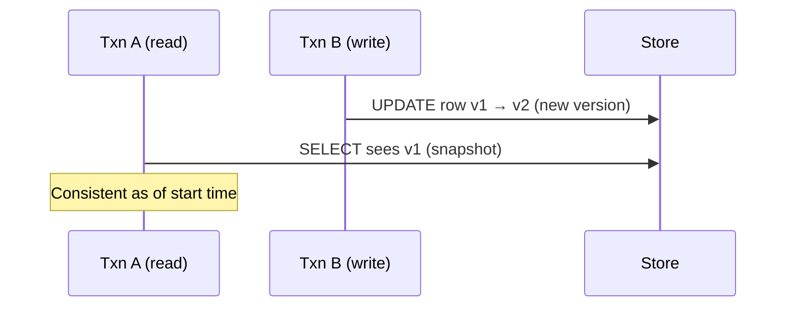
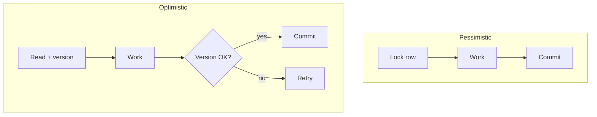
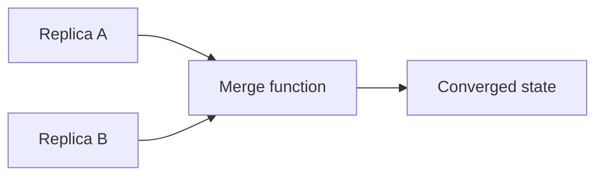
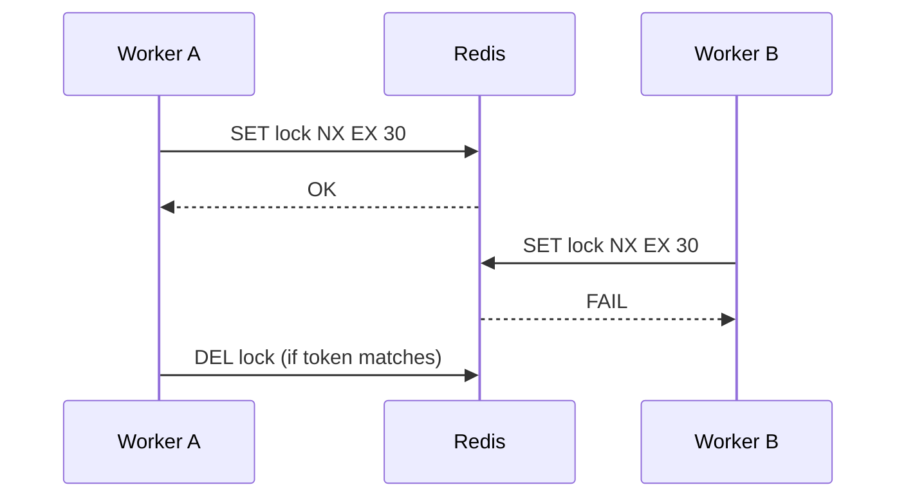
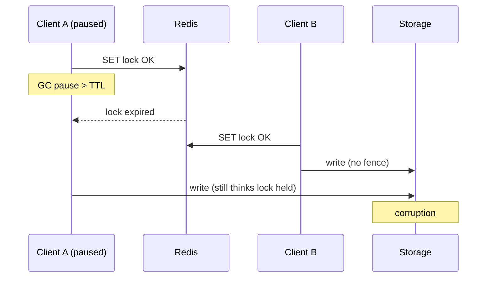

# Concurrency and Locking: CRDTs, MVCC, Optimistic/Pessimistic, Distributed Locks

> How replicas agree under partitions, how databases hide locks, and when Redis locks help or hurt.

---

## MVCC (multi-version concurrency control)

### Idea

Readers don't block writers; writers don't block readers. Each transaction sees a **snapshot** of row versions.



| Engine | Implementation sketch |
|--------|------------------------|
| Postgres | `xmin` / `xmax`, vacuum reclaims dead tuples |
| InnoDB | Undo log chain, purge thread |
| SQL Server | Row versioning in tempdb |

### Implications for you

| Effect | Symptom |
|--------|---------|
| Long read txn | Bloat, vacuum can't reclaim |
| Snapshot isolation | Write skew possible (phantoms) |
| Serializable | Higher conflict abort rate |

```sql
-- Postgres: avoid long transactions in migrations/backfills
BEGIN;
SET TRANSACTION ISOLATION LEVEL READ COMMITTED;
-- short work
COMMIT;
```

**Migration link:** one long verifier snapshot pins **whole-database** xmin—chunk work.

---

## Optimistic vs pessimistic locking

### Pessimistic

**Lock first, then work**—`SELECT ... FOR UPDATE`.

```sql
BEGIN;
SELECT balance FROM accounts WHERE id = $1 FOR UPDATE;
UPDATE accounts SET balance = balance - 100 WHERE id = $1;
COMMIT;
```

| Pros | Cons |
|------|------|
| No surprise conflicts | Holds locks; deadlocks; throughput cap on hot rows |

### Optimistic

**Read, compute, commit if version unchanged.**

```sql
UPDATE accounts
SET balance = balance - 100, version = version + 1
WHERE id = $1 AND version = $expected;
-- rows_affected = 0 → retry or fail
```

| Pros | Cons |
|------|------|
| High read throughput | Conflicts fail at commit—retry storms on hot keys |



### When to choose

| Scenario | Prefer |
|----------|--------|
| Low contention, read-heavy | Optimistic |
| Financial invariants on few rows | Pessimistic or serializable |
| Long business logic | Avoid holding DB locks—sagas + outbox |

---

## CRDTs (conflict-free replicated data types)

### Problem

Users edit concurrently **offline** or across regions; you want **availability** without a central lock every edit.

> **CRDTs** are data structures where merges are **associative, commutative, idempotent**—replicas **converge** to the same state.

### Two families

| Family | Examples | Merge |
|--------|----------|-------|
| **State-based** | G-Counter, PN-Counter | Join = max / sum rules |
| **Op-based** | Text (RGA, WOOT), sets | Replay ops in defined order |



### Example: G-Counter (grow-only)

Each replica has local counts per id; global value = sum of all replica counts (max per replica vector).

```typescript
type GCounter = Record<string, number>; // replicaId -> count

function merge(a: GCounter, b: GCounter): GCounter {
  const out: GCounter = { ...a };
  for (const [k, v] of Object.entries(b))
    out[k] = Math.max(out[k] ?? 0, v);
  return out;
}

function value(c: GCounter): number {
  return Object.values(c).reduce((s, n) => s + n, 0);
}
```

### Example: OR-Set (observed-remove set)

Adds and removes carry unique tags; merge keeps elements with unremoved tags.

| CRDT | Use |
|------|-----|
| LWW-Register | Last-writer-wins field (clocks!) |
| OR-Set | Collaborative set membership |
| RGA / automerge | Collaborative text |

**Caveats:**

- **LWW** needs reliable logical clocks (HLC) or accepts bias
- Not every domain is CRDT-friendly (arbitrary invariants → sagas or consensus)

---

## Distributed locks with Redis

### Pattern (Redlock-style concept)

```python
# Simplified — production use redis-py lock or dedicated library
import uuid, time

token = str(uuid.uuid4())
if redis.set("lock:job:42", token, nx=True, ex=30):
    try:
        run_job()
    finally:
        if redis.get("lock:job:42") == token:
            redis.delete("lock:job:42")
```



### Safety requirements

| Requirement | Why |
|-------------|-----|
| **Unique token** per holder | Don't delete another worker's lock |
| **TTL** | Prevent deadlocks if worker dies |
| **Fence token** (optional) | Storage ignores stale writes after lock lost |
| Clock skew awareness | Redlock debates—prefer **single authoritative Redis** or **DB advisory lock** for strictness |

| Good for | Bad for |
|----------|---------|
| Cron leader election | Fine-grained per-row banking |
| Batch job exclusivity | Long-held locks without renewal |
| Cache rebuild mutex | Cross-region strong consistency |

**Renewal:** extend TTL in heartbeat loop only if still owner.

```lua
-- Atomic compare-and-delete (Redis Lua)
if redis.call("get", KEYS[1]) == ARGV[1] then
  return redis.call("del", KEYS[1])
else
  return 0
end
```

### Alternatives

| Mechanism | Consistency |
|-----------|-------------|
| Postgres `pg_advisory_lock` | Strong within DB |
| ZooKeeper / etcd lease | Consensus-backed |
| DynamoDB conditional writes | Cloud-native mutex |

---

## Comparison table

| Tool | Partition tolerance | Typical use |
|------|---------------------|-------------|
| MVCC | N/A (single DB) | OLTP default |
| Optimistic versioning | App-level | Low contention updates |
| Pessimistic `FOR UPDATE` | N/A | Hot row invariants |
| CRDT | High (eventual) | Collaborative / offline |
| Redis lock | Depends on setup | Coarse mutual exclusion |

---

## Key takeaways

1. **MVCC** powers most OLTP; long snapshots hurt everyone—chunk work.
2. **Optimistic** scales reads; **pessimistic** protects hot invariants.
3. **CRDTs** converge without locks when the data structure fits the math.
4. **Distributed locks** need tokens, TTL, and clear scope—not a distributed database.
5. Migrations: **version columns** and **fenced flips** are optimistic concurrency at system scale.

---

## Production deep dives (extended)

### The Redlock debate (Martin Kleppmann critique)

**Redlock** (Redis distributed lock across **N independent masters**, quorum acquire, TTL) was critiqued on grounds that:

1. **Clock skew** and **pause** (GC, STW, VM freeze) can cause a client to believe it holds a lock after TTL expired — another client acquires — **two writers**.
2. Redis async replication: lock acquired on master that **dies before replicate** — second client wins — **unsafe without fencing**.
3. Locks without **fencing tokens** do not protect **external systems** (object storage, DB) that cannot participate in Redis TTL semantics.

| Position | Summary |
|----------|---------|
| **Antirez (original)** | Redlock is safe enough with bounded clock error + proper client behavior for **coarse** locks |
| **Kleppmann** | Without consensus + fencing, it is **not** a safe distributed lock for resource mutual exclusion |
| **Pragmatic ops** | Use Redlock for **best-effort** leader election; use **etcd/ZK/DB** for strict exclusion |



### Fencing token implementation

Monotonic **fence** issued by lock service; storage rejects writes with `fence < max_seen`.

```python
# Lock service returns monotonic fence (e.g., Redis INCR on lock acquire)
def acquire_lock(redis, key: str, ttl_sec: int) -> tuple[str, int] | None:
    token = str(uuid.uuid4())
    if redis.set(key, token, nx=True, ex=ttl_sec):
        fence = redis.incr(f"fence:{key}")
        return token, fence
    return None

# Storage layer (object store metadata or SQL)
def write_object(db, path: str, body: bytes, fence: int):
    row = db.query("SELECT max_fence FROM objects WHERE path = %1", path)
    if row and fence < row.max_fence:
        raise FencedOutError("stale lock holder")
    db.execute("""
        INSERT INTO objects (path, body, max_fence)
        VALUES ($1, $2, $3)
        ON CONFLICT (path) DO UPDATE
        SET body = EXCLUDED.body, max_fence = EXCLUDED.max_fence
        WHERE objects.max_fence < EXCLUDED.max_fence
    """, path, body, fence)
```

```lua
-- Safe unlock (Redis): delete only if token matches
if redis.call("get", KEYS[1]) == ARGV[1] then
  return redis.call("del", KEYS[1])
else
  return 0
end
```

### Redlock-style multi-node acquire (illustrative — understand tradeoffs)

```python
import time
import uuid
from redis import Redis

def redlock_acquire(nodes: list[Redis], resource: str, ttl_ms: int) -> str | None:
    token = str(uuid.uuid4())
    start = time.monotonic()
    quorum = len(nodes) // 2 + 1
    acquired = 0
    for r in nodes:
        if r.set(resource, token, nx=True, px=ttl_ms):
            acquired += 1
    elapsed_ms = (time.monotonic() - start) * 1000
    validity = ttl_ms - elapsed_ms - 50  # drift fudge
    if acquired >= quorum and validity > 0:
        return token
    # release on all nodes if failed
    for r in nodes:
        release_if_owner(r, resource, token)
    return None

def release_if_owner(r: Redis, resource: str, token: str):
    r.eval(
        "if redis.call('get',KEYS[1])==ARGV[1] then return redis.call('del',KEYS[1]) else return 0 end",
        1, resource, token,
    )
```

**Production guidance:** prefer **single authoritative** store (Postgres advisory lock, DynamoDB conditional write) for **financial** exclusivity; Redlock for **cron dedup** where duplicate run is annoying but not corrupting **if** jobs are idempotent.

### MVCC in production: vacuum and long transactions

```sql
-- Postgres: find blockers of vacuum (illustrative query pattern)
SELECT pid, state, query_start, left(query, 80)
FROM pg_stat_activity
WHERE state != 'idle'
ORDER BY query_start;
```

| Symptom | Cause | Fix |
|---------|-------|-----|
| Table bloat | Long `REPEATABLE READ` report | Chunk reads, `READ COMMITTED` |
| Replication lag | Hot update + long snapshot on replica | Cancel long queries on replica |
| Write skew | Two txs read disjoint rows, write conflict | `SERIALIZABLE` or app-level lock |

### CRDT in production: HLC for LWW-Register

```typescript
type HLC = { wall: number; logical: number; node: string };

function mergeHLC(a: HLC, b: HLC): HLC {
  const wall = Math.max(a.wall, b.wall);
  let logical = 0;
  if (a.wall === b.wall && b.wall === wall) logical = Math.max(a.logical, b.logical) + 1;
  else if (a.wall === wall) logical = a.logical + 1;
  else if (b.wall === wall) logical = b.logical + 1;
  return { wall, logical, node: a.node };
}
```

---

## Interview Q&A

### Q: Optimistic vs pessimistic — how do you decide on a hot row?

**A:** If conflict probability is **high** (flash sale inventory), pessimistic `FOR UPDATE` or **serializable** prevents wasted work and retry storms. If conflicts are **rare** (profile updates), optimistic versioning scales reads. Middle ground: **short** pessimistic lock on **inventory row only**, not entire order graph.

### Q: Can CRDTs replace sagas?

**A:** No for arbitrary invariants (“balance ≥ 0”). CRDTs converge when merge is defined; **accounting rules** need consensus or single-writer. CRDTs fit **presence, counters, collaborative text**; sagas fit **workflow compensation**.

### Q: What is write skew in snapshot isolation?

**A:** Two transactions read overlapping state, make disjoint writes that **individually** pass constraints but together violate invariant (classic: two doctors on-call). Fix: `SERIALIZABLE`, predicate locks, or **materialize conflict** (lock sentinel row).

### Q: Why are fencing tokens necessary with TTL locks?

**A:** TTL assumes the holder **dies** if slow; in reality **paused** holders wake and write. TTL lock cannot distinguish alive vs zombie — only a **monotonic fence** at the storage layer rejects stale writers after a new lock holder advances the fence.

### Q: Postgres advisory locks vs Redis locks?

**A:** Advisory locks are **strong within one database**, participate in same failure domain as your transaction, and release on connection drop. Redis locks suit **cross-service** coarse mutex when holders are stateless workers — with eyes open about Redlock limits.

### Q: When does etcd leasing beat Redis?

**A:** When you need **consensus-backed** leases, **watch** notifications, and **linearizable** compare-and-swap — e.g., Kubernetes controllers, leader election for **control plane** components. Higher latency than Redis; stronger semantics.

### Q: How do distributed locks relate to migration cutovers?

**A:** **Fenced flip** is optimistic concurrency at system scale: bump epoch at storage/router so old writers cannot commit after cutover — same fencing idea as lock tokens, applied to **traffic** and **write path**.

---

## Decision matrix: locking mechanisms

| Mechanism | Linearizability | Partition behavior | Typical latency |
|-----------|-----------------|--------------------|-----------------|
| `SELECT FOR UPDATE` | Per DB primary | DB unavailable | μs–ms |
| Optimistic version column | On commit | App retry | μs |
| Redis SET NX EX | Best-effort | Split-brain risk | sub-ms |
| Redlock quorum | Debated | Complex | ms |
| etcd lease | Strong | Minority partition OK | ms |
| DynamoDB conditional write | Per item | Regional | ms |

---

## Senior Pitfalls

| Mistake | Impact | Fix |
|---------|--------|-----|
| Redis lock without token/fencing | Client holds lock after TTL; double writer | Redlock + fencing token on storage; or DB advisory lock |
| Optimistic locking without retry budget | User-facing failures spike under contention | Exponential backoff; UX conflict resolution |
| MVCC assumed to prevent all anomalies | Write skew under snapshot isolation | Serializable, `FOR UPDATE`, or constraints |
| CRDT counter for money | Non-associative business rules | Integer ledger in OLTP; CRDT for gauges/presence |
| Distributed lock for every read-modify-write | Latency and Redis SPOF | Local transaction or partition-local lock |
| Long-held pessimistic locks in HTTP handlers | Pool exhaustion; deadlocks | Short transactions; queue for contentious resources |

---

## Production-grade Practice

1. **Build:** Compare optimistic vs pessimistic update on same inventory table under 50 concurrent updaters—conflict rate and p99.
2. **Debug:** Reproduce Redis lock expiry race; add fencing and prove stale holder cannot commit.
3. **Measure:** MVCC bloat (`dead tuples`) vs update rate; tune autovacuum and transaction length.
4. **Capacity plan:** Redis memory and failover for lock service; max lock hold time × peak concurrent workflows.

---

## Decision matrix: CRDT vs lock vs saga

| Data shape | CRDT | Lock | Saga |
|------------|------|------|------|
| Collaborative text | **Yes** | Poor UX | No |
| Inventory decrement | Counter CRDT only if loss OK | **Yes** | With reserve step |
| Cross-service payment | No | No | **Yes** |
| Global config flag | LWW register | **Yes** | Overkill |
