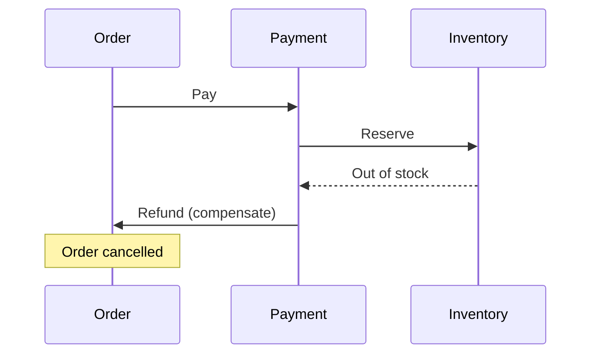
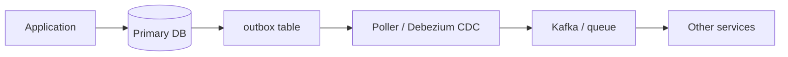
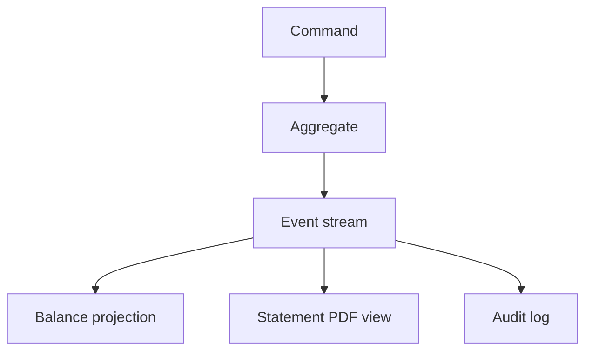
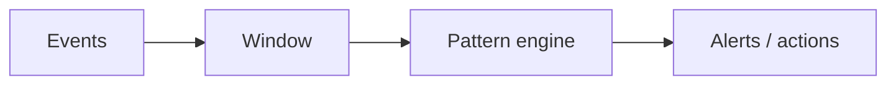
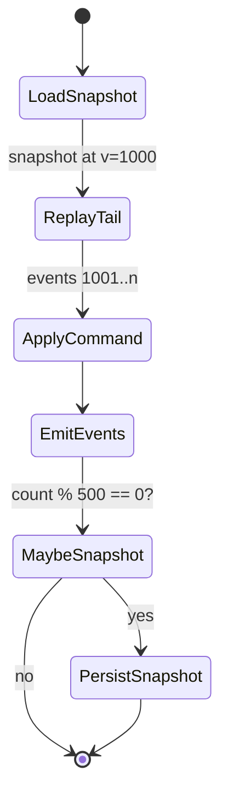
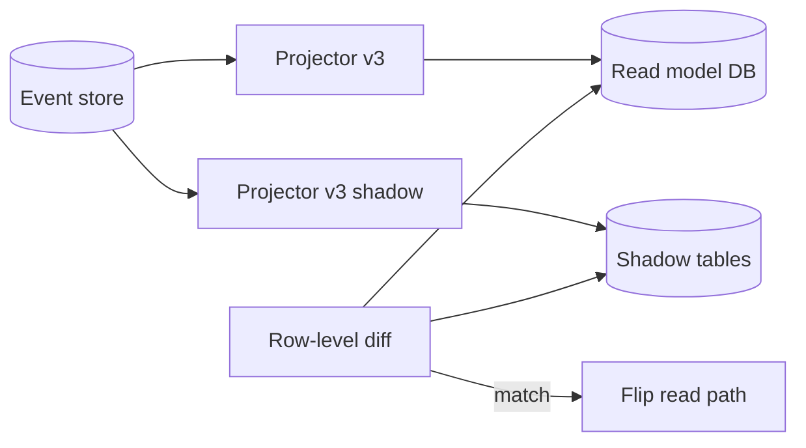

# Event and Data Patterns: Saga, Outbox, Event Sourcing, CEP

> Patterns for **consistency across services**, **reliable messaging**, **audit-grade history**, and **streaming analytics**—without pretending you have one global database.

---

## Saga pattern

### Problem

Microservices own separate databases. You cannot wrap cross-service work in one ACID transaction (2PC is fragile and slow).

> A **saga** is a sequence of **local transactions**, each with a **compensating action** if a later step fails.



### Choreography vs orchestration

| | Choreography | Orchestration |
|--|--------------|---------------|
| Coordinator | None (events) | Central orchestrator |
| Best for | 2–4 simple steps | Branching, many steps |
| Debuggability | Hard | Easier |
| Risk | Cyclic deps | Orchestrator SPOF (mitigate) |

```typescript
// Orchestration sketch (compensate in reverse)
for (const step of steps) {
  try { await step.execute(ctx); executed.push(step); }
  catch { for (const s of executed.reverse()) await s.compensate(ctx); throw e; }
}
```

**Rules:** compensations **idempotent**; persist **saga log**; use **semantic locks** on contested resources.

---

## Transactional outbox

### Problem (dual write)

```text
1. COMMIT order to DB     ✓
2. CRASH
3. publish OrderCreated   ✗  → downstream never hears; or publish first → ghost events
```

### Solution

Write **business row + outbox row** in **one DB transaction**; relay publishes asynchronously.



```sql
BEGIN;
  UPDATE accounts SET balance = balance - 100 WHERE id = $1;
  INSERT INTO outbox (topic, key, payload)
    VALUES ('ledger', $1::text, '{"type":"Debited","amount":100}');
COMMIT;
```

| Relay style | Pros | Cons |
|-------------|------|------|
| Polling | Simple | Latency, missed rows if buggy |
| CDC (Debezium) | Durable, ordered | Slot/WAL ops |

**Idempotent consumers** + **at-least-once** delivery = production safe.

> Outbox fixes **your** publish vs DB commit; pair with **versioned upserts** on the consumer during migrations.

---

## Event sourcing

### Idea

Store **every state change** as an immutable **event**. Current state = **projection** (replay or incremental).

```text
AccountOpened → MoneyDeposited(100) → MoneyWithdrawn(30)
Balance now = 70 (derived)
```



### Benefits

| Benefit | Mechanism |
|---------|-----------|
| Audit trail | Events are the truth |
| Temporal queries | Replay to time T |
| Multiple read models | Different projectors |
| Debug | Reproduce bugs by replay |

### Costs

| Cost | Mitigation |
|------|------------|
| Event schema evolution | Upcasting, versioning |
| Replay time | Snapshots + incremental projections |
| Query complexity | CQRS read models |
| Storage | Compaction policies, archival |

### CQRS (often paired)

| Side | Responsibility |
|------|----------------|
| Command | Validate, emit events |
| Query | Read optimized projections |

```typescript
// Command side
async function withdraw(accountId: string, amount: number) {
  const events = await eventStore.load(accountId);
  const account = Account.fromHistory(events);
  account.withdraw(amount); // emits Withdrawn
  await eventStore.append(accountId, account.newEvents);
}

// Query side (projection worker)
on('MoneyWithdrawn', (e) => db.execute(
  'UPDATE balances SET amount = amount - $1 WHERE id = $2',
  [e.amount, e.accountId]
));
```

**When to use:** domains with rich audit needs, complex lifecycles, multiple views—**not** every CRUD service.

---

## Complex event processing (CEP)

### Problem

Thousands of events/sec; you need **patterns over streams** (fraud, alerting, SLA), not row-by-row CRUD.

### Model



| Concept | Example |
|---------|---------|
| Window | Last 5 minutes per card |
| Pattern | 3 failed logins then success from new country |
| Context | Join payment stream + device stream |

### Technologies (conceptual)

| Engine style | Typical use |
|--------------|-------------|
| Stream SQL (Flink, ksqlDB) | Aggregations, joins |
| Rule engines (Esper-style) | Fraud rules |
| Workflow on streams | Multi-step detection |

```sql
-- Illustrative stream SQL idea
SELECT card_id, COUNT(*) AS fails
FROM payments
WHERE status = 'DECLINED'
GROUP BY card_id, HOPPING(5, MINUTE)
HAVING COUNT(*) >= 5;
```

### CEP vs event sourcing

| | Event sourcing | CEP |
|--|----------------|-----|
| Primary store | Event log | Often derived stream |
| Question | What happened to entity X? | Did pattern Y occur in window? |
| Retention | Long / forever | Often shorter |

**Integration:** domain events → message bus → CEP for **cross-aggregate** rules; keep aggregate consistency inside each service.

---

## Choosing patterns

```mermaid
flowchart TD
    Q1{Cross-service write?}
    Q1 -->|Yes, no 2PC| Saga
    Q1 -->|No| Q2
    Q2{Need atomic DB + publish?}
    Q2 -->|Yes| Outbox
    Q2 -->|No| Q3
    Q3{Audit + time travel?}
    Q3 -->|Yes| Event sourcing + CQRS
    Q3 -->|No| Q4
    Q4{Detect stream patterns?}
    Q4 -->|Yes| CEP
```

| Pattern | You get | You pay |
|---------|---------|---------|
| Saga | Cross-service workflows | Eventual consistency, compensation design |
| Outbox | Reliable integration events | Relay ops, duplicate handling |
| Event sourcing | History, projections | Complexity, replay ops |
| CEP | Real-time pattern detection | Window state, false positives |

---

## Key takeaways

1. **Sagas** trade atomicity for availability—design compensations first-class.
2. **Outbox** is the standard fix for database + message **atomicity**.
3. **Event sourcing** makes the log the truth; projections are disposable caches with benefits.
4. **CEP** answers questions over **streams**, not single rows.
5. In migrations, align with **CDC + versioned upserts** and **verification** of equivalence—not ad-hoc dual writes.

---

## Production deep dives (extended)

### Event sourcing: snapshot strategy

Snapshots are **cached aggregate state + version** so reload does not replay from event 0.

| Strategy | When | Tradeoff |
|----------|------|----------|
| **Every N events** | Steady write rate | Predictable; may snapshot cold aggregates |
| **Time-based** (e.g., hourly) | Bursty writers | Hot aggregates snapshotted often |
| **On release / deploy** | Rare writes | Cheap; long replay after deploy |
| **Adaptive** (replay time > SLO) | Large aggregates | More logic |



```typescript
// Snapshot + tail replay (illustrative)
async function loadAccount(id: string): Promise<Account> {
  const snap = await snapshots.get(id);
  const fromVersion = snap?.version ?? 0;
  const events = await eventStore.read(id, fromVersion + 1);
  return Account.fromHistory(snap?.state, events);
}

async function persistIfNeeded(id: string, account: Account) {
  if (account.version % 500 === 0) {
    await snapshots.put(id, { version: account.version, state: account.toJSON() });
  }
  await eventStore.append(id, account.newEvents);
}
```

**Storage layout:** keep snapshots in **object storage** (S3) with metadata in DB; event stream in Kafka/EventStoreDB. Snapshot is **optimization**, not source of truth — never delete events because you snapped.

### Event versioning and upcasting

Old consumers must read **new** events; new code must read **old** events. **Upcasting** transforms historical payloads at read time (or during async migration).

```typescript
type StoredEvent = { schemaVersion: number; type: string; payload: unknown };

const upcasters: Record<string, ((p: unknown) => unknown)[]> = {
  MoneyDeposited: [
    (p: { amount: number }) => ({ amountCents: p.amount, currency: "USD" }), // v1→v2
  ],
};

function upcast(ev: StoredEvent): StoredEvent {
  const chain = upcasters[ev.type] ?? [];
  let payload = ev.payload;
  let version = ev.schemaVersion;
  for (const fn of chain.slice(version - 1)) {
    payload = fn(payload);
    version++;
  }
  return { ...ev, schemaVersion: version, payload };
}
```

| Approach | Pros | Cons |
|----------|------|------|
| **Upcast on read** | No rewrite of log | CPU on replay |
| **Lazy migration job** | Amortize cost | Dual schema period |
| **New stream + cutover** | Clean break | Operational complexity |

**Rule:** events are **immutable** — never `UPDATE` payload in place; append **correction** events or upcast in projector only.

### Projection rebuild (operational playbook)



1. Deploy **new projector version** writing to `orders_projection_v3` (shadow).
2. Replay from **retained offset** or full stream (idempotent upserts keyed by `aggregate_id + version`).
3. **Diff** shadow vs live until within SLO.
4. **Atomic flip** (feature flag or view rename); keep v2 for rollback.
5. Compensate for **late events** with version checks: `INSERT ... ON CONFLICT DO UPDATE WHERE excluded.version > orders.version`.

```sql
INSERT INTO orders_projection (id, version, total_cents, updated_at)
VALUES ($1, $2, $3, now())
ON CONFLICT (id) DO UPDATE
SET total_cents = EXCLUDED.total_cents,
    version = EXCLUDED.version,
    updated_at = EXCLUDED.updated_at
WHERE orders_projection.version < EXCLUDED.version;
```

### Saga in production: idempotent compensation

```typescript
interface SagaStep {
  name: string;
  execute(ctx: Ctx): Promise<void>;
  compensate(ctx: Ctx): Promise<void>;
}

async function runSaga(steps: SagaStep[], ctx: Ctx) {
  const done: SagaStep[] = [];
  await sagaLog.append({ sagaId: ctx.id, status: "STARTED" });
  try {
    for (const step of steps) {
      await sagaLog.append({ sagaId: ctx.id, step: step.name, status: "EXECUTING" });
      await step.execute(ctx);
      done.push(step);
    }
  } catch (e) {
    for (const step of done.reverse()) {
      await step.compensate(ctx); // must tolerate already-compensated
      await sagaLog.append({ sagaId: ctx.id, step: step.name, status: "COMPENSATED" });
    }
    throw e;
  }
}
```

### Terraform: MSK + outbox consumer (sketch)

```hcl
resource "aws_msk_cluster" "domain" {
  cluster_name           = "domain-events"
  kafka_version          = "3.5.1"
  number_of_broker_nodes = 3
  broker_node_group_info {
    instance_type   = "kafka.m5.large"
    client_subnets  = module.vpc.private_subnets
    storage_info { ebs_storage_info { volume_size = 500 } }
  }
}
```

---

## Interview Q&A

### Q: Outbox vs transactional messaging (Kafka transactions) — when is outbox still required?

**A:** Kafka transactions help **produce + consume offsets** atomically within Kafka, but not **your RDBMS commit** unless you adopt a complex **consume-transform-produce** loop with external stores. Outbox is the standard pattern when the **system of record is SQL** and you need **exactly-once illusion** to the bus: DB commit and outbox row are one transaction; relay handles at-least-once publish. Many teams use **CDC (Debezium)** as the relay to avoid polling latency.

### Q: How do you handle duplicate events in event sourcing?

**A:** Store events with monotonic **`stream_version`**; `append` fails on version gap/duplicate. Projectors use **idempotent upserts** keyed by `(aggregate_id, version)`. Consumers track **processed event IDs** in a side table for cross-stream handlers. Duplicates are expected under at-least-once delivery — correctness is in the idempotency layer.

### Q: Choreography saga vs orchestration — failure mode difference?

**A:** Choreography fails **implicitly**: compensating events can be missed, cycles can form, and nobody owns the global state. Orchestration centralizes state in a **saga log** but the orchestrator is a **SPOT** — mitigate with durable workflow engines (Temporal, Step Functions) and idempotent activities. Use choreography only when steps are few and compensations are obvious; otherwise orchestrate.

### Q: When is event sourcing the wrong choice?

**A:** Simple CRUD with no audit mandate, heavy ad-hoc reporting on current state only, or teams unwilling to operate **projection rebuilds** and schema evolution. If “replay entire system” is never tested in drills, you have an audit log pretense, not event sourcing.

### Q: CEP false positives in fraud — how do you operate it?

**A:** Treat rules as **scores**, not binary bans; human review queues; **cooldown** windows; separate **feature store** freshness SLAs. Version rules and run **shadow mode** on new patterns before enforcement. Align window boundaries with **event time** vs **processing time** (watermarks) to avoid skew across partitions.

### Q: What is the difference between event sourcing and audit logging?

**A:** Audit logging is **append-only records** often without deterministic rebuild of aggregate state. Event sourcing requires **domain events** that reapply through the same logic to reconstruct state. You can source events from an audit log only if those records are complete and ordered per aggregate.

### Q: How do sagas relate to 2PC?

**A:** Sagas **accept eventual consistency** and use **compensating transactions** instead of a single prepare/commit across databases. 2PC blocks under partition and couples availability; sagas trade **semantic rollback** (refund, cancel reservation) for liveness. Compensations are business logic, not automatic DB undo.

---

## Decision matrix: integration patterns

| Need | Saga | Outbox | Event sourcing | CEP |
|------|------|--------|----------------|-----|
| Cross-service workflow | **Yes** | Partial | Optional | No |
| DB + message atomicity | No | **Yes** | Often paired | No |
| Rebuild read models | No | No | **Yes** | Derived only |
| Stream pattern detection | No | No | No | **Yes** |
| Audit/time travel | Partial | Partial | **Yes** | Windowed only |

---

## Senior Pitfalls

| Mistake | Impact | Fix |
|---------|--------|-----|
| Outbox polled without `SKIP LOCKED` | Duplicate publishes under scale | `FOR UPDATE SKIP LOCKED` or lease per row |
| Event sourcing without snapshot strategy | Replay hours to rebuild aggregate | Snapshots every N events; cached projections |
| CEP rules without window bounds | OOM on unbounded state | Tumbling/sliding windows; retention limits |
| Saga choreography for refund flows | No central visibility | Orchestration + audit log for regulated paths |
| Publishing before local commit | Ghost events consumers act on | Transactional outbox same DB as business write |
| ES projection single-threaded forever | Lag grows with traffic | Partition projections by aggregate id |

---

## Production-grade Practice

1. **Build:** Transactional outbox + relay; kill relay mid-batch and verify no duplicate or lost events after restart.
2. **Debug:** Rebuild read model from event log; diff against OLTP and quantify projection lag SLO.
3. **Measure:** End-to-end latency publish→consumer at p50/p99; outbox table depth under peak writes.
4. **Capacity plan:** Event store retention (TB), partition count, and consumer instances for peak domain events/sec.

---

## Decision matrix: saga coordination

| Factor | Choreography | Orchestration |
|--------|--------------|---------------|
| Steps ≤ 3, linear | **OK** | OK |
| Branching / timeouts | Poor | **Strong** |
| Visibility at 3am | Hard | **Saga log** |
| Team familiarity with events | High | Medium |
| Risk of cyclic events | **High** | Low |
