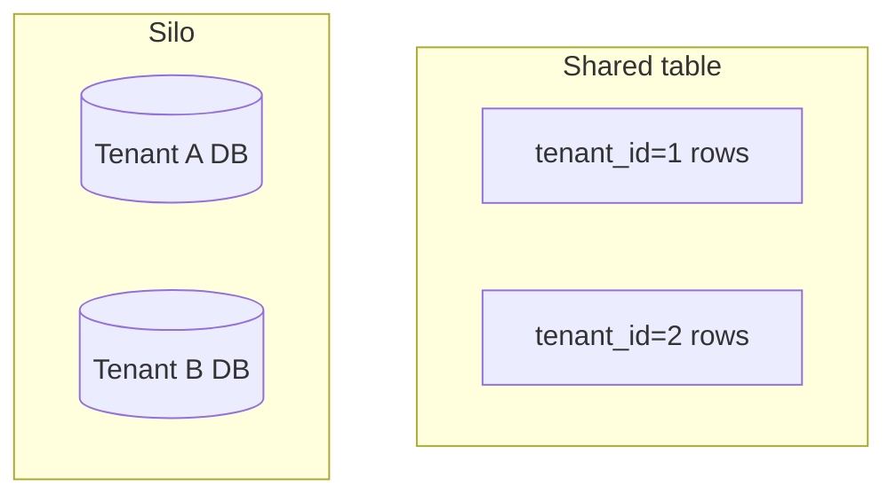
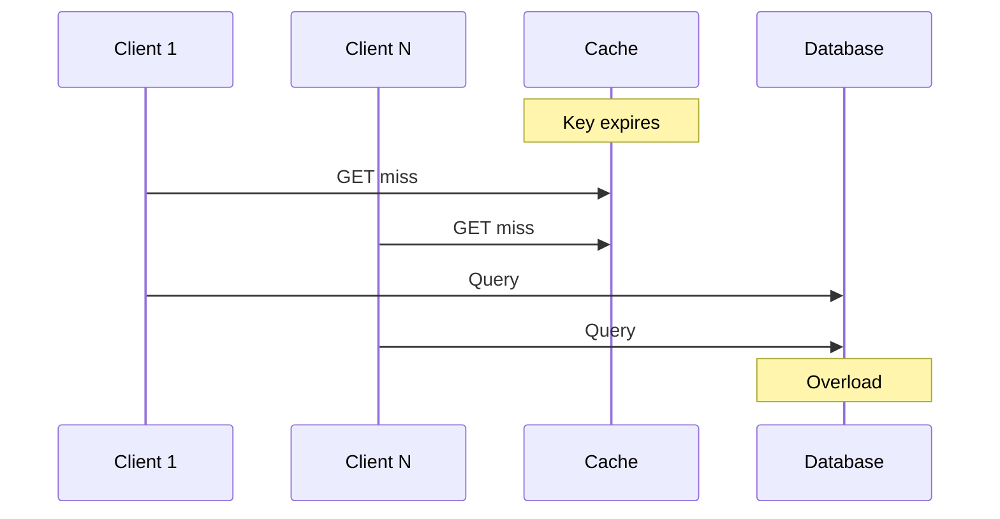
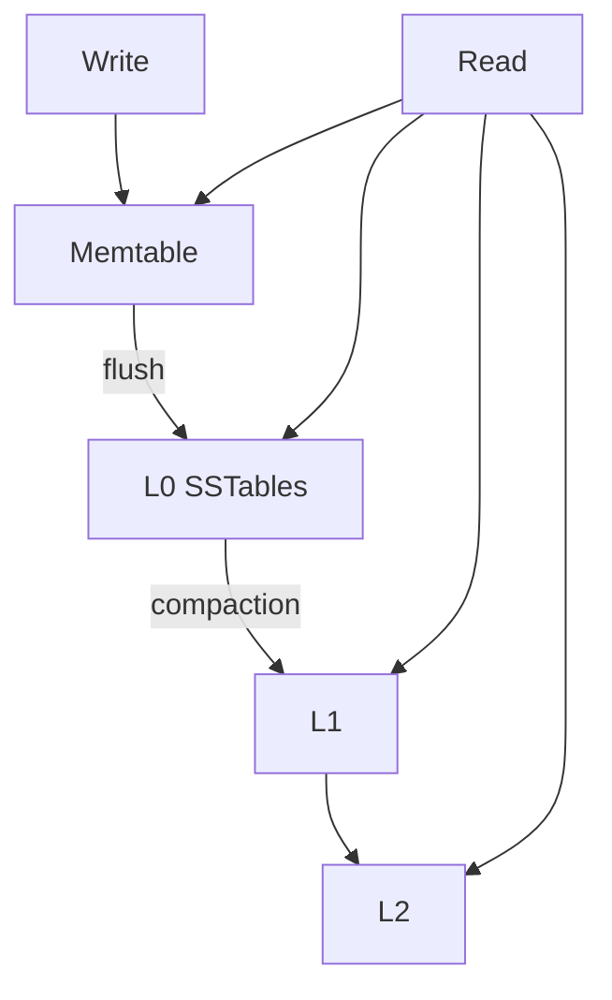
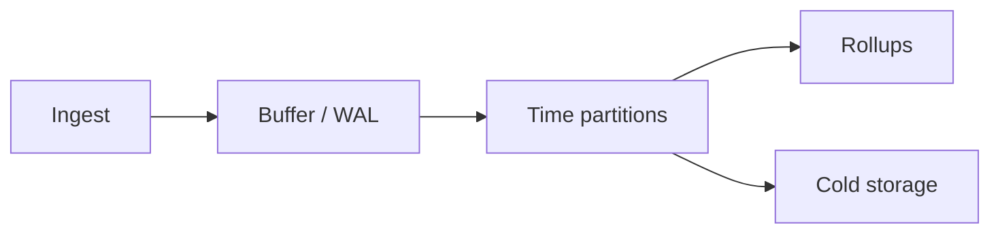
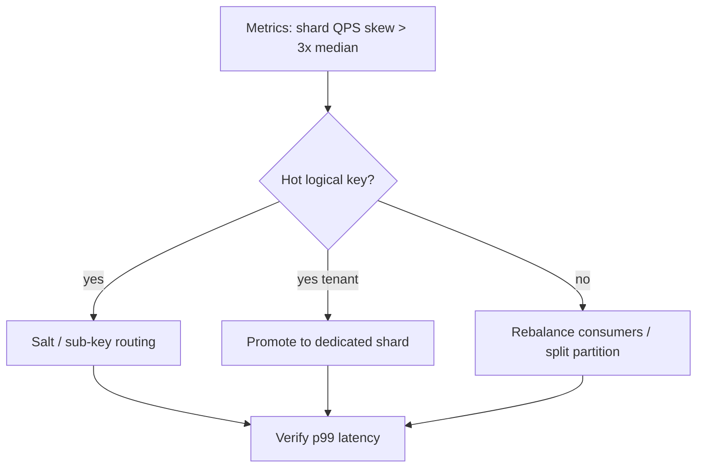

# Scaling and Partitioning: Multi-Tenancy, Hot Partitions, Thundering Herd, LSM, Time Series

> How systems grow past one node—and how they fail when **one key** or **one spike** eats the cluster.

---

## Multi-tenancy architecture

### Models

| Model | Isolation | Cost | Example |
|-------|-----------|------|---------|
| **Shared schema** | Row-level `tenant_id` | Lowest | SaaS default |
| **Schema per tenant** | Medium | Medium | Enterprise tier |
| **Database per tenant** | Strong | Highest | Regulated / whale |



### Design rules

```sql
-- Every query scoped (enforced in app + optional RLS)
SELECT * FROM orders
WHERE tenant_id = $current_tenant AND id = $1;

-- Postgres RLS example
ALTER TABLE orders ENABLE ROW LEVEL SECURITY;
CREATE POLICY tenant_isolation ON orders
  USING (tenant_id = current_setting('app.tenant_id')::uuid);
```

| Concern | Mitigation |
|---------|------------|
| Noisy neighbor | Rate limits per tenant |
| Whale tenant | Dedicated shard / silo |
| Migration slice | **Per-tenant** cutover—watch cross-tenant reports |

---

## Hot partition detection and mitigation

### Problem

Partition key skew: one `tenant_id`, `user_id`, or hash bucket gets disproportionate traffic.

```text
Partition key: hash(user_id) % 16
Celebrity user → 40% of writes on bucket 7
```

```mermaid
bar
    title Write rate by partition (illustrative)
    x-axis [P0, P1, P2, P3, P4, P5, P6, P7]
    y-axis "writes/s" 0 --> 100
    bar [12, 10, 11, 9, 13, 11, 95, 10]
```

### Detection

| Signal | Tooling |
|--------|---------|
| Per-shard QPS / CPU | Metrics by partition |
| Key frequency | Top-K in stream (Count-Min Sketch) |
| Lag per consumer partition | Kafka consumer metrics |

### Mitigation

| Technique | Idea |
|-----------|------|
| **Salting** | `hash(user_id + salt_i)` spread hot logical key |
| **Split hot range** | Sub-partition celebrity tenant |
| **Async aggregation** | Counter in Redis, periodic flush |
| **Dedicated resources** | Whale on own cluster |

```python
# Write spreading for hot counter (illustrative)
SHARDS = 8
def increment_likes(post_id: str):
    for i in range(SHARDS):
        redis.incr(f"likes:{post_id}:{i}")
def read_likes(post_id: str) -> int:
    return sum(int(redis.get(f"likes:{post_id}:{i}") or 0) for i in range(SHARDS))
```

**Migration note:** backfilling into range-partitioned targets with **same key order as source** creates **tail hot spot**—pre-split or sort-between (see migration execution guide).

---

## Thundering herd problem

### Problem

Many clients wake at once (cache expiry, deploy, failover) and **hammer origin**.



### Mitigations

| Technique | How |
|-----------|-----|
| **Jitter on TTL** | `expire = base + random(0, jitter)` |
| **Single-flight / request coalescing** | One loader per key |
| **Stale-while-revalidate** | Serve stale while one refresh |
| **Circuit breaker** | Fail fast when origin sick |
| **Queue + worker** | Smooth spike |

```python
import asyncio

_inflight: dict[str, asyncio.Future] = {}

async def get_with_singleflight(key: str):
    if key in _inflight:
        return await _inflight[key]
    fut = asyncio.get_event_loop().create_future()
    _inflight[key] = fut
    try:
        val = await load_from_db(key)
        fut.set_result(val)
        return val
    finally:
        del _inflight[key]
```

**Cutover link:** stagger pool reconnects after flip—avoid herd on new database.

---

## LSM trees and compaction strategies

### Why LSM?

Writes are **append to memtable + WAL**; reads merge **levels** of sorted files (SSTables). Great for **write-heavy** workloads (Cassandra, RocksDB, LevelDB).



### Compaction strategies

| Strategy | Write amp | Read amp | Space amp |
|----------|-----------|----------|-----------|
| **Size-tiered** (STCS) | Lower | Higher | Higher |
| **Leveled** (LCS) | Higher | Lower | Lower |
| **Time-window** (TWCS) | Good for TTL | Varies | Good for TS data |

| Symptom | Likely cause |
|---------|--------------|
| Read p99 spikes | Compaction debt, too many L0 files |
| Disk growth | Tombstones not compacted |
| Write stall | Memtable flush + compaction backlog |

**Ops:** monitor **pending compactions**, **SSTable count per level**, **disk amplification**.

```text
# RocksDB-style levers (conceptual)
max_background_jobs
level0_file_num_compaction_trigger
target_file_size_base
```

**Migration / backfill:** loading into LSM target in **random key order** triggers **read amplification**—prefer sorted loads or drop indexes during bulk load.

---

## Time-series database optimization

### Data shape

| Property | Implication |
|----------|-------------|
| Append-mostly | No hot UPDATE rows |
| Time-range queries | Partition by time |
| High cardinality tags | Index cost explodes |



### Schema patterns

```text
# Conceptual line protocol
cpu,host=h1,region=us usage=0.64 1710000000000000000
```

| Practice | Why |
|----------|-----|
| **Partition by time** (day/hour) | Drop old data cheaply |
| **Cardinality control** | Avoid unique tag per request |
| **Rollups** | 1s → 1m → 1h for dashboards |
| **Separate hot/warm** | Recent on SSD, archive on object store |

| Engine angle | Note |
|--------------|------|
| Influx / Prometheus | Label cardinality limits |
| Timescale / PG hypertables | SQL ecosystem |
| ClickHouse | Columnar aggregates |

```sql
-- Hypertable idea (Timescale)
SELECT create_hypertable('metrics', 'ts');
-- Retention policy
SELECT add_retention_policy('metrics', INTERVAL '90 days');
```

### Query optimization

- Push aggregations to DB—don't pull billions of points to app
- Use **continuous aggregates** / materialized views for dashboards
- Align scrapes and **downsample** windows

---

## Cross-topic matrix

| Failure | First knob |
|---------|------------|
| One tenant slow | Rate limit / silo |
| One partition hot | Salt / split / dedicated shard |
| Cache expiry spike | Jitter + single-flight |
| LSM read spikes | Compaction tuning + load ordering |
| TSDB cost | Retention + rollups + cardinality caps |

---

## Key takeaways

1. **Multi-tenancy** is a spectrum—isolation vs cost; enforce `tenant_id` everywhere.
2. **Hot partitions** need detection (metrics + top-K) and spreading strategies.
3. **Thundering herd** is timing—jitter, coalescing, staggered cutovers.
4. **LSM** trades write smoothness for compaction work—bulk load with care.
5. **Time-series** wins on partition-by-time, low cardinality, and rollups—not raw point scans.

---

## Production deep dives (extended)

### Hot partition: detection algorithms

| Method | Idea | Complexity | Use |
|--------|------|------------|-----|
| **Per-shard metrics** | QPS, CPU, lag by partition id | Low | First line in Kafka/Cassandra/Dynamo |
| **Top-K (Heavy Hitters)** | Count-Min Sketch + min-heap | Medium | Find celebrity keys in stream |
| **Entropy of key hash** | Low entropy → skew | Medium | Dashboard alert |
| **Latency p99 by partition** | Tail on one bucket | Low | User-facing symptom |
| **Space-Saving algorithm** | Approx top-K with bounded memory | Medium | In-gateway abuse detection |

```python
# Space-Saving style heavy hitter (simplified)
from collections import defaultdict

class HeavyHitters:
    def __init__(self, k: int):
        self.k = k
        self.counts: dict[str, int] = {}

    def add(self, key: str, inc: int = 1):
        if key in self.counts:
            self.counts[key] += inc
            return
        if len(self.counts) < self.k:
            self.counts[key] = inc
            return
        # evict min (simplified; full algorithm uses error bounds)
        min_key = min(self.counts, key=self.counts.get)
        self.counts[min_key] -= inc
        if self.counts[min_key] <= 0:
            del self.counts[min_key]
        if key not in self.counts:
            self.counts[key] = inc

    def top(self) -> list[tuple[str, int]]:
        return sorted(self.counts.items(), key=lambda x: -x[1])
```

**Kafka:** monitor `records-lag-max` per **partition**; one partition lagging while others idle → hot key or slow consumer on that partition.

**DynamoDB:** `ConsumedWriteCapacityUnits` per partition key in CloudWatch Contributor Insights.

### Automatic split strategies

| System | Split trigger | Action |
|--------|---------------|--------|
| **DynamoDB** | Split when partition exceeds throughput | Automatic; **cannot** merge — key design still matters |
| **Cassandra** | Manual `nodetool split` / add vnode | Ops-heavy; prefer **salting** upfront |
| **Kafka** | Add partitions (key order not preserved) | **Re-key** or dual-write during repartition |
| **Redis Cluster** | Reshard slots | Migrate hash slots to new nodes |
| **Custom sharded SQL** | Celebrity tenant exceeds threshold | **Promote** tenant to dedicated shard |



```python
# Salting with readable routing — post_id + salt bucket
def write_shard_for(post_id: str, user_id: str) -> str:
    if is_celebrity(user_id):
        bucket = hash(user_id) % 32  # dedicated spread for whale
    else:
        bucket = hash(post_id) % 8
    return f"shard-{bucket}"
```

### Thundering herd: Kubernetes + cache at scale

```yaml
# Pod anti-affinity + PDB + preStop for graceful drain (reduces synchronized reconnect)
apiVersion: apps/v1
kind: Deployment
spec:
  template:
    spec:
      containers:
        - name: api
          lifecycle:
            preStop:
              exec:
                command: ["sh", "-c", "sleep 15"]
```

Combine **jitter**, **single-flight**, and **staggered rollouts** (`maxUnavailable: 1`, `maxSurge: 1`) so cache expiry and deploy waves do not align.

### LSM: production compaction tuning matrix

| Workload | Strategy | Notes |
|----------|----------|-------|
| Time-series TTL | **TWCS** | Drop old windows on compaction |
| Write-heavy ingest | STCS | Watch read amp |
| Read-heavy | LCS | Higher write amp |
| Bulk migration load | Pause compaction, **sorted** load | Random keys → L0 explosion |

```ini
# Cassandra TWCS (conceptual)
compaction = {
  'class': 'TimeWindowCompactionStrategy',
  'compaction_window_unit': 'DAYS',
  'compaction_window_size': 1
}
```

### Multi-tenancy: noisy neighbor controls

```yaml
# K8s ResourceQuota + LimitRange per tenant namespace
apiVersion: v1
kind: LimitRange
metadata:
  namespace: tenant-whale
spec:
  limits:
    - defaultRequest:
        cpu: 500m
        memory: 512Mi
      type: Container
```

| Control layer | Example |
|---------------|---------|
| API gateway | Rate limit `tenant_id` |
| DB | Connection pooler per tenant (PgBouncer) |
| Queue | Fair dispatch across tenant topics |
| Billing | Hard cap → throttle |

### Time series: cardinality explosion guard

```text
# BAD: unique request_id as tag
http_requests,request_id=uuid,path=/api → millions of series

# GOOD: bounded tags
http_requests,method=GET,path=/api,status=200
```

---

## Interview Q&A

### Q: Why does adding Kafka partitions not fix a hot key?

**A:** Partition assignment is by **key hash** — one hot key still maps to **one partition**. More partitions help **parallelism across keys**, not skew on a single key. Fixes: **salt** messages (multiple partitions per logical key, aggregate on read), **dedicated topic** for hot entity, or **async aggregation** (Redis counter + periodic flush).

### Q: Shared schema multi-tenancy — how do whales break the model?

**A:** One `tenant_id` with 10× traffic dominates indexes, cache, and background jobs — **noisy neighbor**. Mitigations: **silo** whale to dedicated DB/shard, **rate limits**, separate **connection pools**, and **per-tenant autoscaling** where supported.

### Q: Explain write amplification in LSM during bulk load.

**A:** Random-order inserts land in **L0** as many overlapping SSTables; reads must check many files; compactions **rewrite** data repeatedly. Sorted bulk load (or **ingest SSTables** externally) reduces L0 fan-in. During migration backfill, **drop secondary indexes**, load, rebuild — same principle.

### Q: Thundering herd after regional failover — what besides cache?

**A:** **Connection pools** recreate simultaneously; **JIT** cold starts; **DNS** storms. Stagger: exponential backoff on clients, **max connection age** with jitter, **warm** standby with synthetic traffic, **rate limit** at gateway during failover drills.

### Q: Count-Min Sketch vs exact Top-K?

**A:** CMS gives **approximate frequencies** in bounded memory — great for **alerting** on skew. Exact Top-K needs more memory or streaming heap (Space-Saving) — use when you will **automate splits** on detected keys and false positives are costly.

### Q: RLS in Postgres — enough for multi-tenant security?

**A:** RLS is **defense in depth** if `app.tenant_id` is set per connection from trusted middleware — not if app bugs pass wrong tenant. Still need **app-level** scoping, audits, and **least privilege** DB roles. RLS does not stop **DoS** from one tenant’s volume.

### Q: When to choose schema-per-tenant vs row-level?

**A:** **Row-level** for cost and simplicity at scale. **Schema-per-tenant** for enterprise isolation, per-tenant migration, or regulatory **data residency** within one cluster. **DB-per-tenant** for whales and strict compliance — highest ops cost.

---

## Decision matrix: tenancy models

| Requirement | Shared row | Schema/tenant | DB/tenant |
|-------------|------------|---------------|-----------|
| Cost at 10k tenants | **Best** | Poor | Worst |
| Noisy neighbor isolation | Weak | Medium | **Strong** |
| Per-tenant backup/restore | Hard | Medium | **Easy** |
| Cross-tenant reporting | **Easy** | Medium | Hard |

---

## Decision matrix: hot partition mitigation

| Symptom | First action | If insufficient |
|---------|--------------|-----------------|
| Single hot key | Salt + aggregate | Dedicated pipeline |
| Hot tenant | Rate limit | Silo shard |
| Hot Kafka partition | Secondary topic by hash | Consumer scale won't help same key |
| Hot Dynamo partition | Random suffix on sort key | AWS split + redesign |
| LSM read spikes | Compaction tune + sorted load | Hardware / cache |

---

## Senior Pitfalls

| Mistake | Impact | Fix |
|---------|--------|-----|
| Tenant on shared partition key | One enterprise saturates shard | Silo hot tenants; secondary partition dimension |
| Detecting hot partition only from CPU | Disk and network hot first | Per-partition metrics: keys/sec, size, throttle events |
| LSM compaction ignored in capacity | Sudden read latency cliff | Plan compaction I/O; leveled vs tiered tradeoff |
| Thundering herd fix only at CDN | Origin still dies on cache miss | Jitter + single-flight at app and DB |
| Time-series DB without cardinality limits | Label explosion; query timeout | Cardinality budgets; aggregation at ingest |
| Multi-tenant pool without per-tenant caps | Noisy neighbor outage | Rate limits and fair queuing per tenant |

---

## Production-grade Practice

1. **Build:** Simulate hot key on Dynamo/Kafka partition; apply salt or shuffle sharding and compare throttle rate.
2. **Debug:** Profile LSM read during compaction spike; tune schedule or isolate read replicas.
3. **Measure:** Per-tenant QPS and storage in shared cluster; alert at 3× median tenant usage.
4. **Capacity plan:** Shard count so no partition exceeds 70% of provider limit at 12-month forecast; include rebalance bandwidth.

---

## Decision matrix: thundering herd controls

| Layer | Technique | Effort |
|-------|-----------|--------|
| CDN / edge | SWR, stale-if-error | Low |
| App cache | Jitter + single-flight | Medium |
| DB | Read replicas + queue | Medium |
| Clients | Backoff + hedge limiting | **Often overlooked** |
| Cutover | Stagger pool reconnect | **Critical** on migrations |
