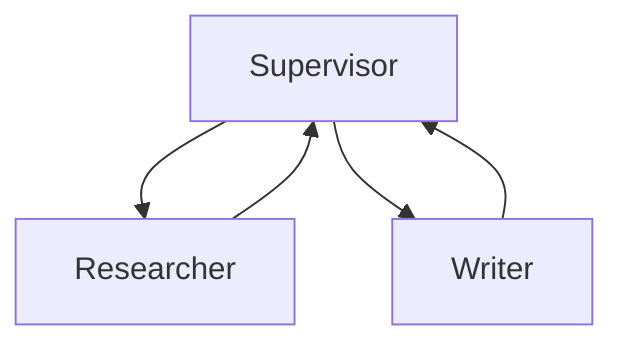

# 03 — LangGraph: Chatbots, ReAct, Memory, HITL, Multi-Agent, MCP

## Learning objectives

Build a **LangGraph** agent with explicit **state**, **conditional edges**, **checkpoints** for multi-turn memory, **HITL interrupts** for dangerous tools, and a **multi-agent supervisor** — the production orchestration layer that replaces ad-hoc while-loops.

---

## Why LangGraph (vs a raw while-loop)

| Raw agent loop | LangGraph |
|--------------|-----------|
| Spaghetti state | **Explicit graph** — nodes, edges, state schema |
| Hard to debug | **Checkpoints**, Studio visualization |
| No HITL | **Interrupts** before/after nodes |
| Single agent | **Multi-agent** subgraphs |

LangGraph is **orchestration** — you still use LangChain for models/tools.

---

## Project structure (senior default)

```text
app/
  graph/
    state.py      # TypedDict state
    nodes.py      # planner, retrieve, respond
    graph.py      # compile()
  tools/
  prompts/
  main.py         # FastAPI entry
tests/
  eval/
.env.example
pyproject.toml
```

---

## State and basic chatbot graph

```python
from typing import Annotated, TypedDict
from langgraph.graph import StateGraph, START, END
from langgraph.graph.message import add_messages
from langchain_core.messages import BaseMessage

class State(TypedDict):
    messages: Annotated[list[BaseMessage], add_messages]

def chatbot(state: State):
    response = llm.invoke(state["messages"])
    return {"messages": [response]}

builder = StateGraph(State)
builder.add_node("chatbot", chatbot)
builder.add_edge(START, "chatbot")
builder.add_edge("chatbot", END)
graph = builder.compile()
```

`add_messages` reducer **appends** — same pattern as event sourcing for chat.

### Conditional routing (RAG-style)

```python
def route(state: State) -> str:
    last = state["messages"][-1].content.lower()
    return "retrieve" if "policy" in last or "?" in last else "chatbot"

builder.add_conditional_edges("router", route, {"retrieve": "retrieve", "chatbot": "chatbot"})
```

Conditional edges are how **agentic RAG** avoids retrieving on “hello”.

---

## ReAct agent

Use `create_react_agent` or custom graph: **agent** node → **tools** node → loop until no tool calls.

```python
from langgraph.prebuilt import create_react_agent

agent = create_react_agent(llm, tools)
config = {"configurable": {"thread_id": "user-123"}}
agent.invoke({"messages": [HumanMessage("...")]}, config)
```

---

## Memory with checkpoints

```python
from langgraph.checkpoint.memory import MemorySaver

memory = MemorySaver()
graph = builder.compile(checkpointer=memory)
# Same thread_id → continues conversation
```

**Production:** Redis or Postgres checkpointer — not in-memory `MemorySaver`.

| Memory type | Course + module 09 |
|-------------|-------------------|
| Thread checkpoint | LangGraph `thread_id` |
| Long-term facts | Vector store / Mem0 / LangMem |

---

## Human-in-the-loop

```python
from langgraph.types import interrupt

def sensitive_tool_node(state):
    if not state.get("approved"):
        interrupt({"action": "approve_tool", "payload": state["pending"]})
    return run_tool(state)
```

Resume with `Command(resume=...)` after human approval in UI.

---

## Multi-agent

Patterns:

- **Supervisor** — one model routes to worker agents.  
- **Handoff** — specialist agents pass state.  



**Pitfall:** Too many agents → cost + debugging hell. Start **one** graph, split only when metrics prove need.

---

## MCP (Model Context Protocol)

MCP standardizes **tools/resources** exposed to agents (filesystem, DB, APIs).

- LangGraph + MCP: connect MCP server as tool provider.  
- **Security:** MCP server = **new trust boundary** — authenticate like any microservice.

---

## LangGraph Studio

Run graph locally, inspect steps — like **debugger breakpoints** for agents. Use for dev; not production runtime.

---

## Senior pitfalls

| Mistake | Impact | Fix |
|---------|--------|-----|
| `MemorySaver` in production | Lost state on restart; no multi-instance | Postgres or Redis checkpointer |
| No `recursion_limit` | Infinite loop burns tokens + money | Set `recursion_limit=25` (or lower) |
| All tools available to all agents | Blast radius; cost explosion | Tool allowlist per agent/subgraph |
| State leakage between threads | User A sees user B's conversation | Verify `thread_id` isolation in tests |
| No timeout on individual LLM calls | One slow call blocks entire graph | `timeout=30` on model + circuit breaker |
| Multi-agent "because it's cool" | 3x cost, harder debugging | Start single graph; split when metrics justify |

## Debugging checklist (senior)

| Symptom | Likely cause |
|---------|----------------|
| Infinite tool loop | Missing stop condition / max iterations |
| Empty tool args | Schema docstring unclear |
| State not updating | Wrong reducer on `messages` key |
| HITL never resumes | Wrong `thread_id` / checkpoint config |

Set `recursion_limit` in config to cap runaway agents.

---

## Production notes

### Deploying LangGraph with FastAPI

```python
from fastapi import FastAPI
from langgraph.checkpoint.postgres import PostgresSaver

# Production: Postgres checkpointer, not MemorySaver
checkpointer = PostgresSaver.from_conn_string(DATABASE_URL)
graph = builder.compile(checkpointer=checkpointer)

app = FastAPI()

@app.post("/agent")
async def run_agent(thread_id: str, message: str):
    config = {"configurable": {"thread_id": thread_id}, "recursion_limit": 25}
    result = graph.invoke({"messages": [HumanMessage(content=message)]}, config)
    return {"response": result["messages"][-1].content}
```

### Recursion limit and cost protection

| Config | Default | Production recommendation |
|--------|---------|--------------------------|
| `recursion_limit` | 25 | 15–25 (lower = safer; tune per use case) |
| `timeout` on LLM | None | 30s per call; circuit breaker after 3 timeouts |
| Max tool calls per run | Unlimited | Cap at 10 via state counter |

```python
def tool_node(state: State):
    if state.get("tool_call_count", 0) >= 10:
        return {"messages": [AIMessage(content="I've reached the action limit. Please clarify.")]}
    # ... execute tool ...
    return {"messages": [...], "tool_call_count": state.get("tool_call_count", 0) + 1}
```

### Multi-agent cost tracking

Log tokens per agent in traces; one expensive agent can dominate cost.

```python
# After each agent node, emit metric:
# agent_tokens{agent="researcher"} += response.usage_metadata.total_tokens
```

### MCP server security in production

| Rule | Reason |
|------|--------|
| **Authenticate** MCP connections (mTLS or API key) | MCP server = new attack surface |
| **Allowlist** tools per agent graph | Researcher cannot call `send_email` |
| **Rate limit** MCP calls | Runaway agent can exhaust external service |
| **Audit log** every MCP tool call | Compliance + debugging |

### Graceful degradation

If Qdrant/vector DB is down, the retrieve node should return a **fallback** ("I cannot search documents right now") rather than crash the entire graph.

---

## Practice

1. Compile graph with `MemorySaver`; send two turns with same `thread_id`.  
2. Add `interrupt` before a mock `refund` tool.  
3. Trace run in LangSmith (module 04).

## Production-grade practice

4. **Replace `MemorySaver` with Postgres checkpointer** — verify threads persist across process restarts.
5. **Add a `tool_call_count` guard** that stops the agent after 10 tool calls with a user-facing message.
6. **Implement graceful degradation** — mock vector DB down; verify agent returns fallback, not a 500.
7. **Write load test** with 20 concurrent threads (different `thread_id`s); verify no state leakage between users.
8. **Build a supervisor + 2 workers** graph; trace in LangSmith; measure per-agent token cost.

---

## Lecture map

| Lectures | Topic |
|----------|--------|
| Introduction to Langgraph | Why graphs |
| Project structure And Environment Set up | Layout |
| Building Basic AI Chatbots | StateGraph |
| Building React Agent | ReAct |
| Memory Implementation | Checkpointer |
| Human In the Loop Implementation | Interrupts |
| Debugging, Monitoring Langsmith | → module 04 |
| Multi agent Implementation | Multi-agent |
| MCP Implementation | MCP |
| Langraph App Development / Studio | Studio |

**Next:** [04-observability-langsmith-logfire.md](./04-observability-langsmith-logfire.md)
