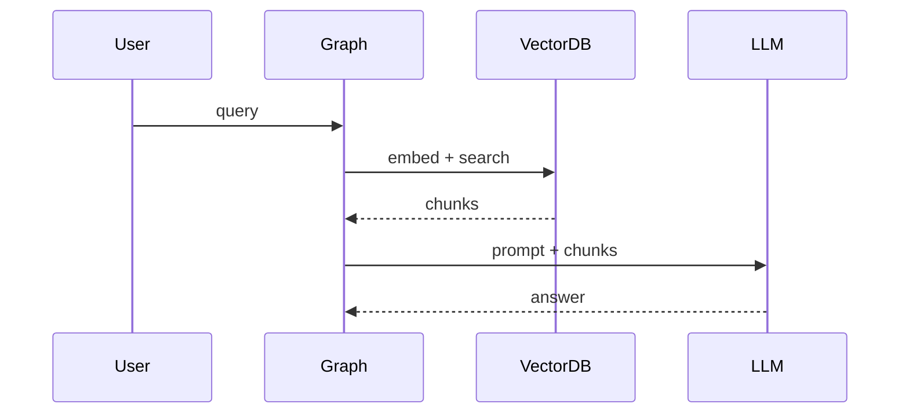

# 04 — Observability: LangSmith, Logfire, Tracing RAG and Agents

## Learning objectives

Instrument **RAG and agent** paths so you can answer: which step failed, how much it cost, and whether quality regressed — using the same on-call habits you use for HTTP services.

---

## Beginner explanation

**Tracing** records each step of a request (LLM call, retrieval, tool) with timing and metadata — like **distributed tracing** for microservices, but spans include `prompt_tokens` and `chunk_ids`.

Without traces, debugging “it answered wrong yesterday” is guesswork.

---

## What to observe (senior SLOs)

| SLI | Why |
|-----|-----|
| TTFT / E2E latency | User experience |
| Tokens in/out | **Cost** |
| Tool error rate | Reliability |
| Guardrail block rate | Safety |
| Eval faithfulness (offline) | Quality regression |

Same discipline as microservices — **traces**, not only logs.

---

## LangSmith setup

```bash
export LANGCHAIN_TRACING_V2=true
export LANGCHAIN_API_KEY=...
export LANGCHAIN_PROJECT=my-agent-prod
```

Runs auto-capture many LangChain/LangGraph calls.

### Datasets and experiments (eval bridge)

In LangSmith UI (or API):

1. Upload **dataset** of inputs (+ optional reference outputs).  
2. Run chain/graph as **experiment** on dataset.  
3. Compare runs when you change prompt/model.

This connects directly to module **08** — same goldens, different runner.

**Manual span:**

```python
from langsmith import traceable

@traceable(name="retrieve_docs")
def retrieve(query: str) -> list[str]:
    return vector_store.similarity_search(query, k=5)
```

---

## Custom tracing for RAG

Trace **each stage** — retrieval, rerank, generation:



Log: `chunk_ids`, `scores`, `model`, `prompt_version`.

---

## Pydantic Logfire

OpenTelemetry-native; great for **FastAPI + LLM** in one trace.

```python
import logfire

logfire.configure()
logfire.instrument_openai()  # or auto-instrument LangChain

with logfire.span("rag_pipeline", query=query):
    docs = retrieve(query)
    answer = generate(docs, query)
```

**Course flow:** setup → simple RAG trace → ReAct agent trace → test agentic workflow.

---

## Framework comparison

| Tool | Strength |
|------|----------|
| **LangSmith** | LangChain ecosystem, datasets, eval UI |
| **Logfire** | OTel, Python-first, Pydantic team |
| **Datadog / Honeycomb** | Enterprise APM + LLM modules |

Use **one** primary trace backend in prod; export OTel if multi-vendor.

---

## Deep dive: what breaks traces

- Missing propagation across **async** tasks.  
- **Batch** tool calls attributed to wrong parent span.  
- Logging **full prompts** with PII — scrub in collector.

See also: `MD/observability/02-opentelemetry-distributed-tracing.md` (OTel deep dive in this repo).

---

## Senior pitfalls

- **Sampling** set to 0% on errors — you lose the traces you need most; use tail sampling (see observability guides).  
- One giant span for entire agent loop — cannot see which tool blew the budget.  
- Storing **full** retrieved chunks in traces — PII and size; store chunk IDs + hashes only.

---

## Production notes

### Trace-based alerting (real-world setup)

```yaml
# Alert rules (Datadog / Grafana sketch)
alerts:
  - name: llm_latency_p99_high
    condition: p99(llm.latency) > 5s for 5min
    severity: warning
    action: page on-call; check provider status page

  - name: eval_faithfulness_drop
    condition: avg(eval.faithfulness, 1d) < baseline - 0.03
    severity: critical
    action: rollback last prompt change; investigate retrieval

  - name: guardrail_block_spike
    condition: rate(guardrail.blocks, 1h) > 2x normal
    severity: warning
    action: investigate new attack pattern; review logs
```

### Cost dashboard (daily operational review)

| Metric | Query |
|--------|-------|
| **Daily spend by model** | `SUM(tokens_in * price_in + tokens_out * price_out) GROUP BY model` |
| **Cost per user** | `SUM(cost) GROUP BY user_id ORDER BY cost DESC LIMIT 20` |
| **Cache savings** | `COUNT(cache_hit) * avg_completion_cost` |
| **Eval runs cost** | `SUM(judge_tokens) * judge_price` — eval itself costs money |

### PII scrubbing in traces

**What is PII scrubbing?** Your traces log the full prompt + response for debugging. But if a user says "My SSN is 123-45-6789", that PII (**Personally Identifiable Information**) is now in your trace store — a compliance violation. **Scrubbing** = removing/replacing PII **before** it's written to the trace backend.

```python
import re
from langsmith import traceable

def redact_pii(text: str) -> str:
    """
    Replace PII with safe placeholders BEFORE writing to trace store.
    This prevents SSNs, emails, credit cards from sitting in your
    observability backend (Datadog, LangSmith, Logfire, etc.)
    """
    replacements = {
        "SSN":         r"\b\d{3}-\d{2}-\d{4}\b",
        "EMAIL":       r"\b[\w.+-]+@[\w-]+\.[\w.]+\b",
        "CREDIT_CARD": r"\b\d{4}[-\s]?\d{4}[-\s]?\d{4}[-\s]?\d{4}\b",
        "PHONE":       r"\b(?:\+1[-.\s]?)?\(?\d{3}\)?[-.\s]?\d{3}[-.\s]?\d{4}\b",
    }
    for label, pattern in replacements.items():
        text = re.sub(pattern, f"[REDACTED_{label}]", text)
    return text


@traceable(name="generate", metadata={"pii_scrubbed": True})
def generate(context: str, query: str) -> str:
    # NEVER pass raw PII to trace metadata
    # Store chunk_ids and hashes, not full text
    scrubbed_context = redact_pii(context)
    scrubbed_query = redact_pii(query)
    # ... call LLM with original text, but LOG scrubbed version
```

**Rule:** trace metadata is searchable and often stored long-term — treat it like a log line. Scrub **at the collector** (before write), not at read time — if you mask at read, raw PII already sits in backups.

### Incident response with traces

1. Get `request_id` from user report.
2. Look up trace in LangSmith/Logfire.
3. Identify which **span** failed (retrieval? tool? LLM?).
4. Check `prompt_version`, `model_id`, `chunk_ids` in span metadata.
5. Reproduce with same inputs in staging.

---

## Practice

Add a manual span around `retrieve()` and `generate()` in a minimal RAG script; compare LangSmith waterfall vs Logfire for the same run.

## Production-grade practice

4. **Build a cost dashboard** — write a script that reads LangSmith traces for one day and computes total cost by model.
5. **Set up an alert** (even just a Python script with Slack webhook) that fires when p99 latency exceeds 5s in the last hour.
6. **Implement PII scrubbing** — add a `redact_pii()` function to your trace pipeline; verify SSN/email never appears in exported traces.
7. **Incident drill** — intentionally break retrieval (wrong embedding model); follow the 5-step incident process above to find root cause using traces alone.

---

## Lecture map

Introduction to observability, Frameworks, LangSmith intro, Manual/Custom tracing, Simple and Agentic RAG tracing, LangGraph development/Studio, Logfire setup and tracing modules.

**Next:** [05-guardrails-nemo-and-guardrails-ai.md](./05-guardrails-nemo-and-guardrails-ai.md)
