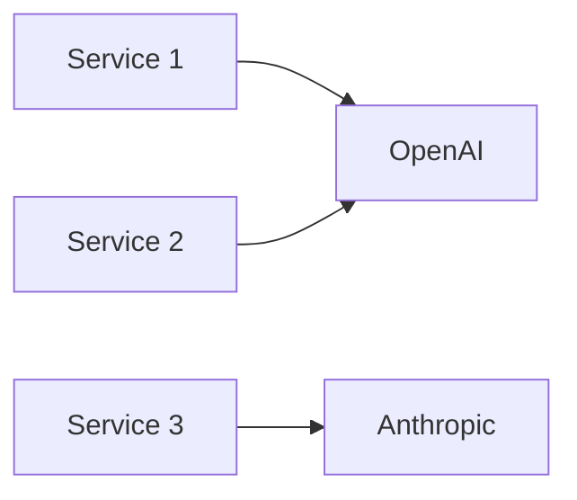

# 07 — LLM Gateways (Portkey, TensorZero, Bifrost, MeshAPI)

## Learning objectives

Deploy a **gateway proxy** between your app and LLM providers for routing, fallback, caching, and per-tenant budgets — the AI equivalent of an API gateway you already use for REST services.

---

## What is an LLM gateway?

A **proxy** between your app and model providers.

| Feature | Benefit |
|---------|---------|
| **Routing** | Model A vs B by cost/latency |
| **Fallback** | Primary down → secondary |
| **Retry / timeout** | Central policy |
| **Caching** | Exact + semantic |
| **Virtual keys** | Per-tenant budgets, audit |
| **Tracing** | Unified request logs |

Terminology: **virtual key** = API key mapped to config (models, limits).

---

## Problem without gateways



Each service implements retry, fallback, logging differently → **inconsistent SLOs**.

**With gateway:** one place for policy.

---

## Virtual keys and per-tenant budgets

**Virtual key** = gateway-side alias for a provider API key + config (model, limits, metadata).

| Use case | Implementation |
|----------|----------------|
| Per-customer spend cap | Virtual key per `tenant_id`; gateway tracks usage |
| Dev vs prod isolation | Separate keys → separate billing |
| Audit trail | Gateway logs `virtual_key_id` per request |

```text
# Conceptual mapping
vk-prod-acme  → OpenAI key #1, max $500/day, models: [gpt-4o-mini]
vk-dev-team   → OpenAI key #2, max $50/day,  models: [gpt-4o-mini, gpt-4o]
```

---

## Portkey

- Quick experiments, LangChain integration.  
- User tracing, retry, timeout, fallback, load balancing, cache.

```python
# Conceptual — follow Portkey SDK docs for current API
from portkey_ai import Portkey

client = Portkey(api_key="...", virtual_key="vk-prod")
# Route OpenAI through Portkey base URL + headers
```

### Portkey features map

| Feature | SWE equivalent |
|---------|---------------|
| Virtual keys | API key rotation + per-tenant billing |
| Retry/timeout | Resilience4j / tenacity |
| Request logs | Structured access logs |
| Cache | HTTP response cache |

---

## TensorZero

- **TOML** config: models, prompts (Minijinja), routing, A/B tests.  
- Episodes + UI for feedback loop.  
- Course: direct vs gateway request comparison, fallback benchmarking, tool calling demo, customer support capstone.

```toml
# tensorzero.toml (illustrative)
[models.gpt4_mini]
routing = ["openai::gpt-4o-mini"]

[gateways.fallback]
primary = "gpt4_mini"
fallback = ["anthropic::claude-3-5-haiku"]
```

---

## Bifrost

- Multi-provider, streaming, logging, virtual keys, **MCP** play.  
- Good for teams wanting self-hosted gateway.

---

## MeshAPI

- RAG, multi-agent, MCP server, media generation APIs in one mesh.  
- Course: mini RAG with Qdrant, multi-agent with LangChain.

---

## A/B testing with gateways

Route traffic to compare prompt versions or models:

```toml
# TensorZero routing sketch
[routing.ab_test]
variant_a = { model = "gpt-4o-mini", prompt = "v3", weight = 0.5 }
variant_b = { model = "gpt-4o-mini", prompt = "v4", weight = 0.5 }
```

Log `variant` in traces → compare eval scores → promote winner.

**Senior note:** A/B on LLM output requires **statistical power** — small sample ≈ noise. Combine with offline eval (module 08) for prompt changes; A/B for model swaps.

---

## Caching at the gateway layer

| Cache type | How | Hit rate |
|------------|-----|----------|
| **Exact** | Hash(prompt + model + temperature) | High for FAQ bots |
| **Semantic** | Embedding similarity (module 11) | Medium; false positive risk |

Gateway cache sits **before** provider call → zero provider cost on hit.

**Do not** cache when: temperature > 0 for creative tasks, user-specific context makes each prompt unique, or output includes time-sensitive data.

---

## Math: fallback latency

If primary fails with probability \(p\) and fallback adds latency \(L_f\):

\[
\mathbb{E}[\text{latency}] \approx (1-p)L_1 + p(L_1 + L_{\text{retry}} + L_f)
\]

Benchmark fallbacks — **slow fallback** can violate p99 SLO.

---

## Decision matrix (which gateway when)

| Need | Portkey | TensorZero | Bifrost | MeshAPI |
|------|---------|------------|---------|---------|
| Fast SaaS + LangChain | Strong | Good | Good | Good |
| TOML gitops prompts | Weak | **Strong** | Medium | Medium |
| Self-host / air-gap | Medium | Medium | **Strong** | Varies |
| Built-in RAG/mesh APIs | Weak | Weak | Weak | **Strong** |

Start with **one** gateway; avoid two proxies in series (latency + debug pain).

---

## Production notes

### Deploy topology

```text
App (FastAPI) → Gateway sidecar or external proxy → Provider
```

| Option | Pros | Cons |
|--------|------|------|
| **Sidecar** (same pod/container) | Low latency; simple networking | Coupled deploy |
| **Shared gateway** (central service) | One config for all apps; audit | Extra hop; single point of failure |
| **SaaS** (Portkey hosted) | Zero ops | Data leaves your infra |

Start with **SaaS** for speed; migrate to self-hosted when compliance requires it.

### Gateway health check

```python
@app.get("/health")
async def health():
    gateway_status = check_gateway_ping()  # lightweight call to gateway
    return {
        "status": "ok" if gateway_status else "degraded",
        "gateway": "reachable" if gateway_status else "unreachable",
        "fallback_active": is_fallback_active(),
    }
```

### Gateway metrics to monitor

| Metric | Alert condition | Action |
|--------|----------------|--------|
| `gateway_latency_p99` | > 3s sustained 5min | Check provider status; activate fallback |
| `gateway_error_rate` | > 5% | Provider outage likely; auto-fallback should kick in |
| `cache_hit_rate` | Drops below 20% (was 40%) | Cache config changed? TTL expired? |
| `fallback_activation_count` | > 0 in last hour | Primary provider issues; investigate |
| `virtual_key_spend` per tenant | > daily budget | Throttle tenant; alert billing |

### Incident: primary provider down

1. Alert fires: `gateway_error_rate > 5%`.
2. Check provider status page.
3. If gateway auto-fallback is working: monitor fallback model latency and quality.
4. If auto-fallback fails: manually update gateway config to route 100% to fallback.
5. When primary recovers: revert to primary; compare eval scores to ensure no quality regression during fallback.
6. Post-incident: review if fallback model was adequate; update runbook.

---

## Senior pitfalls

| Mistake | Impact |
|---------|--------|
| Two gateways in series (app + infra) | Double latency, confused traces |
| Fallback to expensive model without budget cap | Cost spike during outage |
| Cache without TTL | Stale answers served forever |
| No gateway in staging | "Works in dev" fails with provider throttling in prod |

---

## Practice

1. Configure fallback primary `gpt-4o-mini` → `claude-3-5-haiku`; measure p99 under artificial 503 from primary.
2. Set up virtual keys for two tenants; verify billing isolation.
3. Enable exact cache; measure cache hit rate on 50 repeated prompts.

## Production-grade practice

4. **Deploy a gateway with health check** — stand up TensorZero or Portkey; add `/health` endpoint that verifies gateway reachability; alert when unreachable.
5. **Simulate a provider outage** — block primary model endpoint (firewall or mock 503); verify auto-fallback activates; measure fallback p99 latency.
6. **Set up per-tenant budgets** — create 2 virtual keys with different daily limits; send traffic until one hits the cap; verify throttling works.
7. **Build a gateway metrics dashboard** — log latency, error rate, cache hits, fallback activations; identify the noisiest metric in a 24h window.

---

## Lecture map

Portkey (intro, experiments, tracing, LangChain), TensorZero M1–M5, Bifrost, MeshAPI + Qdrant mini RAG.

**Next:** [08-evaluation-ragas-deepeval.md](./08-evaluation-ragas-deepeval.md)
