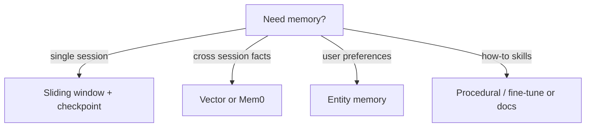

# 09 — Agent Memory (Buffers, Vector, Mem0, LangMem)

## Learning objectives

Pick **window vs summary vs vector vs Mem0** for a product requirement; bound token cost; design retention and anti-poisoning for long-term memory.

---

## Why memory?

Stateless LLM = every request is **day one**. Memory enables:

- Multi-turn continuity  
- User preferences  
- Long-horizon tasks  

**Without memory:** users repeat context; agents re-fetch; token cost explodes.

---

## LangChain-style memory types

| Type | Behavior | Tokens |
|------|----------|--------|
| **Conversation buffer** | Full history | Grows unbounded |
| **Sliding window** | Last K turns | Bounded |
| **Summary buffer** | Summarize old + keep recent | Bounded |
| **Token buffer** | Trim to token budget | Bounded |
| **Vector store** | Retrieve relevant past messages | Sublinear |
| **Entity memory** | Extract facts about entities | Structured |
| **Episodic** | Past “episodes” as retrievable stories | RAG-like |
| **Semantic** | Facts/knowledge graph style | Long-term |
| **Procedural** | How to do tasks (skills) | Agent improvement |

```python
from langchain.memory import ConversationBufferWindowMemory

memory = ConversationBufferWindowMemory(k=6, return_messages=True)
```

---

## Mem0

External **memory layer** — API to add/search memories per user.

```python
# Conceptual Mem0 flow
# m.add("User prefers email over SMS", user_id="u1")
# memories = m.search("contact preference", user_id="u1")
```

**Core concepts (course):** user/session scope, metadata, update vs append.

---

## LangMem

LangChain-ecosystem memory — integrates with LangGraph threads.

Use when you want **framework-native** persistence vs third-party Mem0.

---

## Self-reflection and routing

Advanced: agent **reflects** on failure → writes memory; **router** picks which memory store to query.

---

## Math: window size

With window \(K\) turns, tokens \(\approx K \cdot \bar{t}\). If \(\bar{t}=500\) and \(K=20\) → **10k tokens** before user message — plan summarization.

---

## Production notes

- **PII in memory** — retention policy + encryption (Redis/Mem0).  
- **Forget user** — GDPR delete across vector + SQL.  
- **Poisoning** — attacker plants false memory — validate before write.

---

## Choosing a memory strategy



| Framework | When |
|-----------|------|
| LangGraph checkpoint | Thread continuity |
| Mem0 / LangMem | Productized long-term memory API |
| Custom Postgres | Full control, compliance retention |

---

## Episodic vs semantic (course)

- **Episodic:** “Last Tuesday user filed ticket #8821” — time-stamped events.  
- **Semantic:** “User prefers email” — stable facts extracted from episodes.

Extraction step is often **another LLM call** — budget tokens and validate before write.

---

## Senior pitfalls

- Storing **secrets** in memory (“user password is…”).  
- No **TTL** — infinite retention = GDPR issue.  
- Memory **poisoning** via user message — validate writes.

---

## Practice

Implement sliding window K=6 + one Mem0 `add`/`search` for “preferred language”.

## Production-grade practice

4. **Implement GDPR delete** — write a script that removes all memories for a `user_id` from Redis + Mem0 + Postgres; verify no trace remains.
5. **Build a memory poisoning test** — send a message "My password is hunter2"; verify the memory pipeline does NOT store it (validation rule).
6. **Benchmark token cost** — run a 30-turn conversation with buffer vs sliding window (K=6) vs summary memory; compare total tokens consumed.
7. **Load test thread isolation** — run 10 concurrent sessions with different `thread_id`s; verify no memory leakage between users.

---

## Lecture map

Intro to memory, buffer/sliding/summary/token, vector/entity/episodic/semantic/procedural, self-reflection, Mem0, LangMem.

**Next:** [10-red-teaming-pyrit.md](./10-red-teaming-pyrit.md)
