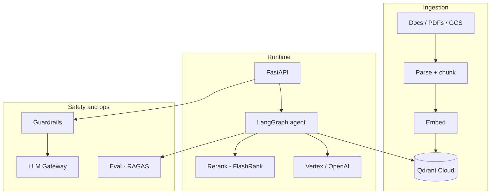

# 12 — Capstone Projects: Architecture Patterns (GCP, AWS, HR RAG)

## Learning objectives

Design and deploy an **end-to-end agentic RAG system** on a cloud provider: data ingestion, graph orchestration, guardrails, gateway, eval CI, Docker, and a production deploy checklist — the same deliverables a staff engineer produces for a real launch.

---

## How to read this as a senior SWE

These capstones are **full system designs** — same rigor as a staff design doc: data flow, failure modes, IAM, cost, eval, guardrails, gateways. You are not learning “one notebook”; you are learning **how teams ship agentic RAG in cloud**.

---

## Pattern A — GCP Agentic RAG (Qdrant + Cloud Run)

**Course arc:** data ingestion → agentic graph (planner/retriever/responder) → FlashRank rerank → API/UI → Docker → Cloud Run → guardrails → gateway → eval pipeline.

### Architecture



### Agentic RAG vs naive RAG

| Naive RAG | Agentic RAG |
|-----------|---------------|
| Always retrieve k chunks | **Planner** decides if retrieval needed |
| Single LLM call | Multiple nodes: plan → retrieve → rerank → answer |
| Fixed pipeline | Can branch (clarify question, refuse) |

**Planner node (intuition):** classify query → `NEED_RETRIEVAL | CHITCHAT | CLARIFY`.

```python
from typing import Literal
from pydantic import BaseModel

class Plan(BaseModel):
    action: Literal["retrieve", "answer_direct", "ask_clarification"]
    search_query: str | None = None

# structured output from small model → route graph edge
```

### Data ingestion (production checklist)

| Step | Pitfall |
|------|---------|
| Parse PDF | Tables lost → bad chunks |
| Chunk size | Too small: no context; too large: noisy retrieval |
| Metadata | Store `source`, `page`, `acl` for secure retrieval |
| Embedding model | **Same model** at ingest and query time |

**Chunking math:** if avg chunk = 512 tokens, 10k docs × 20 chunks/doc → **200k vectors** — size Qdrant cluster accordingly.

### Reranking

Bi-encoder (embedding) is fast but coarse; **cross-encoder / FlashRank** reranks top-50 → top-5.

\[
\text{score}(q, d) = \text{CrossEncoder}(q, d)
\]

Latency trade-off: +50–200ms for much better precision.

### GCP wiring

| Service | Role |
|---------|------|
| GCS | Raw documents |
| Qdrant Cloud | Vector index |
| Cloud Run | Stateless API + graph |
| Artifact Registry | Docker images |
| IAM | Service account per service; least privilege |

### Integration sequence (course order)

1. Guardrails on API input/output.  
2. Gateway for model routing/fallback.  
3. Eval phase 1: offline dataset; phase 2: CI gate on PR.

---

## Pattern B — AWS Terraform full stack

**Course modules:** VPC/RDS/Redis/SQS, auth, guardrails, caching, memory, multi-agent, LangSmith eval, TensorZero, PyRIT dashboard, GitHub Actions, FastAPI + Dockerfile.

### Logical architecture

```text
Client → ALB → FastAPI
              ├─ Auth (JWT / session)
              ├─ Redis (cache + rate limit + session memory)
              ├─ RDS (users, outbox, audit)
              ├─ SQS (async jobs)
              ├─ LangGraph multi-agent
              ├─ Guardrails + Gateway (TensorZero)
              └─ Observability (LangSmith)
```

### Retry and connection pool (lecture 09)

Same as any OLTP service:

```python
from sqlalchemy import create_engine
from sqlalchemy.pool import QueuePool

engine = create_engine(
    DATABASE_URL,
    poolclass=QueuePool,
    pool_size=10,
    max_overflow=20,
    pool_pre_ping=True,
)
```

LLM calls: **tenacity** with exponential backoff; **circuit breaker** when provider 5xx.

### Multi-agent (lecture 12)

Supervisor routes to `research_agent`, `writer_agent` — each with **tool allowlist**. Store `thread_id` in Redis checkpoint.

### Eval with LangSmith (lecture 13)

Dataset runs as experiments — compare `prompt_v3` vs `prompt_v4` on faithfulness before merge.

### PyRIT dashboard (lecture 16)

Attack staging in CI weekly — not on every PR (too slow).

---

## Pattern C — HR Hybrid RAG (Phases 1–3)

| Phase | Focus |
|-------|--------|
| **1 Hybrid RAG** | Load, chunk, embed, HR agent, retrieval, LangGraph Studio traces |
| **2 AI Security** | LLM routing/fallback, Google Model Armor, semantic cache, scope guardrail, red team, eval |
| **3 Cloud** | Dockerfile, deployment pipeline, cleanup |

**Scope guardrail:** HR bot only answers **HR policy** questions — input rail rejects legal/medical; retrieval filtered by `doc_type=hr_policy`.

**Semantic cache:** repeated “What is PTO policy?” hits cache — see module 11.

---

## Cross-capstone comparison

| Dimension | GCP agentic | AWS Terraform | HR hybrid |
|-----------|-------------|---------------|-----------|
| Vector DB | Qdrant | (project-specific) | Hybrid + secure retrieval |
| Deploy | Cloud Run | ECS/EC2 + TF | Container pipeline |
| Security emphasis | Guardrails + eval | PyRIT + full IAM | Model Armor + scope |
| Best learning focus | Agent graph + rerank | **End-to-end ops** | Security + RAG trace |

---

## Senior deliverables (do this for your portfolio)

1. **ARCHITECTURE.md** — diagram + data classification.  
2. **THREAT_MODEL.md** — injection, tool abuse, data leak.  
3. **eval/** — 50+ golden cases + CI threshold.  
4. **Cost model** — $/1k requests at expected traffic.  
5. **Runbook** — provider outage → fallback route.

---

## Production notes

### Deploy checklist (use for any capstone)

```markdown
## Pre-deploy
- [ ] Eval suite passes on golden set (faithfulness >= baseline - 0.02)
- [ ] Red-team smoke (20 prompts) passes
- [ ] Guardrail version matches deploy manifest
- [ ] Prompt version tagged in git
- [ ] Docker image tagged with git SHA
- [ ] Secrets in vault / SSM, not in env vars or code
- [ ] Health check endpoint returns model + prompt version

## Deploy
- [ ] Deploy to staging; run full eval + red-team
- [ ] Canary 5% traffic; monitor latency + block rate + cost
- [ ] Promote to 100% after 30min green metrics

## Post-deploy
- [ ] Verify traces flowing to LangSmith / Logfire
- [ ] Check cost dashboard for first-hour spend
- [ ] Confirm CloudWatch / Grafana alerts active
```

### Cost model template

| Component | Unit cost | Volume/day | Daily cost |
|-----------|----------|------------|------------|
| LLM (gpt-4o-mini) | $0.15/1M in + $0.60/1M out | 500k in + 100k out tokens | ~$0.14 |
| Embedding | $0.02/1M tokens | 200k tokens | ~$0.004 |
| Reranker | $0.001/query | 1k queries | ~$1 |
| Vector DB (Qdrant Cloud) | $0.10/hr | 24hr | ~$2.40 |
| Compute (Cloud Run) | $0.00002/vCPU-sec | 50k sec | ~$1 |
| Guardrails (Bedrock) | per-invocation | 1k calls | check pricing |
| **Total** | | | **~$5/day at low traffic** |

Scale linearly with traffic; cache saves proportionally.

### Runbook template

```markdown
## Incident: Provider outage (OpenAI / Anthropic)
1. Alert fires: `llm_error_rate > 5%` for 5min
2. Check provider status page
3. If confirmed: switch gateway fallback model (gateway TOML or Portkey dashboard)
4. Monitor latency and eval scores on fallback model
5. When primary recovers: revert gateway config
6. Post-incident: update runbook with fallback model performance notes

## Incident: Eval regression
1. Alert fires: `eval_faithfulness_7d < baseline - 0.03`
2. Check last merged PR (prompt or retrieval change)
3. Roll back prompt version in deploy manifest
4. Re-run eval to confirm recovery
5. RCA: what changed and why eval didn't catch it on PR
```

---

## Senior pitfalls

| Mistake | Impact | Fix |
|---------|--------|-----|
| No eval before deploy | Ship hallucinating RAG to production | Eval gate in CI (module 08) |
| Hardcoded model ID in code | Cannot switch during outage | Config / env var / gateway route |
| Skip Docker for "just a script" | Works on laptop, breaks on Cloud Run | Dockerize from day one |
| No cost monitoring | $500 surprise bill from agent loop | Daily cost alert + `recursion_limit` |
| Same IAM role for all services | Blast radius of compromise | Least-privilege per service |
| No runbook | 3am page with no playbook | Write runbook before launch |

---

## Practice exercises

1. Add **HITL** node before `send_email` tool in any capstone graph.  
2. Break retrieval by swapping embedding model — observe eval **context recall** drop (module 08).  
3. Run PyRIT **XPIA** case: malicious chunk in vector DB.

## Production-grade practice

4. **Fill in the deploy checklist** above for your chosen capstone; execute it end-to-end on staging.
5. **Build a cost model** — measure actual token usage for 100 queries; project daily/monthly cost; identify the most expensive component.
6. **Write a runbook** for your capstone — at least 2 incident types (provider outage + eval regression); include decision tree and escalation path.
7. **Run a canary deploy** — deploy v2 of your prompt to 10% traffic (or simulate with a feature flag); compare eval scores between v1 and v2 using LangSmith experiments.

---

## Lecture map (course)

GCP project (ingestion through eval), AWS Terraform project (01–21), HR project (intro through phase 3 deployment).

**Next:** [13-claude-deep-agents-governance.md](./13-claude-deep-agents-governance.md)
