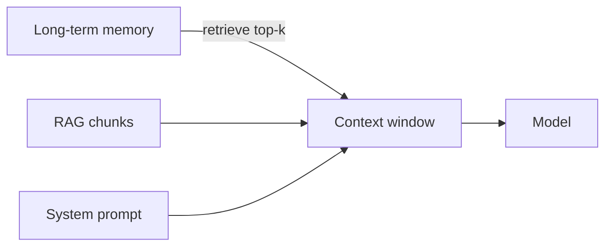

# 13 — Claude Code, Deep Agents, Context Engineering, AI Governance

## Learning objectives

Use **Claude Code** and **deep agents** safely with hooks and CI; design a **context budget**; implement a **governance callback** that audits every tool call — the controls enterprises require before approving an LLM deployment.

---

## Audience note

This module covers **tooling for building agents** (Claude Code, deep agents) and **governance** (Sentience Governor) — how seniors keep agents aligned with policy at scale.

---

## Claude ecosystem (for builders)

| Piece | What it is |
|-------|------------|
| **Claude API** | Models (Sonnet, Opus, Haiku) via Messages API |
| **Claude Code** | Agentic IDE assistant — reads repo, runs commands, edits files |
| **Agent teams / hooks / skills** | Composable automation in the IDE workflow |

**SWE analogy:** Claude Code ≈ a junior dev with shell access — you still need **code review, CI, and branch protections**.

### Safe usage patterns

- **Hooks:** run formatter/tests after agent edits.  
- **Skills/plugins:** encode team conventions (API style, test patterns).  
- **Never** give production credentials in agent context.

```text
# Example hook concept (pseudo)
post_edit: run `ruff check` && `pytest -q`
```

---

## Deep agents vs Claude SDK

| | Deep agents (course) | Claude Agent SDK |
|---|----------------------|------------------|
| Focus | Long-horizon tasks, subagents, backends | API-first agent loops |
| Customization | Skills, context engineering, memory backends | You build graph |
| When to pick | IDE/research automation product | Embedded in your SaaS |

**Deep agent basics:** planner + tool use + **persistent workspace** (files, notes).

### Backend in deep agents

Agents need **durable state**:

- File system sandbox  
- DB for task status  
- Vector memory for prior sessions  

Same as LangGraph checkpointer — different packaging.

---

## Context engineering

**Input context** = everything the model sees: system prompt, tools, retrieved docs, memory, examples.

| Technique | Purpose |
|-----------|---------|
| **Prompt templates** | Versioned instructions (Minijinja / Jinja) |
| **Skills context** | Inject domain playbooks on demand |
| **Subagents** | Isolate context — researcher only sees search tools |
| **Compaction** | Summarize / prune to fit window |

### Memory vs context

- **Context:** what is in **this** request (bounded by \(C_{\max}\)).  
- **Memory:** what is stored **across** requests (Redis, Mem0, files).

**Rule:** put stable facts in memory; put task-specific data in context.



### Subagents deep agents

Parent spawns child with **narrow tool set** — reduces prompt injection surface and cost.

---

## AI governance — why it matters

Regulated industries and enterprise procurement ask:

- Who approved this model/prompt?  
- Can we prove guardrails ran?  
- Can we audit decisions?

**Governance ≠ slower shipping** — it is **release gates** for non-deterministic components.

---

## Sentience Governor (course)

Framework for **policy enforcement** on LangChain agents via **callbacks**:

1. **Observe** agent steps (LLM start/end, tool calls).  
2. **Evaluate** against governor rules.  
3. **Block or modify** before side effects.

```python
# Conceptual pattern — see course implementation lectures
class GovernorCallback(BaseCallbackHandler):
    def on_tool_start(self, serialized, input_str, **kwargs):
        if serialized["name"] in BLOCKED_TOOLS:
            raise PolicyViolation("Tool not allowed")
```

**With guardrails:** governor + NeMo/Guardrails AI = defense in depth.

### Implementation phases (course)

1. LangChain agents + callbacks.  
2. Add guardrails in callback chain.  
3. Audit log every allow/deny decision.

---

## Senior checklist: governance MVP

| Control | Implementation |
|---------|----------------|
| Prompt versioning | Git tags + deploy manifest |
| Model allowlist | Gateway config |
| PII handling | Redaction rail + no PII in traces |
| Human approval | HITL on financial tools |
| Eval gate | DeepEval on PR |
| Red team | PyRIT weekly on staging |

---

## Industry parallels

- **Microsoft:** responsible AI dashboard + content filters.  
- **Google:** Model Armor / safety settings on Vertex.  
- **AWS:** Bedrock Guardrails (module 06).  
- **Banks:** model risk management — document eval methodology.

---

## Production notes

### Governance CI pipeline

```yaml
# .github/workflows/governance-check.yml (sketch)
name: governance-audit
on:
  pull_request:
    paths: ["app/graph/**", "prompts/**", "tools/**"]
jobs:
  check:
    runs-on: ubuntu-latest
    steps:
      - uses: actions/checkout@v4
      - name: Tool allowlist validation
        run: uv run python scripts/validate_tool_allowlist.py
      - name: Prompt version check
        run: |
          # Ensure every prompt file has a version field
          uv run python scripts/check_prompt_versions.py
      - name: Eval gate
        run: uv run pytest tests/eval/ --maxfail=1
      - name: Red-team smoke
        run: uv run pytest tests/red_team/smoke.py --maxfail=3
```

Every PR that touches agent code runs: allowlist check, prompt version check, eval, red-team smoke.

### Audit log schema

```sql
CREATE TABLE governance_audit (
    id UUID PRIMARY KEY DEFAULT gen_random_uuid(),
    timestamp TIMESTAMPTZ DEFAULT NOW(),
    request_id TEXT NOT NULL,
    thread_id TEXT NOT NULL,
    agent_name TEXT NOT NULL,
    step_type TEXT NOT NULL,          -- 'llm_call' | 'tool_call' | 'guardrail'
    step_name TEXT NOT NULL,          -- model ID or tool name
    decision TEXT NOT NULL,           -- 'allow' | 'block' | 'hitl_pending'
    rule_triggered TEXT,              -- governor rule that fired
    tokens_in INT,
    tokens_out INT,
    latency_ms INT,
    metadata JSONB                    -- prompt version, model config, etc.
);

CREATE INDEX idx_audit_request ON governance_audit(request_id);
CREATE INDEX idx_audit_time ON governance_audit(timestamp);
```

Query for compliance reports:

```sql
-- All blocked tool calls in last 7 days
SELECT step_name, rule_triggered, COUNT(*)
FROM governance_audit
WHERE decision = 'block' AND timestamp > NOW() - INTERVAL '7 days'
GROUP BY step_name, rule_triggered
ORDER BY count DESC;
```

### Model registry pattern

| Field | Example |
|-------|---------|
| `model_id` | `gpt-4o-mini` |
| `approved_by` | `security-team` |
| `approved_date` | `2026-03-15` |
| `eval_score` | `faithfulness=0.94` |
| `allowed_use_cases` | `[hr-bot, support-agent]` |
| `max_temperature` | `0.3` |
| `gateway_route` | `prod-primary` |

Before onboarding a new model: eval on golden set, red-team, governance review, add to registry, configure gateway route.

---

## Senior pitfalls

| Mistake | Impact | Fix |
|---------|--------|-----|
| Governance only in docs, not in code | Auditors find no enforcement | Governor callback + CI gate |
| No audit log for HITL decisions | Cannot prove human approved action | Log every approve/deny with who + when |
| Claude Code with prod credentials | Agent can access production data | Use dev credentials; sandbox filesystem |
| Context window exceeded silently | Model ignores oldest instructions | Monitor token usage; compaction middleware |
| Single model for all use cases | Expensive + wrong capability | Model registry with per-use-case routing |
| Subagent without tool scoping | Child agent inherits all tools | Explicit tool allowlist per subagent |

---

## Practice exercises

1. Design **context budget**: 8k total — allocate % to system, RAG, history, tools schema.  
2. Add governor callback that logs **token usage per step** to OpenTelemetry.  
3. Compare **single agent** vs **subagent** cost on same task (measure steps + tokens).

## Production-grade practice

4. **Create a governance audit table** (Postgres or SQLite) and a governor callback that writes every tool call to it; query for blocked calls.
5. **Build a model registry** (YAML or DB) with 3 models; write a validation script that ensures only registered models are used in gateway config.
6. **Implement a governance CI pipeline** — tool allowlist check + prompt version check; make a PR that violates the allowlist; verify CI fails.
7. **Run a compliance report** — query audit log for all decisions in the last 24h; produce a summary with block rate, most-triggered rules, and HITL response times.

---

## Lecture map

Claude ecosystem, Claude Code, agents/views/teams, hooks, skills/plugins, deep agents basics/customization/backend, context engineering, skills, subagents, projects; governance intro, Sentience Governor, LangChain callback implementation, guardrails integration.

**Next:** [14-databricks-agentic-rag.md](./14-databricks-agentic-rag.md)
