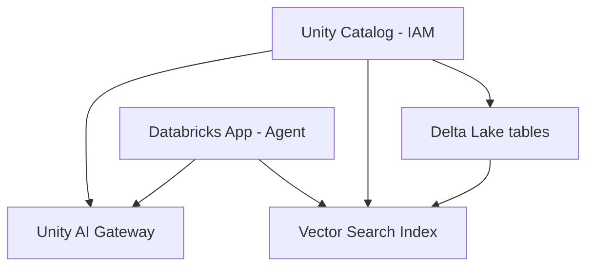

# 14 — Databricks: Agentic RAG, Delta Lake, Unity Catalog, MLOps

## Learning objectives

Deploy an **agentic RAG app** on the Databricks lakehouse with **Delta Lake** as the source of truth, **Unity Catalog** for ACL-enforced retrieval, and **Asset Bundles** for CI/CD — the enterprise data platform pattern interviews ask about.

---

## Why Databricks in an AI engineer path

Many enterprises centralize **data + ML + agents** on the lakehouse. Even if you deploy on AWS/GCP, interviews and jobs ask: **Delta Lake, Unity Catalog, vector search, governance gateways**.

---

## Agentic AI on Databricks (project overview)

**Course project:** agentic RAG app on **Databricks Apps** with:

- Delta Lake tables as source of truth  
- **Vector Search** index (delta sync)  
- **Unity Catalog** for ACLs on data and models  
- **Unity AI Gateways** for governed model access  
- CI/CD via **Databricks Asset Bundles**



---

## Why Delta Lake

| Problem without Delta | Delta Lake |
|----------------------|------------|
| Parquet alone: no ACID | **ACID** transactions on object storage |
| Bad concurrent writers | Optimistic concurrency |
| Hard time travel | **Version** history for audit/repro |

**AI use:** training datasets, document silver tables, **feature tables** for eval metrics.

```sql
-- Time travel for debugging bad RAG ingest
SELECT * FROM docs_chunks VERSION AS OF 42 WHERE doc_id = 'policy-2024';
```

---

## Data governance with Unity Catalog

| Concept | Meaning |
|---------|---------|
| **Metastore** | Top-level governance root |
| **Catalog / Schema / Table** | Three-level namespace |
| **Grants** | `SELECT` on tables for service principals only |

**Agent principle:** retrieval must enforce **same ACLs** as SQL — user A must not retrieve user B's docs via vector search.

Course: long session on governance + granting app service principal access.

---

## Vector Search in Databricks

- **Delta Sync:** index updates when Delta table changes.  
- Embedding column + sync pipeline — managed infra vs self-hosted Qdrant.

**Trade-off:** operational simplicity vs vendor lock-in — common in enterprise.

---

## Unity AI Gateways

Central **model access** with policies (analogous to module 07 gateways, inside Databricks).

- Route to foundation models  
- Audit usage per workspace  
- Pair with Unity Catalog for **lineage** (which table → which prompt)

---

## CI/CD with Asset Bundles

```text
databricks.yml   # bundle definition
resources/
  jobs/
  apps/
.github/workflows/deploy.yml
```

**Senior practice:** dev/staging/prod workspaces; bundle promotes artifacts; **OIDC** to GitHub (course: workspace + OIDC setup).

Pipeline stages:

1. Lint/test Python.  
2. Run eval job on golden set.  
3. Deploy bundle to staging.  
4. Manual approval → prod.

---

## Agentic RAG deployment on Databricks Apps

- Containerized app with agent graph  
- Reads vector index + calls gateway  
- **Happy ending:** tear down resources (cost control)

---

## Comparison to GCP/AWS capstones (module 12)

| | Databricks | Cloud Run / AWS ECS |
|---|------------|---------------------|
| Data ACL | Unity Catalog native | DIY IAM + row filters |
| Vectors | Managed Vector Search | Qdrant / OpenSearch |
| Buyers | Enterprise data teams | Product eng startups |

---

## Math: index freshness

If ingest lag = \(L\) seconds and sync interval = \(S\):

\[
\text{staleness} \lesssim L + S
\]

SLA for “policy updates in RAG” must account for **both** Delta commit and vector sync.

---

## Production notes

### Bundle deploy checklist

```markdown
## Pre-deploy
- [ ] `databricks.yml` has correct workspace target (dev/staging/prod)
- [ ] OIDC configured for GitHub Actions (no long-lived tokens)
- [ ] Vector Search index sync verified (check `delta_sync_status`)
- [ ] Unity Catalog grants reviewed — app principal has minimum required permissions
- [ ] Eval job passes on golden set in staging workspace

## Deploy
- [ ] `databricks bundle deploy --target staging`
- [ ] Run smoke test via app endpoint
- [ ] Verify traces in workspace logs
- [ ] `databricks bundle deploy --target prod` (after manual approval)

## Post-deploy
- [ ] Monitor job runs in Databricks Workflows UI
- [ ] Check Unity AI Gateway usage metrics
- [ ] Verify cost in Databricks billing dashboard
- [ ] Tear down staging resources if not needed
```

### Monitoring Databricks jobs

| Metric | Source | Alert |
|--------|--------|-------|
| Job run failures | Workflows API / email alerts | Any failure → investigate |
| Vector sync lag | `delta_sync_index_status` | Lag > 5min → check ingest pipeline |
| Gateway throttle | Unity AI Gateway metrics | 429 rate > 1% → increase quota or add fallback |
| Compute cost | Billing API | Daily cost > budget → auto-terminate cluster |
| Agent latency | App logs | p99 > 10s → optimize graph or model choice |

### Cost tracking

```sql
-- Databricks SQL: daily token usage from agent logs
SELECT
    DATE(timestamp) AS day,
    model_id,
    SUM(tokens_in) AS total_in,
    SUM(tokens_out) AS total_out,
    COUNT(*) AS request_count
FROM agent_logs
GROUP BY 1, 2
ORDER BY 1 DESC;
```

Set up a Databricks SQL alert: `SUM(tokens_out) > 500000` in a day → notify Slack.

### Unity Catalog: multi-tenant retrieval security

```sql
-- Production pattern: row-level security view
CREATE VIEW hr.docs_chunks_filtered AS
SELECT * FROM hr.docs_chunks
WHERE tenant_id = CURRENT_USER()
   OR tenant_id = 'public';

-- Grant app principal access to view, not base table
GRANT SELECT ON hr.docs_chunks_filtered TO `app-principal`;
```

Agent retrieval queries the **view**, not the base table — user A never sees user B's documents.

---

## Senior pitfalls

| Mistake | Impact | Fix |
|---------|--------|-----|
| Long-lived tokens for CI/CD | Security risk; tokens leaked in logs | OIDC with GitHub Actions |
| Skip eval job in bundle pipeline | Deploy broken RAG to prod | Eval job as required step before promotion |
| Vector index and Delta table out of sync | Stale or missing answers | Monitor `delta_sync_status`; alert on lag |
| Same workspace for dev and prod | Accidental data access, cost bleed | Separate workspaces with separate catalogs |
| No row-level security on vector search | Tenant data leakage | Filtered views + Unity Catalog grants |
| Forget to tear down staging resources | Idle cluster cost accumulates | Auto-termination policy + cleanup job |

---

## Practice exercises

1. Sketch **GRANT** statements for an app principal read-only on `hr.docs_chunks`.  
2. Write eval query: join **agent logs** Delta table with **golden questions** table.  
3. Document **failover** if Unity AI Gateway throttles — fallback model in bundle config.

## Production-grade practice

4. **Write a `databricks.yml` bundle** with dev + staging + prod targets; include an eval job that runs before app deploy.
5. **Implement row-level security** — create a filtered view for multi-tenant retrieval; verify tenant isolation with two test users.
6. **Set up a cost alert** — Databricks SQL query that sums daily tokens; alert when > 500k; test by sending burst traffic.
7. **Run a full deploy cycle** — push bundle to staging → eval job → manual approval gate → prod deploy → verify traces and metrics flowing.

---

## Lecture map

Agentic AI overview, Databricks overview, agentic side of project, Delta Lake, governance/Unity Catalog, Apps + Vector Search, Delta Sync, Unity AI Gateways, deployment/OIDC/bundles/CI/CD, vector index ingest, grants, deploy app, cleanup.

**Back to index:** [README.md](./README.md)
