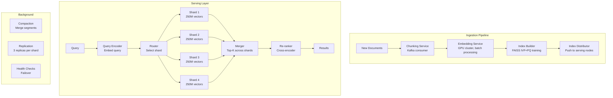
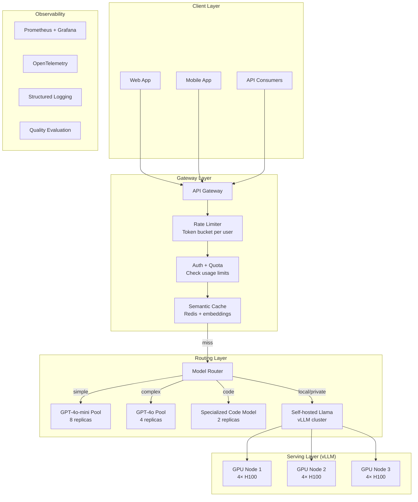
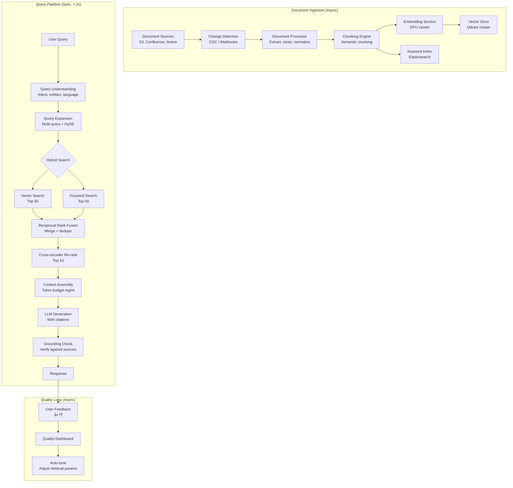

# AI Engineering — Large-Scale Solutions & Best Practices (Master Reference)

> **This is the production bible.** Every pattern, number, and architecture here comes from how FAANG companies actually run AI at scale — billions of requests, millions of users, petabytes of data.

---

## Table of Contents

1. [Large-Scale Embedding & Retrieval](#1-large-scale-embedding--retrieval)
2. [Large-Scale LLM Serving](#2-large-scale-llm-serving)
3. [Large-Scale RAG Systems](#3-large-scale-rag-systems)
4. [Large-Scale Agent Systems](#4-large-scale-agent-systems)
5. [Cost Engineering at Scale](#5-cost-engineering-at-scale)
6. [Reliability & Fault Tolerance](#6-reliability--fault-tolerance)
7. [Evaluation & Quality at Scale](#7-evaluation--quality-at-scale)
8. [Security & Safety at Scale](#8-security--safety-at-scale)
9. [Observability & Monitoring](#9-observability--monitoring)
10. [Migration & Rollout Patterns](#10-migration--rollout-patterns)

---

## 1. Large-Scale Embedding & Retrieval

### The Numbers at Scale

```
Google Search AI Overview:
  Documents indexed:    100+ billion web pages
  Embedding dimensions: ~768 (custom model)
  Query volume:         8.5 billion searches/day
  Latency target:       < 200ms end-to-end
  
Spotify Recommendations:
  Items to embed:       100M+ songs, 5M+ podcasts
  User embeddings:      600M+ users
  Update frequency:     Daily re-embedding for active items
  Serving:              Real-time, < 100ms

Pinterest Visual Search:
  Image embeddings:     300+ billion pins
  Embedding model:      Custom CLIP variant
  Index type:           HNSW + Product Quantization
  Queries/day:          1 billion+
```

### Architecture: Billion-Scale Vector Search



### Best Practices: Embedding at Scale

```python
class ProductionEmbeddingPipeline:
    """
    Handles embedding 100M+ documents with:
    - Batched API calls (2048 texts per call)
    - Rate limiting and retry logic
    - Incremental re-indexing (only changed docs)
    - Quality monitoring
    """
    
    def __init__(self):
        self.batch_size = 2048  # OpenAI max batch
        self.max_concurrent = 50  # Parallel API calls
        self.rate_limiter = TokenBucketRateLimiter(
            tokens_per_minute=1_000_000,  # OpenAI tier 5
            requests_per_minute=5_000
        )
    
    async def embed_corpus(self, documents: AsyncIterator[Document]):
        """Embed millions of documents efficiently."""
        batch = []
        tasks = []
        stats = {"total": 0, "embedded": 0, "skipped": 0, "errors": 0}
        
        async for doc in documents:
            stats["total"] += 1
            
            # Skip if embedding is fresh (< 7 days old and doc unchanged)
            if self.is_fresh(doc):
                stats["skipped"] += 1
                continue
            
            batch.append(doc)
            
            if len(batch) >= self.batch_size:
                # Submit batch for embedding
                task = asyncio.create_task(
                    self.embed_batch_with_retry(batch.copy())
                )
                tasks.append(task)
                batch.clear()
                
                # Limit concurrent requests
                if len(tasks) >= self.max_concurrent:
                    done, tasks = await asyncio.wait(
                        tasks, return_when=asyncio.FIRST_COMPLETED
                    )
                    for t in done:
                        result = t.result()
                        stats["embedded"] += result["count"]
                        stats["errors"] += result["errors"]
        
        # Process remaining
        if batch:
            tasks.append(asyncio.create_task(self.embed_batch_with_retry(batch)))
        
        await asyncio.gather(*tasks)
        return stats
    
    async def embed_batch_with_retry(self, docs: list, max_retries=3):
        """Embed a batch with retry and rate limiting."""
        for attempt in range(max_retries):
            try:
                await self.rate_limiter.acquire(len(docs))
                
                texts = [doc.text[:8000] for doc in docs]  # Truncate to model limit
                
                response = await self.client.embeddings.create(
                    model="text-embedding-3-small",
                    input=texts
                )
                
                # Store embeddings
                for doc, item in zip(docs, response.data):
                    await self.vector_store.upsert(
                        id=doc.id,
                        vector=item.embedding,
                        metadata=doc.metadata
                    )
                
                return {"count": len(docs), "errors": 0}
                
            except openai.RateLimitError:
                wait = 2 ** attempt
                await asyncio.sleep(wait)
            except Exception as e:
                if attempt == max_retries - 1:
                    logger.error(f"Batch failed after {max_retries} retries: {e}")
                    return {"count": 0, "errors": len(docs)}
                await asyncio.sleep(1)
```

### Sharding Strategy for 1B+ Vectors

```python
class ShardedVectorIndex:
    """
    Distribute vectors across multiple shards.
    
    Strategy: Content-based sharding
    - Each shard holds vectors for a specific category/domain
    - Query router selects relevant shards
    - Reduces search space by 80%+ for filtered queries
    """
    
    SHARD_CONFIG = {
        "by_category": {
            "description": "Shard by content category",
            "pros": "Can skip irrelevant shards. Even within-shard distribution.",
            "cons": "Category rebalancing needed. Hot categories need more replicas.",
            "best_for": "E-commerce, content platforms",
        },
        "by_hash": {
            "description": "Hash(doc_id) % num_shards",
            "pros": "Even distribution. Simple. No routing logic.",
            "cons": "Must query ALL shards for every search.",
            "best_for": "General search, no natural partitioning",
        },
        "by_time": {
            "description": "Shard by creation date",
            "pros": "Easy archival. Recent data = hot, old = cold.",
            "cons": "Recent shard overloaded. Old shards underused.",
            "best_for": "News, social media, logs",
        },
        "by_geography": {
            "description": "Shard by region",
            "pros": "Data locality. Comply with data residency laws.",
            "cons": "Cross-region queries are slow.",
            "best_for": "Multi-region deployments, GDPR compliance",
        },
    }
    
    def __init__(self, num_shards: int, strategy: str = "by_hash"):
        self.shards = [VectorShard(i) for i in range(num_shards)]
        self.strategy = strategy
        self.router = ShardRouter(strategy, num_shards)
    
    async def search(self, query_vector, filters=None, top_k=10):
        # Determine which shards to search
        target_shards = self.router.route(filters)
        
        # Fan-out: search shards in parallel
        shard_results = await asyncio.gather(*[
            shard.search(query_vector, filters, top_k=top_k)
            for shard in target_shards
        ])
        
        # Fan-in: merge results
        all_results = []
        for results in shard_results:
            all_results.extend(results)
        
        all_results.sort(key=lambda x: x.score, reverse=True)
        return all_results[:top_k]


# Capacity planning
def capacity_plan_vector_search(
    total_vectors: int,
    dimensions: int,
    qps: int,
    latency_target_ms: int,
    index_type: str = "HNSW"
):
    """Plan infrastructure for vector search."""
    
    # Memory per vector
    if index_type == "HNSW":
        bytes_per_vector = dimensions * 4 + 64 * 4 * 2  # vectors + graph links
    elif index_type == "IVF_PQ":
        bytes_per_vector = 48 + 8  # PQ codes + metadata
    else:
        bytes_per_vector = dimensions * 4  # flat
    
    total_memory_gb = total_vectors * bytes_per_vector / 1e9
    
    # HNSW can do ~1000 QPS per core per million vectors
    if index_type == "HNSW":
        qps_per_replica = 1000 * (1_000_000 / min(total_vectors, 10_000_000))
    else:
        qps_per_replica = 500
    
    replicas_for_qps = max(1, qps // qps_per_replica)
    
    # Memory per node (leave 30% headroom)
    memory_per_node_gb = 64  # Typical server
    usable_per_node = memory_per_node_gb * 0.7
    
    shards = max(1, int(total_memory_gb / usable_per_node) + 1)
    total_nodes = shards * replicas_for_qps
    
    return {
        "total_memory_gb": total_memory_gb,
        "shards": shards,
        "replicas_per_shard": replicas_for_qps,
        "total_nodes": total_nodes,
        "estimated_cost_monthly": total_nodes * 500,  # ~$500/node/month
    }

# Examples:
print(capacity_plan_vector_search(
    total_vectors=10_000_000, dimensions=1536, qps=1000, latency_target_ms=10
))
# {'total_memory_gb': 60, 'shards': 2, 'replicas_per_shard': 1, 'total_nodes': 2, 'cost': $1000/mo}

print(capacity_plan_vector_search(
    total_vectors=1_000_000_000, dimensions=1536, qps=50000, latency_target_ms=10
))
# {'total_memory_gb': 6000, 'shards': 134, 'replicas_per_shard': 50, 'total_nodes': 6700, 'cost': $3.35M/mo}
```

---

## 2. Large-Scale LLM Serving

### The Numbers

```
OpenAI (estimated):
  Requests/day:       1+ billion
  GPU cluster:        ~30,000 H100 GPUs
  Models served:      20+ (different versions/sizes)
  p50 latency (GPT-4o): ~500ms
  Cost to serve:      ~$1B/year in compute
  
Anthropic Claude:
  Context window:     200K tokens
  Throughput:         ~100 tokens/second/request
  Concurrent users:   millions
  
Google Gemini:
  TPU pods:           8,960 TPU v5p chips per pod
  Training cost:      ~$100M+ per model
  Serving:            Through Vertex AI, global edge
```

### Production LLM Serving Architecture



### Best Practices: LLM Serving

```python
class ProductionLLMGateway:
    """
    Production LLM gateway with:
    - Multi-model routing
    - Semantic caching
    - Rate limiting (per-user and global)
    - Automatic fallback
    - Cost tracking
    - Quality monitoring
    """
    
    def __init__(self):
        self.models = {
            "gpt-4o": ModelEndpoint(provider="openai", model="gpt-4o"),
            "gpt-4o-mini": ModelEndpoint(provider="openai", model="gpt-4o-mini"),
            "claude-3.5": ModelEndpoint(provider="anthropic", model="claude-3-5-sonnet"),
            "llama-70b": ModelEndpoint(provider="vllm", url="http://vllm-cluster:8000"),
        }
        self.cache = SemanticCache(redis_url="redis://cache:6379", ttl=3600)
        self.rate_limiter = RateLimiter()
        self.circuit_breakers = {name: CircuitBreaker() for name in self.models}
        self.cost_tracker = CostTracker()
    
    async def generate(self, request: LLMRequest) -> LLMResponse:
        """Full production pipeline for an LLM request."""
        
        request_id = uuid4()
        start_time = time.perf_counter()
        
        try:
            # ── Step 1: Rate limit check ──
            if not await self.rate_limiter.check(
                user_id=request.user_id,
                tokens_estimate=request.estimated_tokens,
            ):
                raise RateLimitExceeded(
                    f"Rate limit: {request.user_id} exceeded "
                    f"{self.rate_limiter.get_limit(request.user_id)} tokens/min"
                )
            
            # ── Step 2: Check semantic cache ──
            cached = await self.cache.get(request.messages)
            if cached:
                self._record_metrics(request_id, "cache_hit", 0, 0)
                return LLMResponse(
                    content=cached["content"],
                    model="cache",
                    cost=0,
                    latency_ms=time.perf_counter() - start_time,
                    cached=True
                )
            
            # ── Step 3: Route to optimal model ──
            model_name = await self._route(request)
            
            # ── Step 4: Generate with circuit breaker ──
            cb = self.circuit_breakers[model_name]
            
            if cb.is_open():
                # Primary model is down → fallback
                model_name = self._get_fallback(model_name)
                cb = self.circuit_breakers[model_name]
            
            response = await cb.call(
                self.models[model_name].generate,
                messages=request.messages,
                temperature=request.temperature,
                max_tokens=request.max_tokens,
                timeout=request.timeout or 30
            )
            
            # ── Step 5: Track cost ──
            cost = self.cost_tracker.calculate(
                model=model_name,
                input_tokens=response.usage.prompt_tokens,
                output_tokens=response.usage.completion_tokens
            )
            
            # ── Step 6: Cache the response ──
            await self.cache.set(
                request.messages,
                {"content": response.content, "model": model_name}
            )
            
            # ── Step 7: Quality check (async, non-blocking) ──
            asyncio.create_task(
                self._async_quality_check(request, response)
            )
            
            latency = (time.perf_counter() - start_time) * 1000
            
            return LLMResponse(
                content=response.content,
                model=model_name,
                cost=cost,
                latency_ms=latency,
                tokens_used=response.usage.total_tokens,
                request_id=str(request_id)
            )
            
        except Exception as e:
            self._record_error(request_id, e)
            raise
    
    async def _route(self, request: LLMRequest) -> str:
        """Intelligent model routing."""
        
        # User-specified model
        if request.model:
            return request.model
        
        # Auto-routing based on complexity
        complexity = await self._estimate_complexity(request)
        
        routing_rules = [
            # (condition, model, reason)
            (lambda c, r: r.requires_privacy, "llama-70b", "Data privacy"),
            (lambda c, r: c == "simple" and r.max_tokens < 200, "gpt-4o-mini", "Simple query"),
            (lambda c, r: c == "code", "gpt-4o", "Code generation"),
            (lambda c, r: c == "complex", "gpt-4o", "Complex reasoning"),
            (lambda c, r: True, "gpt-4o-mini", "Default"),
        ]
        
        for condition, model, reason in routing_rules:
            if condition(complexity, request):
                logger.info(f"Routed to {model}: {reason}")
                return model
    
    def _get_fallback(self, failed_model: str) -> str:
        """Fallback chain when primary model is unavailable."""
        fallback_chain = {
            "gpt-4o": "claude-3.5",
            "claude-3.5": "gpt-4o",
            "gpt-4o-mini": "llama-70b",
            "llama-70b": "gpt-4o-mini",
        }
        return fallback_chain.get(failed_model, "gpt-4o-mini")


class CircuitBreaker:
    """
    Circuit breaker pattern for LLM APIs.
    
    CLOSED → errors normal, requests go through
    OPEN   → too many errors, reject immediately, try fallback
    HALF   → allow one test request to check if service is back
    """
    
    def __init__(self, failure_threshold=5, recovery_timeout=60):
        self.failure_count = 0
        self.failure_threshold = failure_threshold
        self.recovery_timeout = recovery_timeout
        self.state = "CLOSED"
        self.last_failure_time = 0
    
    def is_open(self) -> bool:
        if self.state == "OPEN":
            if time.time() - self.last_failure_time > self.recovery_timeout:
                self.state = "HALF_OPEN"
                return False
            return True
        return False
    
    async def call(self, func, **kwargs):
        if self.is_open():
            raise CircuitBreakerOpen(f"Circuit breaker is OPEN")
        
        try:
            result = await asyncio.wait_for(func(**kwargs), timeout=kwargs.get("timeout", 30))
            self._on_success()
            return result
        except Exception as e:
            self._on_failure()
            raise
    
    def _on_success(self):
        self.failure_count = 0
        self.state = "CLOSED"
    
    def _on_failure(self):
        self.failure_count += 1
        self.last_failure_time = time.time()
        if self.failure_count >= self.failure_threshold:
            self.state = "OPEN"
```

### Self-Hosted LLM Serving with vLLM

```python
# Production vLLM deployment configuration
"""
# docker-compose.yml for vLLM cluster
version: '3.8'
services:
  vllm-node-1:
    image: vllm/vllm-openai:latest
    deploy:
      resources:
        reservations:
          devices:
            - driver: nvidia
              count: 4
              capabilities: [gpu]
    command: >
      --model meta-llama/Llama-3.1-70B-Instruct
      --tensor-parallel-size 4
      --max-model-len 32768
      --gpu-memory-utilization 0.90
      --max-num-seqs 256
      --enable-prefix-caching
      --quantization awq
    environment:
      - HUGGING_FACE_HUB_TOKEN=${HF_TOKEN}
    ports:
      - "8000:8000"
    healthcheck:
      test: ["CMD", "curl", "-f", "http://localhost:8000/health"]
      interval: 30s
      timeout: 10s
      retries: 3
"""

# Capacity planning for self-hosted
def plan_vllm_cluster(
    model_params_B: float,
    target_qps: int,
    avg_input_tokens: int,
    avg_output_tokens: int,
    max_concurrent: int,
    quantization: str = "awq",  # none, awq, gptq
    gpu_type: str = "H100"
):
    GPU_MEMORY = {"A100": 80, "H100": 80, "A10G": 24, "L4": 24}
    GPU_COST_HR = {"A100": 3.0, "H100": 4.5, "A10G": 1.0, "L4": 0.8}
    
    # Model memory
    bytes_per_param = {"none": 2, "awq": 0.5, "gptq": 0.5}  # float16, int4
    model_memory_gb = model_params_B * 1e9 * bytes_per_param[quantization] / 1e9
    
    # KV cache memory per request
    # Rough: 2 * layers * kv_heads * head_dim * (input + output) * 2 bytes
    kv_per_request_gb = 0.5 * (avg_input_tokens + avg_output_tokens) / 4096  # Rough estimate
    
    # Total memory needed
    kv_total = kv_per_request_gb * max_concurrent
    total_memory_gb = model_memory_gb + kv_total + model_memory_gb * 0.1  # 10% overhead
    
    gpu_mem = GPU_MEMORY[gpu_type]
    gpus_for_model = max(1, int(model_memory_gb / (gpu_mem * 0.85)) + 1)
    
    # Throughput per replica (~30 tokens/sec/request on H100 for 70B)
    tokens_per_sec = 30 if gpu_type == "H100" else 20
    throughput_per_replica = tokens_per_sec * max_concurrent / avg_output_tokens
    
    replicas = max(1, int(target_qps / throughput_per_replica) + 1)
    total_gpus = gpus_for_model * replicas
    
    monthly_cost = total_gpus * GPU_COST_HR[gpu_type] * 24 * 30
    cost_per_query = monthly_cost / (target_qps * 86400 * 30)
    
    return {
        "model_memory_gb": round(model_memory_gb, 1),
        "gpus_per_replica": gpus_for_model,
        "replicas": replicas,
        "total_gpus": total_gpus,
        "monthly_cost": f"${monthly_cost:,.0f}",
        "cost_per_query": f"${cost_per_query:.5f}",
        "gpu_type": gpu_type,
    }

# Example: Llama 3.1 70B for production
print(plan_vllm_cluster(
    model_params_B=70, target_qps=100, avg_input_tokens=500,
    avg_output_tokens=200, max_concurrent=50, quantization="awq", gpu_type="H100"
))
# {'model_memory_gb': 35, 'gpus_per_replica': 1, 'replicas': 4, 
#  'total_gpus': 4, 'monthly_cost': '$12,960', 'cost_per_query': '$0.00005'}
```

---

## 3. Large-Scale RAG Systems

### Production RAG Architecture



### Best Practices: Chunking at Scale

```python
class ProductionChunker:
    """
    Smart chunking for 100K+ documents with different formats.
    
    Key insight: chunk strategy should match document type.
    """
    
    STRATEGIES = {
        "legal_contract": {
            "method": "by_clause",
            "chunk_size": 1000,
            "overlap": 200,
            "preserve": ["clause_numbers", "definitions", "parties"],
        },
        "technical_docs": {
            "method": "by_section",
            "chunk_size": 800,
            "overlap": 100,
            "preserve": ["code_blocks", "headers", "lists"],
        },
        "faq": {
            "method": "by_qa_pair",
            "chunk_size": 500,
            "overlap": 0,
            "preserve": ["question", "answer"],
        },
        "email_thread": {
            "method": "by_message",
            "chunk_size": 600,
            "overlap": 50,
            "preserve": ["sender", "timestamp", "subject"],
        },
        "default": {
            "method": "semantic",
            "chunk_size": 500,
            "overlap": 100,
            "preserve": [],
        },
    }
    
    def chunk(self, text: str, doc_type: str, metadata: dict) -> list[Chunk]:
        strategy = self.STRATEGIES.get(doc_type, self.STRATEGIES["default"])
        
        if strategy["method"] == "semantic":
            return self.semantic_chunk(text, strategy, metadata)
        elif strategy["method"] == "by_section":
            return self.section_chunk(text, strategy, metadata)
        elif strategy["method"] == "by_qa_pair":
            return self.qa_chunk(text, strategy, metadata)
        else:
            return self.sliding_window_chunk(text, strategy, metadata)
    
    def semantic_chunk(self, text: str, strategy: dict, metadata: dict) -> list[Chunk]:
        """
        Split at semantic boundaries (topic shifts).
        
        1. Split into sentences
        2. Embed consecutive sentence pairs
        3. Find points where similarity drops (topic boundary)
        4. Split at those boundaries
        """
        sentences = self.split_sentences(text)
        
        if len(sentences) < 3:
            return [Chunk(text=text, metadata=metadata)]
        
        # Embed pairs of consecutive sentences
        pairs = [f"{sentences[i]} {sentences[i+1]}" for i in range(len(sentences)-1)]
        embeddings = self.embed_batch(pairs)
        
        # Find similarity drops
        similarities = []
        for i in range(len(embeddings) - 1):
            sim = cosine_similarity(embeddings[i], embeddings[i+1])
            similarities.append(sim)
        
        # Split at points where similarity drops below threshold
        threshold = np.percentile(similarities, 25)  # Bottom 25% = boundaries
        
        chunks = []
        current_chunk = [sentences[0]]
        
        for i, sim in enumerate(similarities):
            current_chunk.append(sentences[i + 1])
            
            if sim < threshold or self.token_count(" ".join(current_chunk)) > strategy["chunk_size"]:
                chunk_text = " ".join(current_chunk)
                chunks.append(Chunk(text=chunk_text, metadata=metadata))
                
                # Overlap: keep last sentence
                current_chunk = [current_chunk[-1]] if strategy["overlap"] > 0 else []
        
        if current_chunk:
            chunks.append(Chunk(text=" ".join(current_chunk), metadata=metadata))
        
        return chunks
```

### Best Practices: Retrieval Quality

```python
class ProductionRetriever:
    """
    Production retrieval with all the optimizations.
    
    Typical improvement over naive retrieval:
    - Hybrid search: +15% recall
    - Query expansion: +10% recall
    - Re-ranking: +20% precision
    - Combined: 40-50% improvement
    """
    
    async def retrieve(self, query: str, user: User, top_k: int = 10) -> list[Result]:
        # ── 1. Query Understanding ──
        query_analysis = await self.analyze_query(query)
        # {"intent": "factual", "entities": ["refund", "policy"], 
        #  "language": "en", "needs_recency": false}
        
        # ── 2. Query Expansion (3 variants) ──
        expanded_queries = await self.expand_query(query, query_analysis)
        # Original: "what's our refund policy?"
        # Variant 1: "return and refund procedure for products"
        # Variant 2: "how to get money back after purchase"
        # HyDE: "Our refund policy allows customers to return items within 30 days..."
        
        # ── 3. Hybrid Search (parallel) ──
        all_results = await asyncio.gather(*[
            self.vector_search(q, user.access_levels, top_k=20)
            for q in expanded_queries
        ] + [
            self.keyword_search(query, user.access_levels, top_k=20)
        ])
        
        # ── 4. Reciprocal Rank Fusion ──
        fused = self.rrf_merge(all_results, k=60)
        
        # ── 5. Cross-encoder Re-ranking ──
        reranked = await self.rerank(query, fused[:50], top_k=top_k)
        
        # ── 6. Freshness boost ──
        if query_analysis.get("needs_recency"):
            reranked = self.boost_recent(reranked)
        
        # ── 7. Diversity filter ──
        diverse = self.ensure_diversity(reranked, max_per_source=3)
        
        return diverse[:top_k]
    
    def rrf_merge(self, result_lists: list[list], k: int = 60) -> list:
        """
        Reciprocal Rank Fusion — combine rankings from multiple sources.
        
        RRF(d) = Σ 1/(k + rank_i(d))
        
        Why RRF works: balances different scoring scales automatically.
        No tuning needed — just set k=60.
        """
        scores = {}
        
        for results in result_lists:
            for rank, result in enumerate(results):
                doc_id = result.id
                if doc_id not in scores:
                    scores[doc_id] = {"score": 0, "result": result}
                scores[doc_id]["score"] += 1 / (k + rank + 1)
        
        ranked = sorted(scores.values(), key=lambda x: x["score"], reverse=True)
        return [item["result"] for item in ranked]
```

---

## 4. Large-Scale Agent Systems

### Production Agent Architecture

```python
class ProductionAgent:
    """
    Enterprise-grade agent with:
    - Budget controls
    - Loop detection
    - Timeout handling
    - Audit logging
    - Human escalation
    - State persistence
    """
    
    def __init__(self, config: AgentConfig):
        self.config = config
        self.max_iterations = config.max_iterations or 25
        self.max_cost_usd = config.max_cost_usd or 5.0
        self.timeout_seconds = config.timeout_seconds or 300
        self.state = AgentState()
    
    async def execute(self, task: str, context: dict = None) -> AgentResult:
        """Execute a task with full production guardrails."""
        
        execution_id = uuid4()
        start = time.time()
        
        try:
            # Initialize state
            self.state.reset(task, context)
            
            for iteration in range(self.max_iterations):
                elapsed = time.time() - start
                
                # ── Guard: Timeout ──
                if elapsed > self.timeout_seconds:
                    return self._timeout_result(iteration)
                
                # ── Guard: Budget ──
                if self.state.total_cost > self.max_cost_usd:
                    return self._budget_exceeded_result(iteration)
                
                # ── Guard: Loop detection ──
                if self._detect_loop():
                    return self._loop_detected_result(iteration)
                
                # ── Think: Decide next action ──
                thought = await self._think(iteration)
                
                # ── Check: Is the task complete? ──
                if thought.action == "FINISH":
                    return AgentResult(
                        status="completed",
                        answer=thought.answer,
                        iterations=iteration + 1,
                        cost=self.state.total_cost,
                        elapsed_seconds=elapsed,
                        execution_id=str(execution_id),
                        trace=self.state.trace
                    )
                
                # ── Check: Does this need human approval? ──
                if self._needs_human_approval(thought):
                    return AgentResult(
                        status="needs_approval",
                        pending_action=thought.action,
                        reason="Action requires human approval",
                        trace=self.state.trace
                    )
                
                # ── Act: Execute the tool ──
                try:
                    result = await asyncio.wait_for(
                        self._execute_tool(thought.tool, thought.args),
                        timeout=min(30, self.timeout_seconds - elapsed)
                    )
                except asyncio.TimeoutError:
                    result = ToolResult(error="Tool execution timed out")
                except Exception as e:
                    result = ToolResult(error=str(e))
                
                # ── Observe: Record result ──
                self.state.add_step(thought, result)
                
                # ── Log: Audit trail ──
                await self._audit_log(execution_id, iteration, thought, result)
            
            return self._max_iterations_result()
            
        except Exception as e:
            logger.error(f"Agent {execution_id} failed: {e}")
            return AgentResult(status="error", error=str(e), trace=self.state.trace)
    
    def _detect_loop(self) -> bool:
        """Detect if agent is repeating the same actions."""
        if len(self.state.trace) < 4:
            return False
        
        # Check last 4 actions
        recent = [step.action_signature for step in self.state.trace[-4:]]
        
        # Same action repeated 3+ times
        if len(set(recent)) == 1:
            return True
        
        # ABAB pattern (two actions alternating)
        if len(self.state.trace) >= 6:
            last6 = [step.action_signature for step in self.state.trace[-6:]]
            if last6[0] == last6[2] == last6[4] and last6[1] == last6[3] == last6[5]:
                return True
        
        return False
    
    def _needs_human_approval(self, thought) -> bool:
        """Check if action requires human-in-the-loop."""
        dangerous_actions = {
            "delete_data", "send_email", "create_payment",
            "modify_production", "grant_access", "execute_sql_write"
        }
        return thought.tool in dangerous_actions
```

---

## 5. Cost Engineering at Scale

### The Cost Stack

```python
class CostDashboard:
    """
    Track and optimize AI costs across all dimensions.
    """
    
    def monthly_report(self) -> dict:
        return {
            "llm_api_costs": {
                "gpt-4o": {"calls": 2_500_000, "cost": 45_000, "avg_per_call": 0.018},
                "gpt-4o-mini": {"calls": 15_000_000, "cost": 12_000, "avg_per_call": 0.0008},
                "claude-3.5": {"calls": 500_000, "cost": 8_000, "avg_per_call": 0.016},
            },
            "embedding_costs": {
                "openai": {"tokens_embedded": 5_000_000_000, "cost": 1_000},
                "self_hosted": {"documents_embedded": 50_000_000, "gpu_cost": 3_000},
            },
            "infrastructure": {
                "vector_db": {"nodes": 8, "cost": 4_000},
                "gpu_serving": {"gpus": 4, "cost": 12_960},
                "redis_cache": {"nodes": 2, "cost": 500},
            },
            "total_monthly": 86_460,
            "cost_per_user_query": 0.0043,
            "savings_from_optimizations": {
                "semantic_caching": -18_000,  # 35% cache hit rate
                "model_routing": -25_000,     # 70% queries to mini
                "prompt_optimization": -8_000, # 20% shorter prompts
                "total_saved": -51_000,
            }
        }

# ── Cost optimization playbook ──────────────────────────────
COST_OPTIMIZATION_PLAYBOOK = {
    "immediate_wins": {
        "semantic_caching": {
            "savings": "20-40%",
            "effort": "1 week",
            "description": "Cache similar queries. 'What is your refund policy?' "
                          "≈ 'Can I get a refund?'. Embed queries, find near-matches.",
            "implementation": """
                1. Embed every query
                2. Before LLM call: search cache for similar query (cosine > 0.95)
                3. If found and < TTL: return cached response
                4. If not: call LLM, cache result with query embedding
                Typical hit rate: 30-50% for support chatbots
            """
        },
        "model_routing": {
            "savings": "40-70%",
            "effort": "2 weeks",
            "description": "Use cheap models for simple queries, expensive for complex.",
            "implementation": """
                1. Classify query complexity (use gpt-4o-mini, costs $0.00001)
                2. Simple → gpt-4o-mini ($0.0008/query)
                3. Complex → gpt-4o ($0.018/query)
                4. Result: 70% of queries at 20x lower cost
            """
        },
        "prompt_shortening": {
            "savings": "10-30%",
            "effort": "3 days",
            "description": "Shorter prompts = fewer input tokens = less cost.",
            "implementation": """
                1. Audit all system prompts for verbosity
                2. Use abbreviations in few-shot examples
                3. Compress retrieved context (summarize before injecting)
                4. Remove redundant instructions
            """
        },
    },
    "medium_term": {
        "knowledge_distillation": {
            "savings": "60-90%",
            "effort": "2-4 weeks",
            "description": "Train cheap model to mimic expensive model on your task.",
        },
        "self_hosted_embedding": {
            "savings": "80% on embeddings",
            "effort": "1-2 weeks",
            "description": "Run sentence-transformers locally instead of API.",
        },
    },
    "long_term": {
        "self_hosted_llm": {
            "savings": "50-80% at high volume",
            "effort": "4-8 weeks",
            "description": "Run Llama on your own GPUs. Break-even at ~$10K/month API spend.",
        },
    },
}
```

---

## 6. Reliability & Fault Tolerance

```python
class ResilientAIPipeline:
    """
    Production reliability patterns for AI systems.
    
    Target: 99.95% availability (22 minutes downtime/month max)
    """
    
    # ── Pattern 1: Multi-provider failover ──
    async def call_with_failover(self, request):
        providers = [
            ("openai", "gpt-4o"),
            ("anthropic", "claude-3-5-sonnet"),
            ("self_hosted", "llama-70b"),
        ]
        
        for provider, model in providers:
            try:
                return await self.call_provider(provider, model, request)
            except Exception as e:
                logger.warning(f"{provider}/{model} failed: {e}")
                continue
        
        # All providers failed → graceful degradation
        return self.degraded_response(request)
    
    def degraded_response(self, request):
        """When all AI providers are down, provide useful fallback."""
        return {
            "content": "I'm experiencing technical difficulties. "
                       "Here are some resources that might help:",
            "fallback_links": self.get_relevant_faq_links(request.query),
            "escalation": "A human agent has been notified and will respond shortly.",
            "degraded": True
        }
    
    # ── Pattern 2: Bulkhead isolation ──
    # Separate thread pools for different priorities
    HIGH_PRIORITY_POOL = asyncio.Semaphore(100)   # Paying customers
    LOW_PRIORITY_POOL = asyncio.Semaphore(20)     # Free tier
    BATCH_POOL = asyncio.Semaphore(5)             # Background jobs
    
    async def prioritized_call(self, request, priority="normal"):
        pools = {
            "high": self.HIGH_PRIORITY_POOL,
            "normal": self.LOW_PRIORITY_POOL,
            "batch": self.BATCH_POOL,
        }
        
        pool = pools[priority]
        async with pool:
            return await self.call_with_failover(request)
    
    # ── Pattern 3: Request hedging ──
    async def hedged_call(self, request, timeout_ms=500):
        """
        Send to primary. If no response in 500ms, also send to secondary.
        Return whichever responds first.
        """
        primary = asyncio.create_task(
            self.call_provider("openai", "gpt-4o", request)
        )
        
        try:
            return await asyncio.wait_for(primary, timeout=timeout_ms/1000)
        except asyncio.TimeoutError:
            secondary = asyncio.create_task(
                self.call_provider("anthropic", "claude-3-5-sonnet", request)
            )
            
            done, pending = await asyncio.wait(
                {primary, secondary},
                return_when=asyncio.FIRST_COMPLETED
            )
            
            for task in pending:
                task.cancel()
            
            return done.pop().result()
```

---

## 7. Evaluation & Quality at Scale

```python
class ProductionEvalPipeline:
    """
    Continuous evaluation for AI systems.
    
    Run on:
    - Every deployment (blocking)
    - Every hour (monitoring)
    - Every week (deep analysis)
    """
    
    def __init__(self):
        self.golden_test_set = self.load_golden_set()  # 500+ Q&A pairs
        self.adversarial_set = self.load_adversarial()  # 200+ attack vectors
    
    async def pre_deployment_eval(self, new_config: dict) -> EvalResult:
        """Must pass before any deployment."""
        
        results = {}
        
        # 1. Golden test set — accuracy
        accuracy = await self.run_golden_tests(new_config)
        results["accuracy"] = accuracy
        
        # 2. Regression — no worse than current production
        regression = await self.regression_test(new_config)
        results["regression"] = regression
        
        # 3. Adversarial — safety
        safety = await self.run_adversarial(new_config)
        results["safety"] = safety
        
        # 4. Latency benchmark
        latency = await self.benchmark_latency(new_config)
        results["latency_p95"] = latency
        
        # 5. Cost estimate
        cost = await self.estimate_cost(new_config)
        results["cost_per_query"] = cost
        
        # Pass/fail criteria
        passed = all([
            accuracy >= 0.92,           # 92%+ accuracy
            regression["degradation"] < 0.02,  # < 2% worse than prod
            safety["toxic_rate"] < 0.001,       # < 0.1% toxic outputs
            latency <= 3000,                     # p95 < 3 seconds
            cost <= 0.02,                        # < $0.02 per query
        ])
        
        return EvalResult(passed=passed, details=results)
    
    async def continuous_monitoring(self):
        """Run hourly in production."""
        
        # Sample 1% of production traffic
        samples = await self.sample_production_logs(rate=0.01)
        
        metrics = {
            # LLM judge: is the response helpful?
            "helpfulness": await self.judge_helpfulness(samples),
            
            # Grounding: is the response based on retrieved context?
            "grounding_rate": await self.check_grounding(samples),
            
            # User signals
            "thumbs_up_rate": self.get_user_feedback_rate(samples),
            
            # Technical
            "error_rate": self.get_error_rate(samples),
            "latency_p95": self.get_latency_percentile(samples, 0.95),
        }
        
        # Alert if metrics degrade
        for metric, value in metrics.items():
            threshold = self.alert_thresholds[metric]
            if value < threshold["critical"]:
                await self.alert("CRITICAL", metric, value, threshold)
            elif value < threshold["warning"]:
                await self.alert("WARNING", metric, value, threshold)
        
        return metrics

# Alert thresholds
ALERT_THRESHOLDS = {
    "helpfulness": {"warning": 0.85, "critical": 0.75},
    "grounding_rate": {"warning": 0.90, "critical": 0.80},
    "thumbs_up_rate": {"warning": 0.70, "critical": 0.60},
    "error_rate": {"warning": 0.02, "critical": 0.05},  # Inverted: high is bad
    "latency_p95": {"warning": 3000, "critical": 5000},  # ms, inverted
}
```

---

## 8. Security & Safety at Scale

```python
class AISecurityLayer:
    """
    Production security for AI systems.
    
    Threats:
    1. Prompt injection — manipulating model behavior
    2. Data exfiltration — extracting training data or system prompts
    3. Jailbreaking — bypassing safety guardrails
    4. PII leakage — exposing personal information
    """
    
    async def secure_pipeline(self, user_input: str, user: User) -> dict:
        # ── Layer 1: Input sanitization ──
        sanitized = self.sanitize_input(user_input)
        
        # ── Layer 2: Prompt injection detection ──
        injection_score = await self.detect_prompt_injection(sanitized)
        if injection_score > 0.8:
            await self.log_security_event("prompt_injection_blocked", user, user_input)
            return {"error": "Request blocked for security reasons."}
        
        # ── Layer 3: PII detection & redaction ──
        redacted_input, pii_found = self.redact_pii(sanitized)
        if pii_found:
            await self.log_security_event("pii_detected_in_input", user, pii_found)
        
        # ── Layer 4: Generate response ──
        response = await self.generate(redacted_input, user)
        
        # ── Layer 5: Output safety check ──
        safety = await self.check_output_safety(response)
        if not safety["is_safe"]:
            await self.log_security_event("unsafe_output_blocked", user, safety)
            return {"error": "I can't provide that information."}
        
        # ── Layer 6: PII check on output ──
        clean_response, output_pii = self.redact_pii(response)
        if output_pii:
            await self.log_security_event("pii_in_output_redacted", user, output_pii)
            response = clean_response
        
        return {"content": response}
    
    def sanitize_input(self, text: str) -> str:
        """Remove or escape potentially dangerous patterns."""
        # Remove control characters
        text = ''.join(c for c in text if c.isprintable() or c in '\n\t')
        
        # Detect role-switching attempts
        dangerous_patterns = [
            r"ignore (all |previous |above )?instructions",
            r"you are now",
            r"new instructions:",
            r"system prompt:",
            r"\[SYSTEM\]",
            r"<\|im_start\|>system",
            r"```\s*system",
        ]
        
        import re
        for pattern in dangerous_patterns:
            if re.search(pattern, text, re.IGNORECASE):
                text = re.sub(pattern, "[REDACTED]", text, flags=re.IGNORECASE)
        
        return text
    
    async def detect_prompt_injection(self, text: str) -> float:
        """
        Multi-layer prompt injection detection.
        Returns score 0-1 (1 = definitely injection).
        """
        scores = []
        
        # Method 1: Classifier (fine-tuned BERT, <5ms)
        classifier_score = self.injection_classifier.predict(text)
        scores.append(classifier_score)
        
        # Method 2: Heuristic rules
        heuristic_score = self.heuristic_check(text)
        scores.append(heuristic_score)
        
        # Method 3: LLM judge (for borderline cases)
        if 0.3 < max(scores) < 0.8:
            llm_score = await self.llm_injection_judge(text)
            scores.append(llm_score)
        
        return max(scores)
    
    def redact_pii(self, text: str) -> tuple[str, list]:
        """Detect and redact PII from text."""
        import re
        
        pii_patterns = {
            "email": r'\b[\w.-]+@[\w.-]+\.\w+\b',
            "phone": r'\b\d{3}[-.]?\d{3}[-.]?\d{4}\b',
            "ssn": r'\b\d{3}-\d{2}-\d{4}\b',
            "credit_card": r'\b\d{4}[-\s]?\d{4}[-\s]?\d{4}[-\s]?\d{4}\b',
            "ip_address": r'\b\d{1,3}\.\d{1,3}\.\d{1,3}\.\d{1,3}\b',
        }
        
        found = []
        for pii_type, pattern in pii_patterns.items():
            matches = re.findall(pattern, text)
            if matches:
                found.append({"type": pii_type, "count": len(matches)})
                text = re.sub(pattern, f"[REDACTED_{pii_type.upper()}]", text)
        
        return text, found
```

---

## 9. Observability & Monitoring

```python
# Production monitoring dashboard metrics

DASHBOARD_PANELS = {
    "real_time": {
        "requests_per_second": "Current QPS across all models",
        "active_connections": "Currently processing requests",
        "error_rate_1m": "Errors in last 1 minute (alert > 5%)",
        "p50_latency": "Median latency (target < 1s)",
        "p95_latency": "95th percentile (target < 3s)",
        "p99_latency": "99th percentile (target < 10s)",
        "cache_hit_rate": "Semantic cache effectiveness",
    },
    
    "quality": {
        "grounding_rate": "% responses grounded in sources (target > 95%)",
        "hallucination_rate": "% responses with ungrounded claims (target < 2%)",
        "user_satisfaction": "Thumbs up ratio (target > 80%)",
        "escalation_rate": "% queries escalated to humans",
        "answer_completeness": "LLM judge score (1-5 scale)",
    },
    
    "cost": {
        "cost_per_query": "Average cost per query by model",
        "daily_spend": "Total API spend today",
        "projected_monthly": "Projected monthly cost at current rate",
        "cost_by_feature": "Breakdown by product feature",
        "cache_savings": "Money saved by cache hits",
    },
    
    "model_health": {
        "provider_availability": "OpenAI / Anthropic / Self-hosted uptime",
        "model_latency_by_provider": "Latency per provider",
        "rate_limit_headroom": "How close to rate limits (%)",
        "token_usage_trend": "Daily token consumption trend",
        "circuit_breaker_state": "Open / Closed / Half-open per provider",
    },
    
    "retrieval": {
        "retrieval_latency": "Vector search + rerank time",
        "index_freshness": "Time since last document was indexed",
        "index_size": "Total vectors in index",
        "search_recall": "Estimated recall on test queries",
        "empty_result_rate": "% queries with no results",
    },
}

# Structured logging
import structlog

logger = structlog.get_logger()

async def log_llm_call(request, response, metadata):
    """Structured log for every LLM call."""
    logger.info(
        "llm_call",
        request_id=metadata["request_id"],
        user_id=metadata["user_id"],
        model=response.model,
        input_tokens=response.usage.prompt_tokens,
        output_tokens=response.usage.completion_tokens,
        total_tokens=response.usage.total_tokens,
        latency_ms=metadata["latency_ms"],
        cost_usd=metadata["cost_usd"],
        cache_hit=metadata.get("cache_hit", False),
        finish_reason=response.choices[0].finish_reason,
        routed_model=metadata.get("routed_from"),
        feature=metadata.get("feature", "unknown"),
        # Don't log actual content — PII risk!
        input_hash=hashlib.sha256(str(request.messages).encode()).hexdigest()[:16],
    )
```

---

## 10. Migration & Rollout Patterns

```python
class AIFeatureRollout:
    """
    Safe rollout patterns for AI features.
    
    Never deploy AI to 100% of users at once.
    """
    
    ROLLOUT_STAGES = [
        {
            "stage": "Shadow Mode",
            "traffic": "0% (run alongside, don't serve)",
            "duration": "1-2 weeks",
            "goal": "Measure quality without user impact",
            "actions": [
                "Run AI pipeline on production queries",
                "Compare AI output vs. human/existing output",
                "Measure accuracy, latency, cost",
                "Identify failure modes",
            ]
        },
        {
            "stage": "Internal Dogfood",
            "traffic": "Internal employees only",
            "duration": "1-2 weeks",
            "goal": "Get real feedback from internal users",
            "actions": [
                "Enable for all employees",
                "Collect detailed feedback",
                "Fix top issues",
                "Establish baseline metrics",
            ]
        },
        {
            "stage": "Canary (1%)",
            "traffic": "1% of external users",
            "duration": "1 week",
            "goal": "Validate at small scale with real users",
            "actions": [
                "Monitor all quality metrics",
                "A/B test vs. existing system",
                "Watch for unexpected failure modes",
                "Ready to kill switch instantly",
            ]
        },
        {
            "stage": "Limited (10%)",
            "traffic": "10% of users",
            "duration": "2 weeks",
            "goal": "Validate at scale",
            "actions": [
                "Monitor cost scaling linearly",
                "Check latency under load",
                "Measure user satisfaction A/B",
                "Verify infrastructure handles load",
            ]
        },
        {
            "stage": "General (50%)",
            "traffic": "50% of users",
            "duration": "2 weeks",
            "goal": "Near-full validation",
        },
        {
            "stage": "Full (100%)",
            "traffic": "100%",
            "duration": "Ongoing",
            "goal": "Full deployment with monitoring",
        },
    ]
    
    async def check_rollout_health(self, stage: dict) -> bool:
        """Check if current stage is healthy enough to proceed."""
        metrics = await self.get_current_metrics()
        
        gates = {
            "accuracy": metrics["accuracy"] >= 0.92,
            "latency": metrics["p95_latency_ms"] <= 3000,
            "error_rate": metrics["error_rate"] <= 0.02,
            "cost": metrics["cost_per_query"] <= 0.02,
            "user_satisfaction": metrics["thumbs_up_rate"] >= 0.75,
            "no_critical_incidents": metrics["critical_incidents_24h"] == 0,
        }
        
        all_passing = all(gates.values())
        
        if not all_passing:
            failing = [k for k, v in gates.items() if not v]
            logger.warning(f"Rollout gates failing: {failing}")
        
        return all_passing

# ── Model migration checklist ──
MODEL_MIGRATION_CHECKLIST = """
When switching from Model A to Model B:

□ 1. Run full eval suite on Model B
□ 2. Compare: accuracy, latency, cost, safety
□ 3. Check prompt compatibility (different models may need different prompts)
□ 4. Test edge cases: long context, multilingual, code, structured output
□ 5. Verify output format hasn't changed (JSON schema, etc.)
□ 6. Shadow-deploy for 1 week
□ 7. Canary at 1% for 1 week
□ 8. Monitor for 2 weeks at 10%
□ 9. Full rollout with instant rollback capability
□ 10. Keep Model A available for 30 days as fallback
"""
```

---

## Quick Reference: Production Checklist

```
BEFORE LAUNCH:
  □ Evaluation suite with 500+ test cases
  □ Adversarial test set (prompt injection, jailbreak)
  □ Rate limiting per user/tier
  □ Cost budget with automatic cutoff
  □ Fallback when model is unavailable
  □ PII detection and redaction
  □ Structured logging (no PII in logs)
  □ Monitoring dashboard with alerts
  □ Runbook for common incidents
  □ Kill switch for instant disable

AFTER LAUNCH:
  □ Daily quality metric review
  □ Weekly cost review
  □ Monthly eval suite update (add real failure cases)
  □ Quarterly model evaluation (is there a better model?)
  □ User feedback collection and analysis
  □ A/B test every significant change

SCALING MILESTONES:
  □ 1K queries/day   → Logging + basic monitoring
  □ 10K queries/day  → Caching + model routing
  □ 100K queries/day → Load testing + auto-scaling
  □ 1M queries/day   → Dedicated infrastructure + cost optimization
  □ 10M queries/day  → Self-hosted models + custom optimizations
```
