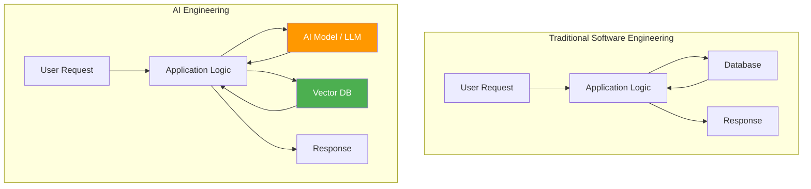
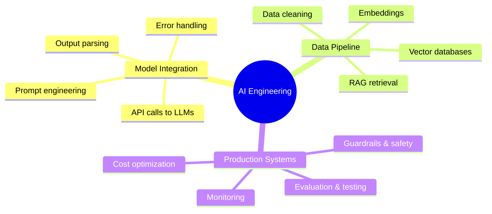
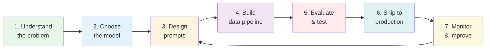

# 01.01 — What AI Engineering Is

> **One sentence:** AI engineering is the practice of building production software that uses AI models as components — just like you'd use a database or an API.

---

## The Big Picture



## What Exactly Is an AI Engineer?

Think of three roles:

| Role | What they do | Analogy |
|------|-------------|---------|
| **ML Researcher** | Invents new model architectures | Designs car engines |
| **ML Engineer** | Trains and fine-tunes models | Builds and tunes engines |
| **AI Engineer** | Uses models to build products | Builds cars using existing engines |

**You don't need to train GPT-4.** You need to know how to *use* it well — prompt it, chain it, ground it with data, and ship it reliably.

### Real-World Example

Google Search is traditional software. Google's AI Overview (the summary at the top) is AI engineering — they took an existing LLM, connected it to their search index, and built a product feature.

---

## The Three Pillars of AI Engineering



### Pillar 1: Model Integration

This is about talking to models correctly:

```python
# Simple model integration — this IS AI engineering
import openai

client = openai.OpenAI()

def classify_support_ticket(ticket_text: str) -> str:
    """Classify a customer support ticket into a category."""
    response = client.chat.completions.create(
        model="gpt-4o",
        messages=[
            {
                "role": "system",
                "content": """You are a support ticket classifier.
                Classify tickets into exactly one category:
                - billing
                - technical
                - account
                - feature_request
                
                Return ONLY the category name, nothing else."""
            },
            {
                "role": "user",
                "content": ticket_text
            }
        ],
        temperature=0,  # Deterministic output
        max_tokens=20    # We only need one word
    )
    return response.choices[0].message.content.strip()

# Usage
category = classify_support_ticket(
    "I was charged twice for my subscription last month"
)
print(category)  # "billing"
```

### Pillar 2: Data Pipeline

Models are smart but **they don't know your data**. You need to feed them the right context:

```python
# Simplified RAG pipeline — connecting your data to an LLM
def answer_question(question: str, company_docs: list[str]) -> str:
    # Step 1: Find relevant documents
    relevant_docs = search_similar(question, company_docs, top_k=3)
    
    # Step 2: Build context
    context = "\n---\n".join(relevant_docs)
    
    # Step 3: Ask the model WITH your data
    response = client.chat.completions.create(
        model="gpt-4o",
        messages=[
            {
                "role": "system",
                "content": f"""Answer using ONLY this context:
                {context}
                
                If the answer isn't in the context, say "I don't know."
                """
            },
            {"role": "user", "content": question}
        ]
    )
    return response.choices[0].message.content
```

### Pillar 3: Production Systems

The difference between a demo and a product:

```python
# Production-grade model call with retries, timeouts, and fallback
import time
from tenacity import retry, stop_after_attempt, wait_exponential

@retry(
    stop=stop_after_attempt(3),
    wait=wait_exponential(multiplier=1, min=1, max=10)
)
def safe_model_call(prompt: str, timeout: int = 30) -> str:
    """Model call with retry logic, timeout, and cost tracking."""
    start = time.time()
    
    try:
        response = client.chat.completions.create(
            model="gpt-4o",
            messages=[{"role": "user", "content": prompt}],
            timeout=timeout
        )
        
        # Track cost (GPT-4o pricing)
        input_tokens = response.usage.prompt_tokens
        output_tokens = response.usage.completion_tokens
        cost = (input_tokens * 2.50 + output_tokens * 10.00) / 1_000_000
        
        latency = time.time() - start
        print(f"Tokens: {input_tokens}+{output_tokens} | Cost: ${cost:.4f} | Latency: {latency:.2f}s")
        
        return response.choices[0].message.content
        
    except openai.RateLimitError:
        print("Rate limited — retrying...")
        raise  # tenacity will retry
    except openai.APITimeoutError:
        print("Timeout — retrying...")
        raise
```

---

## AI Engineering vs. ML Engineering — The Key Difference

```
ML Engineering                          AI Engineering
─────────────                          ──────────────
Collect training data                  Use pre-trained models
Label datasets                         Write prompts
Train models (weeks/months)            Call APIs (milliseconds)
Build training pipelines               Build inference pipelines
Optimize loss functions                Optimize prompts & context
Deploy model artifacts                 Deploy applications
Monitor model drift                    Monitor output quality
GPU clusters for training              API keys for inference
```

### FAANG Interview Insight

> **Amazon's approach:** They don't retrain foundation models for every feature. Their AI engineers use Bedrock (their model API) to build features like product review summarization, Rufus (shopping assistant), and code suggestions in CodeWhisperer. The skill is in **prompt design, context assembly, and system integration** — not in training.

---

## Where AI Engineers Work at FAANG

| Company | AI Engineering Examples |
|---------|----------------------|
| **Google** | Gemini integration in Workspace, Search AI Overviews, NotebookLM |
| **Meta** | AI-powered content recommendations, Llama model deployment |
| **Amazon** | Rufus shopping assistant, Alexa LLM upgrade, CodeWhisperer |
| **Apple** | Apple Intelligence, on-device LLM features |
| **Netflix** | AI-powered thumbnail generation, content recommendations |
| **Microsoft** | Copilot across Office, GitHub Copilot, Bing Chat |

---

## The AI Engineering Workflow



---

## Key Takeaways

1. **AI engineering = building products with AI models**, not training models
2. **Three pillars:** Model integration, data pipelines, production systems
3. **You don't need a PhD** — you need software engineering skills + AI knowledge
4. **The hard part isn't the model** — it's everything around it (data, evaluation, reliability)

---

## 💼 FAANG Interview Questions

1. *"What's the difference between an ML engineer and an AI engineer?"*
2. *"You have a customer support chatbot that sometimes gives wrong answers. How would you improve it?"*
3. *"Design a system that uses an LLM to summarize 10,000 product reviews per hour."*

## 🏋️ Exercise

Build a simple AI-powered CLI tool:
```bash
python classify.py "My app keeps crashing when I try to upload photos"
# Output: technical
```

Use any LLM API (OpenAI, Anthropic, or local Ollama). Focus on error handling and clear output.
