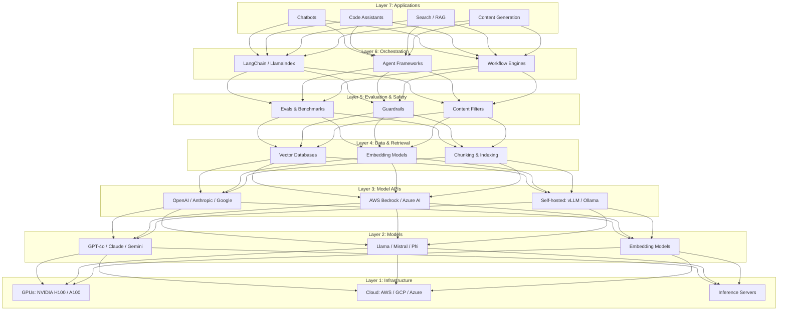
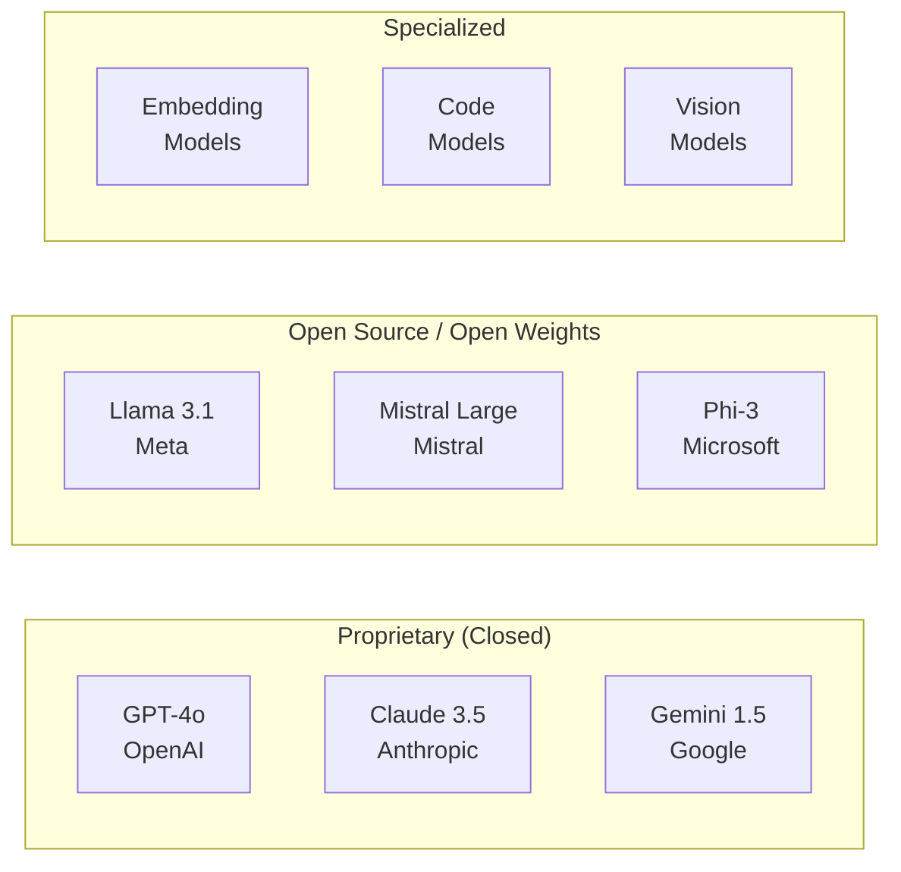
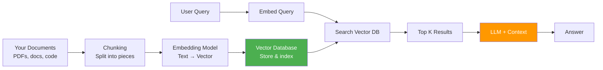

# 01.02 — The AI Engineering Stack

> **One sentence:** The AI engineering stack is a layered architecture — from hardware at the bottom to user-facing apps at the top — and your job is to understand each layer well enough to make smart tradeoffs.

---

## The Full Stack at a Glance



---

## Layer by Layer — Deep Dive

### Layer 1: Infrastructure (The Foundation)

**What it is:** The physical hardware and cloud services that run AI models.

**Why it matters:** A single GPT-4 inference uses ~10x more compute than a Google search. Understanding infrastructure helps you estimate costs and choose deployment strategies.

```
Hardware Hierarchy for AI:

CPU ─────────────── Good for: small models, preprocessing
  └─ GPU (NVIDIA) ── Great for: parallel matrix math (what AI needs)
      ├─ A100 ────── 80GB VRAM, training & inference
      ├─ H100 ────── 80GB VRAM, 2-3x faster than A100
      └─ H200 ────── 141GB VRAM, latest generation
  └─ TPU (Google) ── Specialized for TensorFlow/JAX workloads
  └─ Apple Silicon ─ M-series chips, unified memory, great for local models
```

**FAANG Example:** Google runs Gemini on custom TPU v5p pods. Each pod has 8,960 TPU chips. That's the scale of training. But for *inference* (what AI engineers care about), a single API call is a tiny fraction of this.

### Layer 2: Models (The Brains)

**What it is:** The pre-trained neural networks that understand and generate language.



**How to choose:**

| Factor | Proprietary | Open Source |
|--------|------------|-------------|
| **Quality** | Generally higher | Catching up fast |
| **Cost** | Pay per token | Free weights, pay for compute |
| **Privacy** | Data goes to provider | Stays on your servers |
| **Customization** | Limited (prompting) | Full (fine-tuning) |
| **Speed to build** | Fastest | Slower setup |
| **Vendor lock-in** | Yes | No |

### Layer 3: Model APIs (The Interface)

**What it is:** How your code talks to models.

```python
# Three ways to call an LLM — same result, different tradeoffs

# 1. Direct API (simplest, vendor lock-in)
import openai
client = openai.OpenAI()
response = client.chat.completions.create(
    model="gpt-4o",
    messages=[{"role": "user", "content": "Hello!"}]
)

# 2. Cloud Provider (enterprise features, IAM, logging)
import boto3
bedrock = boto3.client("bedrock-runtime", region_name="us-east-1")
response = bedrock.invoke_model(
    modelId="anthropic.claude-3-sonnet-20240229-v1:0",
    body='{"messages": [{"role": "user", "content": "Hello!"}]}'
)

# 3. Self-hosted (full control, no data leaves your servers)
# Using vLLM server running Llama 3.1
import openai
client = openai.OpenAI(
    base_url="http://localhost:8000/v1",  # Local vLLM server
    api_key="not-needed"                   # No auth needed locally
)
response = client.chat.completions.create(
    model="meta-llama/Llama-3.1-70B-Instruct",
    messages=[{"role": "user", "content": "Hello!"}]
)
```

### Layer 4: Data & Retrieval (The Memory)

**What it is:** How you give models access to YOUR data.



```python
# Simplified retrieval pipeline
from openai import OpenAI
import numpy as np

client = OpenAI()

def embed(text: str) -> list[float]:
    """Convert text to a vector (list of numbers)."""
    response = client.embeddings.create(
        model="text-embedding-3-small",
        input=text
    )
    return response.data[0].embedding

def cosine_similarity(a, b):
    """How similar are two vectors? (1.0 = identical, 0 = unrelated)"""
    a, b = np.array(a), np.array(b)
    return np.dot(a, b) / (np.linalg.norm(a) * np.linalg.norm(b))

# Example: find which doc answers a question
docs = [
    "Our refund policy allows returns within 30 days.",
    "We ship to 45 countries worldwide.",
    "Premium plans include priority support.",
]
doc_embeddings = [embed(doc) for doc in docs]

query = "Can I get my money back?"
query_embedding = embed(query)

# Find most similar document
similarities = [cosine_similarity(query_embedding, de) for de in doc_embeddings]
best_match = docs[np.argmax(similarities)]
print(best_match)  
# "Our refund policy allows returns within 30 days."  ← Found it!
```

### Layer 5: Evaluation & Safety (The Quality Gate)

**What it is:** Making sure your AI doesn't break things.

```python
# Simple evaluation framework
def evaluate_qa_system(test_cases: list[dict]) -> dict:
    """Run test cases and measure quality."""
    results = {"correct": 0, "wrong": 0, "errors": 0}
    
    for test in test_cases:
        try:
            answer = my_qa_system(test["question"])
            
            # Check if expected info is in the answer
            if test["expected_keyword"] in answer.lower():
                results["correct"] += 1
            else:
                results["wrong"] += 1
                print(f"WRONG: Q='{test['question']}' Got='{answer[:50]}'")
        except Exception as e:
            results["errors"] += 1
            print(f"ERROR: {e}")
    
    total = sum(results.values())
    results["accuracy"] = results["correct"] / total if total else 0
    return results

# Test cases — your "unit tests" for AI
test_cases = [
    {"question": "What's the refund policy?", "expected_keyword": "30 days"},
    {"question": "Do you ship to India?", "expected_keyword": "countries"},
    {"question": "What comes with premium?", "expected_keyword": "priority"},
]
print(evaluate_qa_system(test_cases))
# {"correct": 3, "wrong": 0, "errors": 0, "accuracy": 1.0}
```

### Layer 6: Orchestration (The Conductor)

**What it is:** Connecting multiple AI calls into workflows.

```python
# Multi-step AI workflow — not a single prompt, but a PIPELINE
async def process_customer_email(email: str) -> dict:
    """
    Real-world pipeline: classify → extract → respond → review
    Each step is a separate model call.
    """
    # Step 1: Classify the email
    category = await classify(email)  # "complaint" / "question" / "praise"
    
    # Step 2: Extract key information
    entities = await extract_entities(email)
    # {"product": "Widget Pro", "issue": "broken handle", "order_id": "ORD-123"}
    
    # Step 3: Draft a response
    draft = await generate_response(email, category, entities)
    
    # Step 4: Safety check — does the response promise anything we shouldn't?
    is_safe = await safety_check(draft)
    
    if not is_safe:
        return {"status": "needs_human_review", "draft": draft}
    
    return {"status": "ready_to_send", "response": draft}
```

### Layer 7: Applications (The Product)

**What it is:** What users actually see and use.

| Application Type | Example | Key Challenge |
|-----------------|---------|---------------|
| **Chatbot** | Customer support agent | Context management, accuracy |
| **Search** | Semantic document search | Relevance, speed at scale |
| **Code Assistant** | GitHub Copilot | Understanding codebase context |
| **Content Gen** | Marketing copy generator | Brand voice, factual accuracy |
| **Data Analysis** | Natural language to SQL | Security, query correctness |

---

## How FAANG Companies Stack This

```
┌─────────────────────────────────────────────────────────────┐
│  Google                                                      │
│  ┌──────────┐  ┌──────────┐  ┌──────────┐                  │
│  │ Gemini   │  │ Vertex   │  │ Google   │                   │
│  │ (Model)  │→ │ AI (API) │→ │ Search   │                   │
│  └──────────┘  └──────────┘  │ AI       │                   │
│        ↑                      │ Overview │                   │
│  ┌──────────┐                └──────────┘                   │
│  │ TPU v5p  │                                                │
│  │ (Infra)  │                                                │
│  └──────────┘                                                │
├─────────────────────────────────────────────────────────────┤
│  Microsoft                                                   │
│  ┌──────────┐  ┌──────────┐  ┌──────────┐                  │
│  │ GPT-4o   │  │ Azure    │  │ Copilot  │                   │
│  │ (Model)  │→ │ OpenAI   │→ │ (App)    │                   │
│  └──────────┘  │ (API)    │  └──────────┘                   │
│                └──────────┘                                  │
├─────────────────────────────────────────────────────────────┤
│  Amazon                                                      │
│  ┌──────────┐  ┌──────────┐  ┌──────────┐                  │
│  │ Claude/  │  │ Bedrock  │  │ Rufus    │                   │
│  │ Titan    │→ │ (API)    │→ │ (App)    │                   │
│  └──────────┘  └──────────┘  └──────────┘                   │
└─────────────────────────────────────────────────────────────┘
```

---

## The Cost Stack — What Each Layer Costs

```
Layer               Cost Driver              Typical Range
─────               ───────────              ─────────────
Infrastructure      GPU hours                $2-$30/hour per GPU
Models              Training compute         $1M-$100M+ to train
Model APIs          Tokens processed         $0.15-$30 per 1M tokens
Data & Retrieval    Storage + queries        $0.01-$0.10 per query
Evaluation          Test suite runs          ~$5-$50 per full eval
Orchestration       Multiple API calls       Adds up fast
Applications        User-facing infra        Standard web costs
```

**Critical insight:** For most AI engineers, 80%+ of your costs come from **Model API calls**. Optimizing prompt length and choosing the right model matters more than anything.

---

## Key Takeaways

1. **7 layers** — from GPU hardware to user applications
2. **You work mostly in layers 3-7** — APIs, data, evaluation, orchestration, apps
3. **Proprietary vs. open source** is the first big decision
4. **The retrieval layer is where most AI apps live** — RAG is everywhere
5. **Evaluation is what separates demos from products**

---

## 💼 FAANG Interview Questions

1. *"Walk me through the architecture of a production AI chatbot from infrastructure to UI."*
2. *"When would you choose to self-host a model vs. use an API?"*
3. *"Your LLM-powered feature costs $50K/month in API calls. How do you reduce it?"*

## 🏋️ Exercise

Draw your own stack diagram for a **customer support chatbot** that:
- Uses GPT-4o for complex questions and GPT-4o-mini for simple ones
- Retrieves from a knowledge base of 10,000 support articles
- Needs to handle 1,000 concurrent users
- Must not reveal competitor pricing even if asked

Label which stack layer each component belongs to.
