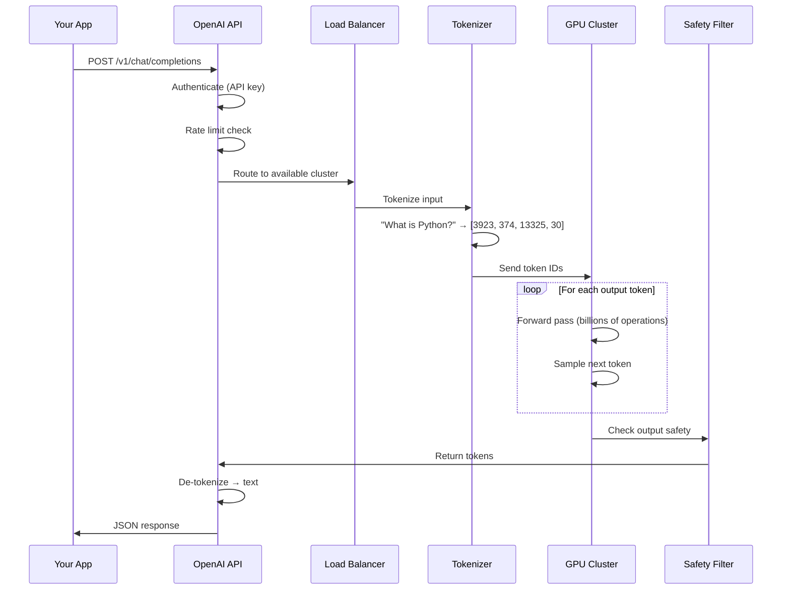
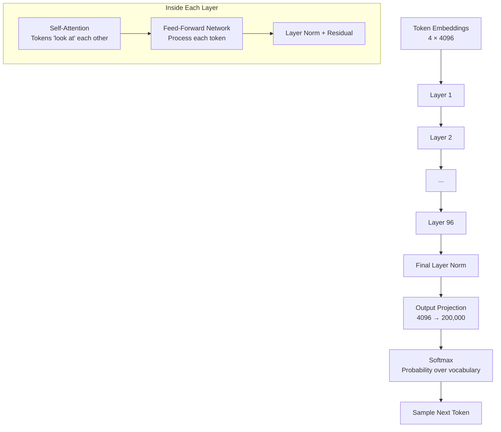
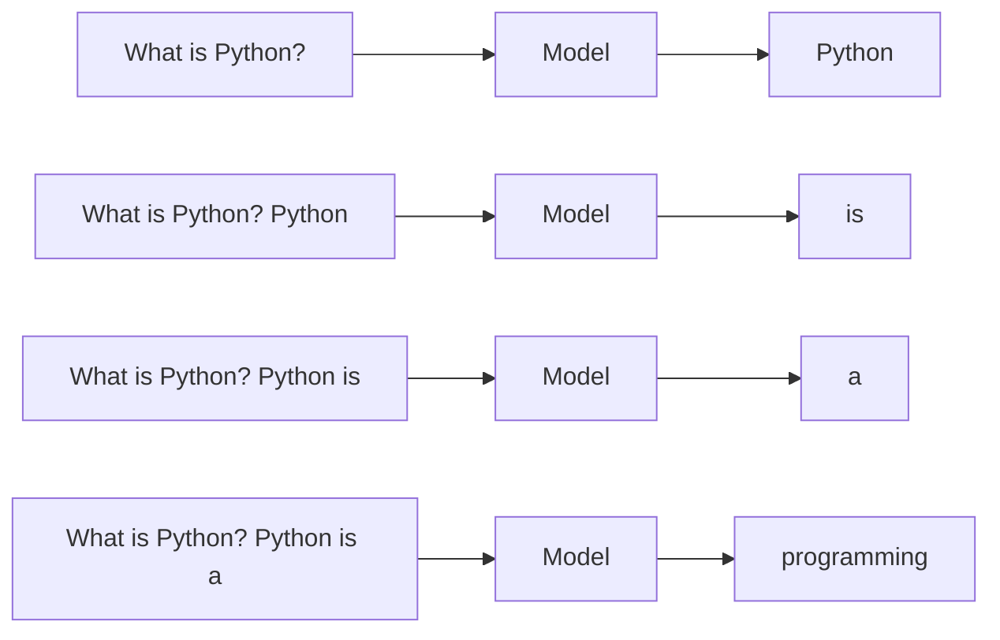

# 01.03 — One Model Call, End to End

> **One sentence:** A single LLM API call involves tokenization, embedding lookup, billions of matrix multiplications, token-by-token generation, and network round trips — understanding this flow is essential for debugging and optimization.

---

## The Journey of a Single Prompt

Let's trace what happens when you run this:

```python
response = client.chat.completions.create(
    model="gpt-4o",
    messages=[{"role": "user", "content": "What is Python?"}]
)
```



---

## Step 1: Tokenization

**What happens:** Your text gets split into "tokens" — not words, but sub-word pieces.

```python
import tiktoken

# GPT-4o uses the "o200k_base" tokenizer
enc = tiktoken.encoding_for_model("gpt-4o")

text = "What is Python?"
tokens = enc.encode(text)
print(tokens)      # [3923, 374, 13325, 30]
print(len(tokens)) # 4 tokens

# Let's see what each token represents
for token_id in tokens:
    print(f"  {token_id} → '{enc.decode([token_id])}'")
# 3923  → 'What'
# 374   → ' is'
# 13325 → ' Python'
# 30    → '?'

# Interesting cases:
print(enc.encode("unhappiness"))  # ['un', 'happiness'] — subword split!
print(enc.encode("🎉"))           # Multiple tokens for emojis
print(enc.encode("HTTP"))         # ['H', 'TTP'] or similar
```

**Why this matters:**
- You're **billed by tokens**, not characters or words
- **Context window** is measured in tokens (GPT-4o = 128K tokens)
- Rare words use MORE tokens → cost more
- Different languages have different token efficiency

```
Token Efficiency by Language:
─────────────────────────────
English:   1 token ≈ 4 characters ≈ 0.75 words
Code:      1 token ≈ 3 characters (less efficient)
Chinese:   1 token ≈ 1-2 characters (much less efficient)
Spanish:   1 token ≈ 3.5 characters
```

---

## Step 2: Embedding Lookup

**What happens:** Each token ID is converted into a vector (a list of numbers).

```python
# Conceptual illustration — this happens INSIDE the model
import numpy as np

# The model has a giant lookup table (embedding matrix)
# For GPT-4o-like models: vocab_size × embedding_dim
# Example: 200,000 tokens × 4,096 dimensions
embedding_matrix = np.random.randn(200_000, 4096)

# Each token ID maps to a row in this matrix
token_ids = [3923, 374, 13325, 30]  # "What is Python?"

# Look up embeddings
token_embeddings = embedding_matrix[token_ids]
print(token_embeddings.shape)  # (4, 4096)
# Each token is now a 4096-dimensional vector
```

Think of it like this:
```
Token "Python"  →  [0.23, -0.87, 0.14, ..., 0.56]
                    ← 4096 numbers that capture MEANING →
```

---

## Step 3: The Forward Pass (Where the Magic Happens)

**What happens:** Tokens flow through ~100 transformer layers, each performing attention and computation.



**The scale is staggering:**

```
GPT-4o (estimated):
─────────────────────
Parameters:        ~200 billion (200,000,000,000 numbers)
Layers:            ~96 transformer layers
Attention heads:   ~96 per layer
Hidden dimension:  ~4096 per token
Vocabulary:        ~200,000 tokens

For ONE forward pass of "What is Python?" (4 tokens):
  Matrix multiplications:  ~200 billion multiply-adds
  Memory accessed:         ~400 GB of weights
  Time:                    ~50-200ms on optimized hardware
```

---

## Step 4: Token Generation (Autoregressive Decoding)

**What happens:** The model generates ONE token at a time, then feeds it back as input.



```python
# How autoregressive generation works (simplified)
def generate(prompt: str, max_tokens: int = 50) -> str:
    tokens = tokenize(prompt)  # [3923, 374, 13325, 30]
    
    for _ in range(max_tokens):
        # Run the ENTIRE model to get next token probabilities
        logits = model.forward(tokens)  # → probabilities over vocab
        
        # Pick the next token
        next_token = sample(logits, temperature=0.7)
        
        # Stop if we hit the end-of-sequence token
        if next_token == EOS_TOKEN:
            break
            
        tokens.append(next_token)
    
    return detokenize(tokens)
```

### Temperature — Controlling Randomness

```python
# Temperature controls how "creative" the model is
import numpy as np

logits = np.array([2.0, 1.0, 0.5, 0.1])  # Raw model scores
vocab = ["Python", "Java", "Rust", "COBOL"]

def softmax_with_temperature(logits, temperature):
    scaled = logits / temperature
    exp_scaled = np.exp(scaled - np.max(scaled))
    return exp_scaled / exp_scaled.sum()

# Temperature = 0.1 (almost deterministic)
print(softmax_with_temperature(logits, 0.1))
# [0.9999, 0.0001, 0.0000, 0.0000]  ← Always picks "Python"

# Temperature = 1.0 (balanced)
print(softmax_with_temperature(logits, 1.0))
# [0.5060, 0.1863, 0.1131, 0.0758]  ← Usually "Python", sometimes others

# Temperature = 2.0 (very random)
print(softmax_with_temperature(logits, 2.0))
# [0.3596, 0.2266, 0.1787, 0.1452]  ← Almost equal chances
```

---

## Step 5: The API Response

**What you get back:**

```json
{
  "id": "chatcmpl-abc123",
  "object": "chat.completion",
  "created": 1699000000,
  "model": "gpt-4o-2024-08-06",
  "choices": [
    {
      "index": 0,
      "message": {
        "role": "assistant",
        "content": "Python is a high-level, interpreted programming language..."
      },
      "finish_reason": "stop"
    }
  ],
  "usage": {
    "prompt_tokens": 4,
    "completion_tokens": 52,
    "total_tokens": 56
  }
}
```

**Key fields to watch:**

| Field | Why it matters |
|-------|---------------|
| `usage.prompt_tokens` | You pay for this — optimize prompt length |
| `usage.completion_tokens` | You pay MORE for this (output tokens cost more) |
| `finish_reason` | `"stop"` = normal, `"length"` = hit max tokens (truncated!) |
| `model` | The exact model version used |

---

## The Complete Timeline

```
Time    Event                           Duration
─────   ─────                           ────────
0ms     App sends HTTP request          -
5ms     Network: App → API server       ~5-50ms (depends on location)
10ms    Auth + rate limit check          ~1-5ms
15ms    Request queued                   ~0-500ms (depends on load)
20ms    Tokenization                     <1ms
25ms    GPU: First forward pass          ~50-200ms (time-to-first-token)
75ms    GPU: Generates token 1          
85ms    GPU: Generates token 2           ~10-30ms per token
...     ...                              
1500ms  GPU: Generates token 52          
1510ms  Safety filter check              ~5-20ms
1520ms  De-tokenize + build response     <1ms
1525ms  Network: API → App               ~5-50ms
1530ms  App receives response            

Total:  ~1.5-3 seconds for a 52-token response
```

### Streaming — Don't Wait for the Whole Response

```python
# Without streaming: wait 3 seconds, get everything at once
# With streaming: get tokens as they're generated

stream = client.chat.completions.create(
    model="gpt-4o",
    messages=[{"role": "user", "content": "What is Python?"}],
    stream=True  # ← This changes everything
)

for chunk in stream:
    token = chunk.choices[0].delta.content
    if token:
        print(token, end="", flush=True)
        # Prints character by character, feels instant!

# User sees: P → Py → Pyt → Pyth → Python → Python is → ...
# Time to first token: ~200ms instead of waiting 3 seconds
```

---

## Cost Breakdown of One Call

```python
# Let's calculate the cost of our example call
prompt_tokens = 4
completion_tokens = 52

# GPT-4o pricing (as of 2024)
input_cost_per_million = 2.50    # $2.50 per 1M input tokens
output_cost_per_million = 10.00  # $10.00 per 1M output tokens

input_cost = (prompt_tokens / 1_000_000) * input_cost_per_million
output_cost = (completion_tokens / 1_000_000) * output_cost_per_million
total_cost = input_cost + output_cost

print(f"Input cost:  ${input_cost:.6f}")   # $0.000010
print(f"Output cost: ${output_cost:.6f}")  # $0.000520
print(f"Total cost:  ${total_cost:.6f}")   # $0.000530

# At 1 million calls per day:
daily_cost = total_cost * 1_000_000
print(f"Daily cost for 1M calls: ${daily_cost:.2f}")  # $530.00
```

---

## End-to-End Code: Production Model Call

```python
"""
Complete production-ready model call with all best practices.
"""
import openai
import time
import json
import logging
from dataclasses import dataclass

logging.basicConfig(level=logging.INFO)
logger = logging.getLogger(__name__)

@dataclass
class ModelCallResult:
    content: str
    model: str
    input_tokens: int
    output_tokens: int
    cost_usd: float
    latency_ms: float
    finish_reason: str

def call_model(
    prompt: str,
    system_prompt: str = "You are a helpful assistant.",
    model: str = "gpt-4o",
    temperature: float = 0.7,
    max_tokens: int = 500,
    timeout: int = 30
) -> ModelCallResult:
    """
    Production model call with:
    - Cost tracking
    - Latency measurement  
    - Error handling
    - Structured result
    """
    client = openai.OpenAI()
    
    # Pricing per million tokens (update as prices change)
    PRICING = {
        "gpt-4o":      {"input": 2.50, "output": 10.00},
        "gpt-4o-mini": {"input": 0.15, "output": 0.60},
    }
    
    start = time.perf_counter()
    
    try:
        response = client.chat.completions.create(
            model=model,
            messages=[
                {"role": "system", "content": system_prompt},
                {"role": "user", "content": prompt}
            ],
            temperature=temperature,
            max_tokens=max_tokens,
            timeout=timeout
        )
        
        latency = (time.perf_counter() - start) * 1000
        
        # Calculate cost
        pricing = PRICING.get(model, {"input": 0, "output": 0})
        input_tokens = response.usage.prompt_tokens
        output_tokens = response.usage.completion_tokens
        cost = (
            (input_tokens * pricing["input"]) + 
            (output_tokens * pricing["output"])
        ) / 1_000_000
        
        result = ModelCallResult(
            content=response.choices[0].message.content,
            model=response.model,
            input_tokens=input_tokens,
            output_tokens=output_tokens,
            cost_usd=cost,
            latency_ms=latency,
            finish_reason=response.choices[0].finish_reason
        )
        
        logger.info(
            f"Model call: {model} | "
            f"Tokens: {input_tokens}→{output_tokens} | "
            f"Cost: ${cost:.6f} | "
            f"Latency: {latency:.0f}ms | "
            f"Finish: {result.finish_reason}"
        )
        
        # Warn if response was truncated
        if result.finish_reason == "length":
            logger.warning("Response was truncated! Increase max_tokens.")
        
        return result
        
    except openai.RateLimitError as e:
        logger.error(f"Rate limited: {e}")
        raise
    except openai.APITimeoutError as e:
        logger.error(f"Timeout after {timeout}s: {e}")
        raise
    except openai.BadRequestError as e:
        logger.error(f"Bad request: {e}")
        raise

# Usage
if __name__ == "__main__":
    result = call_model("What is Python?")
    print(f"\nAnswer: {result.content[:100]}...")
    print(f"Cost: ${result.cost_usd:.6f}")
    print(f"Latency: {result.latency_ms:.0f}ms")
```

---

## Key Takeaways

1. **Tokenization first** — text → token IDs (you pay per token)
2. **Autoregressive generation** — one token at a time, each depending on all previous
3. **Temperature controls randomness** — 0 for facts, 0.7 for creative, >1 for wild
4. **Streaming** reduces perceived latency — user sees tokens as they're generated
5. **Output tokens cost more** than input tokens — keep responses concise
6. **Track everything** — cost, latency, token counts, finish reasons

---

## 💼 FAANG Interview Questions

1. *"Why do LLMs generate one token at a time instead of the entire response at once?"*
2. *"A user complains your chatbot's responses are cut off mid-sentence. What's happening?"*
3. *"How would you reduce the latency of an LLM-powered feature from 3s to under 500ms?"*

## 🏋️ Exercise

Write a function that:
1. Takes a prompt and a budget (e.g., $0.001)
2. Estimates if the call will exceed the budget before making it
3. If within budget, makes the call and returns the result with actual cost
4. If over budget, switches to a cheaper model (gpt-4o-mini) automatically

```python
def budget_aware_call(prompt: str, budget_usd: float = 0.001) -> ModelCallResult:
    # Your code here
    pass
```
