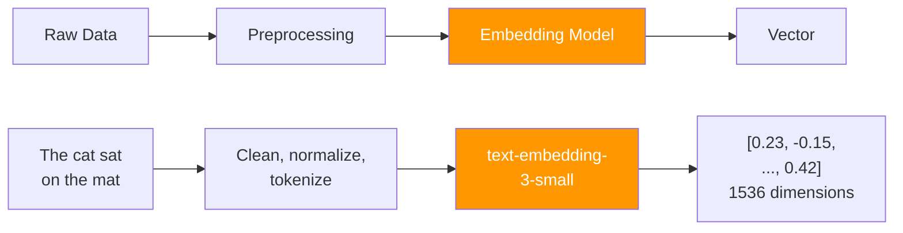
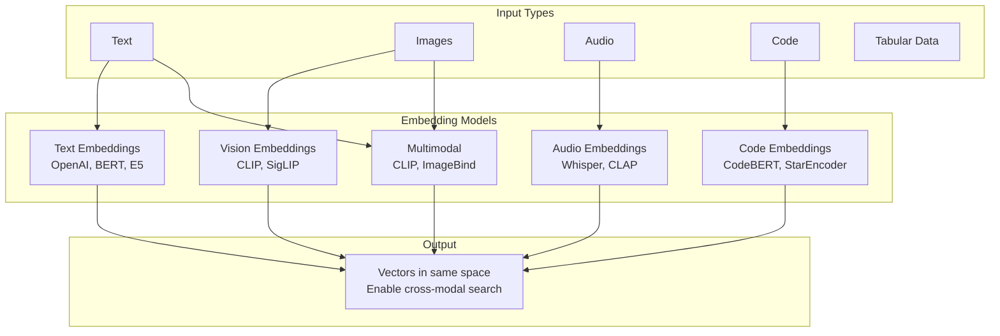

# 02.01 — From Data to Vectors

> **One sentence:** Everything in AI — text, images, audio — gets converted into vectors (lists of numbers) so that machines can do math on meaning.

---

## Why Vectors?

Computers can't understand words. They understand numbers. **Vectors** are how we translate meaning into math.

```
"cat"  →  [0.23, -0.15, 0.89, ..., 0.42]     ← 1536 numbers
"dog"  →  [0.21, -0.18, 0.85, ..., 0.39]     ← similar numbers!
"car"  →  [-0.56, 0.72, -0.11, ..., 0.88]    ← very different numbers
```

**Key insight:** Similar meanings → similar numbers. "Cat" and "dog" are both pets, so their vectors are close. "Car" is unrelated, so its vector points in a different direction.

---

## The Journey: Raw Data → Vector



### Step 1: Preprocessing

```python
def preprocess_text(text: str) -> str:
    """Clean text before embedding."""
    # Remove extra whitespace
    text = " ".join(text.split())
    
    # Remove very long texts (most embedding models have limits)
    max_chars = 8000  # ~2000 tokens for most models
    if len(text) > max_chars:
        text = text[:max_chars]
    
    return text.strip()

# Example
raw = "  The   cat   sat\n\non the    mat.  "
clean = preprocess_text(raw)
print(clean)  # "The cat sat on the mat."
```

### Step 2: Tokenization (Inside the Model)

```python
# The embedding model tokenizes internally, but understanding it helps
# "The cat sat on the mat" → ["The", " cat", " sat", " on", " the", " mat"]
# Each sub-word maps to an ID → model processes these IDs
```

### Step 3: Embedding

```python
from openai import OpenAI
import numpy as np

client = OpenAI()

def get_embedding(text: str, model: str = "text-embedding-3-small") -> list[float]:
    """Convert text to a vector using OpenAI's embedding model."""
    text = text.replace("\n", " ").strip()
    response = client.embeddings.create(
        input=text,
        model=model
    )
    return response.data[0].embedding

# Get a vector
vector = get_embedding("The cat sat on the mat")
print(f"Dimensions: {len(vector)}")   # 1536
print(f"First 5 values: {vector[:5]}") # [-0.023, 0.015, -0.089, ...]
print(f"Vector norm: {np.linalg.norm(vector):.4f}")  # ~1.0 (normalized)
```

---

## What Do These Numbers Mean?

Each dimension captures some **aspect of meaning**. We can't label individual dimensions, but the pattern across ALL dimensions encodes semantics:

```python
# Demonstrating semantic similarity with vectors
texts = [
    "I love programming in Python",
    "Python is my favorite coding language",  # Similar meaning
    "The snake slithered through the grass",   # Different "Python"
    "I enjoy cooking Italian food",             # Totally different
]

embeddings = [get_embedding(t) for t in texts]

def cosine_similarity(a, b):
    a, b = np.array(a), np.array(b)
    return np.dot(a, b) / (np.linalg.norm(a) * np.linalg.norm(b))

# Compare everything to "I love programming in Python"
base = embeddings[0]
for i, text in enumerate(texts):
    sim = cosine_similarity(base, embeddings[i])
    print(f"  {sim:.4f}  →  {text}")

# Output:
#   1.0000  →  I love programming in Python        (identical)
#   0.8923  →  Python is my favorite coding language (very similar!)
#   0.4215  →  The snake slithered through grass     (somewhat related)
#   0.1876  →  I enjoy cooking Italian food          (unrelated)
```

---

## Types of Data You Can Embed



```python
# Multi-type embedding example
from sentence_transformers import SentenceTransformer

# This model can embed both text AND images into the same space
model = SentenceTransformer("clip-ViT-B-32")

# Embed text
text_embedding = model.encode("a photo of a golden retriever")

# Embed image (if you had one)
# image_embedding = model.encode(Image.open("dog.jpg"))

# You can now compare text to images using cosine similarity!
# This is how Google Image Search and Pinterest work
```

---

## Embedding Dimensions — How Many Numbers?

| Model | Dimensions | Use Case |
|-------|-----------|----------|
| `text-embedding-3-small` | 1536 | General purpose, cost-effective |
| `text-embedding-3-large` | 3072 | Higher quality, more expensive |
| `all-MiniLM-L6-v2` | 384 | Fast, lightweight, open source |
| `e5-large-v2` | 1024 | Strong open source option |
| `CLIP ViT-B/32` | 512 | Text + image search |

**More dimensions = more nuance** but also more storage and compute:

```python
# Storage calculation
num_documents = 1_000_000  # 1 million docs
dimensions = 1536           # text-embedding-3-small
bytes_per_float = 4         # float32

storage_bytes = num_documents * dimensions * bytes_per_float
storage_gb = storage_bytes / (1024 ** 3)
print(f"Storage for 1M docs: {storage_gb:.2f} GB")  # ~5.72 GB

# With 384 dimensions (MiniLM):
storage_mini = 1_000_000 * 384 * 4 / (1024 ** 3)
print(f"Storage with MiniLM: {storage_mini:.2f} GB")  # ~1.43 GB — 4x less!
```

---

## Chunking — Preparing Documents for Embedding

You can't embed a 100-page PDF as a single vector. You need to split it into chunks:

```python
def chunk_text(text: str, chunk_size: int = 500, overlap: int = 50) -> list[str]:
    """
    Split text into overlapping chunks.
    
    chunk_size: max characters per chunk
    overlap: characters shared between consecutive chunks
    """
    chunks = []
    start = 0
    
    while start < len(text):
        end = start + chunk_size
        
        # Try to break at a sentence boundary
        if end < len(text):
            # Look for the last period, question mark, or newline
            for sep in ['. ', '? ', '! ', '\n']:
                last_sep = text[start:end].rfind(sep)
                if last_sep != -1:
                    end = start + last_sep + len(sep)
                    break
        
        chunk = text[start:end].strip()
        if chunk:
            chunks.append(chunk)
        
        start = end - overlap  # Overlap to preserve context
    
    return chunks

# Example
document = """
Machine learning is a subset of artificial intelligence. It allows 
computers to learn from data without being explicitly programmed.
Deep learning is a subset of machine learning that uses neural 
networks with many layers. These deep networks can learn complex 
patterns in data. Transformers are a type of deep learning architecture 
that has revolutionized natural language processing.
""".strip()

chunks = chunk_text(document, chunk_size=150, overlap=30)
for i, chunk in enumerate(chunks):
    print(f"Chunk {i}: ({len(chunk)} chars) {chunk[:60]}...")
```

---

## Complete Pipeline: Document → Searchable Vectors

```python
"""
End-to-end: load documents, chunk, embed, and search.
"""
from openai import OpenAI
import numpy as np
from dataclasses import dataclass

client = OpenAI()

@dataclass
class Document:
    id: str
    text: str
    embedding: list[float] = None

def build_search_index(documents: list[str]) -> list[Document]:
    """Embed all documents and return searchable index."""
    docs = []
    
    # Batch embedding for efficiency (up to 2048 texts at once)
    response = client.embeddings.create(
        model="text-embedding-3-small",
        input=documents
    )
    
    for i, item in enumerate(response.data):
        docs.append(Document(
            id=f"doc_{i}",
            text=documents[i],
            embedding=item.embedding
        ))
    
    print(f"Indexed {len(docs)} documents ({len(docs[0].embedding)} dimensions)")
    return docs

def search(query: str, index: list[Document], top_k: int = 3) -> list[tuple]:
    """Find most relevant documents for a query."""
    query_emb = get_embedding(query)
    
    scores = []
    for doc in index:
        sim = cosine_similarity(query_emb, doc.embedding)
        scores.append((sim, doc))
    
    scores.sort(key=lambda x: x[0], reverse=True)
    return scores[:top_k]

# Build index
docs = [
    "Python is a high-level programming language known for its simplicity.",
    "JavaScript is the language of the web, running in every browser.",
    "Rust provides memory safety without garbage collection.",
    "SQL is used to query and manage relational databases.",
    "Docker containers package applications with their dependencies.",
]
index = build_search_index(docs)

# Search
results = search("How do I store and retrieve data?", index)
for score, doc in results:
    print(f"  [{score:.4f}] {doc.text}")
# Top result: SQL doc (most relevant to "store and retrieve data")
```

---

## Key Takeaways

1. **Vectors = meaning as numbers** — similar meanings produce similar vectors
2. **Embedding models** do the conversion (you don't hand-craft vectors)
3. **Dimensions** = how many numbers per vector (384 to 3072 typically)
4. **Chunking** is crucial — split large docs into meaningful pieces
5. **Cosine similarity** measures how "close" two vectors are (1.0 = identical)

---

## 💼 FAANG Interview Questions

1. *"How would you handle a document that's 50 pages long when embedding it?"*
2. *"Why might the embedding for 'bank' be ambiguous? How would you handle it?"*
3. *"You need to search across 100 million product descriptions. Walk me through the pipeline."*

## 🏋️ Exercise

Build a "Find Similar Products" feature:
1. Embed 20 product descriptions
2. Given a product, find the 3 most similar ones
3. Measure how chunk size affects similarity scores
