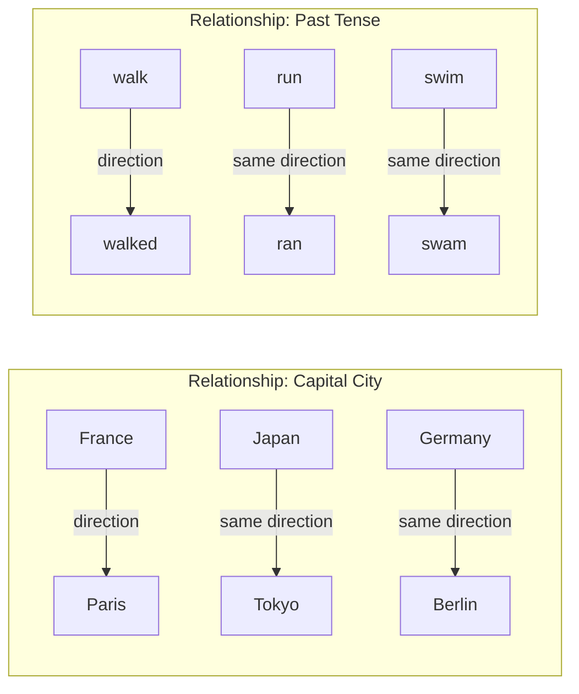
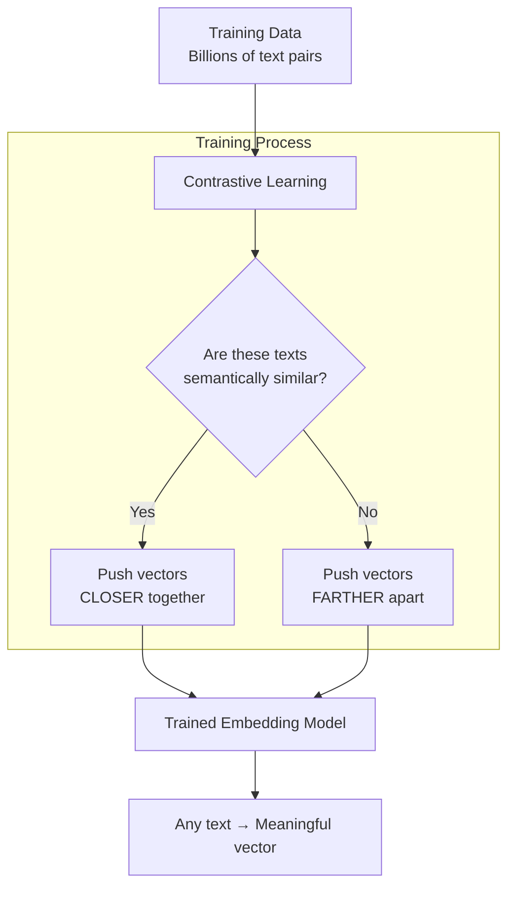

# 02.02 — Vector Embeddings and Semantic Space

> **One sentence:** Semantic space is an imaginary high-dimensional room where meaning lives — words with similar meanings sit close together, and the distance between points captures relationships.

---

## Visualizing Semantic Space

Imagine a 2D map where every word has a position:

```
                    ↑ royalty
                    |
           queen ★ |  ★ king
                    |
                    |
    ─────────────── + ───────────────→ gender
                    |
          woman ★   |  ★ man
                    |
                    |
```

The famous example:
```
king - man + woman ≈ queen
```

This works because the **direction** from "man" to "king" (add royalty) is the same as the direction from "woman" to "queen".

```python
# Vector arithmetic on word embeddings
import numpy as np
from openai import OpenAI

client = OpenAI()

def embed(text: str) -> np.ndarray:
    response = client.embeddings.create(
        model="text-embedding-3-small", input=text
    )
    return np.array(response.data[0].embedding)

# The classic analogy test
king   = embed("king")
man    = embed("man")
woman  = embed("woman")
queen  = embed("queen")

# king - man + woman should be close to queen
result = king - man + woman

# How close is our result to "queen"?
similarity = np.dot(result, queen) / (np.linalg.norm(result) * np.linalg.norm(queen))
print(f"Similarity to 'queen': {similarity:.4f}")  # ~0.85+ (very close!)
```

---

## What Makes Semantic Space "Semantic"?

### Property 1: Similar Things Are Close

```python
# Cluster similar concepts
concepts = {
    "fruits":   ["apple", "banana", "orange", "grape"],
    "animals":  ["dog", "cat", "horse", "elephant"],
    "vehicles": ["car", "truck", "bicycle", "airplane"],
}

all_words = []
all_labels = []
all_embeddings = []

for category, words in concepts.items():
    for word in words:
        all_words.append(word)
        all_labels.append(category)
        all_embeddings.append(embed(word))

# Check: are items in the same category closer to each other?
embeddings = np.array(all_embeddings)

# Average within-category similarity
for cat in concepts:
    cat_indices = [i for i, l in enumerate(all_labels) if l == cat]
    sims = []
    for i in cat_indices:
        for j in cat_indices:
            if i != j:
                sim = np.dot(embeddings[i], embeddings[j]) / (
                    np.linalg.norm(embeddings[i]) * np.linalg.norm(embeddings[j])
                )
                sims.append(sim)
    print(f"{cat}: avg similarity = {np.mean(sims):.4f}")
    
# fruits:   avg similarity = 0.78  (close together)
# animals:  avg similarity = 0.72  (close together)
# vehicles: avg similarity = 0.74  (close together)
# Cross-category similarity would be ~0.30 (far apart)
```

### Property 2: Directions Encode Relationships



### Property 3: Clusters Form Naturally

```
Semantic Space (simplified to 2D):

  ★ TensorFlow         ★ React
  ★ PyTorch               ★ Angular
  ★ Keras                    ★ Vue.js
     ML/AI cluster              Web Dev cluster
     
          ★ Python  (between both — used in ML AND web)
     
  ★ PostgreSQL
  ★ MySQL              ★ Redis
  ★ MongoDB               ★ Memcached
     Database cluster        Cache cluster
```

---

## How Embedding Models Create This Space



### The Training Objective (Simplified)

```python
# Conceptual: how embedding models learn
def contrastive_loss(anchor, positive, negative, margin=0.5):
    """
    anchor:   embedding of the query
    positive: embedding of a RELEVANT document
    negative: embedding of an IRRELEVANT document
    
    Goal: make anchor closer to positive than to negative
    """
    pos_sim = cosine_similarity(anchor, positive)
    neg_sim = cosine_similarity(anchor, negative)
    
    # We want: pos_sim > neg_sim + margin
    loss = max(0, neg_sim - pos_sim + margin)
    return loss

# Training pairs examples:
# Positive: ("What is Python?", "Python is a programming language")
# Negative: ("What is Python?", "The recipe calls for two eggs")
```

---

## Measuring Distance in Semantic Space

Three common distance metrics:

```python
import numpy as np

def cosine_similarity(a, b):
    """
    Measures the ANGLE between two vectors.
    Range: -1 to 1 (1 = identical direction, 0 = perpendicular, -1 = opposite)
    Most commonly used for text embeddings.
    """
    return np.dot(a, b) / (np.linalg.norm(a) * np.linalg.norm(b))

def euclidean_distance(a, b):
    """
    Measures the straight-line DISTANCE between two points.
    Range: 0 to infinity (0 = identical)
    Sensitive to vector magnitude.
    """
    return np.linalg.norm(np.array(a) - np.array(b))

def dot_product(a, b):
    """
    Measures both direction AND magnitude.
    Range: -infinity to infinity
    Used when vector length carries meaning (e.g., popularity).
    """
    return np.dot(a, b)

# Example comparison
a = embed("machine learning")
b = embed("deep learning")
c = embed("cooking recipes")

print(f"ML vs DL - Cosine: {cosine_similarity(a, b):.4f}")    # ~0.85
print(f"ML vs DL - Euclidean: {euclidean_distance(a, b):.4f}") # ~0.55
print(f"ML vs Cook - Cosine: {cosine_similarity(a, c):.4f}")   # ~0.20
print(f"ML vs Cook - Euclidean: {euclidean_distance(a, c):.4f}") # ~1.25
```

### When to Use Which?

| Metric | Best For | Used By |
|--------|----------|---------|
| **Cosine Similarity** | Normalized embeddings, text search | Pinecone, Qdrant |
| **Euclidean Distance** | When magnitude matters | scikit-learn |
| **Dot Product** | Pre-normalized vectors (faster) | FAISS, Milvus |

---

## The Curse of Dimensionality

In high dimensions, weird things happen:

```python
# In high dimensions, ALL points become roughly equidistant
import numpy as np

for dims in [2, 10, 100, 1000, 1536]:
    # Generate random points
    points = np.random.randn(1000, dims)
    
    # Measure all pairwise distances
    from scipy.spatial.distance import pdist
    distances = pdist(points)
    
    ratio = distances.std() / distances.mean()
    print(f"Dims: {dims:5d} | Mean dist: {distances.mean():.2f} | "
          f"Std/Mean ratio: {ratio:.4f}")

# Output:
# Dims:     2 | Mean dist: 1.59 | Std/Mean ratio: 0.3729
# Dims:    10 | Mean dist: 3.78 | Std/Mean ratio: 0.1158
# Dims:   100 | Mean dist: 12.1 | Std/Mean ratio: 0.0362
# Dims:  1000 | Mean dist: 38.4 | Std/Mean ratio: 0.0115
# Dims:  1536 | Mean dist: 47.6 | Std/Mean ratio: 0.0093
# 
# As dimensions increase, the ratio shrinks → distances concentrate!
```

**What this means:** In 1536 dimensions, the difference between the "closest" and "farthest" points is tiny relative to the average distance. That's why we need **specialized search algorithms** (covered in lesson 02.06).

---

## Key Takeaways

1. **Semantic space** = a high-dimensional room where meaning has coordinates
2. **Similar meanings = nearby points** — this is the core principle
3. **Directions encode relationships** — king - man + woman ≈ queen
4. **Cosine similarity** is the go-to metric for text embeddings
5. **High dimensions are weird** — specialized algorithms needed for search

---

## 💼 FAANG Interview Questions

1. *"Explain the difference between cosine similarity and euclidean distance. When would you use each?"*
2. *"What is the curse of dimensionality, and how does it affect vector search?"*
3. *"Your embedding model puts 'Python' (language) and 'python' (snake) close together. How do you fix this?"*

## 🏋️ Exercise

Create a "word analogy solver":
```python
def solve_analogy(a, b, c):
    """a is to b as c is to ???"""
    # Example: solve_analogy("king", "man", "woman") → "queen"
    pass
```
Test with: Paris:France :: Tokyo:?, walk:walked :: run:?
