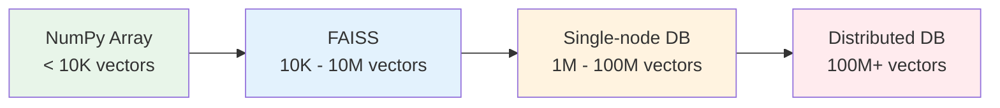
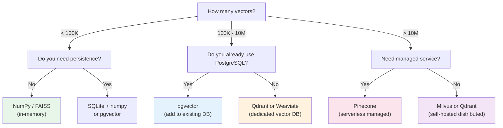

# 02.03 — Matching Storage to Your Workload

> **One sentence:** Where you store your vectors depends on how many you have, how fast you need results, and how much you're willing to spend — from in-memory arrays to distributed vector databases.

---

## The Storage Spectrum



| Scale | Vectors | Solution | Latency | Cost |
|-------|---------|----------|---------|------|
| **Tiny** | < 10K | NumPy / Python list | < 1ms | Free |
| **Small** | 10K - 1M | FAISS (in-memory) | 1-5ms | RAM only |
| **Medium** | 1M - 100M | Qdrant / Weaviate / pgvector | 5-50ms | $50-500/mo |
| **Large** | 100M+ | Pinecone / Milvus (distributed) | 10-100ms | $500-5000/mo |
| **Massive** | 1B+ | Custom FAISS + sharding | Varies | $5000+/mo |

---

## Option 1: Just Use NumPy (Prototyping)

```python
import numpy as np

class SimpleVectorStore:
    """For prototyping. Don't use this in production with >10K vectors."""
    
    def __init__(self, dimension: int):
        self.dimension = dimension
        self.vectors = []
        self.metadata = []
    
    def add(self, vector: list[float], meta: dict):
        self.vectors.append(vector)
        self.metadata.append(meta)
    
    def search(self, query: list[float], top_k: int = 5) -> list[dict]:
        query = np.array(query)
        vectors = np.array(self.vectors)
        
        # Cosine similarity with all vectors at once
        similarities = vectors @ query / (
            np.linalg.norm(vectors, axis=1) * np.linalg.norm(query)
        )
        
        top_indices = np.argsort(similarities)[-top_k:][::-1]
        
        return [
            {"score": similarities[i], "metadata": self.metadata[i]}
            for i in top_indices
        ]

# Usage
store = SimpleVectorStore(dimension=1536)
store.add([0.1, 0.2, ...], {"text": "Python is great"})
results = store.search([0.15, 0.18, ...], top_k=3)
```

**Pros:** Zero dependencies, instant setup, easy to debug  
**Cons:** O(n) search, everything in RAM, no persistence

---

## Option 2: FAISS (Meta's Library)

```python
import faiss
import numpy as np

# Create an index
dimension = 1536
index = faiss.IndexFlatIP(dimension)  # Inner Product (cosine on normalized vectors)

# Add vectors (must be float32, must be normalized for cosine)
vectors = np.random.randn(100_000, dimension).astype("float32")
faiss.normalize_L2(vectors)  # Normalize for cosine similarity
index.add(vectors)

print(f"Index contains {index.ntotal} vectors")

# Search
query = np.random.randn(1, dimension).astype("float32")
faiss.normalize_L2(query)

distances, indices = index.search(query, k=5)
print(f"Top 5 results: {indices[0]}")
print(f"Scores: {distances[0]}")

# Performance at scale
import time
start = time.time()
for _ in range(100):
    distances, indices = index.search(query, k=5)
elapsed = time.time() - start
print(f"100 searches over 100K vectors: {elapsed*1000:.1f}ms total")
# ~50ms total → 0.5ms per search!
```

**Pros:** Blazing fast, battle-tested (used at Meta), supports GPU  
**Cons:** No built-in persistence, no metadata filtering, library not a server

---

## Option 3: Vector Databases (Production)

### PostgreSQL + pgvector (If you already use Postgres)

```sql
-- Enable the extension
CREATE EXTENSION vector;

-- Create a table with a vector column
CREATE TABLE documents (
    id SERIAL PRIMARY KEY,
    content TEXT,
    category VARCHAR(50),
    embedding vector(1536)  -- 1536-dimensional vector
);

-- Insert a document
INSERT INTO documents (content, category, embedding)
VALUES (
    'Python is a programming language',
    'tech',
    '[0.1, 0.2, ..., 0.3]'  -- 1536 values
);

-- Create an index for fast search
CREATE INDEX ON documents 
USING ivfflat (embedding vector_cosine_ops) 
WITH (lists = 100);

-- Search: find similar documents
SELECT content, category, 
       1 - (embedding <=> '[0.15, 0.18, ..., 0.28]') AS similarity
FROM documents
WHERE category = 'tech'  -- Filter BEFORE vector search!
ORDER BY embedding <=> '[0.15, 0.18, ..., 0.28]'
LIMIT 5;
```

**Pros:** Use your existing Postgres, SQL filtering, ACID transactions  
**Cons:** Not as fast as dedicated vector DBs at scale

### Qdrant (Purpose-Built Vector DB)

```python
from qdrant_client import QdrantClient
from qdrant_client.models import Distance, VectorParams, PointStruct

# Connect
client = QdrantClient(host="localhost", port=6333)

# Create collection
client.create_collection(
    collection_name="documents",
    vectors_config=VectorParams(
        size=1536,
        distance=Distance.COSINE
    )
)

# Insert documents
client.upsert(
    collection_name="documents",
    points=[
        PointStruct(
            id=1,
            vector=[0.1, 0.2, ...],  # 1536 dims
            payload={"text": "Python is great", "category": "tech"}
        ),
        PointStruct(
            id=2,
            vector=[0.3, 0.1, ...],
            payload={"text": "SQL for databases", "category": "tech"}
        ),
    ]
)

# Search with filtering
results = client.search(
    collection_name="documents",
    query_vector=[0.15, 0.18, ...],
    query_filter={
        "must": [{"key": "category", "match": {"value": "tech"}}]
    },
    limit=5
)
```

### Pinecone (Fully Managed, Serverless)

```python
from pinecone import Pinecone

pc = Pinecone(api_key="your-key")
index = pc.Index("documents")

# Upsert
index.upsert(
    vectors=[
        {"id": "doc1", "values": [0.1, 0.2, ...], 
         "metadata": {"text": "Python is great", "category": "tech"}},
    ]
)

# Search
results = index.query(
    vector=[0.15, 0.18, ...],
    top_k=5,
    filter={"category": {"$eq": "tech"}},
    include_metadata=True
)
```

---

## Decision Matrix



---

## Key Takeaways

1. **Start simple** — NumPy for prototypes, upgrade when needed
2. **pgvector** if you already have PostgreSQL (no new infrastructure)
3. **Dedicated vector DBs** (Qdrant, Weaviate) for 1M+ vectors with filtering
4. **Managed services** (Pinecone) when you don't want to manage infrastructure
5. **FAISS** for raw speed when you don't need metadata filtering

---

## 💼 FAANG Interview Questions

1. *"Your startup has 500K product embeddings. What storage would you choose and why?"*
2. *"Compare pgvector vs. Pinecone for a RAG system handling 10M documents."*
3. *"How would you handle a vector database that's growing by 1M new vectors per day?"*
