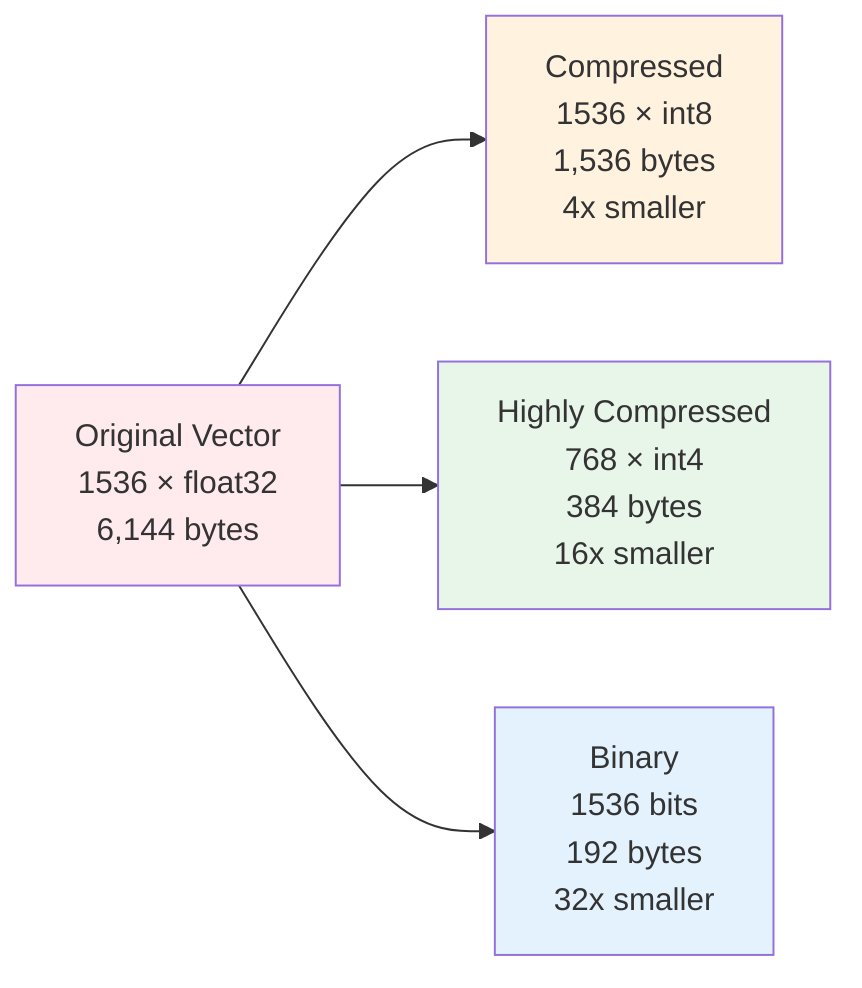
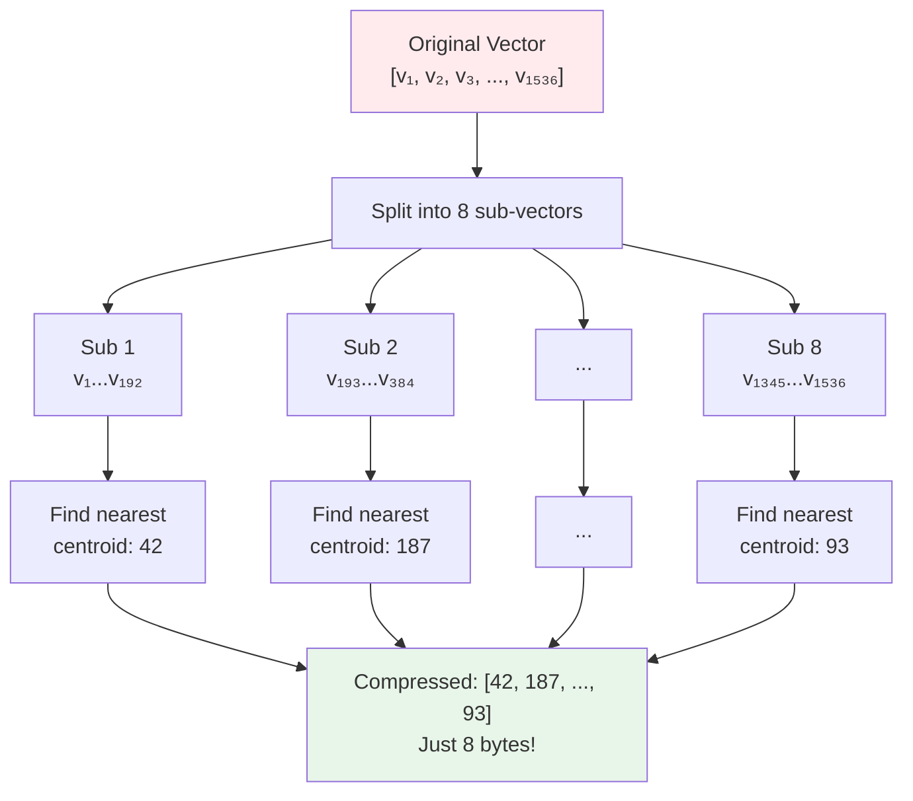

# 02.04 — Vector Compression

> **One sentence:** Raw vectors eat memory — compression techniques like Product Quantization reduce storage by 4-32x while keeping search quality surprisingly high.

---

## Why Compress?

```
The Problem:
─────────────
1 billion vectors × 1536 dimensions × 4 bytes (float32) = 5.7 TB
→ You'd need ~$15,000/month in RAM alone

With 8x compression:
1 billion vectors × 1536 dimensions × 0.5 bytes = 715 GB
→ $2,000/month — much more reasonable
```



---

## Compression Strategy 1: Dimensionality Reduction

**Idea:** Use fewer dimensions. Some dimensions carry more information than others.

```python
import numpy as np
from sklearn.decomposition import PCA

# Original: 1536-dimensional vectors
vectors_1536 = np.random.randn(10000, 1536).astype("float32")

# Reduce to 256 dimensions using PCA
pca = PCA(n_components=256)
vectors_256 = pca.fit_transform(vectors_1536)

print(f"Original: {vectors_1536.nbytes / 1e6:.1f} MB")    # 61.4 MB
print(f"Reduced:  {vectors_256.nbytes / 1e6:.1f} MB")      # 10.2 MB
print(f"Variance retained: {pca.explained_variance_ratio_.sum():.2%}")  # ~85-95%

# OpenAI's text-embedding-3 models support this natively!
from openai import OpenAI
client = OpenAI()

response = client.embeddings.create(
    model="text-embedding-3-small",
    input="Hello world",
    dimensions=256  # Reduce from 1536 to 256 at the API level
)
# No PCA needed — the model does it for you
```

### Compression Ratio vs. Quality

| Dimensions | Storage per vector | Recall@10 | Compression |
|-----------|-------------------|-----------|-------------|
| 1536 | 6,144 bytes | 100% (baseline) | 1x |
| 768 | 3,072 bytes | ~98% | 2x |
| 512 | 2,048 bytes | ~96% | 3x |
| 256 | 1,024 bytes | ~92% | 6x |
| 128 | 512 bytes | ~85% | 12x |

---

## Compression Strategy 2: Scalar Quantization

**Idea:** Use fewer bits per number. Instead of float32 (32 bits), use int8 (8 bits).

```python
import numpy as np

def scalar_quantize(vectors: np.ndarray) -> tuple:
    """
    Convert float32 vectors to int8 (4x compression).
    """
    # Find the range of values
    vmin = vectors.min(axis=0)
    vmax = vectors.max(axis=0)
    
    # Scale to 0-255 range
    scale = (vmax - vmin) / 255.0
    scale[scale == 0] = 1  # Avoid division by zero
    
    # Quantize
    quantized = np.round((vectors - vmin) / scale).astype(np.uint8)
    
    return quantized, vmin, scale

def scalar_dequantize(quantized: np.ndarray, vmin, scale) -> np.ndarray:
    """Reverse the quantization."""
    return quantized.astype(np.float32) * scale + vmin

# Example
original = np.random.randn(1000, 1536).astype(np.float32)
quantized, vmin, scale = scalar_quantize(original)
reconstructed = scalar_dequantize(quantized, vmin, scale)

# Measure quality loss
error = np.mean(np.abs(original - reconstructed))
print(f"Original size: {original.nbytes / 1e6:.1f} MB")   # 6.1 MB
print(f"Quantized size: {quantized.nbytes / 1e6:.1f} MB")  # 1.5 MB (4x smaller!)
print(f"Mean absolute error: {error:.6f}")  # Very small!
```

---

## Compression Strategy 3: Product Quantization (PQ)

**Idea:** Split each vector into sub-vectors and compress each piece independently using a codebook.



```python
import faiss
import numpy as np

# Product Quantization with FAISS
dimension = 1536
num_subquantizers = 48   # Split vector into 48 sub-vectors
bits_per_code = 8        # 256 centroids per sub-vector

# Create PQ index
index = faiss.IndexPQ(dimension, num_subquantizers, bits_per_code)

# Train the codebook (needs representative data)
training_data = np.random.randn(50000, dimension).astype("float32")
index.train(training_data)

# Add vectors
vectors = np.random.randn(1_000_000, dimension).astype("float32")
index.add(vectors)

# Search
query = np.random.randn(1, dimension).astype("float32")
distances, indices = index.search(query, k=10)

# Storage comparison
original_size = 1_000_000 * 1536 * 4  # float32
pq_size = 1_000_000 * 48  # 48 bytes per vector

print(f"Original: {original_size / 1e9:.1f} GB")  # 5.7 GB
print(f"PQ:       {pq_size / 1e6:.0f} MB")         # 48 MB → 120x compression!
```

---

## Compression Strategy 4: Binary Quantization

**Idea:** Convert each dimension to just 1 bit (positive → 1, negative → 0). Fastest search possible.

```python
import numpy as np

def binary_quantize(vectors: np.ndarray) -> np.ndarray:
    """Convert float vectors to binary (1 bit per dimension)."""
    return np.packbits((vectors > 0).astype(np.uint8), axis=1)

def hamming_distance(a: np.ndarray, b: np.ndarray) -> int:
    """Count differing bits between two binary vectors."""
    xor = np.bitwise_xor(a, b)
    return sum(bin(byte).count('1') for byte in xor)

# Example
vectors = np.random.randn(5, 1536).astype(np.float32)
binary = binary_quantize(vectors)

print(f"Original: {vectors[0].nbytes} bytes")   # 6144 bytes
print(f"Binary:   {binary[0].nbytes} bytes")      # 192 bytes → 32x compression!

# Search using Hamming distance (XOR + popcount — extremely fast on CPUs)
query_binary = binary_quantize(np.random.randn(1, 1536).astype(np.float32))
distances = [hamming_distance(query_binary[0], b) for b in binary]
print(f"Hamming distances: {distances}")
```

---

## Comparison Summary

| Method | Compression | Search Quality | Speed | Best For |
|--------|-------------|---------------|-------|----------|
| **Full float32** | 1x (baseline) | 100% | Baseline | Small datasets |
| **Dimensionality reduction** | 2-6x | 92-98% | Faster | API-level reduction |
| **Scalar quantization (int8)** | 4x | 98-99% | 2x faster | General use |
| **Product quantization** | 32-128x | 90-95% | 5-10x faster | Large datasets |
| **Binary quantization** | 32x | 80-90% | 50x faster | First-pass filtering |

---

## Key Takeaways

1. **You almost always need compression** at scale (>1M vectors)
2. **Scalar quantization (int8)** is the easiest win — 4x compression with <2% quality loss
3. **Product quantization** gives massive compression but needs training data
4. **Binary quantization** is blazing fast for re-ranking pipelines
5. **Combine methods** for best results (e.g., binary first pass → full re-rank top 100)

---

## 💼 FAANG Interview Questions

1. *"You have 500M product vectors on a budget. How do you compress them?"*
2. *"Explain Product Quantization to a junior engineer."*
3. *"What's the tradeoff between compression and recall accuracy?"*

---

## 🏋️ Exercise

Using FAISS or pure NumPy on 50K random 1536-d vectors:

1. Build a **float32** index and measure **recall@10** against brute force.
2. Apply **scalar int8** quantization and measure recall again.
3. Train **PQ** with `M=48`, `nbits=8` and measure recall + index size on disk.

Plot compression ratio vs recall@10. Write two sentences on which method you'd ship for a 20M-vector catalog with a 32 GB RAM budget.
