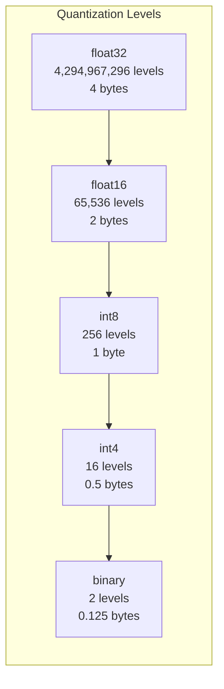
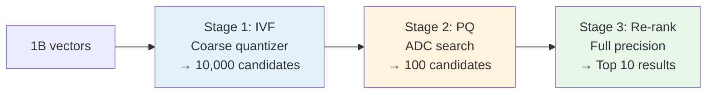

# 02.05 — Compression and Quantization (Advanced)

> **One sentence:** Quantization maps continuous float values to a finite set of discrete values — the art is choosing how many levels you need and where to place them.

---

## Quantization Fundamentals

```
Float32 (32 bits per number):
  Value: 0.7823456789...
  Precision: ~7 decimal digits
  Range: ±3.4 × 10³⁸

Int8 (8 bits per number):
  Value: 200 (out of 0-255)
  Precision: 256 discrete levels
  4x less storage

Int4 (4 bits per number):
  Value: 12 (out of 0-15)  
  Precision: 16 discrete levels
  8x less storage

Binary (1 bit per number):
  Value: 1 or 0
  Precision: 2 levels (positive/negative)
  32x less storage
```



---

## Uniform vs. Non-Uniform Quantization

### Uniform Quantization

Equal spacing between levels. Simple but wasteful if values aren't evenly distributed.

```python
import numpy as np

def uniform_quantize(values: np.ndarray, bits: int = 8) -> tuple:
    """Uniform quantization with equal-width bins."""
    num_levels = 2 ** bits  # 256 for 8-bit
    
    vmin, vmax = values.min(), values.max()
    scale = (vmax - vmin) / (num_levels - 1)
    zero_point = round(-vmin / scale)
    
    quantized = np.clip(
        np.round(values / scale) + zero_point, 
        0, num_levels - 1
    ).astype(np.uint8)
    
    return quantized, scale, zero_point

def uniform_dequantize(quantized, scale, zero_point):
    return (quantized.astype(np.float32) - zero_point) * scale

# Example with embedding-like values
values = np.random.randn(1000)  # Normal distribution
q, scale, zp = uniform_quantize(values, bits=8)
reconstructed = uniform_dequantize(q, scale, zp)

error = np.mean(np.abs(values - reconstructed))
print(f"8-bit uniform quantization error: {error:.6f}")
```

### Non-Uniform Quantization (k-Means)

Place levels where the data is dense. Better quality, but more complex.

```python
from sklearn.cluster import KMeans

def nonuniform_quantize(values: np.ndarray, num_levels: int = 256):
    """Non-uniform quantization using k-means clustering."""
    # Find optimal level positions
    kmeans = KMeans(n_clusters=num_levels, random_state=42)
    kmeans.fit(values.reshape(-1, 1))
    
    # Quantize: assign each value to nearest centroid
    labels = kmeans.predict(values.reshape(-1, 1))
    centroids = kmeans.cluster_centers_.flatten()
    
    return labels.astype(np.uint8), centroids

def nonuniform_dequantize(labels, centroids):
    return centroids[labels]

# Compare quality
values = np.random.randn(1000)

# Uniform
q_uniform, s, zp = uniform_quantize(values)
recon_uniform = uniform_dequantize(q_uniform, s, zp)

# Non-uniform
labels, centroids = nonuniform_quantize(values)
recon_nonuniform = nonuniform_dequantize(labels, centroids)

print(f"Uniform error:     {np.mean(np.abs(values - recon_uniform)):.6f}")
print(f"Non-uniform error: {np.mean(np.abs(values - recon_nonuniform)):.6f}")
# Non-uniform is typically 20-40% lower error for the same number of bits
```

---

## Product Quantization — Deep Dive

PQ is the most important compression technique for vectors. Let's trace it step by step:

```python
import numpy as np

class ProductQuantizer:
    """
    Product Quantization from scratch.
    
    Idea: Split D-dimensional vector into M sub-vectors,
    quantize each sub-vector independently using K centroids.
    
    Storage: M bytes per vector (if K=256, i.e., 8-bit codes)
    """
    
    def __init__(self, D: int, M: int, K: int = 256):
        """
        D: vector dimension (e.g., 1536)
        M: number of sub-quantizers (e.g., 48 → each handles 32 dims)
        K: centroids per sub-quantizer (256 → 8-bit codes)
        """
        assert D % M == 0, "D must be divisible by M"
        self.D = D
        self.M = M
        self.K = K
        self.ds = D // M  # sub-vector dimension
        self.codebooks = None  # M codebooks, each K × ds
    
    def train(self, X: np.ndarray):
        """Learn codebooks from training data."""
        from sklearn.cluster import KMeans
        
        self.codebooks = np.zeros((self.M, self.K, self.ds), dtype=np.float32)
        
        for m in range(self.M):
            # Extract sub-vectors for this segment
            sub_vectors = X[:, m * self.ds : (m + 1) * self.ds]
            
            # Cluster them into K centroids
            kmeans = KMeans(n_clusters=self.K, random_state=42, n_init=1)
            kmeans.fit(sub_vectors)
            self.codebooks[m] = kmeans.cluster_centers_
            
            print(f"  Trained sub-quantizer {m+1}/{self.M}")
    
    def encode(self, X: np.ndarray) -> np.ndarray:
        """Encode vectors to compact codes."""
        N = X.shape[0]
        codes = np.zeros((N, self.M), dtype=np.uint8)
        
        for m in range(self.M):
            sub_vectors = X[:, m * self.ds : (m + 1) * self.ds]
            # Find nearest centroid for each sub-vector
            distances = np.linalg.norm(
                sub_vectors[:, np.newaxis] - self.codebooks[m], axis=2
            )
            codes[:, m] = distances.argmin(axis=1)
        
        return codes
    
    def decode(self, codes: np.ndarray) -> np.ndarray:
        """Reconstruct approximate vectors from codes."""
        N = codes.shape[0]
        X_reconstructed = np.zeros((N, self.D), dtype=np.float32)
        
        for m in range(self.M):
            X_reconstructed[:, m * self.ds : (m + 1) * self.ds] = \
                self.codebooks[m][codes[:, m]]
        
        return X_reconstructed

# Usage
D = 128  # Using smaller dimension for demo
M = 8    # 8 sub-quantizers, each handles 16 dims
pq = ProductQuantizer(D=D, M=M, K=256)

# Train
training_data = np.random.randn(10000, D).astype(np.float32)
pq.train(training_data)

# Encode
vectors = np.random.randn(1000, D).astype(np.float32)
codes = pq.encode(vectors)

# Storage comparison
print(f"\nOriginal: {vectors.nbytes} bytes ({vectors.nbytes/1000:.0f} per vector)")
print(f"Codes:    {codes.nbytes} bytes ({codes.nbytes/1000:.0f} per vector)")
print(f"Compression: {vectors.nbytes / codes.nbytes:.1f}x")

# Quality check
reconstructed = pq.decode(codes)
error = np.mean(np.linalg.norm(vectors - reconstructed, axis=1))
print(f"Mean reconstruction error: {error:.4f}")
```

---

## Asymmetric Distance Computation (ADC)

**Key optimization:** During search, you don't decompress the database vectors. You compute distances directly on the codes.

```python
def asymmetric_search(pq, query: np.ndarray, codes: np.ndarray, top_k: int = 5):
    """
    ADC: compare full query vector against compressed database vectors.
    
    1. Pre-compute distances from query sub-vectors to all centroids
    2. For each database vector, look up and sum the pre-computed distances
    """
    # Step 1: Pre-compute distance tables
    # For each sub-quantizer, compute distance from query to all K centroids
    distance_tables = np.zeros((pq.M, pq.K), dtype=np.float32)
    
    for m in range(pq.M):
        query_sub = query[m * pq.ds : (m + 1) * pq.ds]
        for k in range(pq.K):
            centroid = pq.codebooks[m][k]
            distance_tables[m, k] = np.linalg.norm(query_sub - centroid) ** 2
    
    # Step 2: For each database vector, sum up sub-distances
    N = codes.shape[0]
    distances = np.zeros(N, dtype=np.float32)
    
    for m in range(pq.M):
        distances += distance_tables[m, codes[:, m]]  # Just a lookup!
    
    # Step 3: Return top-k
    top_indices = np.argsort(distances)[:top_k]
    return top_indices, distances[top_indices]
```

```
Why ADC is brilliant:
─────────────────────
Without ADC: N × D multiplications per query     (e.g., 1M × 1536)
With ADC:    M × K + N × M additions per query    (e.g., 48 × 256 + 1M × 48)

For 1M vectors, 1536 dims, 48 sub-quantizers:
  Brute force: 1,536,000,000 operations
  ADC:              48,012,288 operations  ← 32x fewer!
```

---

## Multi-Stage Search: Coarse + Fine



```python
import faiss

# IVF + PQ: the workhorse of billion-scale search
dimension = 1536
nlist = 4096          # Number of coarse clusters (Voronoi cells)
M = 48                # PQ sub-quantizers
bits = 8              # Bits per sub-quantizer

# Create composite index
quantizer = faiss.IndexFlatL2(dimension)  # Coarse quantizer
index = faiss.IndexIVFPQ(quantizer, dimension, nlist, M, bits)

# Train and add
training_data = np.random.randn(100000, dimension).astype("float32")
index.train(training_data)

data = np.random.randn(1_000_000, dimension).astype("float32")
index.add(data)

# Search (only scans ~1% of the database)
index.nprobe = 64  # Search 64 out of 4096 clusters
query = np.random.randn(1, dimension).astype("float32")
distances, indices = index.search(query, k=10)
```

---

## Key Takeaways

1. **Quantization = fewer bits per number** — the core idea behind all compression
2. **Uniform quantization** is simple; **non-uniform** adapts to your data distribution
3. **Product Quantization** splits vectors into sub-vectors — gets 32-128x compression
4. **ADC** makes search on compressed vectors nearly as fast as decompressed
5. **Multi-stage search** (IVF + PQ) is how billion-scale systems work in practice

---

## 💼 FAANG Interview Questions

1. *"Explain how Product Quantization works. What's the space-accuracy tradeoff?"*
2. *"Why is Asymmetric Distance Computation faster than decompressing all vectors?"*
3. *"Design a search system for 2 billion image embeddings on a $10K/month budget."*
