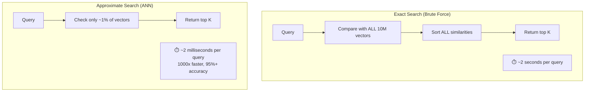
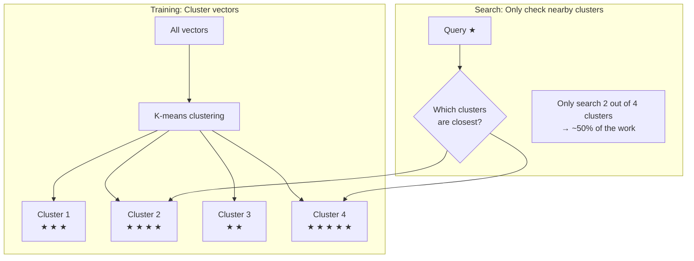
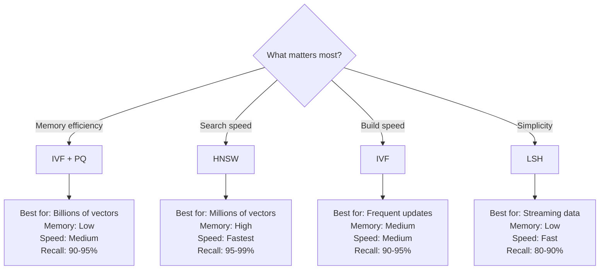

# 02.06 — Vector Search

> **One sentence:** Vector search finds the most similar items from millions of candidates in milliseconds — by trading perfect accuracy for dramatic speed gains using approximate nearest neighbor (ANN) algorithms.

---

## The Core Problem

```
Given:  A query vector q (1536 dimensions)
        A database of N vectors (could be millions or billions)
Find:   The K most similar vectors to q

Brute force: Compare q to ALL N vectors → O(N × D) → TOO SLOW at scale
```



---

## Strategy 1: Inverted File Index (IVF)

**Idea:** Cluster your vectors into groups. At search time, only search the nearby groups.



```python
import faiss
import numpy as np
import time

dimension = 1536
n_vectors = 1_000_000

# Generate data
data = np.random.randn(n_vectors, dimension).astype("float32")
query = np.random.randn(1, dimension).astype("float32")

# === Exact search (brute force) ===
index_flat = faiss.IndexFlatL2(dimension)
index_flat.add(data)

start = time.time()
D_exact, I_exact = index_flat.search(query, k=10)
exact_time = time.time() - start
print(f"Exact search: {exact_time*1000:.1f}ms")  # ~500-2000ms

# === IVF search (approximate) ===
nlist = 1024  # Number of clusters
quantizer = faiss.IndexFlatL2(dimension)
index_ivf = faiss.IndexIVFFlat(quantizer, dimension, nlist)

# Train clusters on the data
index_ivf.train(data)
index_ivf.add(data)

# Search — nprobe controls accuracy vs. speed
index_ivf.nprobe = 16  # Check 16 out of 1024 clusters (~1.6%)

start = time.time()
D_ivf, I_ivf = index_ivf.search(query, k=10)
ivf_time = time.time() - start
print(f"IVF search:   {ivf_time*1000:.1f}ms")  # ~5-20ms

# Check recall (how many true top-10 did we find?)
recall = len(set(I_exact[0]) & set(I_ivf[0])) / 10
print(f"Recall@10: {recall:.0%}")  # Usually 90-100%
```

### nprobe Tradeoff

| nprobe | Clusters checked | Search time | Recall@10 |
|--------|-----------------|-------------|-----------|
| 1 | 0.1% | ~1ms | ~60% |
| 8 | 0.8% | ~5ms | ~85% |
| 32 | 3.1% | ~15ms | ~95% |
| 128 | 12.5% | ~50ms | ~99% |
| 1024 | 100% | ~500ms | 100% (exact) |

---

## Strategy 2: HNSW (Hierarchical Navigable Small World)

**Idea:** Build a multi-layer graph. Upper layers have long-range connections (highways), lower layers have local connections (local roads).

```
Layer 3 (express):    A ─────────────────── Z
                      
Layer 2 (fast):       A ────── M ────── Z
                      
Layer 1 (medium):     A ── F ── M ── R ── Z
                      
Layer 0 (full):       A─B─C─D─E─F─G─H─I─J─K─L─M─N─O─P─Q─R─S─T─U─V─W─X─Y─Z

Search path for query near "R":
  Layer 3: Start at A → jump to Z (wrong direction, stay at A)
  Layer 2: A → M (closer!) → Z (too far, stay at M)
  Layer 1: M → R (found region!)
  Layer 0: R → check neighbors → find exact nearest
```

```python
import hnswlib
import numpy as np

dimension = 1536
num_elements = 1_000_000

# Create HNSW index
index = hnswlib.Index(space="cosine", dim=dimension)

# Initialize — M and ef_construction control graph quality
index.init_index(
    max_elements=num_elements,
    M=16,              # Connections per node (higher = better recall, more memory)
    ef_construction=200 # Build-time beam width (higher = better graph, slower build)
)

# Add data
data = np.random.randn(num_elements, dimension).astype("float32")
index.add_items(data, ids=np.arange(num_elements))

# Search — ef controls search quality
index.set_ef(50)  # Higher = better recall, slower search

labels, distances = index.knn_query(
    np.random.randn(1, dimension).astype("float32"), k=10
)
```

### HNSW Parameter Guide

| Parameter | What it does | Typical values |
|-----------|-------------|----------------|
| `M` | Edges per node | 16-64 (higher = better recall, more RAM) |
| `ef_construction` | Build quality | 100-500 (higher = better graph) |
| `ef` (search) | Search quality | 50-500 (higher = better recall) |

---

## Strategy 3: LSH (Locality-Sensitive Hashing)

**Idea:** Hash similar vectors into the same bucket. Only compare items in the same bucket.

```python
import numpy as np

class SimpleLSH:
    """
    Random projection LSH for cosine similarity.
    """
    def __init__(self, dim: int, num_hashes: int = 128):
        self.planes = np.random.randn(num_hashes, dim).astype("float32")
        self.buckets = {}
    
    def hash(self, vector: np.ndarray) -> str:
        """Hash a vector into a binary string."""
        projections = self.planes @ vector
        bits = (projections > 0).astype(int)
        return "".join(map(str, bits))
    
    def insert(self, vector: np.ndarray, id: int):
        h = self.hash(vector)
        if h not in self.buckets:
            self.buckets[h] = []
        self.buckets[h].append((id, vector))
    
    def search(self, query: np.ndarray, top_k: int = 5):
        h = self.hash(query)
        candidates = self.buckets.get(h, [])
        
        # Score candidates
        results = []
        for id, vec in candidates:
            sim = np.dot(query, vec) / (np.linalg.norm(query) * np.linalg.norm(vec))
            results.append((sim, id))
        
        results.sort(reverse=True)
        return results[:top_k]
```

---

## Comparison of ANN Strategies



| Method | Build Time | Search Time | Memory | Recall | Updates |
|--------|-----------|-------------|--------|--------|---------|
| **Flat (exact)** | O(1) per item | O(N) | N × D × 4B | 100% | Easy |
| **IVF** | O(N × K) | O(N/nlist × nprobe) | N × D × 4B | 90-99% | Rebuild clusters |
| **HNSW** | O(N × log N) | O(log N) | N × (D × 4B + links) | 95-99% | Moderate |
| **IVF + PQ** | O(N × K) | O(N/nlist × nprobe) | N × M bytes | 85-95% | Rebuild needed |

---

## Hybrid Search: Vectors + Filters

Real-world search is never "just vectors." You need filters too.

```python
# "Find shoes similar to this image, under $100, in size 10"

# BAD approach: search first, filter after
results = vector_search(shoe_embedding, top_k=1000)  # Get 1000 similar
filtered = [r for r in results if r.price < 100 and r.size == 10]
# Problem: What if all top 1000 are expensive? You get 0 results.

# GOOD approach: filter first (pre-filtering) or filter during search
results = vector_search(
    shoe_embedding,
    top_k=10,
    filters={
        "price": {"$lt": 100},
        "size": {"$eq": 10}
    }
)
# Vector DB handles filtering efficiently during the search
```

---

## Key Takeaways

1. **Brute force is too slow** beyond ~100K vectors
2. **IVF** divides vectors into clusters — search only relevant clusters
3. **HNSW** builds a graph with shortcuts — O(log N) search
4. **Recall vs. speed** is the fundamental tradeoff — tune with `nprobe` or `ef`
5. **Hybrid search** (vectors + metadata filters) is what production systems need

---

## 💼 FAANG Interview Questions

1. *"Explain HNSW to me like I'm a junior engineer."*
2. *"Your vector search returns results in 50ms but you need 10ms. What do you do?"*
3. *"Compare IVF vs. HNSW. When would you choose each?"*

## 🏋️ Exercise

Build a benchmark comparing IVF and HNSW:
- 100K, 500K, and 1M random vectors (128 dimensions)
- Measure: build time, search time, recall@10
- Plot the results
