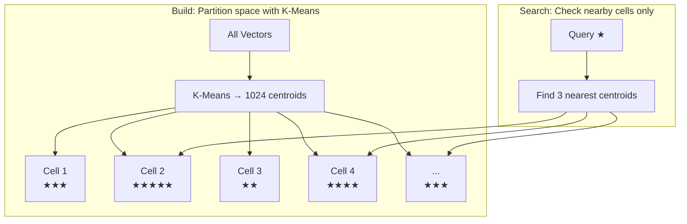
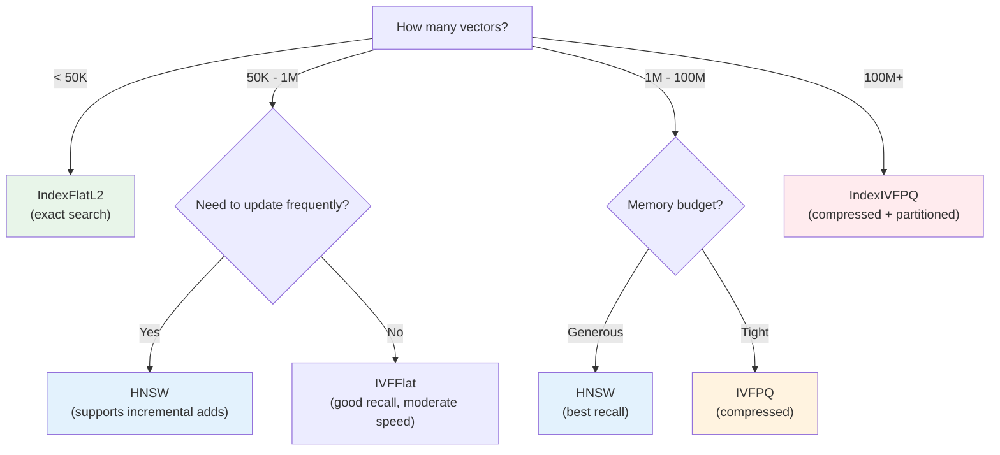

# 02.07 — Indexing Techniques That Make Vector Search Scale

> **One sentence:** Vector indexes are data structures that organize vectors so you only need to compare against a tiny fraction of the database — turning a million-comparison problem into a thousand-comparison one.

---

## Why Indexing Matters

```
Without index: Search 10M vectors → 10,000,000 comparisons → 2 seconds
With index:    Search 10M vectors →      10,000 comparisons → 2 ms
                                         ↑ 1000x fewer comparisons
```

---

## Index Type 1: Flat Index (Baseline)

No structure at all — just compare with everything.

```python
import faiss
import numpy as np

# Flat index = brute force
index = faiss.IndexFlatL2(1536)
data = np.random.randn(100_000, 1536).astype("float32")
index.add(data)

# Searches ALL 100K vectors every time
D, I = index.search(query, k=10)
```

```
Flat Index:
[v₁][v₂][v₃][v₄][v₅]...[vₙ]   ← just a list
  ↕   ↕   ↕   ↕   ↕       ↕
  compare query with every single one
```

**Use when:** < 100K vectors, or when you need 100% exact results.

---

## Index Type 2: IVF (Inverted File Index)



```python
# IVF partitions vectors into Voronoi cells
nlist = 1024  # Number of cells

quantizer = faiss.IndexFlatL2(1536)  # Used to find nearest cell
index = faiss.IndexIVFFlat(quantizer, 1536, nlist)

# Must train before adding
index.train(training_data)  # Learns cell centroids
index.add(data)

# nprobe = how many cells to check (accuracy vs speed knob)
index.nprobe = 32  # Check 32/1024 cells = ~3% of data
D, I = index.search(query, k=10)
```

### How Many Cells (nlist)?

```
Rule of thumb: nlist ≈ sqrt(N)

N = 100,000  → nlist = ~300
N = 1,000,000 → nlist = ~1,000
N = 100,000,000 → nlist = ~10,000
```

---

## Index Type 3: HNSW (Graph-Based)

```
Layer 2:  A ──────────────────────── P ──────────────────────── Z
          |                          |                          |
Layer 1:  A ──── D ──── H ──── K ── P ──── S ──── V ──── X ── Z
          |    |    |    |    |  |    |    |    |    |    |  |
Layer 0:  A B C D E F G H I J K L M N O P Q R S T U V W X Y Z

Search for nearest to query Q:
  L2: Start at A → jump to P (closer!) → P is closest on this layer
  L1: P → S (further!) stay at P → check K (further!) stay at P
  L0: P → check O, Q, N → Q is nearest neighbor!
```

**Why it works:**
- Upper layers = express highways (few nodes, long jumps)
- Lower layers = local streets (all nodes, short connections)
- Each node connects to M neighbors on each layer
- Probability of being on layer L: p^L (exponentially fewer nodes higher up)

```python
# HNSW parameters and their effect
import faiss

# M = connections per node
# Higher M = better recall, more memory, slower build
index_m16 = faiss.IndexHNSWFlat(1536, 16)   # Standard
index_m32 = faiss.IndexHNSWFlat(1536, 32)   # Higher recall
index_m64 = faiss.IndexHNSWFlat(1536, 64)   # Maximum recall

# ef_construction = beam width during build
# Higher = better graph quality, slower build
index = faiss.IndexHNSWFlat(1536, 32)
index.hnsw.efConstruction = 200  # Default 40

# ef_search = beam width during search
# Higher = better recall, slower search
index.hnsw.efSearch = 64  # Must be >= k (top_k)
```

### HNSW Memory Overhead

```
Memory = N × (D × 4 + M × 2 × 4 × avg_layers) bytes

For 1M vectors, D=1536, M=32:
  Vectors:  1M × 1536 × 4 = 5.7 GB
  Graph:    1M × 32 × 2 × 4 × ~1.33 = ~340 MB
  Total:    ~6.0 GB

Compare to flat: 5.7 GB (graph adds ~6% overhead)
```

---

## Index Type 4: IVF + PQ (Memory-Efficient)

Combine partitioning (IVF) with compression (PQ) for massive scale:

```python
dimension = 1536
nlist = 4096       # Voronoi cells
M = 48             # PQ sub-quantizers  
nbits = 8          # 256 centroids per sub-quantizer

quantizer = faiss.IndexFlatL2(dimension)
index = faiss.IndexIVFPQ(quantizer, dimension, nlist, M, nbits)

# Train
index.train(training_data)  # Learn cells + codebooks

# Add 100M vectors
index.add(big_data)

# Memory: 100M × 48 bytes = 4.5 GB (instead of 573 GB!)

index.nprobe = 64
D, I = index.search(query, k=10)
```

---

## Index Type 5: ScaNN (Google's Solution)

Google's production vector search uses **anisotropic vector quantization**:

```
Traditional PQ:     Minimize reconstruction error equally in all directions
ScaNN's approach:   Focus on preserving the RANKING order, not exact distances

Result: Better recall at the same compression level
```

```python
# ScaNN (Google's library)
import scann

# Build ScaNN index
searcher = scann.scann_ops_pybind.builder(
    data, num_neighbors=10, distance_measure="dot_product"
).tree(
    num_leaves=2000,           # Partitioning
    num_leaves_to_search=100   # nprobe equivalent
).score_ah(
    dimensions_per_block=2,    # Anisotropic hashing
    anisotropic_quantization_threshold=0.2
).reorder(
    reordering_num_neighbors=100  # Re-rank top candidates
).build()

neighbors, distances = searcher.search(query)
```

---

## Choosing the Right Index



| Vectors | Index | Memory/vector | Search time | Recall |
|---------|-------|--------------|-------------|--------|
| 10K | Flat | 6 KB | 1ms | 100% |
| 100K | IVFFlat | 6 KB | 5ms | 95%+ |
| 1M | HNSW | 6.3 KB | 1ms | 99% |
| 10M | IVFPQ | 48 B | 5ms | 92% |
| 1B | IVF + PQ + OPQ | 64 B | 10ms | 90% |

---

## Key Takeaways

1. **Flat index** for prototyping and < 50K vectors
2. **IVF** partitions space — tune `nprobe` for recall vs. speed
3. **HNSW** builds a navigable graph — best recall but most memory
4. **IVF + PQ** combines partitioning with compression — billion-scale
5. **No index is universally best** — it depends on your N, D, memory, and latency requirements

---

## 💼 FAANG Interview Questions

1. *"You have 50M product embeddings and need sub-5ms search. Which index and why?"*
2. *"What happens to HNSW recall if you set M too low? Too high?"*
3. *"Your IVF index has 95% recall. How do you get to 99% without major latency increase?"*
