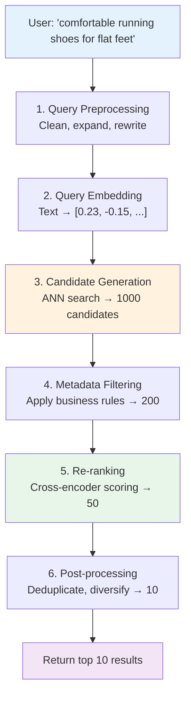
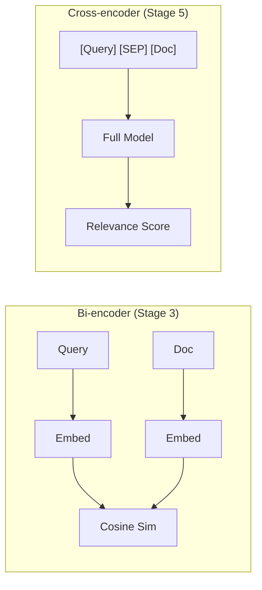

# 02.08 — Search Execution: From Query to Result

> **One sentence:** A vector search query goes through embedding, routing, candidate generation, scoring, filtering, and re-ranking — understanding each stage lets you optimize the pipeline end to end.

---

## The Complete Search Pipeline



---

## Stage 1: Query Preprocessing

```python
def preprocess_query(query: str) -> str:
    """
    Clean and normalize the query before embedding.
    """
    # Remove extra whitespace
    query = " ".join(query.split())
    
    # Fix common typos (optional, model-dependent)
    typo_map = {"recieve": "receive", "teh": "the"}
    for typo, fix in typo_map.items():
        query = query.replace(typo, fix)
    
    return query.strip()

def expand_query(query: str) -> list[str]:
    """
    Generate multiple query variations to improve recall.
    
    'comfortable running shoes' might miss docs about 'cushioned sneakers'
    """
    # Use an LLM to generate variations
    response = client.chat.completions.create(
        model="gpt-4o-mini",
        messages=[{
            "role": "system",
            "content": "Generate 3 alternative phrasings for this search query. Return one per line."
        }, {
            "role": "user", 
            "content": query
        }],
        temperature=0.7
    )
    
    variations = response.choices[0].message.content.strip().split("\n")
    return [query] + variations

# Example
queries = expand_query("comfortable running shoes for flat feet")
# ["comfortable running shoes for flat feet",
#  "cushioned sneakers with arch support",
#  "best running footwear for low arches",
#  "supportive athletic shoes for overpronation"]
```

### Hypothetical Document Embedding (HyDE)

A clever trick: instead of embedding the question, embed a hypothetical answer.

```python
def hyde_search(question: str) -> list[float]:
    """
    HyDE: Generate a hypothetical answer, embed THAT instead.
    
    Why? The hypothetical answer looks more like the documents
    in your database than the question does.
    """
    # Generate a hypothetical answer
    response = client.chat.completions.create(
        model="gpt-4o-mini",
        messages=[{
            "role": "system",
            "content": "Answer this question in 2-3 sentences as if you were a product description."
        }, {
            "role": "user",
            "content": question
        }]
    )
    hypothetical_doc = response.choices[0].message.content
    
    # Embed the hypothetical document (not the question!)
    return get_embedding(hypothetical_doc)
```

---

## Stage 2: Query Embedding

```python
from openai import OpenAI
import time

client = OpenAI()

def embed_query(text: str) -> tuple[list[float], float]:
    """Embed query and track latency."""
    start = time.perf_counter()
    
    response = client.embeddings.create(
        model="text-embedding-3-small",
        input=text
    )
    
    latency_ms = (time.perf_counter() - start) * 1000
    return response.data[0].embedding, latency_ms

# Typical latency: 20-80ms for API embedding
embedding, latency = embed_query("comfortable running shoes")
print(f"Embedding latency: {latency:.1f}ms")
```

---

## Stage 3: Candidate Generation (ANN Search)

```python
# Retrieve 1000 candidates using approximate nearest neighbor
def generate_candidates(
    query_embedding: list[float],
    index,  # Your vector index (FAISS, Qdrant, etc.)
    num_candidates: int = 1000
) -> list[dict]:
    """
    Cast a wide net — get many candidates, refine later.
    """
    distances, ids = index.search(
        np.array([query_embedding]).astype("float32"),
        k=num_candidates
    )
    
    return [
        {"id": int(ids[0][i]), "score": float(distances[0][i])}
        for i in range(len(ids[0]))
    ]
```

**Why 1000 candidates for 10 results?**
- ANN search might miss some truly relevant items
- Filtering will remove many candidates
- Re-ranking will reorder the rest
- Retrieving extras is cheap; missing relevant items is expensive

---

## Stage 4: Metadata Filtering

```python
def apply_filters(candidates: list[dict], filters: dict, metadata_store: dict) -> list[dict]:
    """
    Apply business rules AFTER vector search.
    
    Filters: price, category, availability, user permissions, etc.
    """
    filtered = []
    
    for candidate in candidates:
        meta = metadata_store[candidate["id"]]
        
        # Apply each filter
        passes = True
        
        if "max_price" in filters and meta.get("price", 0) > filters["max_price"]:
            passes = False
        
        if "category" in filters and meta.get("category") != filters["category"]:
            passes = False
        
        if "in_stock" in filters and not meta.get("in_stock", False):
            passes = False
        
        if passes:
            candidate["metadata"] = meta
            filtered.append(candidate)
    
    return filtered

# Better: use the vector DB's built-in filtering (pre-filtering)
# Qdrant example:
results = qdrant_client.search(
    collection_name="products",
    query_vector=query_embedding,
    query_filter={
        "must": [
            {"key": "category", "match": {"value": "running_shoes"}},
            {"key": "price", "range": {"lte": 150}},
            {"key": "in_stock", "match": {"value": True}}
        ]
    },
    limit=100
)
```

---

## Stage 5: Re-ranking (The Quality Boost)

**Key insight:** Bi-encoder (embedding) search is fast but approximate. Cross-encoder re-ranking is slow but much more accurate.



```python
from sentence_transformers import CrossEncoder

# Cross-encoder considers query AND document TOGETHER
reranker = CrossEncoder("cross-encoder/ms-marco-MiniLM-L-12-v2")

def rerank(query: str, candidates: list[dict], top_k: int = 10) -> list[dict]:
    """
    Re-score candidates using a cross-encoder.
    Much slower than bi-encoder, but much more accurate.
    """
    # Create query-document pairs
    pairs = [(query, c["metadata"]["text"]) for c in candidates]
    
    # Score all pairs
    scores = reranker.predict(pairs)
    
    # Sort by cross-encoder score
    for i, candidate in enumerate(candidates):
        candidate["rerank_score"] = float(scores[i])
    
    candidates.sort(key=lambda x: x["rerank_score"], reverse=True)
    return candidates[:top_k]

# Usage
reranked = rerank("comfortable running shoes", filtered_candidates, top_k=10)
```

### Cohere Rerank API (Production Shortcut)

```python
import cohere

co = cohere.Client("your-api-key")

results = co.rerank(
    query="comfortable running shoes for flat feet",
    documents=["Nike Air Zoom Pegasus with cushioned sole...",
               "Steel-toed work boots for construction...",
               "Brooks Ghost with arch support technology..."],
    model="rerank-english-v3.0",
    top_n=10
)

for r in results.results:
    print(f"Score: {r.relevance_score:.4f} → {r.document.text[:50]}")
```

---

## Stage 6: Post-processing

```python
def post_process(results: list[dict], max_per_brand: int = 3) -> list[dict]:
    """
    Final refinements: deduplicate, diversify, apply business logic.
    """
    seen_texts = set()
    brand_counts = {}
    final = []
    
    for result in results:
        text = result["metadata"]["text"]
        brand = result["metadata"].get("brand", "unknown")
        
        # Deduplicate near-identical content
        text_hash = hash(text[:100])
        if text_hash in seen_texts:
            continue
        seen_texts.add(text_hash)
        
        # Diversity: limit results per brand
        brand_counts[brand] = brand_counts.get(brand, 0) + 1
        if brand_counts[brand] > max_per_brand:
            continue
        
        final.append(result)
    
    return final
```

---

## Complete Pipeline Implementation

```python
class SearchPipeline:
    """End-to-end vector search pipeline."""
    
    def __init__(self, index, metadata_store, reranker=None):
        self.index = index
        self.metadata_store = metadata_store
        self.reranker = reranker
    
    def search(self, query: str, filters: dict = None, top_k: int = 10) -> list[dict]:
        """Full search pipeline."""
        import time
        timings = {}
        
        # Stage 1: Preprocess
        t = time.perf_counter()
        query = preprocess_query(query)
        timings["preprocess"] = (time.perf_counter() - t) * 1000
        
        # Stage 2: Embed
        t = time.perf_counter()
        embedding, _ = embed_query(query)
        timings["embed"] = (time.perf_counter() - t) * 1000
        
        # Stage 3: Candidate generation (wide net)
        t = time.perf_counter()
        candidates = generate_candidates(embedding, self.index, num_candidates=500)
        timings["ann_search"] = (time.perf_counter() - t) * 1000
        
        # Stage 4: Filter
        t = time.perf_counter()
        if filters:
            candidates = apply_filters(candidates, filters, self.metadata_store)
        timings["filter"] = (time.perf_counter() - t) * 1000
        
        # Stage 5: Re-rank (optional, expensive)
        t = time.perf_counter()
        if self.reranker and len(candidates) > 0:
            candidates = rerank(query, candidates, top_k=top_k * 3)
        timings["rerank"] = (time.perf_counter() - t) * 1000
        
        # Stage 6: Post-process
        t = time.perf_counter()
        results = post_process(candidates)[:top_k]
        timings["postprocess"] = (time.perf_counter() - t) * 1000
        
        # Log timing breakdown
        total = sum(timings.values())
        print(f"Search completed in {total:.1f}ms:")
        for stage, ms in timings.items():
            pct = (ms / total) * 100 if total > 0 else 0
            print(f"  {stage:15s}: {ms:6.1f}ms ({pct:.0f}%)")
        
        return results
```

### Typical Timing Breakdown

```
Search completed in 127.3ms:
  preprocess     :    0.1ms ( 0%)
  embed          :   45.2ms (36%)   ← API call dominates
  ann_search     :    3.8ms ( 3%)   ← HNSW is fast
  filter         :    1.2ms ( 1%)
  rerank         :   72.4ms (57%)   ← Cross-encoder is expensive
  postprocess    :    4.6ms ( 4%)
```

---

## Key Takeaways

1. **6 stages:** preprocess → embed → ANN search → filter → re-rank → post-process
2. **Cast a wide net** (500-1000 candidates) then narrow down
3. **Re-ranking** is the biggest quality boost — but also the most expensive
4. **Query expansion** (HyDE, multi-query) improves recall significantly
5. **Most latency** comes from embedding API calls and re-ranking

---

## 💼 FAANG Interview Questions

1. *"Walk me through every step that happens when a user searches for a product."*
2. *"Why use a two-stage approach (bi-encoder then cross-encoder) instead of just cross-encoder?"*
3. *"Your search pipeline takes 200ms. Break down where the time goes and how to optimize each stage."*
