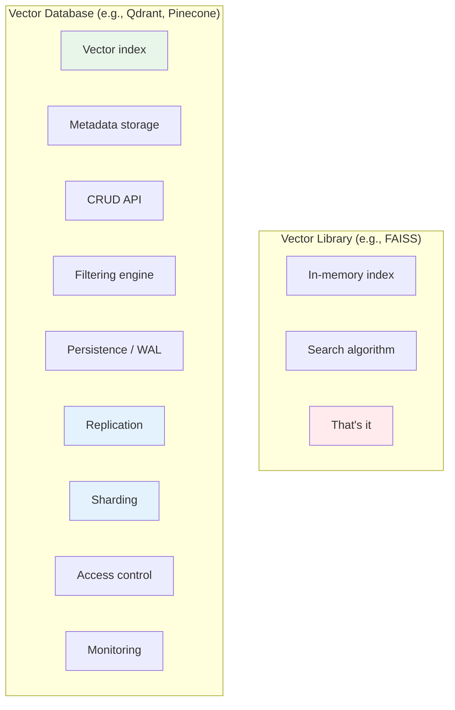
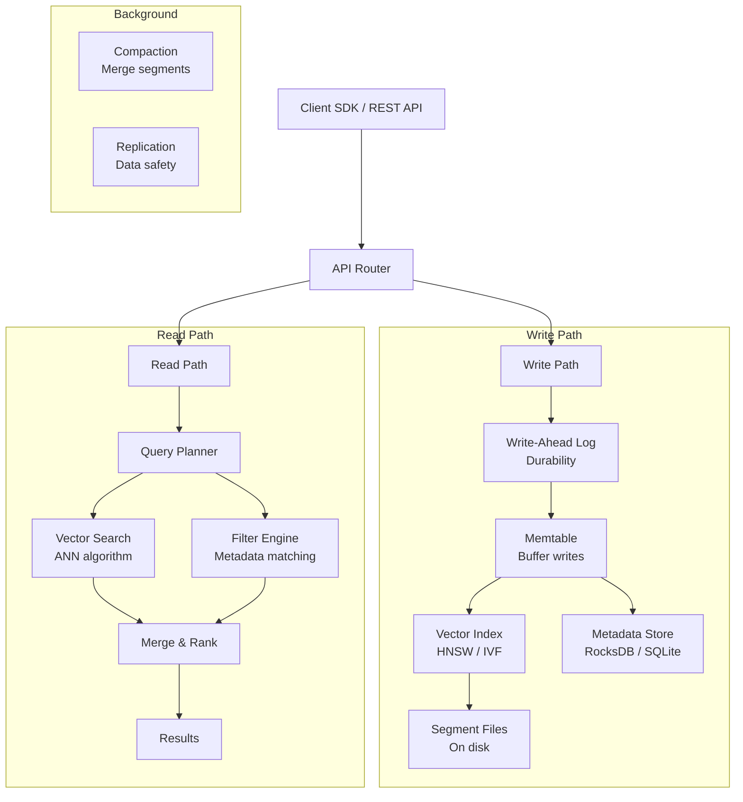
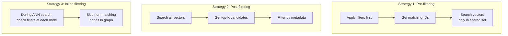
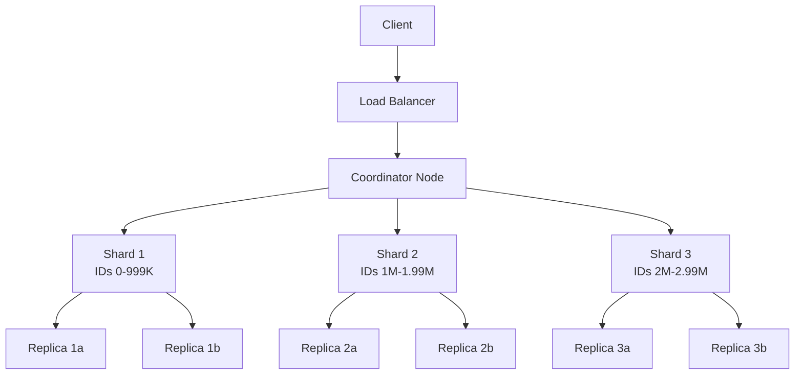

# 02.09 — Inside a Vector Database

> **One sentence:** A vector database is a specialized data system that combines vector indexes, metadata storage, CRUD operations, filtering, and distributed infrastructure — it's the difference between a FAISS index and a production-ready system.

---

## Vector Database vs. Vector Library



| Feature | FAISS (Library) | Qdrant (Database) | Pinecone (Managed) |
|---------|----------------|-------------------|-------------------|
| **In-memory search** | Yes | Yes | Yes |
| **Disk persistence** | Manual save/load | Built-in WAL | Managed |
| **Insert/update/delete** | Full rebuild | Real-time CRUD | Real-time CRUD |
| **Metadata filtering** | No | Yes (rich filters) | Yes |
| **Distributed** | Manual sharding | Built-in clustering | Serverless |
| **Access control** | None | API keys | API keys + IAM |
| **Monitoring** | None | Prometheus metrics | Dashboard |

---

## Architecture of a Vector Database



---

## Component 1: Write-Ahead Log (WAL)

**What it does:** Records every write operation BEFORE applying it. If the system crashes, replay the WAL to recover.

```python
# Conceptual WAL implementation
import json
import os

class WriteAheadLog:
    def __init__(self, path: str):
        self.path = path
        self.file = open(path, "a")
    
    def append(self, operation: dict):
        """Write operation to log before applying."""
        line = json.dumps(operation) + "\n"
        self.file.write(line)
        self.file.flush()
        os.fsync(self.file.fileno())  # Force to disk
    
    def replay(self):
        """Replay log entries to recover state after crash."""
        with open(self.path, "r") as f:
            for line in f:
                op = json.loads(line)
                yield op

# Usage in vector DB
wal = WriteAheadLog("/data/vectors.wal")

# Every upsert goes to WAL first
wal.append({
    "op": "upsert",
    "id": "doc_123",
    "vector": [0.1, 0.2, ...],
    "metadata": {"category": "tech"}
})
# THEN update the in-memory index
```

---

## Component 2: Segment Architecture

Vector databases store data in **segments** (similar to LSM trees in databases like Cassandra):

```
Segment Architecture:
─────────────────────

Active Segment (in memory, accepts writes)
  ├── Vector data: [v₁, v₂, v₃, ..., v₁₀₀₀]
  ├── HNSW graph: {node_id → [neighbor_ids]}
  ├── Metadata: {id → {key: value}}
  └── Delete bitmap: [0, 0, 1, 0, ...]  (1 = deleted)

Sealed Segment 1 (on disk, read-only)
  ├── vectors.bin (memory-mapped)
  ├── hnsw.graph  
  ├── metadata.db
  └── deletes.bitmap

Sealed Segment 2 (on disk, read-only)
  └── ...

Search = search ALL segments + merge results
```

```python
class Segment:
    """One segment of a vector database."""
    
    def __init__(self, max_size: int = 100_000):
        self.vectors = {}        # id → vector
        self.metadata = {}       # id → metadata dict
        self.deleted = set()     # deleted IDs
        self.index = None        # HNSW index
        self.max_size = max_size
        self.sealed = False
    
    def upsert(self, id: str, vector: list, meta: dict):
        if self.sealed:
            raise RuntimeError("Cannot write to sealed segment")
        self.vectors[id] = vector
        self.metadata[id] = meta
        # Rebuild index periodically (simplified)
    
    def delete(self, id: str):
        """Soft delete — mark as deleted, don't remove."""
        self.deleted.add(id)
    
    def search(self, query: list, k: int, filters: dict = None) -> list:
        """Search this segment."""
        # ANN search on index
        candidates = self.index.search(query, k=k * 2)  # Over-fetch
        
        # Filter out deleted and apply metadata filters
        results = []
        for score, id in candidates:
            if id in self.deleted:
                continue
            if filters and not self._matches_filter(id, filters):
                continue
            results.append((score, id, self.metadata[id]))
        
        return results[:k]
    
    def seal(self):
        """Stop accepting writes, optimize for reads."""
        self.sealed = True
        # Flush to disk, optimize index
```

---

## Component 3: Filtering Engine

The hard part: combine vector similarity with metadata filters efficiently.



```python
# The filtering dilemma
# 
# Pre-filtering:  
#   Good when filter is very selective (e.g., "brand = Nike" → 1% of data)
#   Bad when filter matches most data (unnecessary overhead)
#
# Post-filtering:
#   Good when filter is broad (most items match)
#   Bad when filter is very selective (might return 0 results after filtering!)
#
# Smart databases use BOTH and choose dynamically:

def smart_filter_strategy(filter_selectivity: float):
    """
    filter_selectivity = fraction of data matching the filter
    """
    if filter_selectivity < 0.01:
        return "pre-filter"   # Very selective → filter first
    elif filter_selectivity > 0.5:
        return "post-filter"  # Broad filter → search first
    else:
        return "inline"       # In between → check during search
```

---

## Component 4: Distributed Architecture



```python
# Distributed search flow (simplified)
class DistributedVectorDB:
    def __init__(self, shards: list):
        self.shards = shards  # Each shard is a separate vector index
    
    async def search(self, query: list, k: int = 10) -> list:
        """Search all shards in parallel, merge results."""
        import asyncio
        
        # Fan-out: search all shards simultaneously
        tasks = [
            shard.search(query, k=k)  # Each shard returns its top-k
            for shard in self.shards
        ]
        shard_results = await asyncio.gather(*tasks)
        
        # Fan-in: merge and re-rank
        all_results = []
        for results in shard_results:
            all_results.extend(results)
        
        # Sort by score and return global top-k
        all_results.sort(key=lambda x: x["score"], reverse=True)
        return all_results[:k]
```

### Sharding Strategies

| Strategy | How | Pros | Cons |
|----------|-----|------|------|
| **Random** | Hash(ID) % num_shards | Even distribution | Must query ALL shards |
| **By category** | Shard per category | Can skip irrelevant shards | Uneven sizes |
| **By time** | Shard per time window | Easy to archive old data | Recent shard is hot |

---

## Production Vector DB Comparison

```
                    Qdrant          Pinecone        Weaviate        Milvus
                    ──────          ────────        ────────        ──────
Language           Rust             ?               Go              Go/C++
Index types        HNSW             Proprietary     HNSW, Flat      IVF, HNSW, DiskANN
Filtering          Rich (pre+post)  Basic           GraphQL-like    Attribute filtering
Disk index         Yes (mmap)       Managed         Yes             DiskANN
Multi-tenancy      Payload-based    Namespaces      Class-based     Partitions
Hybrid search      Dense + Sparse   Dense only      Dense + BM25    Dense + Sparse
Open source        Yes (Apache 2)   No              Yes (BSD)       Yes (Apache 2)
Managed cloud      Yes              Yes             Yes             Zilliz Cloud
Max scale tested   100M+ vectors    1B+ vectors     100M+ vectors   1B+ vectors
```

---

## Building a Mini Vector DB

```python
"""
A minimal but functional vector database in ~100 lines.
Demonstrates: CRUD, persistence, HNSW search, metadata filtering.
"""
import json
import numpy as np
import hnswlib
from pathlib import Path

class MiniVectorDB:
    def __init__(self, dimension: int, path: str = "./mini_vdb"):
        self.dim = dimension
        self.path = Path(path)
        self.path.mkdir(exist_ok=True)
        
        self.vectors = {}      # id → vector
        self.metadata = {}     # id → metadata
        self.index = None
        self._id_to_int = {}   # string id → internal int id
        self._int_to_id = {}   # internal int id → string id
        self._next_int = 0
    
    def upsert(self, id: str, vector: list[float], metadata: dict = None):
        """Insert or update a vector."""
        self.vectors[id] = np.array(vector, dtype=np.float32)
        self.metadata[id] = metadata or {}
        
        if id not in self._id_to_int:
            self._id_to_int[id] = self._next_int
            self._int_to_id[self._next_int] = id
            self._next_int += 1
    
    def delete(self, id: str):
        """Delete a vector."""
        self.vectors.pop(id, None)
        self.metadata.pop(id, None)
    
    def build_index(self):
        """Build HNSW index from current vectors."""
        n = len(self.vectors)
        if n == 0:
            return
        
        self.index = hnswlib.Index(space="cosine", dim=self.dim)
        self.index.init_index(max_elements=max(n * 2, 1000), M=16, ef_construction=200)
        
        ids = []
        vecs = []
        for str_id, vec in self.vectors.items():
            int_id = self._id_to_int[str_id]
            ids.append(int_id)
            vecs.append(vec)
        
        self.index.add_items(np.array(vecs), np.array(ids))
        self.index.set_ef(50)
    
    def search(self, query: list[float], k: int = 10, 
               filters: dict = None) -> list[dict]:
        """Search with optional metadata filtering."""
        if self.index is None:
            self.build_index()
        
        # Over-fetch to account for filtering
        fetch_k = min(k * 5, len(self.vectors))
        
        labels, distances = self.index.knn_query(
            np.array([query], dtype=np.float32), k=fetch_k
        )
        
        results = []
        for i in range(len(labels[0])):
            int_id = labels[0][i]
            str_id = self._int_to_id.get(int_id)
            
            if str_id is None or str_id not in self.vectors:
                continue
            
            # Apply metadata filters
            if filters:
                meta = self.metadata.get(str_id, {})
                if not all(meta.get(k) == v for k, v in filters.items()):
                    continue
            
            results.append({
                "id": str_id,
                "score": 1 - distances[0][i],  # Convert distance to similarity
                "metadata": self.metadata.get(str_id, {})
            })
            
            if len(results) >= k:
                break
        
        return results
    
    def save(self):
        """Persist to disk."""
        data = {
            "vectors": {k: v.tolist() for k, v in self.vectors.items()},
            "metadata": self.metadata,
        }
        with open(self.path / "data.json", "w") as f:
            json.dump(data, f)
    
    def load(self):
        """Load from disk."""
        with open(self.path / "data.json", "r") as f:
            data = json.load(f)
        
        for id, vec in data["vectors"].items():
            self.upsert(id, vec, data["metadata"].get(id, {}))
        self.build_index()

# Usage
db = MiniVectorDB(dimension=1536)

db.upsert("doc1", get_embedding("Python programming"), {"lang": "python", "type": "tutorial"})
db.upsert("doc2", get_embedding("JavaScript web dev"),  {"lang": "js", "type": "tutorial"})
db.upsert("doc3", get_embedding("Python data science"), {"lang": "python", "type": "guide"})

db.build_index()

results = db.search(
    get_embedding("how to code in Python"),
    k=2,
    filters={"lang": "python"}
)
for r in results:
    print(f"  [{r['score']:.4f}] {r['id']} — {r['metadata']}")
```

---

## Key Takeaways

1. A vector DB is more than an index — it includes **persistence, CRUD, filtering, distribution**
2. **Write path:** WAL → memtable → sealed segments (like LSM trees)
3. **Read path:** search all segments in parallel, merge results
4. **Filtering** is the hardest problem — pre-filter, post-filter, or inline depending on selectivity
5. **Distributed** via sharding (split data) + replication (copies for safety)

---

## 💼 FAANG Interview Questions

1. *"Design the architecture of a vector database that handles 1 billion vectors."*
2. *"How would you handle a vector database that needs to support real-time inserts while serving low-latency queries?"*
3. *"Compare pre-filtering vs. post-filtering in vector search. When does each strategy fail?"*

## 🏋️ Exercise

Extend the `MiniVectorDB` above with:
1. Range filters (price > 10 AND price < 100)
2. Automatic index rebuilding when >1000 new vectors are added
3. Simple WAL for crash recovery
