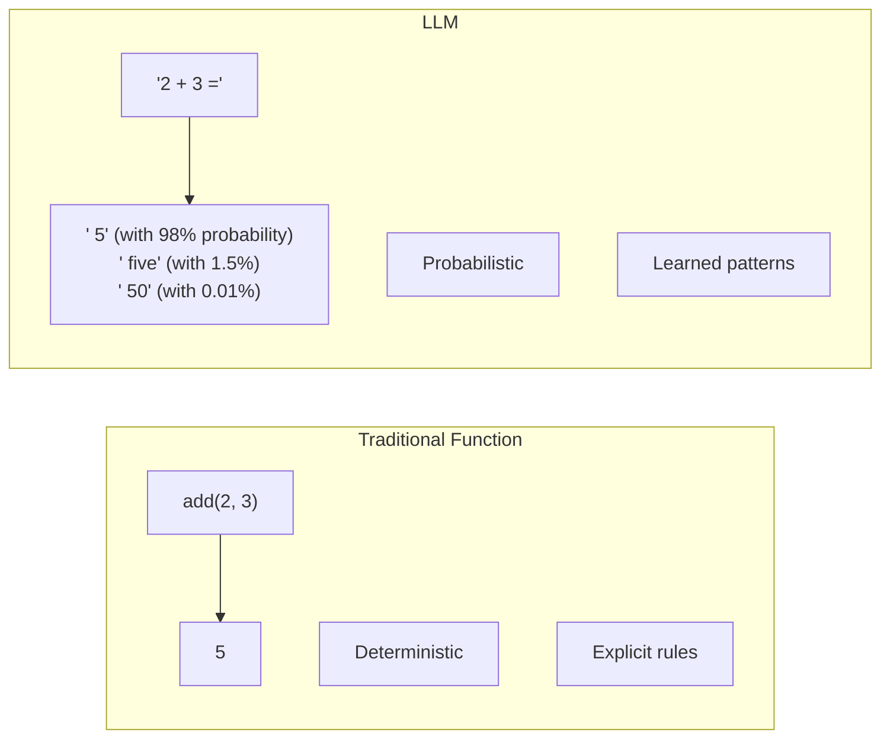
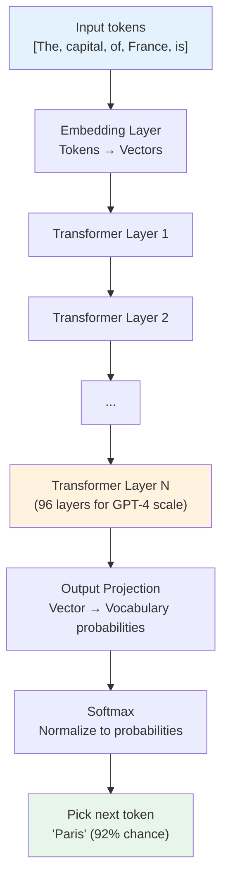
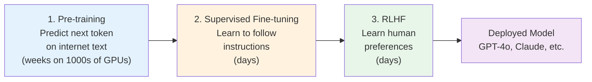

# 03.01 — What a Large Language Model Does

> **One sentence:** An LLM is a next-token prediction machine — given a sequence of tokens, it outputs the probability of every possible next token, and it's shockingly good at this one task.

---

## The Simplest Possible Explanation

```
Input:  "The capital of France is"
Output: {
  "Paris": 0.92,
  " the": 0.03,
  " a": 0.02,
  " located": 0.01,
  ... 200,000 other tokens with tiny probabilities
}
```

That's it. That's ALL an LLM does. Everything else — conversations, coding, reasoning — emerges from doing this one thing extremely well across billions of parameters.

---

## How It Differs from Traditional Software



| Traditional Code | LLM |
|-----------------|-----|
| Rules written by humans | Patterns learned from data |
| Same input → same output | Same input → usually same output (but not guaranteed) |
| Fails explicitly on unknown inputs | Always produces output (sometimes wrong) |
| Fast and cheap | Slow and expensive |
| Can't handle ambiguity | Handles ambiguity naturally |

---

## What's Inside the Box



### The Numbers

```
Model           Parameters      Training Data      Context Window
──────          ──────────      ─────────────      ──────────────
GPT-2            1.5B            40 GB text         1,024 tokens
GPT-3           175B             570 GB text        4,096 tokens
GPT-4       ~1.7T (est.)        ~13T tokens       128,000 tokens
Llama 3.1       405B            15T+ tokens        128,000 tokens
Claude 3.5      ~175B (est.)     unknown           200,000 tokens
```

---

## What "Understanding" Really Means

LLMs don't "understand" like humans. They recognize patterns:

```python
# The model has seen patterns like:
# "The capital of France is Paris"
# "The capital of Germany is Berlin"
# "The capital of Japan is Tokyo"
#
# So when you say "The capital of Spain is ___"
# It predicts "Madrid" because that pattern matches.
#
# This works surprisingly well for:
# - Factual knowledge (learned from training data)
# - Language structure (grammar, syntax)
# - Reasoning patterns (if X then Y)
# - Code patterns (function definitions, algorithms)
# - Conversation patterns (Q&A, dialogue)

# But it FAILS when:
# - The answer isn't in the training data
# - The answer changed after training (cutoff date)
# - The question requires genuine novel reasoning
# - The question is adversarial / trick question
```

---

## The Training Process (Simplified)



```python
# Stage 1: Pre-training objective
# Given: "The cat sat on the"
# Predict: "mat" (or any plausible next word)
# Do this for TRILLIONS of tokens from the internet

# Stage 2: Instruction fine-tuning
# Given: "Summarize this article: [article text]"
# Expected: A good summary
# This teaches the model to follow instructions

# Stage 3: RLHF (Reinforcement Learning from Human Feedback)
# Human rates two model outputs: "Which response is better?"
# Model learns to produce outputs humans prefer
# This makes it helpful, harmless, and honest
```

---

## Key Capabilities & Limitations

### What LLMs Are Good At

```python
# 1. LANGUAGE TASKS — the core strength
# Translation, summarization, Q&A, classification, generation

# 2. FEW-SHOT LEARNING — learn from examples in the prompt
response = client.chat.completions.create(
    model="gpt-4o",
    messages=[{"role": "user", "content": """
    Classify sentiment:
    "Great product!" → positive
    "Terrible experience" → negative
    "It was okay" → neutral
    "Best purchase ever!" → ???
    """}]
)
# Output: "positive" — learned the pattern from 3 examples!

# 3. REASONING — step-by-step problem solving
# "If a train leaves at 3pm going 60mph, and another at 4pm going 80mph..."
# The model can work through this step by step

# 4. CODE GENERATION — writing and debugging code
# "Write a Python function that sorts a list using merge sort"
```

### What LLMs Are Bad At

```python
# 1. MATH — unreliable for multi-step arithmetic
# "What is 7,923 × 4,817?" → Often wrong
# Solution: Use code execution (tool use)

# 2. CURRENT EVENTS — knowledge cutoff
# "Who won the 2025 Super Bowl?" → Doesn't know
# Solution: RAG (retrieval-augmented generation)

# 3. HALLUCINATION — confidently says wrong things
# "What's the capital of Molvania?" → Will make up an answer
# Solution: Grounding, citations, fact-checking

# 4. COUNTING — surprisingly bad at counting
# "How many r's in 'strawberry'?" → Often says 2 (it's 3)
# This is a tokenization issue, not a reasoning one
```

---

## Key Takeaways

1. **LLMs predict the next token** — that's the fundamental operation
2. **Everything is a token** — words, subwords, punctuation, code
3. **Capabilities emerge from scale** — bigger models can do more things
4. **Three training phases** — pre-training, instruction tuning, RLHF
5. **They're pattern matchers, not reasoning engines** — great at language, unreliable at math

---

## 💼 FAANG Interview Questions

1. *"Explain to a product manager how an LLM works in two sentences."*
2. *"Why do LLMs sometimes produce incorrect but confident-sounding answers?"*
3. *"What's the difference between GPT's pre-training and fine-tuning?"*
