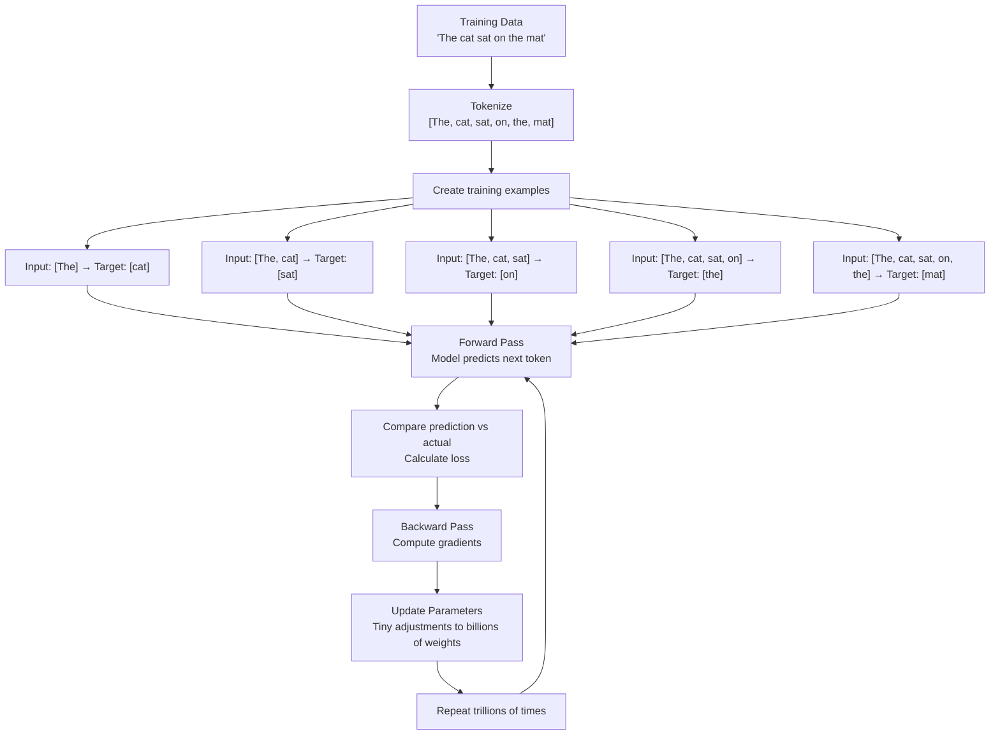

# 03.02 — How LLMs Learn and Generate Text

> **One sentence:** LLMs learn by adjusting billions of parameters to minimize prediction error across trillions of tokens — then generate text by sampling from the learned probability distribution one token at a time.

---

## Phase 1: Learning (Training)

### The Training Loop



```python
import torch
import torch.nn as nn

# Simplified training step
def training_step(model, tokens, optimizer):
    """
    One step of LLM training — this happens billions of times.
    """
    # Input: all tokens except the last
    # Target: all tokens except the first (shifted by 1)
    input_ids = tokens[:, :-1]     # "The cat sat on the"
    target_ids = tokens[:, 1:]      # "cat sat on the mat"
    
    # Forward pass — model predicts next token probabilities
    logits = model(input_ids)       # Shape: (batch, seq_len, vocab_size)
    
    # Calculate loss — how wrong was the prediction?
    loss_fn = nn.CrossEntropyLoss()
    loss = loss_fn(
        logits.reshape(-1, logits.size(-1)),  # Flatten
        target_ids.reshape(-1)                 # Flatten
    )
    
    # Backward pass — compute gradients
    loss.backward()
    
    # Update weights — tiny step in the direction that reduces loss
    optimizer.step()
    optimizer.zero_grad()
    
    return loss.item()

# This runs for weeks on thousands of GPUs
# GPT-4 training cost: estimated $100M+
# Training tokens: estimated 13 trillion
```

### What Does "Loss" Mean?

```python
# Cross-entropy loss measures: "How surprised was the model?"

# Low surprise (low loss): 
# Model predicted "Paris" with 90% confidence, and the answer WAS "Paris"
# Loss ≈ -log(0.90) = 0.105

# High surprise (high loss):
# Model predicted "Paris" with 1% confidence, but the answer WAS "Paris"  
# Loss ≈ -log(0.01) = 4.605

# Training goal: minimize total surprise across all training data
```

### The Learning Process Visualized

```
Training Progress:
──────────────────

Epoch 1: "The capital of France is ___"
  Model predicts: "blue" (random guess)  → Loss: 11.2

Epoch 1000: "The capital of France is ___"
  Model predicts: "the" (somewhat better) → Loss: 3.8

Epoch 100000: "The capital of France is ___"
  Model predicts: "Paris" (correct!)      → Loss: 0.3

The model doesn't memorize individual facts — it learns PATTERNS:
  "The capital of [COUNTRY] is [CITY]"
  "The CEO of [COMPANY] is [PERSON]"
  "To [VERB] in Python, use [FUNCTION]"
```

---

## Phase 2: Generating Text (Inference)

### Autoregressive Generation

```python
def generate_text(model, prompt: str, max_tokens: int = 50) -> str:
    """
    How LLMs generate text — one token at a time.
    """
    tokens = tokenize(prompt)
    
    for step in range(max_tokens):
        # 1. Run the FULL model on ALL tokens so far
        logits = model(tokens)  # → probabilities for next token
        
        # 2. Get probabilities for the LAST position only
        next_token_logits = logits[:, -1, :]  # (1, vocab_size)
        
        # 3. Convert to probabilities
        probs = torch.softmax(next_token_logits, dim=-1)
        
        # 4. Sample the next token
        next_token = torch.multinomial(probs, num_samples=1)
        
        # 5. Append to sequence
        tokens = torch.cat([tokens, next_token], dim=1)
        
        # 6. Stop if we hit end-of-sequence
        if next_token.item() == EOS_TOKEN:
            break
    
    return detokenize(tokens)
```

### Sampling Strategies

```python
import torch
import torch.nn.functional as F

def sample_next_token(logits, strategy="top_p", **kwargs):
    """Different ways to pick the next token."""
    
    if strategy == "greedy":
        # Always pick the most likely token
        # Deterministic but boring/repetitive
        return logits.argmax(dim=-1)
    
    elif strategy == "temperature":
        # Scale logits by temperature before softmax
        temp = kwargs.get("temperature", 1.0)
        probs = F.softmax(logits / temp, dim=-1)
        return torch.multinomial(probs, 1)
    
    elif strategy == "top_k":
        # Only consider the top K most likely tokens
        k = kwargs.get("k", 50)
        top_k_logits, top_k_indices = logits.topk(k)
        probs = F.softmax(top_k_logits, dim=-1)
        sampled = torch.multinomial(probs, 1)
        return top_k_indices.gather(-1, sampled)
    
    elif strategy == "top_p":
        # Nucleus sampling: include tokens until cumulative prob ≥ p
        p = kwargs.get("p", 0.9)
        sorted_logits, sorted_indices = logits.sort(descending=True)
        sorted_probs = F.softmax(sorted_logits, dim=-1)
        cumulative_probs = sorted_probs.cumsum(dim=-1)
        
        # Remove tokens with cumulative probability above threshold
        sorted_indices_to_remove = cumulative_probs > p
        sorted_indices_to_remove[..., 1:] = sorted_indices_to_remove[..., :-1].clone()
        sorted_indices_to_remove[..., 0] = False
        
        sorted_logits[sorted_indices_to_remove] = float('-inf')
        probs = F.softmax(sorted_logits, dim=-1)
        sampled = torch.multinomial(probs, 1)
        return sorted_indices.gather(-1, sampled)
```

### Comparison of Sampling Strategies

```
Prompt: "Once upon a time"

Greedy (temp=0):
  "Once upon a time, there was a young girl named Sarah who lived in 
   a small village. She was a kind and gentle soul who..."
  → Coherent but predictable and repetitive

Temperature=0.7 + top_p=0.9:
  "Once upon a time, in a kingdom perched atop shimmering crystal cliffs,
   there lived a curious inventor who spent her days..."
  → Creative and diverse, still coherent

Temperature=1.5:
  "Once upon a time, whiskers dancing through kaleidoscopic nebulae 
   while grandmother's typewriter sang operatic..."
  → Wild and often incoherent
```

---

## The Math Behind Next-Token Prediction

```python
import numpy as np

# Simplified: what happens at the output layer
def predict_next_token(hidden_state, output_weights, vocab_size=50000):
    """
    hidden_state:    (4096,) — the model's internal representation
    output_weights:  (50000, 4096) — one row per vocabulary token
    """
    # Step 1: Project hidden state to vocabulary space
    logits = output_weights @ hidden_state  # (50000,) — one score per token
    
    # Step 2: Convert to probabilities
    # Softmax: e^xi / Σ(e^xj) — makes everything sum to 1
    exp_logits = np.exp(logits - np.max(logits))  # Subtract max for numerical stability
    probabilities = exp_logits / exp_logits.sum()
    
    # Step 3: The highest probability token is the prediction
    predicted_token = np.argmax(probabilities)
    confidence = probabilities[predicted_token]
    
    print(f"Predicted token ID: {predicted_token}")
    print(f"Confidence: {confidence:.4f}")
    print(f"Top 5 tokens: {np.argsort(probabilities)[-5:][::-1]}")
    
    return predicted_token, probabilities
```

---

## Why Scale Matters

```
              1B params    10B params    100B params   1T params
              ─────────    ──────────    ───────────   ─────────
Spelling      Good         Good          Good          Good
Grammar       Good         Good          Good          Good
Translation   Okay         Good          Great         Great
Summarize     Poor         Good          Great         Excellent
Reasoning     Poor         Okay          Good          Great
Math          Poor         Poor          Okay          Good
Code          Poor         Okay          Good          Excellent
```

**Emergent abilities:** Some capabilities only appear above a certain parameter count. Below that threshold, performance is near-zero; above it, performance jumps dramatically.

---

## Key Takeaways

1. **Training = minimizing next-token prediction error** over trillions of examples
2. **Generation = sampling from learned probabilities** one token at a time
3. **Temperature** controls creativity (0 = deterministic, >1 = creative)
4. **Top-p (nucleus) sampling** is the most widely used strategy
5. **Scale unlocks capabilities** — bigger models can do qualitatively different things

---

## 💼 FAANG Interview Questions

1. *"Explain the difference between training and inference in an LLM."*
2. *"What is temperature in LLM generation? What happens at temperature 0 vs 2?"*
3. *"Why is autoregressive generation inherently sequential? Can you parallelize it?"*
