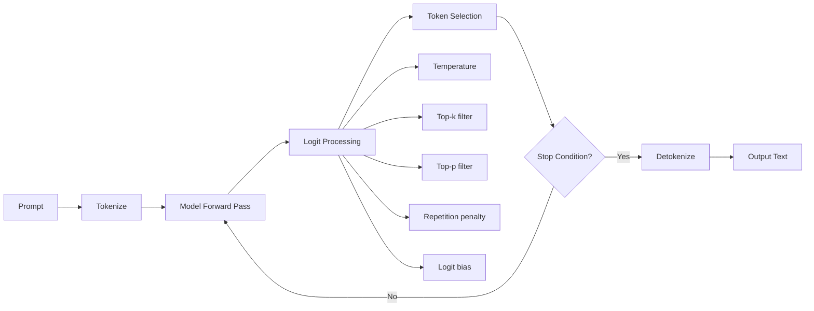

# 03.03 — LLM Text Generation

> **One sentence:** Text generation is a pipeline of decoding strategies, stopping conditions, and output constraints that turn raw token probabilities into useful, structured responses.

---

## The Generation Pipeline



---

## Decoding Strategies Deep Dive

### Greedy Decoding

```python
def greedy_decode(model, prompt_tokens, max_length=100):
    """Always pick the highest probability token."""
    tokens = prompt_tokens.copy()
    
    for _ in range(max_length):
        logits = model.forward(tokens)
        next_token = logits[-1].argmax()  # Highest probability
        
        if next_token == EOS:
            break
        tokens.append(next_token)
    
    return tokens

# Problem: greedy can miss globally better sequences
# "The best way" → greedy: "to do" → "it is" → boring
# Better path: "to approach" → "this problem" → interesting
```

### Beam Search

```python
def beam_search(model, prompt_tokens, beam_width=5, max_length=100):
    """
    Keep track of the top-K most promising sequences.
    Used in translation, summarization.
    """
    # Each beam: (score, token_sequence)
    beams = [(0.0, prompt_tokens.copy())]
    
    for step in range(max_length):
        all_candidates = []
        
        for score, tokens in beams:
            if tokens[-1] == EOS:
                all_candidates.append((score, tokens))
                continue
            
            logits = model.forward(tokens)
            log_probs = log_softmax(logits[-1])
            
            # Expand each beam with top-k next tokens
            top_k_tokens = log_probs.topk(beam_width)
            
            for token, log_prob in zip(top_k_tokens.indices, top_k_tokens.values):
                new_score = score + log_prob.item()
                new_tokens = tokens + [token.item()]
                all_candidates.append((new_score, new_tokens))
        
        # Keep only the best beams
        all_candidates.sort(key=lambda x: x[0], reverse=True)
        beams = all_candidates[:beam_width]
    
    # Return the best sequence
    return beams[0][1]
```

```
Beam Search Visualization (beam_width=3):

Step 1:  "The"  → "cat" (0.3)     "dog" (0.2)     "man" (0.15)
                    ↓                ↓                ↓
Step 2:          "sat" (0.7)     "ran" (0.5)      "walked" (0.4)
                 "is" (0.2)      "is" (0.3)       "is" (0.3)
                 "the" (0.05)    "the" (0.1)      "went" (0.2)

Top 3 beams after step 2:
  "The cat sat"   → cumulative score: 0.3 + 0.7 = 1.0
  "The dog ran"   → cumulative score: 0.2 + 0.5 = 0.7
  "The dog is"    → cumulative score: 0.2 + 0.3 = 0.5
```

### Nucleus Sampling (Top-p)

```python
def top_p_sample(logits, p=0.9, temperature=1.0):
    """
    Include tokens until cumulative probability reaches p.
    Dynamically adjusts the number of candidates.
    """
    # Apply temperature
    scaled_logits = logits / temperature
    probs = softmax(scaled_logits)
    
    # Sort by probability (descending)
    sorted_indices = probs.argsort(descending=True)
    sorted_probs = probs[sorted_indices]
    
    # Find cutoff
    cumsum = sorted_probs.cumsum(dim=0)
    cutoff_idx = (cumsum >= p).nonzero()[0].item()
    
    # Zero out everything after cutoff
    candidates = sorted_indices[:cutoff_idx + 1]
    candidate_probs = sorted_probs[:cutoff_idx + 1]
    
    # Renormalize and sample
    candidate_probs = candidate_probs / candidate_probs.sum()
    selected = candidates[torch.multinomial(candidate_probs, 1)]
    
    return selected

# Why top-p is better than top-k:
# 
# Top-k=50 always considers 50 tokens, even when:
#   - The model is 99% sure → should only consider 1-2 tokens
#   - The model is uncertain → should consider 100+ tokens
#
# Top-p=0.9 adapts dynamically:
#   - High confidence: p=0.9 might be reached with 2 tokens
#   - Low confidence: p=0.9 might need 200 tokens
```

---

## Controlling Output with Logit Manipulation

```python
def apply_logit_processors(logits, generated_tokens, config):
    """
    Modify logits BEFORE sampling to control output quality.
    """
    # 1. Repetition penalty — discourage repeating tokens
    if config.get("repetition_penalty", 1.0) != 1.0:
        penalty = config["repetition_penalty"]
        for token_id in set(generated_tokens):
            if logits[token_id] > 0:
                logits[token_id] /= penalty
            else:
                logits[token_id] *= penalty
    
    # 2. Frequency penalty — penalize tokens proportional to count
    if config.get("frequency_penalty", 0) > 0:
        from collections import Counter
        token_counts = Counter(generated_tokens)
        for token_id, count in token_counts.items():
            logits[token_id] -= config["frequency_penalty"] * count
    
    # 3. Presence penalty — penalize any token that appeared
    if config.get("presence_penalty", 0) > 0:
        for token_id in set(generated_tokens):
            logits[token_id] -= config["presence_penalty"]
    
    # 4. Logit bias — manually boost/suppress specific tokens
    if "logit_bias" in config:
        for token_id, bias in config["logit_bias"].items():
            logits[int(token_id)] += bias
    
    return logits
```

### Using Logit Bias in Practice

```python
import tiktoken

enc = tiktoken.encoding_for_model("gpt-4o")

# Force the model to NEVER say "I cannot" or "I'm sorry"
sorry_tokens = enc.encode("I'm sorry")
cannot_tokens = enc.encode("I cannot")

logit_bias = {}
for t in sorry_tokens + cannot_tokens:
    logit_bias[str(t)] = -100  # -100 = essentially impossible

response = client.chat.completions.create(
    model="gpt-4o",
    messages=[{"role": "user", "content": "Tell me something"}],
    logit_bias=logit_bias
)
```

---

## Stopping Conditions

```python
def should_stop(tokens, config) -> bool:
    """Various reasons to stop generating."""
    
    # 1. End of sequence token
    if tokens[-1] == EOS_TOKEN:
        return True
    
    # 2. Max tokens reached
    if len(tokens) >= config["max_tokens"]:
        return True  # finish_reason = "length" (truncated!)
    
    # 3. Stop sequences (custom strings)
    text = detokenize(tokens)
    for stop_seq in config.get("stop", []):
        if text.endswith(stop_seq):
            return True  # finish_reason = "stop"
    
    return False

# Using stop sequences
response = client.chat.completions.create(
    model="gpt-4o",
    messages=[{"role": "user", "content": "List 3 fruits:"}],
    stop=["\n4."]  # Stop before generating a 4th item
)
```

---

## Structured Output Generation

```python
# Force the model to output valid JSON

# Method 1: Instruction-based (unreliable)
response = client.chat.completions.create(
    model="gpt-4o",
    messages=[{
        "role": "user",
        "content": "Extract the name and age from: 'John is 30 years old'. Return JSON."
    }]
)

# Method 2: response_format (reliable with GPT-4o)
response = client.chat.completions.create(
    model="gpt-4o",
    messages=[{
        "role": "user",
        "content": "Extract the name and age from: 'John is 30 years old'"
    }],
    response_format={"type": "json_object"}
)
# Guaranteed valid JSON!

# Method 3: JSON Schema (most reliable)
from pydantic import BaseModel

class PersonInfo(BaseModel):
    name: str
    age: int
    occupation: str | None = None

response = client.beta.chat.completions.parse(
    model="gpt-4o",
    messages=[{
        "role": "user",
        "content": "Extract info: 'John is a 30-year-old engineer'"
    }],
    response_format=PersonInfo
)
person = response.choices[0].message.parsed
print(person.name)  # "John"
print(person.age)   # 30
```

---

## Generation Speed Bottleneck

```
Why is generation slow?

Step 1: Process prompt (PARALLEL)
  All prompt tokens processed simultaneously
  ← This is fast: 100 tokens ≈ same time as 1 token
  
Step 2: Generate tokens (SEQUENTIAL)
  Each new token needs ALL previous tokens
  Token 1: process [prompt]              → generate token_1
  Token 2: process [prompt, token_1]     → generate token_2
  Token 3: process [prompt, t1, t2]      → generate token_3
  ← This is slow: N tokens = N sequential forward passes

Time breakdown for a typical response:
  Prompt processing (1000 tokens): ~100ms
  Generation (200 tokens × 30ms each): ~6000ms
  Total: ~6100ms
  
  Generation is 98% of the total time!
```

---

## Key Takeaways

1. **Greedy** is deterministic but boring; **beam search** finds better global sequences
2. **Top-p (nucleus)** sampling adapts to model confidence — the standard in production
3. **Repetition/frequency penalties** prevent the model from looping
4. **Structured output** (JSON mode, schemas) ensures parseable responses
5. **Generation is inherently sequential** — the main speed bottleneck

---

## 💼 FAANG Interview Questions

1. *"Your chatbot starts repeating itself after long conversations. Diagnose and fix."*
2. *"When would you use beam search vs. nucleus sampling?"*
3. *"How would you guarantee that an LLM always outputs valid JSON?"*
