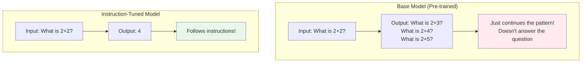
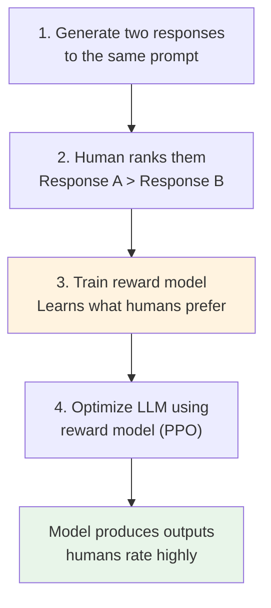
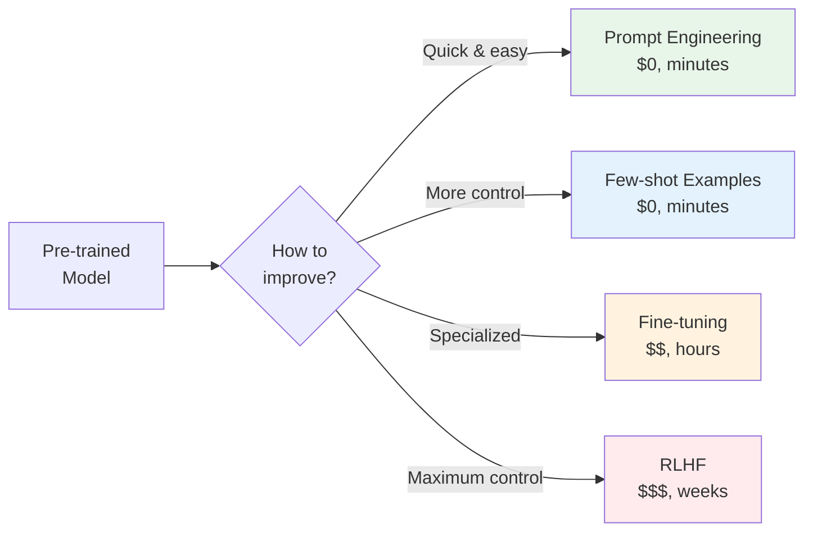

# 03.04 — Making a Model Useful

> **One sentence:** A pre-trained LLM just predicts the next token — you make it useful through instruction tuning, RLHF, prompting, and fine-tuning to solve specific problems reliably.

---

## The Gap Between "Can Predict Text" and "Is Useful"



---

## Step 1: Instruction Fine-Tuning (SFT)

```python
# Training data format for instruction tuning
training_examples = [
    {
        "instruction": "Summarize the following article in 2 sentences.",
        "input": "The James Webb Space Telescope has captured unprecedented images...",
        "output": "The James Webb Space Telescope has revealed new details about..."
    },
    {
        "instruction": "Translate to French.",
        "input": "Hello, how are you?",
        "output": "Bonjour, comment allez-vous ?"
    },
    {
        "instruction": "Write Python code that sorts a list.",
        "input": "",
        "output": "def sort_list(lst):\n    return sorted(lst)"
    },
    # ... 10,000 - 100,000 such examples
]

# The model learns: when someone gives you an instruction, FOLLOW IT
# Instead of continuing the text, it answers the question
```

### Popular Instruction Datasets

| Dataset | Size | Source | Quality |
|---------|------|--------|---------|
| **Alpaca** | 52K | GPT-3.5 generated | Medium |
| **Dolly** | 15K | Databricks employees | High |
| **OpenAssistant** | 161K | Crowdsourced | Mixed |
| **ShareGPT** | 90K | User-shared conversations | High |
| **FLAN** | 15M+ | Google research | Very high |

---

## Step 2: RLHF (Reinforcement Learning from Human Feedback)



```python
# Conceptual: reward model training
class RewardModel:
    """Learns to predict human preference scores."""
    
    def score(self, prompt: str, response: str) -> float:
        """Score a response — higher = humans would prefer this."""
        # Returns a scalar score
        # Trained on human comparison data:
        #   "Given this prompt, humans preferred response A over B"
        pass

# Training pairs look like:
# Prompt: "Explain quantum computing"
# Response A: "Quantum computing uses qubits that can be 0, 1, or both..."
# Response B: "Quantum computing is super complicated and you wouldn't understand."
# Human preference: A > B
# Reward model learns: helpful, clear, non-condescending → higher score
```

### What RLHF Optimizes For

```
Before RLHF:
  ✗ Generates harmful content if prompted
  ✗ Makes up answers confidently  
  ✗ Gives overly verbose responses
  ✗ Ignores safety instructions

After RLHF:
  ✓ Refuses harmful requests politely
  ✓ Says "I don't know" when uncertain
  ✓ Gives concise, helpful responses
  ✓ Follows safety guidelines

The alignment tax: sometimes RLHF makes the model overly cautious
  "How do I kill a Python process?" → "I can't help with violence"
  This is a known failure mode called "over-refusal"
```

---

## Step 3: Prompt Engineering (Your Main Tool)

### System Prompts — Setting the Stage

```python
# The system prompt is your most powerful tool
response = client.chat.completions.create(
    model="gpt-4o",
    messages=[
        {
            "role": "system",
            "content": """You are a senior Python developer at Google.

Rules:
1. Always write production-quality code with type hints
2. Include error handling for every function  
3. Add docstrings in Google style
4. If a question is ambiguous, ask for clarification
5. Never use deprecated APIs

When reviewing code, use this format:
🔴 Critical: [issue]
🟡 Warning: [issue]  
🟢 Good: [positive observation]"""
        },
        {"role": "user", "content": "Review this code: def add(a,b): return a+b"}
    ]
)
```

### Few-Shot Prompting — Teaching by Example

```python
def classify_with_examples(text: str) -> str:
    """Use few-shot examples to teach classification."""
    response = client.chat.completions.create(
        model="gpt-4o",
        messages=[
            {"role": "system", "content": "Classify customer feedback."},
            
            # Example 1
            {"role": "user", "content": "The app crashes every time I open it"},
            {"role": "assistant", "content": "category: bug\nurgency: high\nsentiment: negative"},
            
            # Example 2
            {"role": "user", "content": "It would be nice to have dark mode"},
            {"role": "assistant", "content": "category: feature_request\nurgency: low\nsentiment: neutral"},
            
            # Example 3
            {"role": "user", "content": "Your support team was incredibly helpful!"},
            {"role": "assistant", "content": "category: praise\nurgency: none\nsentiment: positive"},
            
            # Actual input
            {"role": "user", "content": text}
        ],
        temperature=0
    )
    return response.choices[0].message.content
```

### Chain-of-Thought — Making the Model Think

```python
# Without CoT:
# "Roger has 5 balls. He buys 2 more. He gives 3 to Bob. How many does he have?"
# Model might say: "4" (wrong!)

# With CoT:
response = client.chat.completions.create(
    model="gpt-4o",
    messages=[{
        "role": "user",
        "content": """Roger has 5 balls. He buys 2 more cans of 3 tennis balls each. 
        He gives 3 to Bob. How many does he have?
        
        Think step by step."""
    }]
)
# Output:
# Step 1: Roger starts with 5 balls
# Step 2: He buys 2 cans × 3 balls = 6 new balls
# Step 3: Total so far: 5 + 6 = 11 balls
# Step 4: He gives 3 to Bob: 11 - 3 = 8 balls
# Answer: 8 balls ✓
```

---

## Step 4: Fine-Tuning (When Prompting Isn't Enough)

```python
# When to fine-tune vs. prompt:
#
# Use PROMPTING when:
#   - Task is general (summarization, Q&A, classification)
#   - You have < 100 examples
#   - You need flexibility to change behavior quickly
#   - Budget is limited
#
# Use FINE-TUNING when:
#   - Task is very specific (your company's coding style)
#   - You have 1000+ high-quality examples
#   - Prompt is getting too long (saving tokens = saving money)
#   - You need consistent formatting
#   - Latency matters (shorter prompts = faster responses)

# OpenAI fine-tuning example
from openai import OpenAI
client = OpenAI()

# Prepare training data (JSONL file)
# Each line:
# {"messages": [
#     {"role": "system", "content": "You classify support tickets."},
#     {"role": "user", "content": "My payment failed"},
#     {"role": "assistant", "content": "billing"}
# ]}

# Upload and create fine-tuning job
file = client.files.create(file=open("training.jsonl"), purpose="fine-tune")

job = client.fine_tuning.jobs.create(
    training_file=file.id,
    model="gpt-4o-mini-2024-07-18"
)

# After training (hours later):
# Use your fine-tuned model
response = client.chat.completions.create(
    model="ft:gpt-4o-mini-2024-07-18:my-org::abc123",  # Your model ID
    messages=[{"role": "user", "content": "I can't log in to my account"}]
)
```

---

## Comparison: Making Models Useful



| Method | Cost | Time | Flexibility | Quality Ceiling |
|--------|------|------|-------------|----------------|
| **Zero-shot prompt** | Free | Seconds | Very high | Medium |
| **Few-shot prompt** | Free | Minutes | High | High |
| **System prompt** | Free | Minutes | High | High |
| **Fine-tuning** | $5-500 | Hours | Medium | Very high |
| **RLHF** | $10K-1M | Weeks | Low | Highest |

---

## Key Takeaways

1. **Base models just continue text** — instruction tuning makes them follow directions
2. **RLHF makes models helpful and safe** — but can over-restrict (alignment tax)
3. **Prompt engineering is your 80/20** — it gets you most of the way for free
4. **Fine-tune only when prompting isn't enough** — it's expensive and inflexible
5. **Chain-of-thought dramatically improves reasoning** — just add "think step by step"

---

## 💼 FAANG Interview Questions

1. *"Your LLM-powered chatbot gives inconsistent answers. How do you improve consistency?"*
2. *"When would you fine-tune a model instead of using prompt engineering?"*
3. *"Explain RLHF to a non-technical stakeholder."*
