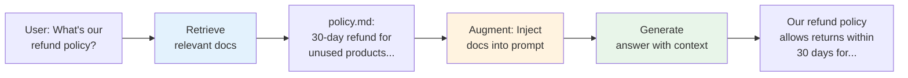
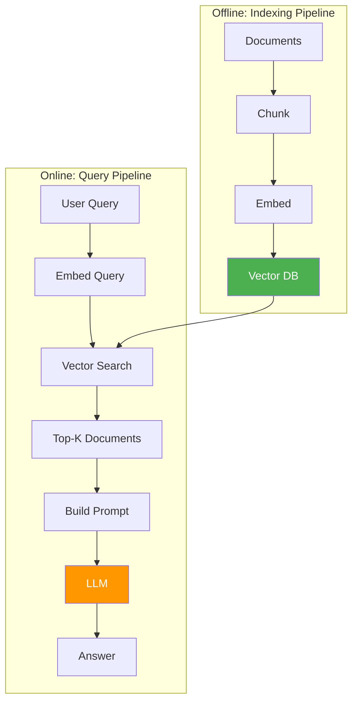
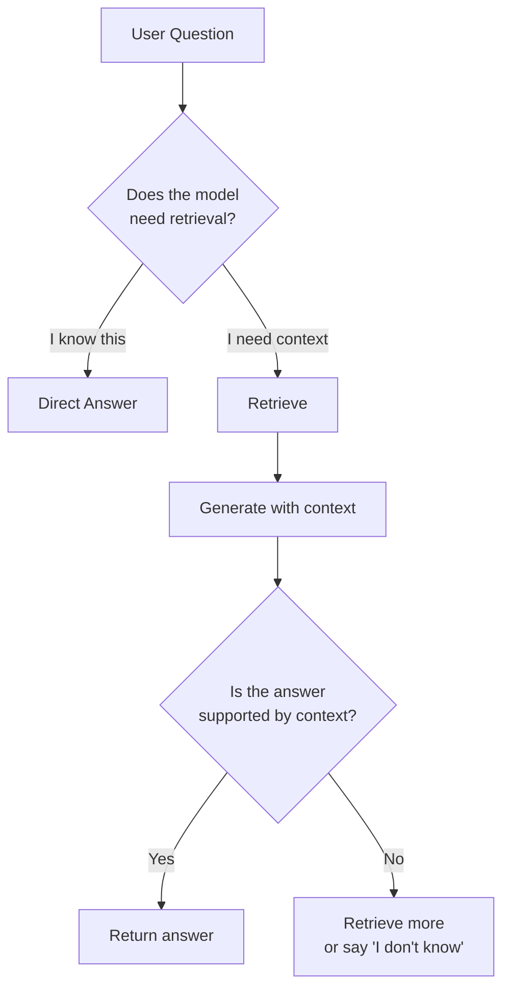

# 03.05 — Retrieval-Augmented Generation (RAG)

> **One sentence:** RAG connects an LLM to external data by retrieving relevant documents and injecting them into the prompt — giving the model up-to-date, accurate information without retraining.

---

## Why RAG Exists

```
Problem: LLMs have a knowledge cutoff date and don't know YOUR data.

"What's our refund policy?"   → LLM: "I don't know your company's policy."
"What happened yesterday?"    → LLM: "My training data ends in April 2024."
"What's in document XYZ?"     → LLM: "I haven't seen that document."

Solution: RETRIEVE the relevant info, then AUGMENT the prompt with it.
```



---

## The RAG Architecture



---

## Complete RAG Implementation

```python
"""
Production RAG system — from scratch.
"""
from openai import OpenAI
from qdrant_client import QdrantClient
from qdrant_client.models import Distance, VectorParams, PointStruct
import hashlib

client = OpenAI()
qdrant = QdrantClient(":memory:")  # In-memory for demo

# ─── STEP 1: Chunking ────────────────────────────────────
def chunk_document(text: str, chunk_size: int = 500, overlap: int = 100) -> list[dict]:
    """Split document into overlapping chunks with metadata."""
    chunks = []
    start = 0
    chunk_id = 0
    
    while start < len(text):
        end = min(start + chunk_size, len(text))
        
        # Try to break at sentence boundary
        if end < len(text):
            for sep in ['. ', '? ', '! ', '\n\n', '\n']:
                last_sep = text[start:end].rfind(sep)
                if last_sep > chunk_size // 2:
                    end = start + last_sep + len(sep)
                    break
        
        chunk_text = text[start:end].strip()
        if chunk_text:
            chunks.append({
                "id": hashlib.md5(chunk_text.encode()).hexdigest()[:16],
                "text": chunk_text,
                "start_char": start,
                "end_char": end,
                "chunk_index": chunk_id
            })
            chunk_id += 1
        
        start = end - overlap
    
    return chunks

# ─── STEP 2: Embedding ───────────────────────────────────
def embed_texts(texts: list[str]) -> list[list[float]]:
    """Batch embed texts."""
    response = client.embeddings.create(
        model="text-embedding-3-small",
        input=texts
    )
    return [item.embedding for item in response.data]

# ─── STEP 3: Indexing ────────────────────────────────────
def index_documents(documents: list[dict]):
    """Store document chunks in vector database."""
    # Create collection
    qdrant.recreate_collection(
        collection_name="knowledge_base",
        vectors_config=VectorParams(size=1536, distance=Distance.COSINE)
    )
    
    all_chunks = []
    for doc in documents:
        chunks = chunk_document(doc["text"])
        for chunk in chunks:
            chunk["source"] = doc["title"]
        all_chunks.extend(chunks)
    
    # Batch embed
    texts = [c["text"] for c in all_chunks]
    embeddings = embed_texts(texts)
    
    # Store in Qdrant
    points = [
        PointStruct(
            id=i,
            vector=embeddings[i],
            payload={
                "text": all_chunks[i]["text"],
                "source": all_chunks[i]["source"],
                "chunk_index": all_chunks[i]["chunk_index"]
            }
        )
        for i in range(len(all_chunks))
    ]
    
    qdrant.upsert(collection_name="knowledge_base", points=points)
    print(f"Indexed {len(points)} chunks from {len(documents)} documents")

# ─── STEP 4: Retrieval ───────────────────────────────────
def retrieve(query: str, top_k: int = 5) -> list[dict]:
    """Find relevant chunks for a query."""
    query_embedding = embed_texts([query])[0]
    
    results = qdrant.search(
        collection_name="knowledge_base",
        query_vector=query_embedding,
        limit=top_k
    )
    
    return [
        {
            "text": r.payload["text"],
            "source": r.payload["source"],
            "score": r.score
        }
        for r in results
    ]

# ─── STEP 5: Generation ──────────────────────────────────
def rag_answer(question: str, top_k: int = 5) -> dict:
    """Full RAG pipeline: retrieve → augment → generate."""
    # Retrieve relevant context
    contexts = retrieve(question, top_k=top_k)
    
    # Build context string with sources
    context_str = ""
    for i, ctx in enumerate(contexts):
        context_str += f"\n--- Source: {ctx['source']} (relevance: {ctx['score']:.2f}) ---\n"
        context_str += ctx["text"] + "\n"
    
    # Generate answer with context
    response = client.chat.completions.create(
        model="gpt-4o",
        messages=[
            {
                "role": "system",
                "content": f"""Answer the user's question based ONLY on the following context.
If the answer is not in the context, say "I don't have enough information to answer that."
Always cite which source document you used.

Context:
{context_str}"""
            },
            {"role": "user", "content": question}
        ],
        temperature=0
    )
    
    return {
        "answer": response.choices[0].message.content,
        "sources": [ctx["source"] for ctx in contexts],
        "context_used": len(contexts),
        "tokens_used": response.usage.total_tokens
    }

# ─── Usage ────────────────────────────────────────────────
# Index your documents
index_documents([
    {
        "title": "Refund Policy",
        "text": "Our refund policy allows returns within 30 days of purchase. Products must be unused and in original packaging. Refunds are processed within 5 business days."
    },
    {
        "title": "Shipping Guide", 
        "text": "We ship to 45 countries. Standard shipping takes 5-7 business days. Express shipping is available for $15 and takes 2-3 business days."
    }
])

# Ask a question
result = rag_answer("How long do refunds take?")
print(result["answer"])
# "Based on the Refund Policy, refunds are processed within 5 business days. 
#  Products must be returned within 30 days of purchase in unused condition 
#  with original packaging. [Source: Refund Policy]"
```

---

## Advanced RAG Techniques

### 1. Hybrid Search (Vector + Keyword)

```python
def hybrid_search(query: str, top_k: int = 5) -> list:
    """Combine semantic search with keyword matching (BM25)."""
    # Semantic results
    semantic_results = vector_search(query, top_k=top_k * 2)
    
    # Keyword results (BM25)
    keyword_results = bm25_search(query, top_k=top_k * 2)
    
    # Reciprocal Rank Fusion (RRF) to combine
    scores = {}
    k = 60  # RRF constant
    
    for rank, doc in enumerate(semantic_results):
        scores[doc.id] = scores.get(doc.id, 0) + 1 / (k + rank + 1)
    
    for rank, doc in enumerate(keyword_results):
        scores[doc.id] = scores.get(doc.id, 0) + 1 / (k + rank + 1)
    
    # Sort by combined score
    ranked = sorted(scores.items(), key=lambda x: x[1], reverse=True)
    return ranked[:top_k]
```

### 2. Multi-Query RAG

```python
def multi_query_retrieve(question: str, top_k: int = 5) -> list:
    """Generate multiple search queries to improve recall."""
    # Use LLM to generate query variations
    response = client.chat.completions.create(
        model="gpt-4o-mini",
        messages=[{
            "role": "user",
            "content": f"""Generate 3 different search queries for: "{question}"
            Return one query per line."""
        }]
    )
    
    queries = [question] + response.choices[0].message.content.strip().split("\n")
    
    # Search with each query and combine
    all_results = {}
    for q in queries:
        results = retrieve(q, top_k=top_k)
        for r in results:
            key = r["text"][:100]
            if key not in all_results or r["score"] > all_results[key]["score"]:
                all_results[key] = r
    
    ranked = sorted(all_results.values(), key=lambda x: x["score"], reverse=True)
    return ranked[:top_k]
```

### 3. Self-RAG (Model Decides What to Retrieve)



---

## RAG Evaluation

```python
def evaluate_rag(test_cases: list[dict]) -> dict:
    """Evaluate RAG system quality."""
    metrics = {
        "retrieval_precision": [],  # Did we retrieve relevant docs?
        "answer_correctness": [],   # Is the answer right?
        "faithfulness": [],         # Is the answer grounded in context?
    }
    
    for test in test_cases:
        # Get RAG answer
        result = rag_answer(test["question"])
        contexts = retrieve(test["question"])
        
        # Check retrieval: did we find the right documents?
        expected_source = test["expected_source"]
        retrieved_sources = [c["source"] for c in contexts]
        precision = 1 if expected_source in retrieved_sources else 0
        metrics["retrieval_precision"].append(precision)
        
        # Check answer: does it contain expected information?
        expected_answer = test["expected_answer"]
        if expected_answer.lower() in result["answer"].lower():
            metrics["answer_correctness"].append(1)
        else:
            metrics["answer_correctness"].append(0)
        
        # Check faithfulness: is the answer based on retrieved context?
        # (This often requires an LLM judge)
        metrics["faithfulness"].append(
            check_faithfulness(result["answer"], contexts)
        )
    
    return {k: sum(v)/len(v) for k, v in metrics.items()}
```

---

## Common RAG Failures and Fixes

| Problem | Symptom | Fix |
|---------|---------|-----|
| **Bad chunking** | Relevant info split across chunks | Overlap chunks, use semantic chunking |
| **Embedding mismatch** | Query and doc styles differ | Use HyDE, query rewriting |
| **Not enough context** | Answer is incomplete | Increase top_k, use multi-query |
| **Too much context** | Exceeds context window | Better ranking, summarize before injecting |
| **Wrong docs retrieved** | Irrelevant context confuses model | Hybrid search, re-ranking |
| **Hallucination** | Model ignores context | Stronger system prompt, lower temperature |

---

## Key Takeaways

1. **RAG = Retrieve + Augment + Generate** — external knowledge for LLMs
2. **Chunking is critical** — bad chunks = bad retrieval = wrong answers
3. **Hybrid search** (semantic + keyword) outperforms either alone
4. **Evaluate all three stages** — retrieval quality, answer correctness, faithfulness
5. **RAG is cheaper than fine-tuning** and works with any new data immediately

---

## 💼 FAANG Interview Questions

1. *"Design a RAG system for a company with 100,000 internal documents."*
2. *"Your RAG chatbot sometimes ignores the retrieved context. Why and how to fix?"*
3. *"Compare RAG vs. fine-tuning. When would you use each?"*
