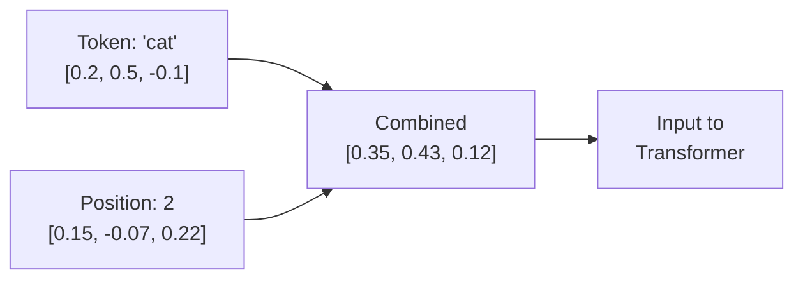

# 04.01 — Positional Embeddings

> **One sentence:** Transformers have no built-in notion of word order — positional embeddings inject sequence information so the model knows that "dog bites man" is different from "man bites dog."

---

## The Problem: Transformers Are Order-Blind

```python
# Without positional information, these look identical to a transformer:
sentence_1 = ["The", "cat", "ate", "the", "fish"]
sentence_2 = ["The", "fish", "ate", "the", "cat"]
# Same bag of tokens! But VERY different meanings.

# Positional embeddings add position information:
# Token embedding for "cat" + Position embedding for "position 2"
# vs.
# Token embedding for "cat" + Position embedding for "position 5"
# Now they're distinguishable!
```



---

## Method 1: Sinusoidal Positional Encoding (Original Transformer)

```python
import numpy as np

def sinusoidal_position_encoding(max_len: int, d_model: int) -> np.ndarray:
    """
    Original transformer (Vaswani et al., 2017).
    
    PE(pos, 2i)   = sin(pos / 10000^(2i/d_model))
    PE(pos, 2i+1) = cos(pos / 10000^(2i/d_model))
    
    Each position gets a unique pattern of sines and cosines.
    """
    PE = np.zeros((max_len, d_model))
    
    for pos in range(max_len):
        for i in range(0, d_model, 2):
            denominator = 10000 ** (i / d_model)
            PE[pos, i]     = np.sin(pos / denominator)
            PE[pos, i + 1] = np.cos(pos / denominator)
    
    return PE

# Visualize
pe = sinusoidal_position_encoding(50, 128)
print(f"Shape: {pe.shape}")  # (50, 128) — 50 positions, 128 dimensions

# Properties:
# 1. Fixed (not learned) — no parameters to train
# 2. Unique for each position — position 0 ≠ position 1
# 3. Relative distances preserved — PE(pos+k) can be expressed as a function of PE(pos)
# 4. Can extrapolate — works for sequences longer than training data (in theory)
```

### Why Sines and Cosines?

```
Position 0:  sin(0)=0.00,  cos(0)=1.00,  sin(0)=0.00,  cos(0)=1.00, ...
Position 1:  sin(1)=0.84,  cos(1)=0.54,  sin(0.01)=0.01, cos(0.01)=1.00, ...
Position 2:  sin(2)=0.91,  cos(2)=-0.42, sin(0.02)=0.02, cos(0.02)=1.00, ...

Low dimensions change rapidly (capture fine positions)
High dimensions change slowly (capture broad positions)

Like a clock: second hand (fast) + minute hand (slow) + hour hand (slower)
Each combination uniquely identifies a point in time!
```

---

## Method 2: Learned Positional Embeddings (GPT-2, BERT)

```python
import torch
import torch.nn as nn

class LearnedPositionalEmbedding(nn.Module):
    """
    GPT-2 and BERT use learned positional embeddings.
    Each position gets its own trainable vector.
    """
    
    def __init__(self, max_len: int, d_model: int):
        super().__init__()
        # Just a lookup table! Learned during training.
        self.position_embeddings = nn.Embedding(max_len, d_model)
    
    def forward(self, x):
        seq_len = x.size(1)
        positions = torch.arange(seq_len, device=x.device)
        return x + self.position_embeddings(positions)

# Limitation: MAX position is fixed at training time
# GPT-2: max 1024 positions → can't handle 1025+ tokens
# This is why GPT-2 has a 1024-token context window
```

---

## Method 3: Rotary Position Embedding (RoPE) — The Modern Standard

```python
import torch
import torch.nn as nn

def precompute_rope_frequencies(dim: int, max_seq_len: int, theta: float = 10000.0):
    """
    RoPE (Rotary Position Embedding) — used by Llama, Mistral, GPT-NeoX.
    
    Instead of ADDING position info, RoPE ROTATES the embedding vectors.
    Position k rotates the vector by angle k × frequency.
    
    Key advantage: relative positions are naturally encoded.
    """
    # Compute frequencies for each dimension pair
    freqs = 1.0 / (theta ** (torch.arange(0, dim, 2).float() / dim))
    
    # Create position × frequency matrix
    positions = torch.arange(max_seq_len)
    angles = torch.outer(positions, freqs)  # (max_seq_len, dim/2)
    
    # Create rotation matrices (as complex numbers)
    cos_angles = torch.cos(angles)
    sin_angles = torch.sin(angles)
    
    return cos_angles, sin_angles

def apply_rope(x, cos, sin):
    """
    Apply rotary embeddings to query/key vectors.
    
    For each pair of dimensions (x₁, x₂), apply 2D rotation:
    x₁' = x₁ × cos(θ) - x₂ × sin(θ)
    x₂' = x₁ × sin(θ) + x₂ × cos(θ)
    """
    # Split into pairs
    x1 = x[..., ::2]   # Even dimensions
    x2 = x[..., 1::2]  # Odd dimensions
    
    # Apply rotation
    x1_rot = x1 * cos - x2 * sin
    x2_rot = x1 * sin + x2 * cos
    
    # Interleave back
    return torch.stack([x1_rot, x2_rot], dim=-1).flatten(-2)

# Why RoPE is dominant:
# 1. Encodes RELATIVE position naturally (q·k depends on position difference)
# 2. Can extend to longer sequences with NTK-aware scaling
# 3. No extra parameters
# 4. Compatible with KV cache (positions don't need to be contiguous)
```

### RoPE Intuition

```
Imagine a clock hand:
  - Position 0: pointing at 12 o'clock (0°)
  - Position 1: rotated slightly (10°)
  - Position 2: rotated more (20°)
  
When computing attention between positions 5 and 3:
  The angle BETWEEN them (20°) depends only on the DISTANCE (2)
  Not on the absolute positions (5 and 3)
  
This is why RoPE naturally encodes RELATIVE positions!

For different dimensions, rotation speeds vary:
  Dim 0-1: fast rotation (captures nearby positions)
  Dim 2-3: medium rotation
  Dim D-1, D: slow rotation (captures distant positions)
```

---

## Method 4: ALiBi (Attention with Linear Biases)

```python
def alibi_bias(num_heads: int, max_seq_len: int):
    """
    ALiBi: Don't modify embeddings at all.
    Instead, subtract a linear bias from attention scores.
    
    Bias = -m × |position_i - position_j|
    where m is different for each head.
    
    Used by: BLOOM, MPT
    """
    # Each head gets a different slope
    slopes = 2 ** (-(8 / num_heads) * torch.arange(1, num_heads + 1))
    
    # Create distance matrix
    positions = torch.arange(max_seq_len)
    distance = torch.abs(positions.unsqueeze(0) - positions.unsqueeze(1))
    
    # Bias for each head
    biases = -slopes.unsqueeze(-1).unsqueeze(-1) * distance.unsqueeze(0)
    
    return biases  # Shape: (num_heads, max_seq_len, max_seq_len)

# ALiBi advantages:
# 1. Zero parameters for position encoding
# 2. Naturally extrapolates to longer sequences
# 3. Simple implementation
# 
# ALiBi disadvantages:
# 1. Performance slightly lower than RoPE on some benchmarks
# 2. Less popular → less tooling support
```

---

## Comparison

| Method | Parameters | Extrapolation | Used By | Year |
|--------|-----------|---------------|---------|------|
| **Sinusoidal** | 0 | Moderate | Original Transformer | 2017 |
| **Learned** | max_len × d | None | GPT-2, BERT | 2018 |
| **RoPE** | 0 | Good (with scaling) | Llama, Mistral, Phi | 2021 |
| **ALiBi** | 0 | Excellent | BLOOM, MPT | 2021 |

---

## Extending Context Length with RoPE

```python
# Modern LLMs extend context with RoPE scaling techniques

# 1. Position Interpolation (PI)
# Scale all positions to fit within original range
# Original: trained on 4K → can extend to 32K
# Position 32000 → treated as position 4000 × (4000/32000) = 500

# 2. NTK-aware Scaling  
# Change the base frequency (theta) to spread out rotations
# theta_new = theta × scale_factor^(dim/(dim-2))
# Better preserves nearby position resolution

# 3. YaRN (Yet another RoPE extensioN)
# Combines NTK scaling with attention scaling
# Best performing method for extending context

# Llama 3.1 uses these techniques to go from 8K → 128K context
```

---

## Key Takeaways

1. **Transformers need explicit position information** — they're order-blind by default
2. **RoPE is the modern standard** — used by most recent LLMs
3. **RoPE encodes relative positions** naturally through rotation
4. **Context extension** is possible by scaling RoPE frequencies
5. **No method is perfect** — all have tradeoffs between quality and extrapolation

---

## 💼 FAANG Interview Questions

1. *"Why can't transformers understand word order without positional embeddings?"*
2. *"Explain RoPE to me. Why is it preferred over learned positional embeddings?"*
3. *"How do modern models like Llama extend their context window from 8K to 128K?"*
