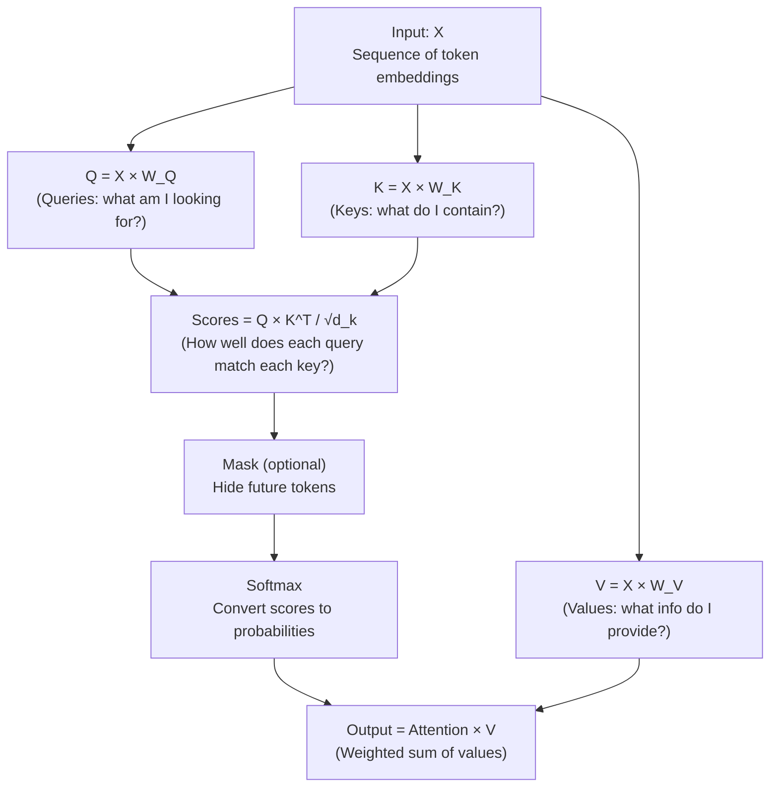
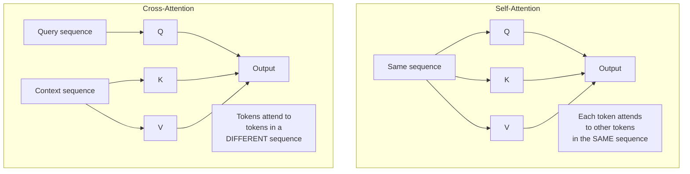

# 04.02 — Attention

> **One sentence:** Attention lets each token look at every other token in the sequence and decide how much to focus on each one — it's the mechanism that allows a model to understand that "it" in "The cat sat because it was tired" refers to "cat".

---

## The Core Idea

```
Sentence: "The cat sat on the mat because it was comfortable"

When processing "it", the model needs to know: what does "it" refer to?

Attention scores for the word "it":
  The     → 0.02  (not important)
  cat     → 0.15  (could be this)
  sat     → 0.05  
  on      → 0.01
  the     → 0.02
  mat     → 0.35  (strong candidate — "it" refers to the mat being comfortable)
  because → 0.01
  it      → 0.04
  was     → 0.02
  comfortable → 0.33  (reinforces mat interpretation)
```

---

## Scaled Dot-Product Attention



```python
import torch
import torch.nn.functional as F
import math

def scaled_dot_product_attention(Q, K, V, mask=None):
    """
    The fundamental attention computation.
    
    Q: (batch, seq_len, d_k) — Queries
    K: (batch, seq_len, d_k) — Keys  
    V: (batch, seq_len, d_v) — Values
    
    Returns: (batch, seq_len, d_v) — Attended output
    """
    d_k = K.size(-1)
    
    # Step 1: Compute attention scores
    # Each query asks: "How relevant is each key to me?"
    scores = torch.matmul(Q, K.transpose(-2, -1))  # (batch, seq_len, seq_len)
    
    # Step 2: Scale by √d_k
    # Without scaling, dot products grow with d_k, making softmax too sharp
    scores = scores / math.sqrt(d_k)
    
    # Step 3: Apply mask (for causal/decoder models)
    if mask is not None:
        scores = scores.masked_fill(mask == 0, float('-inf'))
    
    # Step 4: Softmax → probabilities (each row sums to 1)
    attention_weights = F.softmax(scores, dim=-1)
    
    # Step 5: Weighted sum of values
    output = torch.matmul(attention_weights, V)
    
    return output, attention_weights

# Example with 3 tokens, embedding dim 4
Q = torch.randn(1, 3, 4)  # 3 queries
K = torch.randn(1, 3, 4)  # 3 keys
V = torch.randn(1, 3, 4)  # 3 values

output, weights = scaled_dot_product_attention(Q, K, V)
print(f"Attention weights:\n{weights[0]}")
# Each row shows how much each token attends to every other token
# tensor([[0.42, 0.35, 0.23],   ← token 0 attends mostly to token 0
#         [0.18, 0.55, 0.27],   ← token 1 attends mostly to itself
#         [0.31, 0.22, 0.47]])  ← token 2 attends mostly to itself
```

---

## Query, Key, Value — The Intuition

Think of it like a **library search**:

```
You (Query):   "I want to know about machine learning"
Book (Key):    "Introduction to ML Algorithms"     → High match!
Book (Key):    "Cooking Italian Recipes"            → Low match
Book (Key):    "Advanced Neural Networks"            → Medium match

Value:         The CONTENT of each book

Attention = Look at all books (keys),
            figure out which are relevant (scores),
            read mostly the relevant ones (weighted sum of values)
```

```python
# Concrete example with real tokens
import numpy as np

# Simplified: 3 tokens, 4-dimensional embeddings
# "I love cats"
tokens = {
    "I":    np.array([1.0, 0.0, 0.5, 0.2]),
    "love": np.array([0.5, 1.0, 0.3, 0.8]),
    "cats": np.array([0.2, 0.3, 1.0, 0.1])
}

# The model learns weight matrices W_Q, W_K, W_V
# These project tokens into query/key/value spaces
W_Q = np.random.randn(4, 4) * 0.5
W_K = np.random.randn(4, 4) * 0.5
W_V = np.random.randn(4, 4) * 0.5

# For "cats", compute its query: "What am I looking for?"
q_cats = tokens["cats"] @ W_Q

# For all tokens, compute keys: "What do I represent?"
k_I    = tokens["I"] @ W_K
k_love = tokens["love"] @ W_K
k_cats = tokens["cats"] @ W_K

# Attention scores: how much should "cats" attend to each token?
score_I    = np.dot(q_cats, k_I) / np.sqrt(4)
score_love = np.dot(q_cats, k_love) / np.sqrt(4)
score_cats = np.dot(q_cats, k_cats) / np.sqrt(4)

# Softmax → probabilities
scores = np.array([score_I, score_love, score_cats])
attention = np.exp(scores) / np.exp(scores).sum()
print(f"'cats' attends to: I={attention[0]:.2f}, love={attention[1]:.2f}, cats={attention[2]:.2f}")

# Compute values and weighted sum
v_I    = tokens["I"] @ W_V
v_love = tokens["love"] @ W_V
v_cats = tokens["cats"] @ W_V

output = attention[0] * v_I + attention[1] * v_love + attention[2] * v_cats
# This output is "cats" enriched with context from the whole sentence
```

---

## Self-Attention vs. Cross-Attention



```python
# Self-attention: used in GPT-style models
# "The cat sat" — each word attends to all other words in the SAME sentence

# Cross-attention: used in encoder-decoder models (T5, translation)
# Encoder: "Le chat est assis" (French)
# Decoder: "The cat ___" — attends to the French tokens to generate English
```

---

## The Attention Complexity Problem

```
Self-attention computes ALL pairwise interactions:

Sequence length: n tokens
Computation: n × n attention scores
Memory: n × n attention matrix

  n = 512    →  262,144 scores    (fast)
  n = 4,096  →  16,777,216 scores (okay)
  n = 32,768 →  1,073,741,824 scores (slow!)
  n = 128K   →  16,384,000,000 scores (very expensive!)

This is O(n²) — the fundamental bottleneck of transformers.
```

---

## Why Scaling by √d_k?

```python
# Without scaling, attention scores explode with large dimensions

d_k = 64
q = torch.randn(d_k)
k = torch.randn(d_k)

# Dot product grows with dimension
dot = torch.dot(q, k)
print(f"d_k=64, dot product range: ≈ {-3*d_k**0.5:.1f} to {3*d_k**0.5:.1f}")
# Range: ≈ -24 to 24

# Softmax of large values → extremely peaked (one value ≈ 1, rest ≈ 0)
scores = torch.tensor([24.0, -24.0, 0.0])
print(f"Without scaling: {F.softmax(scores, dim=0)}")
# tensor([1.0000, 0.0000, 0.0000]) — only attends to ONE token!

# With scaling: divide by √64 = 8
scaled_scores = scores / math.sqrt(64)
print(f"With scaling:    {F.softmax(scaled_scores, dim=0)}")
# tensor([0.7310, 0.0180, 0.2510]) — balanced attention
```

---

## Key Takeaways

1. **Attention = selective focus** — each token decides what's relevant
2. **Q, K, V** = query (what I want), key (what I offer), value (my content)
3. **Scaled dot-product** prevents attention from becoming too sharp
4. **O(n²) complexity** is the main limitation of transformer attention
5. **Self-attention** processes one sequence; **cross-attention** bridges two sequences

---

## 💼 FAANG Interview Questions

1. *"Why do we need three separate projections (Q, K, V) instead of just using the input directly?"*
2. *"Explain the scaling factor √d_k. What happens without it?"*
3. *"Attention is O(n²). How would you handle a 1-million-token document?"*
