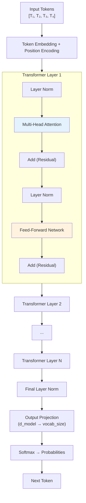
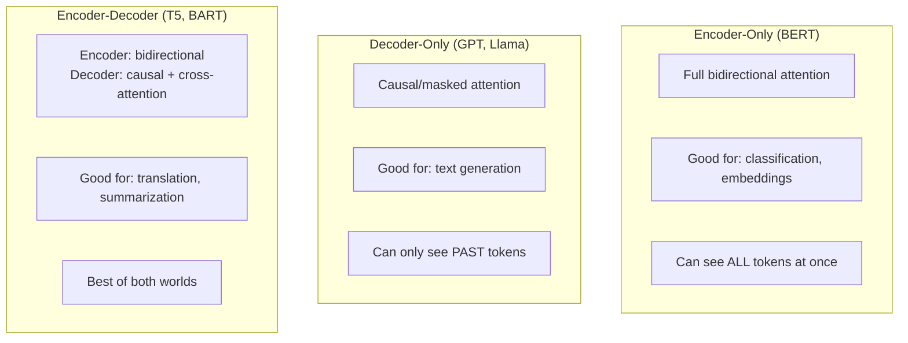

# 04.03 — Transformer Architecture

> **One sentence:** The transformer is a stack of identical layers, each containing multi-head attention and a feed-forward network, connected by residual connections and layer normalization — it's the architecture behind every modern LLM.

---

## The Full Architecture



---

## Component 1: The Embedding Layer

```python
import torch
import torch.nn as nn

class TransformerEmbedding(nn.Module):
    def __init__(self, vocab_size: int, d_model: int, max_len: int):
        super().__init__()
        self.token_embed = nn.Embedding(vocab_size, d_model)
        self.position_embed = nn.Embedding(max_len, d_model)
        self.d_model = d_model
    
    def forward(self, token_ids):
        """
        token_ids: (batch, seq_len) — integer token IDs
        Returns: (batch, seq_len, d_model) — embeddings
        """
        seq_len = token_ids.size(1)
        positions = torch.arange(seq_len, device=token_ids.device)
        
        # Scale embeddings (from original paper)
        x = self.token_embed(token_ids) * (self.d_model ** 0.5)
        x = x + self.position_embed(positions)
        
        return x
```

---

## Component 2: Multi-Head Attention

```python
class MultiHeadAttention(nn.Module):
    def __init__(self, d_model: int, num_heads: int):
        super().__init__()
        assert d_model % num_heads == 0
        
        self.d_model = d_model
        self.num_heads = num_heads
        self.d_k = d_model // num_heads  # Dimension per head
        
        # Linear projections for Q, K, V
        self.W_Q = nn.Linear(d_model, d_model)
        self.W_K = nn.Linear(d_model, d_model)
        self.W_V = nn.Linear(d_model, d_model)
        self.W_O = nn.Linear(d_model, d_model)  # Output projection
    
    def forward(self, x, mask=None):
        batch_size, seq_len, _ = x.shape
        
        # Project to Q, K, V
        Q = self.W_Q(x)  # (batch, seq_len, d_model)
        K = self.W_K(x)
        V = self.W_V(x)
        
        # Split into multiple heads
        # (batch, seq_len, d_model) → (batch, num_heads, seq_len, d_k)
        Q = Q.view(batch_size, seq_len, self.num_heads, self.d_k).transpose(1, 2)
        K = K.view(batch_size, seq_len, self.num_heads, self.d_k).transpose(1, 2)
        V = V.view(batch_size, seq_len, self.num_heads, self.d_k).transpose(1, 2)
        
        # Compute attention for all heads in parallel
        scores = torch.matmul(Q, K.transpose(-2, -1)) / (self.d_k ** 0.5)
        
        if mask is not None:
            scores = scores.masked_fill(mask == 0, float('-inf'))
        
        attention_weights = torch.softmax(scores, dim=-1)
        context = torch.matmul(attention_weights, V)
        
        # Concatenate heads
        # (batch, num_heads, seq_len, d_k) → (batch, seq_len, d_model)
        context = context.transpose(1, 2).contiguous().view(batch_size, seq_len, self.d_model)
        
        # Final projection
        output = self.W_O(context)
        
        return output
```

---

## Component 3: Feed-Forward Network (FFN)

```python
class FeedForward(nn.Module):
    """
    Two-layer MLP applied to each token independently.
    
    This is where the model "thinks" — attention gathers info,
    FFN processes it.
    """
    def __init__(self, d_model: int, d_ff: int):
        super().__init__()
        # Typically d_ff = 4 × d_model
        self.linear1 = nn.Linear(d_model, d_ff)
        self.linear2 = nn.Linear(d_ff, d_model)
        self.activation = nn.GELU()  # Modern transformers use GELU
    
    def forward(self, x):
        # (batch, seq_len, d_model) → (batch, seq_len, d_ff) → (batch, seq_len, d_model)
        return self.linear2(self.activation(self.linear1(x)))

# SwiGLU variant (used in Llama, Mistral — better performance)
class SwiGLU(nn.Module):
    def __init__(self, d_model: int, d_ff: int):
        super().__init__()
        self.w1 = nn.Linear(d_model, d_ff, bias=False)
        self.w2 = nn.Linear(d_ff, d_model, bias=False)
        self.w3 = nn.Linear(d_model, d_ff, bias=False)  # Gate
    
    def forward(self, x):
        # SwiGLU = Swish(W1·x) ⊙ (W3·x) → W2
        return self.w2(nn.functional.silu(self.w1(x)) * self.w3(x))
```

---

## Component 4: Layer Norm + Residual Connections

```python
class TransformerLayer(nn.Module):
    """One complete transformer layer."""
    
    def __init__(self, d_model: int, num_heads: int, d_ff: int):
        super().__init__()
        self.attention = MultiHeadAttention(d_model, num_heads)
        self.feed_forward = FeedForward(d_model, d_ff)
        self.norm1 = nn.LayerNorm(d_model)  # RMSNorm in modern LLMs
        self.norm2 = nn.LayerNorm(d_model)
    
    def forward(self, x, mask=None):
        # Pre-norm architecture (used in GPT-2+, Llama, etc.)
        # Original transformer used post-norm
        
        # Attention sublayer with residual connection
        normed = self.norm1(x)
        attended = self.attention(normed, mask)
        x = x + attended  # Residual: add input back to output
        
        # FFN sublayer with residual connection
        normed = self.norm2(x)
        fed_forward = self.feed_forward(normed)
        x = x + fed_forward  # Residual again
        
        return x
```

### Why Residual Connections?

```
Without residuals:
  x → Layer1 → Layer2 → ... → Layer96 → output
  Gradients must flow through 96 layers → vanishing gradients!

With residuals:
  x → x + Layer1(x) → x + Layer2(x) → ...
  Gradient has a "highway" — can flow directly from output to input
  Each layer only needs to learn the CHANGE (residual), not the full mapping
```

---

## Component 5: The Complete Model

```python
class GPTModel(nn.Module):
    """Simplified GPT-style transformer."""
    
    def __init__(self, vocab_size, d_model, num_heads, num_layers, d_ff, max_len):
        super().__init__()
        
        self.embedding = TransformerEmbedding(vocab_size, d_model, max_len)
        
        self.layers = nn.ModuleList([
            TransformerLayer(d_model, num_heads, d_ff)
            for _ in range(num_layers)
        ])
        
        self.final_norm = nn.LayerNorm(d_model)
        self.output_projection = nn.Linear(d_model, vocab_size, bias=False)
    
    def forward(self, token_ids):
        # Create causal mask (can't look at future tokens)
        seq_len = token_ids.size(1)
        mask = torch.tril(torch.ones(seq_len, seq_len)).unsqueeze(0).unsqueeze(0)
        
        # Embed tokens
        x = self.embedding(token_ids)
        
        # Pass through all transformer layers
        for layer in self.layers:
            x = layer(x, mask)
        
        # Final norm and project to vocabulary
        x = self.final_norm(x)
        logits = self.output_projection(x)  # (batch, seq_len, vocab_size)
        
        return logits

# GPT-4-scale model (estimated)
model = GPTModel(
    vocab_size=200_000,
    d_model=4096,      # Hidden dimension
    num_heads=64,       # 64 attention heads
    num_layers=96,      # 96 transformer layers
    d_ff=16384,         # FFN dimension (4x d_model)
    max_len=128_000     # Context window
)

total_params = sum(p.numel() for p in model.parameters())
print(f"Total parameters: {total_params:,}")
```

---

## Parameter Count Breakdown

```
For a model with d=4096, heads=64, layers=96, d_ff=16384, vocab=200K:

Per layer:
  Attention Q,K,V weights: 3 × d × d = 3 × 4096² = 50,331,648
  Attention output:        d × d     = 4096²      = 16,777,216
  FFN layer 1:            d × d_ff  = 4096×16384 = 67,108,864
  FFN layer 2:            d_ff × d  = 16384×4096 = 67,108,864
  Layer norms:            2 × 2 × d = 4 × 4096   = 16,384
  Per-layer total:                                 ≈ 201,342,976

All layers:
  96 layers × ~201M = ~19.3B parameters

Embedding + output:
  Token embedding:  vocab × d = 200K × 4096 = 819,200,000
  Output projection: d × vocab = 4096 × 200K = 819,200,000
  (Often shared → 819M)

Total: ~20B parameters (for a single expert)
```

---

## Encoder-Only vs. Decoder-Only vs. Encoder-Decoder



---

## Key Takeaways

1. **Transformer = stack of identical layers** with attention + FFN + residuals
2. **Attention** gathers information; **FFN** processes it per-token
3. **Residual connections** enable training of very deep networks (96+ layers)
4. **Layer normalization** stabilizes training
5. **Decoder-only** (GPT-style) dominates modern LLMs

---

## 💼 FAANG Interview Questions

1. *"Walk me through what happens when a token passes through one transformer layer."*
2. *"Why do transformers use residual connections? What happens without them?"*
3. *"A transformer has 70B parameters. Estimate how much GPU memory it needs for inference."*
