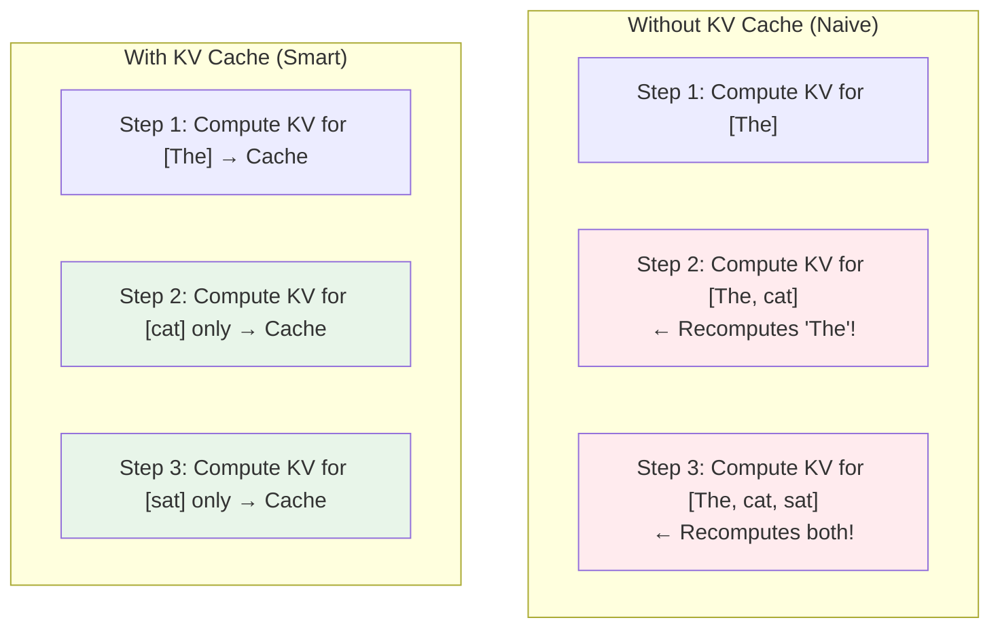
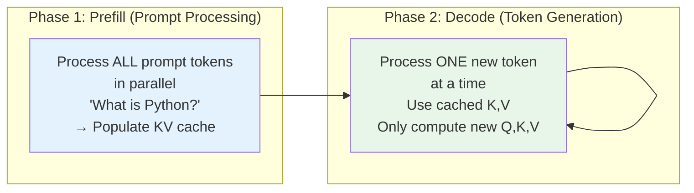
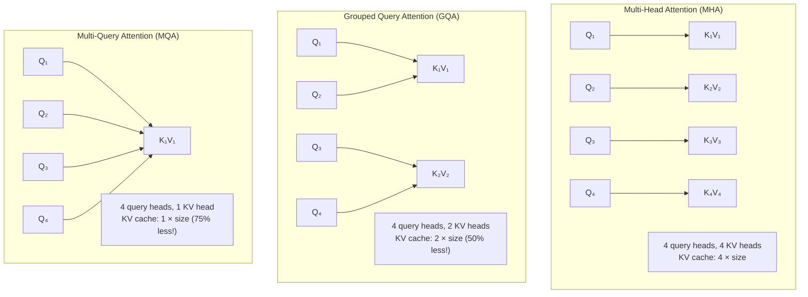

# 04.04 — KV Cache

> **One sentence:** The KV cache stores previously computed key and value tensors so that when generating each new token, the model doesn't have to recompute attention for the entire sequence — turning O(n²) per token into O(n).

---

## The Problem: Redundant Computation

```
Without KV cache — generating "The cat sat"

Token 1: Process ["The"]
  Compute Q, K, V for "The"
  Attention: [The] looks at [The]
  → Output: "cat"

Token 2: Process ["The", "cat"]
  Compute Q, K, V for "The"  ← WASTED! Already did this
  Compute Q, K, V for "cat"
  Attention: each token looks at all tokens
  → Output: "sat"

Token 3: Process ["The", "cat", "sat"]
  Compute Q, K, V for "The"  ← WASTED AGAIN!
  Compute Q, K, V for "cat"  ← WASTED AGAIN!
  Compute Q, K, V for "sat"
  → Output: "on"
```



---

## How KV Cache Works

```python
import torch

class AttentionWithKVCache:
    def __init__(self, d_model, num_heads):
        self.d_model = d_model
        self.num_heads = num_heads
        self.d_k = d_model // num_heads
        
        # Cached keys and values for each layer
        self.cached_K = None  # (batch, num_heads, cached_len, d_k)
        self.cached_V = None  # (batch, num_heads, cached_len, d_k)
    
    def forward(self, x, W_Q, W_K, W_V, W_O, use_cache=True):
        """
        x: (batch, 1, d_model) — ONLY the new token during generation
        """
        batch_size = x.size(0)
        
        # Compute Q, K, V for the NEW token only
        Q_new = (x @ W_Q).view(batch_size, 1, self.num_heads, self.d_k).transpose(1, 2)
        K_new = (x @ W_K).view(batch_size, 1, self.num_heads, self.d_k).transpose(1, 2)
        V_new = (x @ W_V).view(batch_size, 1, self.num_heads, self.d_k).transpose(1, 2)
        
        if use_cache and self.cached_K is not None:
            # Append new K, V to cache
            K = torch.cat([self.cached_K, K_new], dim=2)
            V = torch.cat([self.cached_V, V_new], dim=2)
        else:
            K = K_new
            V = V_new
        
        # Update cache
        self.cached_K = K
        self.cached_V = V
        
        # Attention: new token's query attends to ALL cached keys
        scores = (Q_new @ K.transpose(-2, -1)) / (self.d_k ** 0.5)
        weights = torch.softmax(scores, dim=-1)
        output = weights @ V
        
        # Reshape and project
        output = output.transpose(1, 2).contiguous().view(batch_size, 1, self.d_model)
        output = output @ W_O
        
        return output
```

---

## Two Phases of Generation



```python
def generate_with_kv_cache(model, prompt_tokens, max_new_tokens=50):
    """Two-phase generation with KV cache."""
    
    # Phase 1: PREFILL — process entire prompt at once
    # All tokens processed in parallel, KV cache filled
    logits, kv_cache = model.forward(
        prompt_tokens,       # All prompt tokens
        kv_cache=None        # No cache yet
    )
    
    # Get the first generated token
    next_token = sample(logits[:, -1, :])
    generated = [next_token]
    
    # Phase 2: DECODE — one token at a time
    for _ in range(max_new_tokens - 1):
        # Only pass the LATEST token + cached KV
        logits, kv_cache = model.forward(
            next_token.unsqueeze(1),  # Just 1 token!
            kv_cache=kv_cache          # Reuse cached K,V
        )
        
        next_token = sample(logits[:, -1, :])
        generated.append(next_token)
        
        if next_token == EOS:
            break
    
    return generated
```

---

## KV Cache Memory Analysis

```python
def calculate_kv_cache_size(
    num_layers: int,
    num_heads: int, 
    d_k: int,
    seq_len: int,
    batch_size: int = 1,
    dtype_bytes: int = 2  # float16
) -> dict:
    """Calculate KV cache memory requirements."""
    
    # Per layer: store K and V
    # Each: (batch_size, num_heads, seq_len, d_k)
    per_layer = 2 * batch_size * num_heads * seq_len * d_k * dtype_bytes
    
    total = per_layer * num_layers
    
    return {
        "per_layer_MB": per_layer / 1e6,
        "total_MB": total / 1e6,
        "total_GB": total / 1e9,
    }

# GPT-4 scale (estimated)
cache = calculate_kv_cache_size(
    num_layers=96,
    num_heads=96,
    d_k=128,        # d_model / num_heads = 12288 / 96
    seq_len=128000,  # 128K context
    batch_size=1
)
print(f"KV cache for 128K context: {cache['total_GB']:.1f} GB")
# ~56 GB just for KV cache of ONE request!

# Llama 3.1 70B
cache_llama = calculate_kv_cache_size(
    num_layers=80,
    num_heads=64,     # Using GQA: 8 KV heads
    d_k=128,
    seq_len=128000,
    batch_size=1
)
# With GQA (8 KV heads instead of 64): 
cache_gqa = calculate_kv_cache_size(
    num_layers=80,
    num_heads=8,      # GQA reduces KV heads
    d_k=128,
    seq_len=128000,
    batch_size=1
)
print(f"Without GQA: {cache_llama['total_GB']:.1f} GB")  # ~25 GB
print(f"With GQA:    {cache_gqa['total_GB']:.1f} GB")     # ~3.1 GB — 8x less!
```

---

## Grouped Query Attention (GQA) — Reducing KV Cache



```python
# GQA — used in Llama 2 70B, Llama 3, Mistral
class GroupedQueryAttention(nn.Module):
    def __init__(self, d_model, num_q_heads, num_kv_heads):
        super().__init__()
        self.num_q_heads = num_q_heads    # e.g., 32
        self.num_kv_heads = num_kv_heads  # e.g., 8
        self.group_size = num_q_heads // num_kv_heads  # 4 queries per KV group
        self.d_k = d_model // num_q_heads
        
        self.W_Q = nn.Linear(d_model, num_q_heads * self.d_k)
        self.W_K = nn.Linear(d_model, num_kv_heads * self.d_k)  # Fewer KV heads!
        self.W_V = nn.Linear(d_model, num_kv_heads * self.d_k)
        self.W_O = nn.Linear(d_model, d_model)
    
    def forward(self, x):
        B, S, _ = x.shape
        
        Q = self.W_Q(x).view(B, S, self.num_q_heads, self.d_k).transpose(1, 2)
        K = self.W_K(x).view(B, S, self.num_kv_heads, self.d_k).transpose(1, 2)
        V = self.W_V(x).view(B, S, self.num_kv_heads, self.d_k).transpose(1, 2)
        
        # Repeat K,V to match number of query heads
        # (B, 8, S, d_k) → (B, 32, S, d_k) by repeating each KV head 4 times
        K = K.repeat_interleave(self.group_size, dim=1)
        V = V.repeat_interleave(self.group_size, dim=1)
        
        # Standard attention from here
        scores = (Q @ K.transpose(-2, -1)) / (self.d_k ** 0.5)
        weights = torch.softmax(scores, dim=-1)
        out = (weights @ V).transpose(1, 2).contiguous().view(B, S, -1)
        
        return self.W_O(out)
```

---

## Key Takeaways

1. **KV cache eliminates redundant computation** — store K,V for previous tokens
2. **Two phases:** prefill (parallel, fills cache) and decode (sequential, uses cache)
3. **KV cache is the memory bottleneck** — can exceed model weights for long sequences
4. **GQA reduces KV cache by 4-8x** with minimal quality loss
5. **Memory = model weights + KV cache** — both grow with context length

---

## 💼 FAANG Interview Questions

1. *"Explain the KV cache. Why does it speed up generation?"*
2. *"Your model runs out of memory with long contexts. What options do you have?"*
3. *"Compare MHA, GQA, and MQA. What are the tradeoffs?"*
