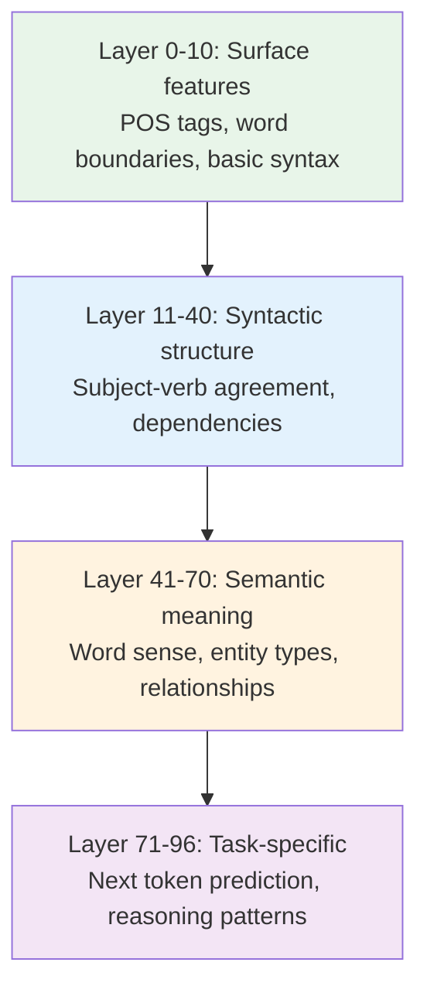

# 04.05 — What Attention Changes

> **One sentence:** Attention transforms each token's representation from a static embedding into a context-aware encoding — after attention, the vector for "bank" in "river bank" is completely different from "bank" in "bank account."

---

## Before vs. After Attention

```
BEFORE attention (static embedding):
  "bank" = [0.34, -0.12, 0.67, ...]  ← Same vector regardless of context

AFTER attention (contextualized):
  "river bank" → "bank" = [0.12, 0.45, -0.23, ...]  ← Nature-related
  "bank account" → "bank" = [0.78, -0.34, 0.11, ...] ← Finance-related
  
  The SAME word gets DIFFERENT representations based on surrounding words!
```

---

## What Each Layer Does



Research has shown that different layers capture different types of information:

```python
# What probing studies reveal about each layer:

# Early layers (1-20%):
#   - Part-of-speech tagging
#   - Token identity (which word is this?)
#   - Local syntactic patterns

# Middle layers (20-60%):
#   - Subject-verb agreement ("The cats ARE..." not "The cats IS...")
#   - Coreference resolution ("she" → "Alice")
#   - Semantic roles (who did what to whom)

# Late layers (60-100%):
#   - Task-specific representations
#   - Abstract reasoning patterns
#   - Next-token prediction features
```

---

## Attention Patterns

```
Different heads learn different patterns:

Head 1: "Previous token"
  Each token attends strongly to the token immediately before it.
  
Head 2: "Sentence start"
  Every token attends to the first token (captures global context).

Head 3: "Subject finder" 
  Verb tokens attend strongly to subject nouns.

Head 4: "Induction head"
  Looks for repeated patterns: [A][B]...[A] → predicts [B]
  This is how in-context learning works!
```

```python
# Visualizing attention patterns
def visualize_attention(model, text: str, layer: int, head: int):
    """Extract and display attention weights for a specific head."""
    tokens = tokenize(text)
    
    with torch.no_grad():
        outputs = model(tokens, output_attentions=True)
    
    # attention shape: (num_layers, batch, num_heads, seq_len, seq_len)
    attention = outputs.attentions[layer][0, head]
    
    token_labels = [detokenize([t]) for t in tokens[0]]
    
    print(f"\nAttention at Layer {layer}, Head {head}:")
    print(f"{'':12s}", end="")
    for label in token_labels:
        print(f"{label:>8s}", end="")
    print()
    
    for i, row_label in enumerate(token_labels):
        print(f"{row_label:12s}", end="")
        for j in range(len(token_labels)):
            weight = attention[i, j].item()
            print(f"{weight:8.3f}", end="")
        print()

# Example output for "The cat sat on the mat":
#              The     cat     sat      on     the     mat
# The        0.900   0.020   0.010   0.020   0.030   0.020
# cat        0.450   0.300   0.050   0.050   0.100   0.050
# sat        0.100   0.550   0.200   0.050   0.050   0.050
# on         0.050   0.100   0.600   0.150   0.050   0.050
# the        0.200   0.050   0.100   0.100   0.400   0.150
# mat        0.050   0.100   0.150   0.100   0.100   0.500
```

---

## The Residual Stream View

```
Modern interpretation: the transformer maintains a "residual stream"
that each layer reads from and writes to.

x₀ ────────────────────────────────────────────────────→ output
   ↑ Attn₁  ↑ FFN₁  ↑ Attn₂  ↑ FFN₂  ...  ↑ AttnN  ↑ FFNN
   └────────┘        └────────┘              └────────┘
   
Each layer:
1. READS from the residual stream (via Q, K, V projections)
2. Computes something useful (attention or FFN)
3. WRITES back by adding its output to the stream

The final representation is the SUM of all contributions:
  output = x₀ + Attn₁ + FFN₁ + Attn₂ + FFN₂ + ... + AttnN + FFNN
```

---

## Induction Heads — The Key to In-Context Learning

```python
# Induction heads are attention heads that implement pattern matching:
# If the model has seen [A][B] earlier, and now sees [A],
# it predicts [B] will come next.

# Example:
# "Harry likes cats. Ron likes dogs. Harry likes ___"
# 
# The induction head:
# 1. Current token "likes" with previous token "Harry" 
#    matches earlier pattern "Harry" → "likes" → "cats"
# 2. Predicts "cats"

# This is believed to be the mechanism behind few-shot learning:
# When you give examples in the prompt, induction heads recognize 
# the pattern and apply it to new inputs.
```

---

## How Attention Changes Information Flow

```python
import torch

# Before attention: each token is an independent embedding
tokens = ["The", "bank", "is", "by", "the", "river"]
embeddings = torch.randn(6, 768)  # Each token: isolated 768-dim vector

# After one attention layer: each token is context-aware
# "bank" now encodes: "I'm the word bank, and I'm near 'river'"
# This shifts its representation toward the "river bank" meaning

# After all layers: rich contextual representation
# "bank" encodes: syntactic role (noun, subject), semantic meaning 
# (geographical feature), relationship to "river," and prediction 
# features for what comes next

# We can verify this with cosine similarity:
def compare_representations(model, sentences, target_word):
    """Show how context changes a word's representation."""
    for sentence in sentences:
        # Get hidden states at each layer
        outputs = model(tokenize(sentence), output_hidden_states=True)
        
        # Find the target word's position
        word_pos = find_token_position(sentence, target_word)
        
        # Layer 0 (embedding only) vs. final layer
        embedding = outputs.hidden_states[0][0, word_pos]
        final = outputs.hidden_states[-1][0, word_pos]
        
        print(f"'{sentence}' — '{target_word}':")
        print(f"  Embedding norm: {embedding.norm():.3f}")
        print(f"  Final norm: {final.norm():.3f}")
        print(f"  Cosine(embed, final): {cosine_sim(embedding, final):.3f}")
        print()

compare_representations(model, [
    "I deposited money at the bank",
    "I walked along the river bank",
    "I need to bank on this strategy"
], "bank")
# Each "bank" will have very different final representations!
```

---

## Key Takeaways

1. **Attention creates context-aware representations** — same word, different meaning in different contexts
2. **Early layers capture syntax**, middle layers capture semantics, late layers capture task-specific features
3. **Induction heads** are the mechanism behind in-context learning
4. **The residual stream** is a shared information highway that all layers read from and write to
5. **Attention heads specialize** — different heads learn different linguistic patterns

---

## 💼 FAANG Interview Questions

1. *"How does the word 'bank' get different representations in different sentences?"*
2. *"What are induction heads and why do they matter for in-context learning?"*
3. *"If you removed all attention layers but kept FFN layers, what would happen?"*
