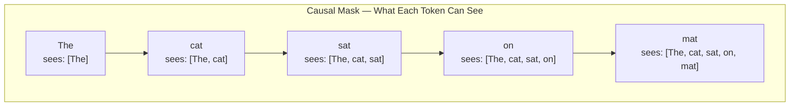

# 05.01 — Masked Attention

> **One sentence:** Masked (causal) attention prevents tokens from seeing future tokens during training and generation — this is what makes GPT-style models autoregressive.

---

## Why Masking?

```
During TRAINING, the model sees the complete sentence:
  "The cat sat on the mat"

But when GENERATING, it can only see what's been produced so far:
  Step 1: "The" → predict "cat"
  Step 2: "The cat" → predict "sat"
  
If during training "sat" could see "mat", it would be cheating!
The mask prevents this.
```

---

## The Causal Mask

```python
import torch

def create_causal_mask(seq_len: int) -> torch.Tensor:
    """
    Lower-triangular mask: each position can only attend
    to itself and earlier positions.
    """
    mask = torch.tril(torch.ones(seq_len, seq_len))
    return mask

mask = create_causal_mask(5)
print(mask)
# tensor([[1, 0, 0, 0, 0],    ← "The" sees only itself
#         [1, 1, 0, 0, 0],    ← "cat" sees "The" and itself
#         [1, 1, 1, 0, 0],    ← "sat" sees "The", "cat", and itself
#         [1, 1, 1, 1, 0],    ← "on" sees everything up to itself
#         [1, 1, 1, 1, 1]])   ← "mat" sees everything

# In the attention computation:
# scores = Q @ K^T → (seq_len, seq_len)
# scores[masked positions] = -infinity
# After softmax: -infinity → 0 probability → token is invisible
```



---

## Masked Attention Step by Step

```python
import torch
import torch.nn.functional as F
import math

def masked_attention(Q, K, V):
    """
    Full causal self-attention computation.
    
    Q, K, V: (batch, seq_len, d_k)
    """
    d_k = Q.size(-1)
    seq_len = Q.size(1)
    
    # Step 1: Compute raw attention scores
    scores = torch.matmul(Q, K.transpose(-2, -1)) / math.sqrt(d_k)
    # Shape: (batch, seq_len, seq_len)
    
    print("Raw scores:")
    print(scores[0].detach())
    
    # Step 2: Apply causal mask
    mask = torch.tril(torch.ones(seq_len, seq_len))
    scores = scores.masked_fill(mask == 0, float('-inf'))
    
    print("\nAfter masking (future = -inf):")
    print(scores[0].detach())
    
    # Step 3: Softmax (converts -inf to 0)
    attention_weights = F.softmax(scores, dim=-1)
    
    print("\nAttention weights (probabilities):")
    print(attention_weights[0].detach())
    
    # Step 4: Weighted sum of values
    output = torch.matmul(attention_weights, V)
    
    return output, attention_weights

# Example: 4 tokens, d_k=3
Q = torch.randn(1, 4, 3)
K = torch.randn(1, 4, 3)
V = torch.randn(1, 4, 3)

output, weights = masked_attention(Q, K, V)

# Output shows:
# Raw scores:
# tensor([[ 0.52, -0.31,  0.78,  0.12],
#         [ 0.15,  0.89, -0.45,  0.33],
#         [-0.22,  0.41,  0.67,  0.55],
#         [ 0.38, -0.11,  0.29,  0.81]])
#
# After masking:
# tensor([[ 0.52,  -inf,  -inf,  -inf],   ← Token 0: only sees itself
#         [ 0.15,  0.89,  -inf,  -inf],   ← Token 1: sees 0 and 1
#         [-0.22,  0.41,  0.67,  -inf],   ← Token 2: sees 0, 1, 2
#         [ 0.38, -0.11,  0.29,  0.81]])  ← Token 3: sees all
#
# Attention weights:
# tensor([[1.000, 0.000, 0.000, 0.000],   ← Token 0: 100% on itself
#         [0.322, 0.678, 0.000, 0.000],   ← Token 1: split between 0 and 1
#         [0.193, 0.362, 0.445, 0.000],   ← Token 2: distributed over 0,1,2
#         [0.224, 0.138, 0.205, 0.433]])  ← Token 3: distributed over all
```

---

## Bidirectional vs. Causal Attention

```
BIDIRECTIONAL (BERT, encoders):
┌─────────────────────────┐
│  1  1  1  1  1          │   Every token can see
│  1  1  1  1  1          │   every other token
│  1  1  1  1  1          │   
│  1  1  1  1  1          │   Used for: understanding, 
│  1  1  1  1  1          │   classification, embeddings
└─────────────────────────┘

CAUSAL (GPT, decoders):
┌─────────────────────────┐
│  1  0  0  0  0          │   Each token can only see
│  1  1  0  0  0          │   past tokens + itself
│  1  1  1  0  0          │   
│  1  1  1  1  0          │   Used for: text generation,
│  1  1  1  1  1          │   chat, code completion
└─────────────────────────┘

PREFIX-LM (PaLM, some models):
┌─────────────────────────┐
│  1  1  1  0  0          │   Prefix is bidirectional
│  1  1  1  0  0          │   (the prompt)
│  1  1  1  0  0          │   
│  1  1  1  1  0          │   Generation is causal
│  1  1  1  1  1          │   (the output)
└─────────────────────────┘
```

---

## Why Causal Masking Enables Parallel Training

```python
# The magic of causal masking during training:
# You can train on ALL positions simultaneously!

def train_step(model, text_tokens):
    """
    Training processes all positions in parallel.
    Each position predicts the next token using only past context.
    """
    # Input:  [The, cat, sat, on, the]
    # Target: [cat, sat, on, the, mat]
    
    input_ids = text_tokens[:, :-1]    # All except last
    target_ids = text_tokens[:, 1:]     # All except first
    
    # ONE forward pass processes ALL positions at once
    # Causal mask ensures each position only uses past context
    logits = model(input_ids)
    
    # Loss at EVERY position simultaneously
    loss = F.cross_entropy(
        logits.reshape(-1, vocab_size),
        target_ids.reshape(-1)
    )
    
    return loss

# This is much more efficient than generating one token at a time!
# Training: parallel (fast)
# Inference: sequential (slow, but KV cache helps)
```

---

## Key Takeaways

1. **Causal mask = lower triangular matrix** — prevents looking ahead
2. **-infinity scores → 0 probability** after softmax — future tokens are invisible
3. **Bidirectional** (BERT) for understanding; **causal** (GPT) for generation
4. **Training is parallel** thanks to masking — all positions computed at once
5. **Inference is sequential** — generate one token, extend the mask

---

## 💼 FAANG Interview Questions

1. *"Why does GPT use causal masking instead of bidirectional attention?"*
2. *"During training, GPT processes 4096 tokens at once. How is this possible if generation is sequential?"*
3. *"What would happen if you accidentally removed the causal mask during training?"*
