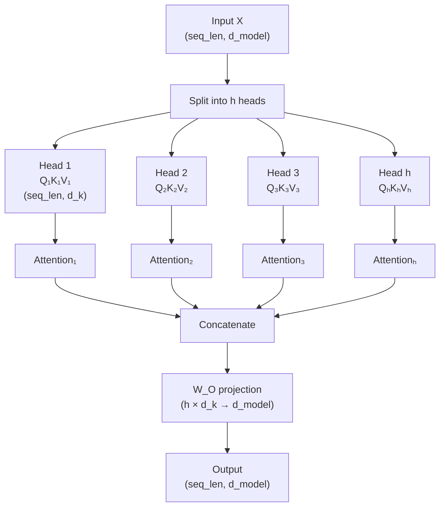

# 05.02 — Multi-Head Attention

> **One sentence:** Multi-head attention runs multiple attention operations in parallel, each focusing on different aspects of the input — one head might track syntax, another tracks semantics, another tracks position.

---

## Why Multiple Heads?

```
Single head: "bank" attends to everything with ONE perspective
  → Can capture syntax OR semantics, but hard to do both

Multi-head: "bank" attends with MANY perspectives simultaneously
  Head 1: Syntax  → "bank" is a noun, subject of the sentence
  Head 2: Meaning → "bank" is near "river" → geographical meaning
  Head 3: Position → "bank" is the 4th word
  Head 4: Pattern → "bank" follows "the" → expecting a noun
```

---

## How Multi-Head Attention Works



```python
import torch
import torch.nn as nn
import math

class MultiHeadAttention(nn.Module):
    """
    Multi-head attention from scratch.
    
    d_model = 512, num_heads = 8
    Each head works with d_k = 512/8 = 64 dimensions
    """
    
    def __init__(self, d_model: int = 512, num_heads: int = 8):
        super().__init__()
        assert d_model % num_heads == 0
        
        self.d_model = d_model
        self.num_heads = num_heads
        self.d_k = d_model // num_heads  # 64
        
        # Each head has its own Q, K, V projections
        # But we compute them all at once with big matrices
        self.W_Q = nn.Linear(d_model, d_model)  # Projects to ALL heads' Q
        self.W_K = nn.Linear(d_model, d_model)  # Projects to ALL heads' K
        self.W_V = nn.Linear(d_model, d_model)  # Projects to ALL heads' V
        self.W_O = nn.Linear(d_model, d_model)  # Combines all heads' output
    
    def forward(self, x, mask=None):
        batch_size, seq_len, _ = x.shape
        
        # Step 1: Project to Q, K, V for ALL heads at once
        Q = self.W_Q(x)  # (batch, seq_len, d_model)
        K = self.W_K(x)
        V = self.W_V(x)
        
        # Step 2: Reshape to separate heads
        # (batch, seq_len, d_model) → (batch, seq_len, num_heads, d_k) 
        # → (batch, num_heads, seq_len, d_k)
        Q = Q.view(batch_size, seq_len, self.num_heads, self.d_k).transpose(1, 2)
        K = K.view(batch_size, seq_len, self.num_heads, self.d_k).transpose(1, 2)
        V = V.view(batch_size, seq_len, self.num_heads, self.d_k).transpose(1, 2)
        
        # Step 3: Scaled dot-product attention (for ALL heads in parallel!)
        scores = Q @ K.transpose(-2, -1) / math.sqrt(self.d_k)
        # scores: (batch, num_heads, seq_len, seq_len)
        
        if mask is not None:
            scores = scores.masked_fill(mask == 0, float('-inf'))
        
        attention_weights = torch.softmax(scores, dim=-1)
        context = attention_weights @ V
        # context: (batch, num_heads, seq_len, d_k)
        
        # Step 4: Concatenate all heads
        # (batch, num_heads, seq_len, d_k) → (batch, seq_len, d_model)
        context = context.transpose(1, 2).contiguous()
        context = context.view(batch_size, seq_len, self.d_model)
        
        # Step 5: Final projection
        output = self.W_O(context)
        
        return output, attention_weights

# Example
mha = MultiHeadAttention(d_model=512, num_heads=8)
x = torch.randn(2, 10, 512)  # batch=2, seq_len=10, d_model=512
output, weights = mha(x)

print(f"Input:  {x.shape}")          # (2, 10, 512)
print(f"Output: {output.shape}")      # (2, 10, 512) — same shape!
print(f"Weights: {weights.shape}")    # (2, 8, 10, 10) — 8 attention patterns
```

---

## What Different Heads Learn

```python
# Research findings on GPT-2's attention heads:

head_patterns = {
    "positional_heads": {
        "description": "Attend to specific relative positions",
        "example": "Head 5.1 always attends to the previous token",
        "layers": "Early layers (1-6)"
    },
    "syntactic_heads": {
        "description": "Track grammatical relationships",
        "example": "Head 8.3 connects verbs to their subjects",
        "layers": "Middle layers (6-20)"
    },
    "induction_heads": {
        "description": "Copy patterns: [A][B]...[A] → predict [B]",
        "example": "Head 12.7 implements in-context learning",
        "layers": "Early-middle layers (5-15)"
    },
    "semantic_heads": {
        "description": "Group semantically related words",
        "example": "Head 20.5 connects 'cat' to 'furry', 'pet'",
        "layers": "Middle-late layers (15-30)"
    },
    "rare_token_heads": {
        "description": "Attend to unusual or important tokens",
        "example": "Head 15.2 focuses on proper nouns",
        "layers": "Various"
    }
}
```

---

## Computation Cost

```python
def multi_head_attention_cost(d_model, num_heads, seq_len, batch_size=1):
    """Calculate FLOPs for multi-head attention."""
    d_k = d_model // num_heads
    
    # Q, K, V projections: 3 × (batch × seq × d_model × d_model)
    qkv_flops = 3 * batch_size * seq_len * d_model * d_model
    
    # Attention scores: batch × heads × seq × seq × d_k
    attn_flops = batch_size * num_heads * seq_len * seq_len * d_k
    
    # Attention × V: same as scores
    context_flops = attn_flops
    
    # Output projection: batch × seq × d_model × d_model
    output_flops = batch_size * seq_len * d_model * d_model
    
    total = qkv_flops + attn_flops + context_flops + output_flops
    
    return {
        "QKV projections": qkv_flops,
        "Attention computation": attn_flops + context_flops,
        "Output projection": output_flops,
        "Total FLOPs": total
    }

# GPT-4 scale
cost = multi_head_attention_cost(
    d_model=4096, num_heads=64, seq_len=4096
)
for k, v in cost.items():
    print(f"  {k}: {v/1e9:.1f} GFLOPs")
```

---

## Key Takeaways

1. **Multi-head = parallel diverse attention** — each head learns different patterns
2. **Split the d_model** across heads — total computation stays the same as single-head
3. **Concatenate + project** combines all heads' perspectives
4. **Heads specialize naturally** — syntax, semantics, position, copying patterns
5. **The number of heads is a hyperparameter** — 8 to 128 in modern models

---

## 💼 FAANG Interview Questions

1. *"Why use 32 small attention heads instead of 1 big one?"*
2. *"If d_model=4096 and num_heads=64, what's the dimension each head works with?"*
3. *"Some attention heads seem redundant. Should we prune them?"*
