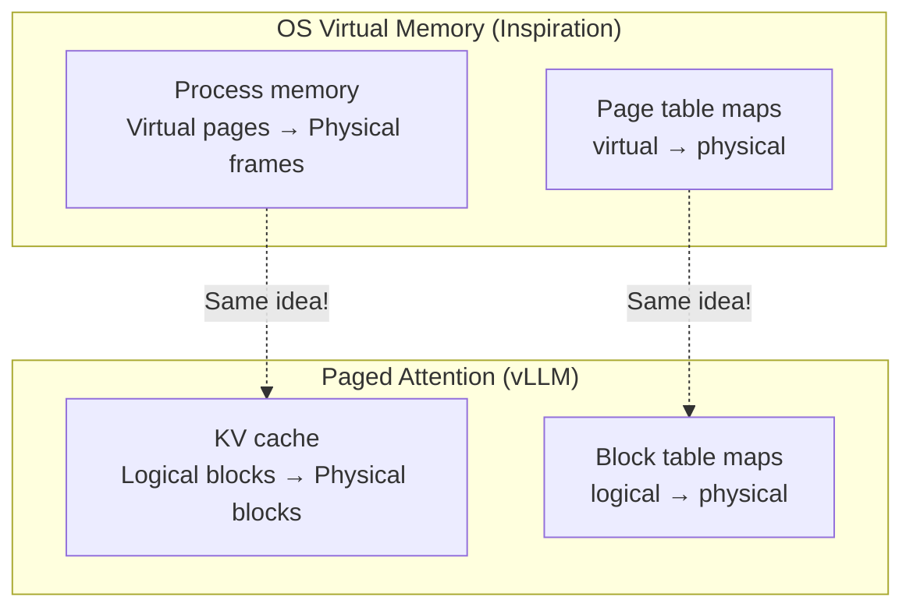

# 06.01 — Paged Attention

> **One sentence:** Paged attention borrows virtual memory ideas from operating systems to manage KV cache — instead of pre-allocating contiguous memory for each sequence, it allocates fixed-size "pages" on demand, reducing memory waste by up to 90%.

---

## The Memory Waste Problem

```
Traditional KV cache allocation:
━━━━━━━━━━━━━━━━━━━━━━━━━━━━━━

Request 1: "Tell me a joke" (will generate ~50 tokens)
  → Pre-allocate cache for max_seq_len = 2048 tokens
  → Actually uses 50 tokens
  → WASTE: 2048 - 50 = 1,998 slots wasted (97.5%!)

Request 2: "Summarize this 5-page document" (will generate ~500 tokens)
  → Pre-allocate cache for 2048 tokens
  → Actually uses 500 tokens
  → WASTE: 1,548 slots wasted (75.6%!)

This waste limits how many requests you can serve simultaneously!
```

---

## How Paged Attention Works



```python
# Conceptual implementation of paged KV cache
class PagedKVCache:
    """
    KV cache using fixed-size blocks (pages).
    Each block holds KV states for a fixed number of tokens.
    """
    
    def __init__(self, block_size: int = 16, num_blocks: int = 1000,
                 num_layers: int = 32, num_heads: int = 32, head_dim: int = 128):
        self.block_size = block_size  # Tokens per block
        
        # Physical block pool (pre-allocated GPU memory)
        # Each block: (num_layers, 2, num_heads, block_size, head_dim)
        # 2 = one for K, one for V
        self.physical_blocks = torch.zeros(
            num_blocks, num_layers, 2, num_heads, block_size, head_dim,
            device="cuda"
        )
        
        # Track which physical blocks are free
        self.free_blocks = list(range(num_blocks))
        
        # Block table: maps sequence_id → list of physical block indices
        self.block_tables = {}  # {seq_id: [block_0, block_1, ...]}
    
    def allocate_block(self, seq_id: int):
        """Allocate ONE new block for a sequence."""
        if not self.free_blocks:
            raise RuntimeError("Out of KV cache memory!")
        
        block_idx = self.free_blocks.pop()
        
        if seq_id not in self.block_tables:
            self.block_tables[seq_id] = []
        self.block_tables[seq_id].append(block_idx)
        
        return block_idx
    
    def free_sequence(self, seq_id: int):
        """Free all blocks for a completed sequence."""
        if seq_id in self.block_tables:
            self.free_blocks.extend(self.block_tables[seq_id])
            del self.block_tables[seq_id]
    
    def get_physical_blocks(self, seq_id: int) -> list:
        """Get physical block indices for a sequence."""
        return self.block_tables.get(seq_id, [])

# Memory comparison
def compare_memory_usage():
    """Traditional vs. paged allocation."""
    max_seq_len = 2048
    actual_lengths = [50, 200, 100, 500, 30]  # Actual token counts
    block_size = 16
    
    # Traditional: pre-allocate max for each request
    traditional = len(actual_lengths) * max_seq_len
    
    # Paged: only allocate blocks needed
    import math
    paged = sum(math.ceil(l / block_size) * block_size for l in actual_lengths)
    
    print(f"Traditional: {traditional:,} token slots")
    print(f"Paged:       {paged:,} token slots")
    print(f"Savings:     {(1 - paged/traditional)*100:.1f}%")

compare_memory_usage()
# Traditional: 10,240 token slots
# Paged:       896 token slots
# Savings:     91.3%!
```

---

## vLLM: The Production Implementation

```python
# vLLM uses paged attention to serve models efficiently
from vllm import LLM, SamplingParams

# Start a vLLM server
llm = LLM(
    model="meta-llama/Llama-3.1-70B-Instruct",
    tensor_parallel_size=4,  # Split across 4 GPUs
    max_model_len=128000,    # Support full 128K context
    gpu_memory_utilization=0.9,
    # Paged attention is automatic — no configuration needed!
)

# Batch multiple requests efficiently
prompts = [
    "Write a haiku about coding",         # Short response
    "Explain quantum computing in detail", # Long response  
    "What is 2+2?",                        # Very short response
]

outputs = llm.generate(prompts, SamplingParams(
    temperature=0.7,
    max_tokens=500
))

# vLLM automatically:
# 1. Allocates KV cache blocks as needed (not all upfront)
# 2. Shares blocks between sequences (copy-on-write for beam search)
# 3. Frees blocks as sequences complete
# 4. Continuously batches incoming requests
```

---

## Benefits of Paged Attention

```
                        Traditional    Paged (vLLM)
                        ───────────    ────────────
Memory waste            60-90%         < 5%
Max batch size          Small          3-5x larger
Throughput              Baseline       2-4x higher
Beam search memory      K × full copy  Shared blocks
Parallel sampling       K × full copy  Copy-on-write
```

---

## Key Takeaways

1. **Traditional KV cache wastes 60-90% of memory** by pre-allocating for max length
2. **Paged attention allocates fixed-size blocks** on demand — like OS virtual memory
3. **vLLM** is the standard implementation — 2-4x throughput improvement
4. **Copy-on-write** enables efficient beam search and parallel sampling
5. **This is a systems optimization**, not a model change — zero quality impact

---

## 💼 FAANG Interview Questions

1. *"How does paged attention reduce memory waste in LLM serving?"*
2. *"Your inference server runs out of GPU memory with 10 concurrent requests. How do you serve 50?"*
3. *"Explain the analogy between OS virtual memory and paged attention."*
