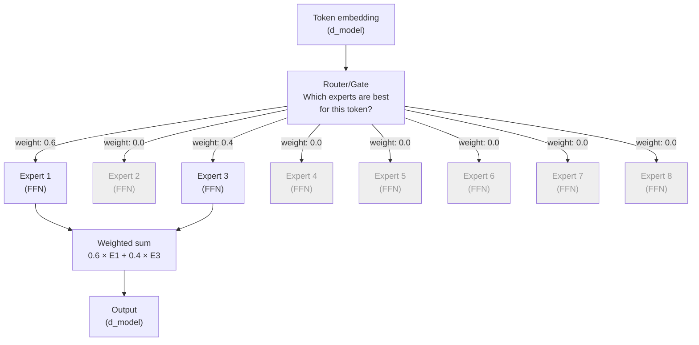

# 06.02 — Mixture of Experts (MoE)

> **One sentence:** MoE replaces one big feed-forward network with many smaller "expert" networks and a router that selects which experts to use for each token — getting a much larger model's knowledge with a much smaller model's compute cost.

---

## The Core Idea



```python
import torch
import torch.nn as nn
import torch.nn.functional as F

class MixtureOfExperts(nn.Module):
    """
    MoE layer — replaces the standard FFN in a transformer.
    
    8 experts, top-2 routing.
    Total parameters: 8x a standard FFN
    Active parameters per token: 2x a standard FFN (only 25% active!)
    """
    
    def __init__(self, d_model: int, d_ff: int, num_experts: int = 8, top_k: int = 2):
        super().__init__()
        self.num_experts = num_experts
        self.top_k = top_k
        
        # Router: decides which experts to use
        self.router = nn.Linear(d_model, num_experts)
        
        # Experts: each is a standard FFN
        self.experts = nn.ModuleList([
            nn.Sequential(
                nn.Linear(d_model, d_ff),
                nn.GELU(),
                nn.Linear(d_ff, d_model)
            )
            for _ in range(num_experts)
        ])
    
    def forward(self, x):
        """
        x: (batch, seq_len, d_model)
        """
        batch_size, seq_len, d_model = x.shape
        x_flat = x.view(-1, d_model)  # (batch*seq_len, d_model)
        
        # Step 1: Route — compute expert scores for each token
        router_logits = self.router(x_flat)  # (batch*seq_len, num_experts)
        
        # Step 2: Select top-k experts
        top_k_logits, top_k_indices = router_logits.topk(self.top_k, dim=-1)
        top_k_weights = F.softmax(top_k_logits, dim=-1)
        
        # Step 3: Compute expert outputs (only for selected experts)
        output = torch.zeros_like(x_flat)
        
        for i in range(self.top_k):
            expert_indices = top_k_indices[:, i]   # Which expert for each token
            expert_weights = top_k_weights[:, i]   # Weight for this expert
            
            for expert_id in range(self.num_experts):
                # Find tokens routed to this expert
                mask = (expert_indices == expert_id)
                if mask.any():
                    expert_input = x_flat[mask]
                    expert_output = self.experts[expert_id](expert_input)
                    output[mask] += expert_weights[mask].unsqueeze(-1) * expert_output
        
        return output.view(batch_size, seq_len, d_model)

# Example
moe = MixtureOfExperts(d_model=768, d_ff=3072, num_experts=8, top_k=2)
x = torch.randn(2, 10, 768)
out = moe(x)
print(f"Input: {x.shape}, Output: {out.shape}")  # Both (2, 10, 768)

# Parameter comparison
standard_ffn_params = 768 * 3072 + 3072 * 768  # ~4.7M
moe_total_params = 8 * standard_ffn_params      # ~37.7M (8x)
moe_active_params = 2 * standard_ffn_params      # ~9.4M (only 2x)
print(f"Standard FFN: {standard_ffn_params:,} params")
print(f"MoE total:    {moe_total_params:,} params (8x)")
print(f"MoE active:   {moe_active_params:,} per token (2x)")
```

---

## Real-World MoE Models

```
Model           Total Params    Active Params    Experts    Top-K
─────           ────────────    ─────────────    ───────    ─────
Mixtral 8x7B    46.7B           12.9B            8          2
GPT-4 (est.)    ~1.7T           ~280B            ~16        ~2
DeepSeek-V2     236B            21B              160        6
Switch-C        1.6T            ~1.6B            2048       1
Grok-1          314B            ~80B             8          2
```

```
The insight:
  GPT-4 has ~1.7 TRILLION parameters
  But each token only uses ~280 BILLION of them
  
  It's like having 16 specialist doctors:
  - For a coding question: the "code expert" and "logic expert" activate
  - For a poetry question: the "language expert" and "creativity expert" activate
  - You get the knowledge of ALL 16 doctors but only pay for 2 at a time
```

---

## Load Balancing — The Key Challenge

```python
class LoadBalancedMoE(nn.Module):
    """MoE with auxiliary load balancing loss."""
    
    def __init__(self, d_model, d_ff, num_experts=8, top_k=2):
        super().__init__()
        self.num_experts = num_experts
        self.top_k = top_k
        self.router = nn.Linear(d_model, num_experts)
        self.experts = nn.ModuleList([
            nn.Sequential(nn.Linear(d_model, d_ff), nn.GELU(), nn.Linear(d_ff, d_model))
            for _ in range(num_experts)
        ])
    
    def compute_load_balance_loss(self, router_probs, expert_indices):
        """
        Encourage equal usage of all experts.
        Without this, the router might always pick the same 2 experts
        and the other 6 would be wasted.
        """
        num_tokens = router_probs.size(0)
        
        # Fraction of tokens routed to each expert
        expert_usage = torch.zeros(self.num_experts, device=router_probs.device)
        for i in range(self.num_experts):
            expert_usage[i] = (expert_indices == i).float().sum() / num_tokens
        
        # Average router probability per expert
        avg_prob = router_probs.mean(dim=0)
        
        # Loss = dot product of usage × probability
        # Minimized when both are uniform (1/num_experts each)
        balance_loss = self.num_experts * (expert_usage * avg_prob).sum()
        
        return balance_loss
    
    # Add balance_loss to the training loss:
    # total_loss = language_model_loss + 0.01 * balance_loss
```

---

## Key Takeaways

1. **MoE = many small experts + a router** — sparse activation for efficiency
2. **Total params can be huge** but **active params per token are small** (25% typical)
3. **Load balancing** is critical — without it, experts become unequally used
4. **GPT-4 is believed to be MoE** — ~1.7T total params, ~280B active
5. **Tradeoff: more memory** (all experts loaded) but **less compute** per token

---

## 💼 FAANG Interview Questions

1. *"Explain MoE to a product manager. Why use it?"*
2. *"Your MoE model routes 80% of tokens to 2 out of 8 experts. What's the problem and fix?"*
3. *"Compare a dense 70B model vs. an MoE 8×7B model. Pros and cons?"*
