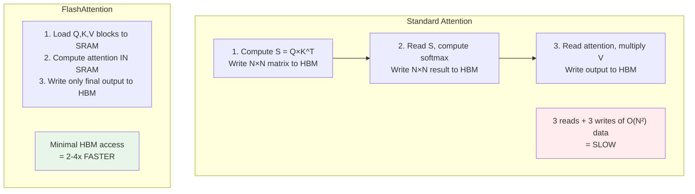

# 06.03 — FlashAttention

> **One sentence:** FlashAttention computes exact attention 2-4x faster by restructuring the computation to minimize GPU memory reads/writes — it's an IO-aware algorithm, not an approximation.

---

## The GPU Memory Hierarchy Problem

```
GPU Memory Hierarchy:
━━━━━━━━━━━━━━━━━━━

SRAM (on-chip)  │  ~20 MB   │  ~19 TB/s bandwidth  │  FAST
                │           │                        │
HBM (GPU VRAM)  │  ~80 GB   │  ~3 TB/s bandwidth   │  6x SLOWER
                │           │                        │
CPU RAM         │  ~256 GB  │  ~50 GB/s bandwidth   │  380x SLOWER

The bottleneck isn't computation — it's MOVING DATA between HBM and SRAM.
Standard attention reads/writes the N×N attention matrix to HBM.
FlashAttention avoids materializing this matrix entirely.
```



---

## How FlashAttention Works (Simplified)

```python
import torch
import math

def flash_attention_simplified(Q, K, V, block_size=64):
    """
    Simplified FlashAttention concept.
    
    Key ideas:
    1. Process Q, K, V in BLOCKS that fit in SRAM
    2. Never materialize the full N×N attention matrix
    3. Use online softmax to accumulate results incrementally
    """
    batch, num_heads, seq_len, d_k = Q.shape
    output = torch.zeros_like(Q)
    
    # Process Q in blocks
    num_blocks_q = math.ceil(seq_len / block_size)
    num_blocks_kv = math.ceil(seq_len / block_size)
    
    for q_block_idx in range(num_blocks_q):
        q_start = q_block_idx * block_size
        q_end = min(q_start + block_size, seq_len)
        Q_block = Q[:, :, q_start:q_end, :]  # Small block of queries
        
        # Running statistics for online softmax
        row_max = torch.full((batch, num_heads, q_end - q_start), float('-inf'))
        row_sum = torch.zeros(batch, num_heads, q_end - q_start)
        O_block = torch.zeros(batch, num_heads, q_end - q_start, d_k)
        
        # Process ALL K, V blocks for this Q block
        for kv_block_idx in range(num_blocks_kv):
            kv_start = kv_block_idx * block_size
            kv_end = min(kv_start + block_size, seq_len)
            K_block = K[:, :, kv_start:kv_end, :]
            V_block = V[:, :, kv_start:kv_end, :]
            
            # Compute attention scores for this block pair
            # This small matrix FITS IN SRAM — no HBM write needed!
            scores = Q_block @ K_block.transpose(-2, -1) / math.sqrt(d_k)
            
            # Online softmax: update running max and sum
            block_max = scores.max(dim=-1).values
            new_max = torch.maximum(row_max, block_max)
            
            # Rescale previous accumulator
            scale_old = torch.exp(row_max - new_max)
            scale_new = torch.exp(block_max - new_max)
            
            # Update: rescale old output + add new contribution
            row_sum = scale_old * row_sum + scale_new * torch.exp(
                scores - block_max.unsqueeze(-1)
            ).sum(dim=-1)
            
            O_block = scale_old.unsqueeze(-1) * O_block + \
                      scale_new.unsqueeze(-1) * (
                          torch.exp(scores - block_max.unsqueeze(-1)) @ V_block
                      )
            
            row_max = new_max
        
        # Normalize by sum
        output[:, :, q_start:q_end, :] = O_block / row_sum.unsqueeze(-1)
    
    return output
```

---

## Online Softmax — The Key Innovation

```python
# Standard softmax needs ALL values at once:
# softmax(x) = exp(xi) / Σ exp(xj)
# You need to know Σ exp(xj) — which requires seeing ALL values

# Online softmax computes incrementally:
# Process values in chunks, maintaining running statistics

def online_softmax_demo():
    """Show how online softmax works."""
    import numpy as np
    
    # Full sequence scores
    scores = np.array([2.0, 1.0, 3.0, 0.5, 2.5, 1.5])
    
    # Standard softmax
    standard = np.exp(scores - scores.max()) / np.sum(np.exp(scores - scores.max()))
    print(f"Standard: {standard}")
    
    # Online softmax (process in blocks of 2)
    running_max = float('-inf')
    running_sum = 0.0
    
    for block_start in range(0, len(scores), 2):
        block = scores[block_start:block_start + 2]
        block_max = block.max()
        
        new_max = max(running_max, block_max)
        
        # Rescale previous sum
        running_sum = running_sum * np.exp(running_max - new_max) + \
                      np.sum(np.exp(block - new_max))
        
        running_max = new_max
    
    online = np.exp(scores - running_max) / running_sum
    print(f"Online:   {online}")
    print(f"Match: {np.allclose(standard, online)}")  # True!

online_softmax_demo()
```

---

## Using FlashAttention in Practice

```python
# PyTorch 2.0+ has FlashAttention built in!
import torch

# Automatic: PyTorch selects FlashAttention when possible
with torch.nn.attention.sdpa_kernel(torch.nn.attention.SDPBackend.FLASH_ATTENTION):
    output = torch.nn.functional.scaled_dot_product_attention(
        query, key, value, 
        is_causal=True  # Causal mask
    )

# Or just use scaled_dot_product_attention — PyTorch auto-selects the best backend
output = torch.nn.functional.scaled_dot_product_attention(
    query, key, value, is_causal=True
)
# PyTorch chooses: FlashAttention, Memory-Efficient, or Math backend
```

---

## Performance Comparison

```
Sequence Length    Standard Attention    FlashAttention-2    Speedup
━━━━━━━━━━━━━━    ━━━━━━━━━━━━━━━━━    ━━━━━━━━━━━━━━━    ━━━━━━━
512               0.5ms                 0.3ms               1.7x
1,024             1.8ms                 0.7ms               2.6x
4,096             28ms                  5ms                 5.6x
16,384            450ms                 45ms                10x
65,536            OOM                   320ms               ∞

Memory usage:
  Standard: O(N²) — stores full attention matrix
  Flash:    O(N) — only stores output and running stats
```

---

## Key Takeaways

1. **FlashAttention is NOT an approximation** — it computes exact attention, just smarter
2. **IO-aware computation** — minimizes HBM reads/writes using SRAM tiling
3. **Online softmax** enables block-by-block computation without materializing N×N matrix
4. **2-4x faster, O(N) memory** instead of O(N²)
5. **Built into PyTorch 2.0+** — you get it automatically

---

## 💼 FAANG Interview Questions

1. *"Why is FlashAttention faster if it does the same computation?"*
2. *"Explain the GPU memory hierarchy and why it matters for attention."*
3. *"What is online softmax and why is it necessary for FlashAttention?"*
