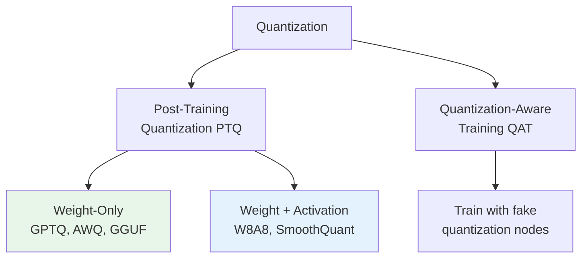

# 07.01 — Quantization

> **One sentence:** Quantization reduces model size and speeds up inference by using fewer bits per parameter — a 70B model in float16 (140GB) can be quantized to int4 (35GB) and run on a single GPU with minimal quality loss.

---

## Why Quantize?

```
Model: Llama 3.1 70B

Precision     Bits/param   Total Size    GPUs Needed    Speed
─────────     ──────────   ──────────    ───────────    ─────
float32       32 bits      280 GB        4× A100        1x
float16       16 bits      140 GB        2× A100        1.5x
int8 (W8A8)   8 bits       70 GB         1× A100        2x
int4 (GPTQ)   4 bits       35 GB         1× A100 ✓      2.5x
int4 (GGUF)   4 bits       ~40 GB        CPU possible!  0.3x
```

---

## Types of Quantization



### Weight-Only Quantization (Most Common)

```python
import torch
import numpy as np

def quantize_weights_int4(weight: torch.Tensor, group_size: int = 128):
    """
    Quantize float16 weights to int4 (4 bits per weight).
    
    Process:
    1. Split weights into groups of 128
    2. For each group, find min/max
    3. Map float values to 0-15 (4-bit range)
    """
    original_shape = weight.shape
    weight_flat = weight.reshape(-1, group_size)
    
    # Per-group scale and zero point
    w_min = weight_flat.min(dim=1, keepdim=True).values
    w_max = weight_flat.max(dim=1, keepdim=True).values
    
    scale = (w_max - w_min) / 15  # 4-bit: 0-15 = 16 levels
    zero_point = (-w_min / scale).round().clamp(0, 15)
    
    # Quantize
    quantized = ((weight_flat - w_min) / scale).round().clamp(0, 15).to(torch.uint8)
    
    # Pack two 4-bit values into one byte
    packed = quantized[:, 0::2] | (quantized[:, 1::2] << 4)
    
    return packed, scale, zero_point, original_shape

def dequantize_int4(packed, scale, zero_point, original_shape):
    """Reconstruct approximate float16 weights from int4."""
    # Unpack
    low = packed & 0x0F
    high = (packed >> 4) & 0x0F
    unpacked = torch.stack([low, high], dim=-1).reshape(packed.shape[0], -1)
    
    # Dequantize
    weight = (unpacked.float() - zero_point) * scale
    return weight.reshape(original_shape)

# Example
weight = torch.randn(4096, 4096, dtype=torch.float16)
packed, scale, zp, shape = quantize_weights_int4(weight)

print(f"Original size: {weight.numel() * 2 / 1e6:.1f} MB")  # 32 MB
print(f"Quantized size: {packed.numel() / 1e6:.1f} MB")       # ~8 MB (4x smaller)

# Check quality
reconstructed = dequantize_int4(packed, scale, zp, shape)
error = (weight.float() - reconstructed).abs().mean()
print(f"Mean absolute error: {error:.6f}")  # Very small!
```

---

## Popular Quantization Methods

### GPTQ (GPU-optimized, fast inference)

```python
# Using GPTQ with Hugging Face
from transformers import AutoModelForCausalLM, AutoTokenizer

model = AutoModelForCausalLM.from_pretrained(
    "TheBloke/Llama-2-70B-GPTQ",
    device_map="auto",
    trust_remote_code=True
)
# Model loads as int4 — fits on 1× A100!
```

### AWQ (Activation-Aware, best quality)

```python
# AWQ preserves important weights at higher precision
from awq import AutoAWQForCausalLM

model = AutoAWQForCausalLM.from_quantized(
    "TheBloke/Llama-2-70B-AWQ",
    fuse_layers=True  # Kernel fusion for speed
)
```

### GGUF (CPU-friendly, used by llama.cpp)

```bash
# Run quantized models locally on CPU/GPU
# Download a GGUF file
# Q4_K_M = 4-bit quantization, medium quality

# Using llama.cpp or Ollama:
ollama run llama3.1:70b-q4_K_M
# Runs 70B model on a MacBook Pro with 64GB RAM!
```

---

## Quality vs. Compression

```
Quantization Level   Size Reduction   Quality (MMLU)   Speed
━━━━━━━━━━━━━━━━━━   ━━━━━━━━━━━━━   ━━━━━━━━━━━━━   ━━━━━
FP16 (baseline)      1x               70.0%            1x
INT8                 2x               69.8%            1.5x
INT4 (GPTQ)         4x               69.2%            2x
INT4 (AWQ)          4x               69.5%            2x
INT3                 5.3x             67.0%            2.5x
INT2                 8x               55.0%            3x

The sweet spot is INT4 — 4x compression with <1% quality loss!
```

---

## Key Takeaways

1. **INT4 quantization is the sweet spot** — 4x compression, <1% quality loss
2. **AWQ > GPTQ** in quality, GPTQ is more widely available
3. **GGUF** enables running large models on consumer hardware
4. **Group-wise quantization** (groups of 128) preserves quality better than per-tensor
5. **Weight-only quantization** is simpler and usually sufficient for inference

---

## 💼 FAANG Interview Questions

1. *"Explain quantization to a non-technical stakeholder. What's the business case?"*
2. *"Your team wants to deploy Llama 70B on 2 A100s. What quantization would you recommend?"*
3. *"At what point does quantization degrade quality unacceptably? How do you measure it?"*
