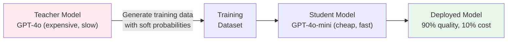

# 07.03 — Teaching a Smaller Model (Knowledge Distillation)

> **One sentence:** Knowledge distillation trains a small, fast "student" model to mimic a large, powerful "teacher" model — getting 90% of the quality at 10% of the cost.

---

## The Idea



```python
# Step 1: Generate training data with the teacher
import openai

client = openai.OpenAI()

def generate_teacher_data(prompts: list[str]) -> list[dict]:
    """Use GPT-4o to create high-quality training examples."""
    training_data = []
    
    for prompt in prompts:
        response = client.chat.completions.create(
            model="gpt-4o",  # Teacher: expensive but high quality
            messages=[
                {"role": "system", "content": "You classify support tickets."},
                {"role": "user", "content": prompt}
            ],
            temperature=0,
            logprobs=True,  # Get probability distribution (soft labels)
            top_logprobs=5
        )
        
        training_data.append({
            "prompt": prompt,
            "response": response.choices[0].message.content,
            "logprobs": response.choices[0].logprobs
        })
    
    return training_data

# Step 2: Fine-tune the student on teacher's outputs
# The student learns from the teacher's BEHAVIOR, not raw data
training_examples = generate_teacher_data([
    "My payment didn't go through",
    "How do I reset my password?",
    "The app crashes on startup",
    # ... thousands more
])

# Step 3: Fine-tune student model
# file = create_training_file(training_examples)
# job = client.fine_tuning.jobs.create(
#     training_file=file.id,
#     model="gpt-4o-mini"  # Student: cheap and fast
# )
```

---

## Why Soft Labels Matter

```python
# Hard labels (traditional training):
# Input: "My payment failed"  →  Label: "billing"
# The student only learns: this is "billing". Period.

# Soft labels (distillation):
# Input: "My payment failed"  →  Teacher's probabilities:
#   "billing":    0.85
#   "technical":  0.10  ← Teacher thinks it might be technical too!
#   "account":    0.04
#   "other":      0.01

# The student learns the NUANCE: this is mostly billing,
# but could have a technical component too.
# This extra information is the "dark knowledge" of the teacher.
```

---

## Distillation Strategies

| Strategy | How | When to use |
|----------|-----|-------------|
| **Output distillation** | Student mimics teacher's output text | Simplest, works for any API |
| **Logit distillation** | Student matches teacher's probability distribution | Best quality, needs logprobs |
| **Feature distillation** | Student matches teacher's internal representations | Requires model access |
| **Data augmentation** | Teacher generates training data for student | Most practical for API models |

---

## Cost Analysis

```python
# Why distillation saves money
def cost_comparison():
    queries_per_day = 1_000_000
    avg_input_tokens = 200
    avg_output_tokens = 50
    
    # Teacher (GPT-4o)
    teacher_cost = queries_per_day * (
        avg_input_tokens * 2.50 / 1e6 +   # Input
        avg_output_tokens * 10.00 / 1e6    # Output
    )
    
    # Student (GPT-4o-mini) 
    student_cost = queries_per_day * (
        avg_input_tokens * 0.15 / 1e6 +
        avg_output_tokens * 0.60 / 1e6
    )
    
    # Distillation cost (one-time)
    training_examples = 50_000
    distillation_cost = training_examples * (
        avg_input_tokens * 2.50 / 1e6 + avg_output_tokens * 10.00 / 1e6
    ) + 25  # Fine-tuning cost
    
    print(f"Teacher daily cost:     ${teacher_cost:,.2f}")
    print(f"Student daily cost:     ${student_cost:,.2f}")
    print(f"Daily savings:          ${teacher_cost - student_cost:,.2f}")
    print(f"One-time distill cost:  ${distillation_cost:,.2f}")
    print(f"Payback period:         {distillation_cost / (teacher_cost - student_cost):.1f} days")

cost_comparison()
# Teacher daily cost:     $1,000.00
# Student daily cost:     $60.00
# Daily savings:          $940.00
# One-time distill cost:  $50.00
# Payback period:         0.1 days  ← Pays for itself in 2 hours!
```

---

## Key Takeaways

1. **Distillation = large model teaches small model** — transfer knowledge cheaply
2. **Soft labels** carry more information than hard labels (the "dark knowledge")
3. **API-based distillation** is practical — use GPT-4o to train a GPT-4o-mini replacement
4. **ROI is enormous** — typically 90% cost savings with <5% quality loss
5. **Check terms of service** — some APIs prohibit using outputs for training competitors

---

## 💼 FAANG Interview Questions

1. *"Your team spends $50K/month on GPT-4o API calls. How do you reduce this?"*
2. *"Explain knowledge distillation. Why does it work?"*
3. *"What are the legal/ethical considerations of distilling a commercial model?"*
