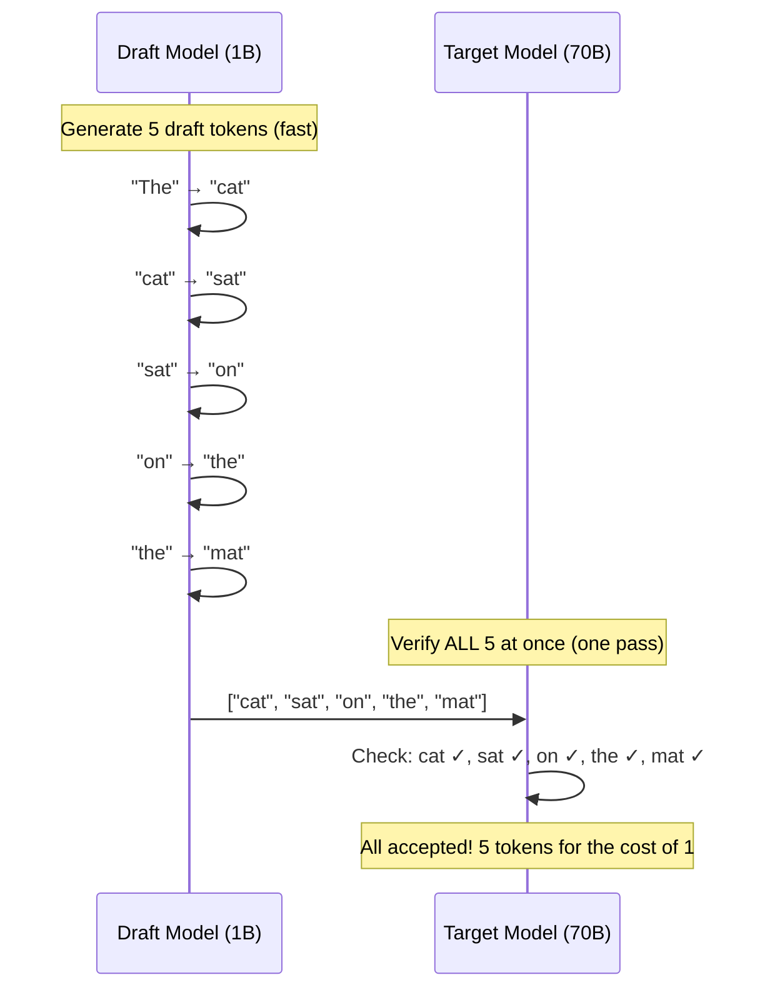

# 07.04 — Speculative Decoding

> **One sentence:** Speculative decoding uses a small, fast "draft" model to guess multiple tokens at once, then uses the large model to verify them all in a single pass — getting 2-3x speedup with zero quality loss.

---

## The Key Insight

```
Normal generation (sequential):
  Large model generates: token₁ (50ms) → token₂ (50ms) → token₃ (50ms)
  Total: 150ms for 3 tokens

Speculative decoding:
  Small model drafts:    token₁, token₂, token₃ (5ms total — it's tiny!)
  Large model verifies:  all 3 at once (50ms — parallel, just one forward pass!)
  Total: 55ms for 3 tokens — 2.7x faster!

Why verification is fast:
  The large model can CHECK n tokens in the same time it takes to GENERATE 1 token
  (Prefill is parallel; generation is sequential)
```



---

## How It Works

```python
import torch
import torch.nn.functional as F

def speculative_decode(
    target_model,    # Large model (70B) — the "judge"
    draft_model,     # Small model (1B) — the "drafter"
    prompt_tokens,
    num_speculative: int = 5,  # How many tokens to draft at once
    max_tokens: int = 100
):
    """
    Speculative decoding — zero quality loss, 2-3x speed.
    
    Guarantee: output distribution is IDENTICAL to target model alone.
    """
    generated = prompt_tokens.clone()
    
    while generated.size(1) < max_tokens:
        # STEP 1: Draft phase — small model generates K tokens quickly
        draft_tokens = []
        draft_probs = []
        current = generated
        
        for _ in range(num_speculative):
            with torch.no_grad():
                draft_logits = draft_model(current)
                draft_p = F.softmax(draft_logits[:, -1, :], dim=-1)
                token = torch.multinomial(draft_p, 1)
                
                draft_tokens.append(token)
                draft_probs.append(draft_p)
                current = torch.cat([current, token], dim=1)
        
        # STEP 2: Verify phase — large model checks ALL draft tokens at once
        # This is a SINGLE forward pass (parallel, like prefill)
        candidate = torch.cat([generated] + draft_tokens, dim=1)
        
        with torch.no_grad():
            target_logits = target_model(candidate)
        
        # STEP 3: Accept/reject each draft token
        num_accepted = 0
        
        for i in range(num_speculative):
            pos = generated.size(1) + i
            
            # Target model's probability for this token
            target_p = F.softmax(target_logits[:, pos - 1, :], dim=-1)
            draft_p = draft_probs[i]
            
            drafted_token = draft_tokens[i]
            
            # Acceptance criterion:
            # Accept with probability min(1, target_p / draft_p)
            p_accept = (target_p[0, drafted_token] / draft_p[0, drafted_token]).clamp(max=1.0)
            
            if torch.rand(1) < p_accept:
                num_accepted += 1
                generated = torch.cat([generated, drafted_token], dim=1)
            else:
                # Reject: sample from corrected distribution
                corrected = F.relu(target_p - draft_p)
                corrected = corrected / corrected.sum()
                new_token = torch.multinomial(corrected, 1)
                generated = torch.cat([generated, new_token], dim=1)
                break  # Stop accepting further drafts
        
        # If all accepted, sample one more from target
        if num_accepted == num_speculative:
            target_p = F.softmax(target_logits[:, -1, :], dim=-1)
            bonus_token = torch.multinomial(target_p, 1)
            generated = torch.cat([generated, bonus_token], dim=1)
    
    return generated
```

---

## Why There's ZERO Quality Loss

```
The acceptance/rejection sampling guarantees:
  P(output | speculative decoding) = P(output | target model alone)

Mathematical proof:
  If draft_p(token) ≤ target_p(token):
    Accept with probability 1 — draft model agrees with target
    
  If draft_p(token) > target_p(token):
    Accept with probability target_p / draft_p
    Reject with probability 1 - target_p / draft_p
    On rejection, sample from corrected distribution
    
  This exactly reproduces the target distribution!
```

---

## Speedup Analysis

```python
def estimate_speedup(
    target_time_per_token: float,  # ms
    draft_time_per_token: float,   # ms
    acceptance_rate: float,         # 0-1
    num_speculative: int            # tokens to draft
):
    """Estimate speedup from speculative decoding."""
    # Draft time
    draft_time = num_speculative * draft_time_per_token
    
    # Verify time (one target forward pass)
    verify_time = target_time_per_token
    
    # Expected tokens per step
    # Geometric series: E[accepted] = (1 - r^K) / (1 - r) if r = acceptance_rate
    expected_accepted = sum(acceptance_rate ** i for i in range(num_speculative))
    # Plus one bonus token if all accepted
    expected_tokens = expected_accepted + acceptance_rate ** num_speculative
    
    # Time per step
    time_per_step = draft_time + verify_time
    
    # Tokens per ms
    spec_throughput = expected_tokens / time_per_step
    base_throughput = 1 / target_time_per_token
    
    speedup = spec_throughput / base_throughput
    
    return {
        "expected_tokens_per_step": expected_tokens,
        "time_per_step_ms": time_per_step,
        "speedup": speedup
    }

# Example: Llama 70B (target) + Llama 1B (draft)
result = estimate_speedup(
    target_time_per_token=50,   # 50ms per token for 70B
    draft_time_per_token=3,     # 3ms per token for 1B
    acceptance_rate=0.7,        # 70% of drafts accepted
    num_speculative=5
)
print(f"Expected tokens per step: {result['expected_tokens_per_step']:.1f}")
print(f"Time per step: {result['time_per_step_ms']:.0f}ms")
print(f"Speedup: {result['speedup']:.1f}x")
# ~2.5x speedup!
```

---

## Key Takeaways

1. **Zero quality loss** — mathematically guaranteed same distribution as target model
2. **2-3x speedup** in practice with good draft/target model pairs
3. **Works because verification is parallel** (prefill) while generation is sequential
4. **Acceptance rate** depends on how well the draft model matches the target
5. **Best when:** target model is memory-bound (not compute-bound)

---

## 💼 FAANG Interview Questions

1. *"Explain speculative decoding. How can it be faster without losing quality?"*
2. *"What determines the acceptance rate? How do you choose a good draft model?"*
3. *"Would speculative decoding help if you're already batching 100 requests?"*
