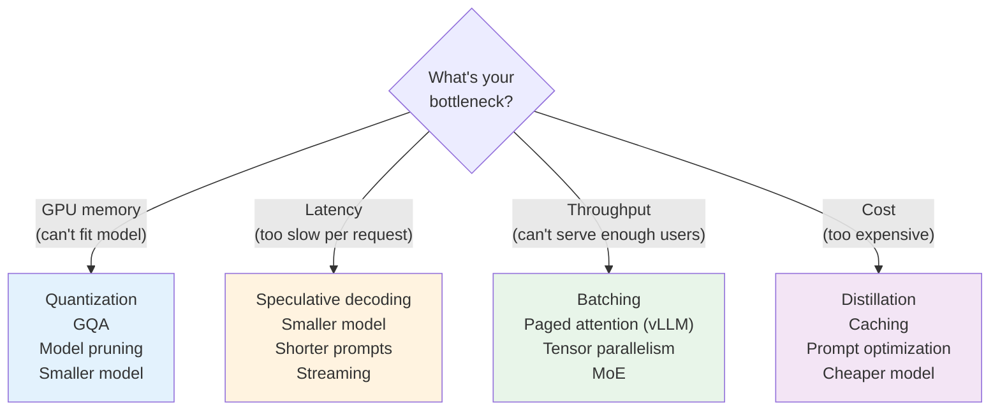

# 07.05 — Match the Optimization to the Bottleneck

> **One sentence:** The right optimization depends on YOUR bottleneck — applying the wrong optimization wastes engineering time and can even make things worse.

---

## The Four Bottlenecks



---

## Decision Matrix

| Symptom | Bottleneck | Optimizations | Anti-patterns |
|---------|-----------|---------------|---------------|
| "Model doesn't fit on GPU" | **Memory** | Quantization (int4/int8), GQA, model parallelism | Adding more batching (makes it worse) |
| "Each response takes 5s" | **Latency** | Speculative decoding, smaller model, streaming | Increasing batch size (adds latency) |
| "Can only serve 10 req/s" | **Throughput** | Continuous batching (vLLM), more GPUs, caching | Reducing batch size |
| "API bill is $50K/month" | **Cost** | Distillation, caching, prompt shortening, routing | Using bigger model "for quality" |

---

## Matching Optimization to Bottleneck

```python
def diagnose_and_recommend(metrics: dict) -> dict:
    """Given system metrics, recommend optimizations."""
    
    recommendations = []
    
    # Memory bottleneck
    if metrics["gpu_memory_usage"] > 0.9:
        recommendations.append({
            "bottleneck": "MEMORY",
            "evidence": f"GPU memory at {metrics['gpu_memory_usage']:.0%}",
            "fixes": [
                "Quantize model to int4 (4x reduction)",
                "Use GQA to reduce KV cache",
                "Enable paged attention (vLLM)",
                "Use a smaller model for simple queries"
            ]
        })
    
    # Latency bottleneck
    if metrics["p95_latency_ms"] > 3000:
        recommendations.append({
            "bottleneck": "LATENCY", 
            "evidence": f"p95 latency = {metrics['p95_latency_ms']}ms",
            "fixes": [
                "Enable streaming (perceived latency drops to TTFT)",
                "Speculative decoding (2-3x real speedup)",
                "Shorten prompts (fewer input tokens)",
                "Use smaller model for simple queries (routing)"
            ]
        })
    
    # Throughput bottleneck
    if metrics["requests_per_second"] < metrics["target_rps"]:
        recommendations.append({
            "bottleneck": "THROUGHPUT",
            "evidence": f"Serving {metrics['requests_per_second']} < target {metrics['target_rps']} RPS",
            "fixes": [
                "Enable continuous batching (vLLM/TGI)",
                "Add more GPUs with tensor parallelism",
                "Cache common queries/embeddings",
                "Use MoE model (more throughput per GPU)"
            ]
        })
    
    # Cost bottleneck  
    if metrics["monthly_cost"] > metrics["budget"]:
        recommendations.append({
            "bottleneck": "COST",
            "evidence": f"${metrics['monthly_cost']:,.0f}/mo > ${metrics['budget']:,.0f} budget",
            "fixes": [
                "Distill to smaller model (90% cost reduction)",
                "Implement semantic caching (avoid redundant calls)",
                "Route easy queries to cheaper model",
                "Optimize prompts (shorter = cheaper)"
            ]
        })
    
    return recommendations

# Example usage
metrics = {
    "gpu_memory_usage": 0.95,
    "p95_latency_ms": 4500,
    "requests_per_second": 15,
    "target_rps": 100,
    "monthly_cost": 45000,
    "budget": 20000
}

for rec in diagnose_and_recommend(metrics):
    print(f"\n🔴 {rec['bottleneck']}: {rec['evidence']}")
    for fix in rec['fixes']:
        print(f"   → {fix}")
```

---

## Key Takeaways

1. **Identify your bottleneck FIRST** — don't guess
2. **Quantization for memory**, speculative decoding for latency, batching for throughput, distillation for cost
3. **Measure before and after** every optimization
4. **Wrong optimizations waste time** and can make things worse
5. **Most systems have multiple bottlenecks** — address them in order of impact
