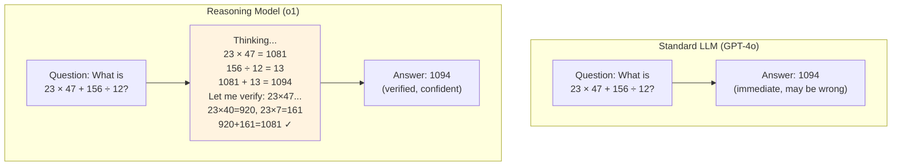
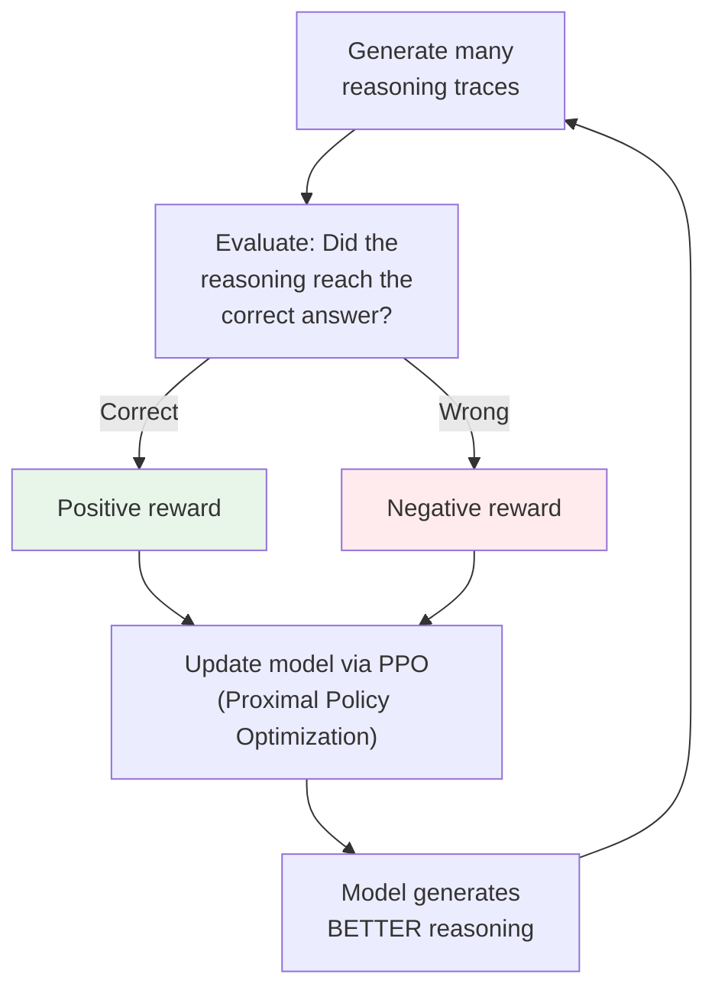

# 08.01 — Reasoning Models with Human Feedback

> **One sentence:** Reasoning models like OpenAI's o1 and DeepSeek-R1 are trained to "think" before answering — using reinforcement learning to develop internal chain-of-thought that dramatically improves performance on complex problems.

---

## Standard LLM vs. Reasoning Model



---

## How Reasoning Models Are Trained

```
Stage 1: Standard pre-training + instruction tuning (same as GPT-4)

Stage 2: Reinforcement Learning for Reasoning
  - Model generates "thinking" traces
  - Reward model scores: Did the reasoning lead to a correct answer?
  - Model learns to produce BETTER reasoning traces
  - Over time, the model develops:
    - Planning before answering
    - Self-correction mid-thought
    - Verification of intermediate steps
    - Backtracking when stuck

Stage 3: Distillation (optional)
  - Take the best reasoning traces
  - Fine-tune a smaller model on them
  - DeepSeek-R1-Distill-Llama-70B: reasoning distilled into Llama
```

```python
# Using a reasoning model via API
from openai import OpenAI
client = OpenAI()

# Standard model — immediate answer
response = client.chat.completions.create(
    model="gpt-4o",
    messages=[{"role": "user", "content": """
    A snail is at the bottom of a 30-foot well.
    Each day it climbs 3 feet and each night slides back 2 feet.
    How many days to reach the top?
    """}]
)
# Might say: "30 days" (wrong! Net 1 foot/day, but exits on day 28)

# Reasoning model — thinks first
response = client.chat.completions.create(
    model="o1",
    messages=[{"role": "user", "content": """
    A snail is at the bottom of a 30-foot well.
    Each day it climbs 3 feet and each night slides back 2 feet.
    How many days to reach the top?
    """}]
)
# Thinks: "Net progress per day = 3 - 2 = 1 foot
# After 27 days: snail is at 27 feet
# Day 28: climbs 3 feet → reaches 30 feet → EXITS before sliding back
# Answer: 28 days" ✓
```

---

## When to Use Reasoning Models

```python
model_selection = {
    "use_standard_llm": [
        "Simple Q&A",
        "Content generation",
        "Classification",
        "Summarization",
        "Translation",
        "Code completion (simple)",
    ],
    "use_reasoning_model": [
        "Multi-step math problems",
        "Logic puzzles",
        "Complex code debugging",
        "Scientific reasoning",
        "Strategic planning",
        "Problems requiring verification",
    ]
}

# Cost comparison
# Standard (GPT-4o): $2.50/$10 per 1M tokens (input/output)
# Reasoning (o1):    $15/$60 per 1M tokens + thinking tokens
# Reasoning models use 3-10x more tokens due to thinking!
```

---

## The RLHF Pipeline for Reasoning



---

## Key Takeaways

1. **Reasoning models "think" before answering** — produces chain-of-thought internally
2. **Trained with RL** — rewarded for reasoning traces that lead to correct answers
3. **Much better at complex tasks** — math, logic, multi-step reasoning
4. **More expensive** — 3-10x more tokens due to thinking
5. **Use strategically** — not every question needs deep reasoning

---

## 💼 FAANG Interview Questions

1. *"When would you use a reasoning model vs. a standard LLM?"*
2. *"How does RLHF improve reasoning capabilities?"*
3. *"A reasoning model takes 10x longer and costs 5x more. Justify using it."*
