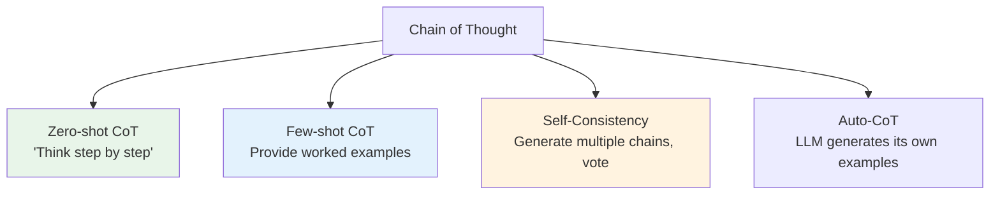

# 08.02 — Chain of Thought (CoT)

> **One sentence:** Chain of thought prompting asks the model to show its work step by step, dramatically improving accuracy on reasoning tasks — sometimes from 20% to 80%+ accuracy.

---

## The Magic Words: "Let's think step by step"

```python
# WITHOUT Chain of Thought:
response = client.chat.completions.create(
    model="gpt-4o",
    messages=[{"role": "user", "content": 
        "If a store has 3 boxes, each with 4 bags, each bag has 5 apples, "
        "and you remove 2 apples from each bag, how many apples are left?"
    }]
)
# Model might jump to an answer: "40" (wrong!)

# WITH Chain of Thought:
response = client.chat.completions.create(
    model="gpt-4o",
    messages=[{"role": "user", "content": 
        "If a store has 3 boxes, each with 4 bags, each bag has 5 apples, "
        "and you remove 2 apples from each bag, how many apples are left?\n\n"
        "Let's think step by step."
    }]
)
# Model outputs:
# Step 1: 3 boxes × 4 bags = 12 bags total
# Step 2: Each bag starts with 5 apples
# Step 3: Total apples initially: 12 × 5 = 60
# Step 4: Remove 2 from each bag: 12 × 2 = 24 removed
# Step 5: Remaining: 60 - 24 = 36 apples ✓
```

---

## CoT Variants



### Few-Shot CoT (Most Reliable)

```python
def math_with_cot(problem: str) -> str:
    return client.chat.completions.create(
        model="gpt-4o",
        messages=[
            {"role": "system", "content": "Solve math problems step by step."},
            # Example 1
            {"role": "user", "content": "A farmer has 15 chickens. He buys 3 more, then sells half. How many does he have?"},
            {"role": "assistant", "content": """Step 1: Start with 15 chickens
Step 2: Buy 3 more: 15 + 3 = 18 chickens
Step 3: Sell half: 18 ÷ 2 = 9 chickens
Answer: 9 chickens"""},
            # Actual problem
            {"role": "user", "content": problem}
        ],
        temperature=0
    ).choices[0].message.content
```

### Self-Consistency (Best Accuracy)

```python
def self_consistency_cot(problem: str, n_samples: int = 5) -> str:
    """Generate multiple reasoning chains and take majority vote."""
    answers = []
    
    for _ in range(n_samples):
        response = client.chat.completions.create(
            model="gpt-4o",
            messages=[
                {"role": "user", "content": f"{problem}\n\nThink step by step."}
            ],
            temperature=0.7  # Diversity in reasoning
        )
        
        chain = response.choices[0].message.content
        final_answer = extract_final_answer(chain)
        answers.append(final_answer)
    
    # Majority vote
    from collections import Counter
    most_common = Counter(answers).most_common(1)[0]
    
    return {
        "answer": most_common[0],
        "confidence": most_common[1] / n_samples,
        "all_answers": answers
    }

# Example: 5 chains might produce [36, 36, 36, 40, 36]
# Majority vote: 36 with 80% confidence
```

---

## When CoT Helps (and When It Doesn't)

| Task | Without CoT | With CoT | Improvement |
|------|------------|----------|-------------|
| Arithmetic (5 steps) | 20% | 80% | +60% |
| Logic puzzles | 35% | 75% | +40% |
| Code debugging | 50% | 70% | +20% |
| Simple classification | 90% | 90% | +0% |
| Translation | 85% | 82% | -3% (hurts!) |

**Rule:** CoT helps most when the task requires **multi-step reasoning**. For simple tasks, it wastes tokens and can actually hurt.

---

## Key Takeaways

1. **"Think step by step"** — 5 words that can double accuracy on hard problems
2. **Few-shot CoT** (with examples) is more reliable than zero-shot
3. **Self-consistency** (multiple chains + voting) gives the best accuracy
4. **Don't use CoT for simple tasks** — it wastes tokens and can decrease quality
5. **CoT costs more** — thinking tokens add to the bill

---

## 💼 FAANG Interview Questions

1. *"Why does chain-of-thought improve LLM performance? What's the mechanism?"*
2. *"When would chain-of-thought HURT performance?"*
3. *"Design a system that automatically decides whether to use CoT for a given query."*
