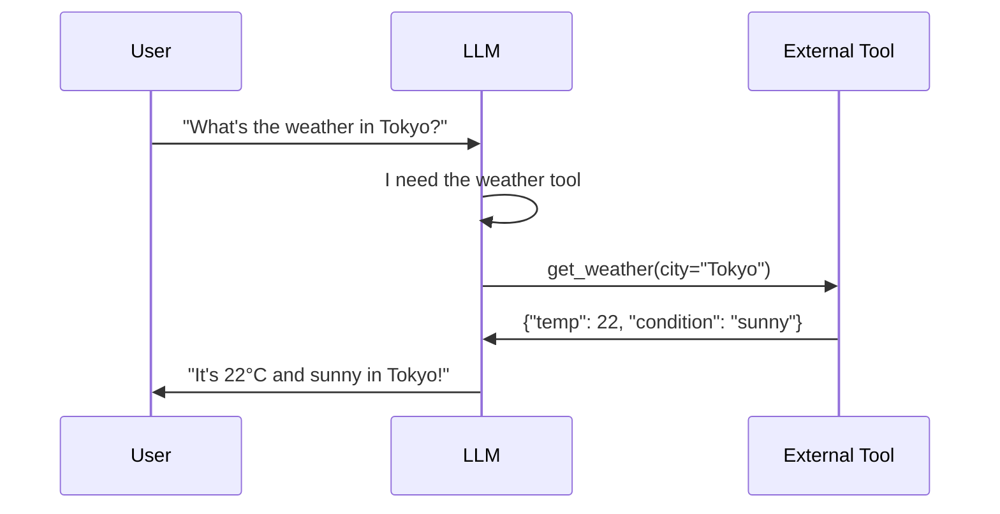

# 08.03 — Tool Usage in LLMs

> **One sentence:** Tool use lets LLMs call external functions — calculators, APIs, databases, code interpreters — overcoming their inherent limitations in math, real-time data, and actions.

---

## Why Tools?

```
LLM alone:
  "What's 7823 × 4817?"  → "37,683,591" (might be wrong)
  "What's the weather?"   → "I don't have real-time data"
  "Book a flight"         → "I can't take actions"

LLM with tools:
  "What's 7823 × 4817?"  → [calls calculator] → "37,683,591" ✓
  "What's the weather?"   → [calls weather API] → "72°F, sunny"
  "Book a flight"         → [calls booking API] → "Confirmed! ✈️"
```

---

## How Function Calling Works



```python
from openai import OpenAI
import json

client = OpenAI()

# Define available tools
tools = [
    {
        "type": "function",
        "function": {
            "name": "get_weather",
            "description": "Get current weather for a city",
            "parameters": {
                "type": "object",
                "properties": {
                    "city": {
                        "type": "string",
                        "description": "City name"
                    },
                    "unit": {
                        "type": "string",
                        "enum": ["celsius", "fahrenheit"],
                        "description": "Temperature unit"
                    }
                },
                "required": ["city"]
            }
        }
    },
    {
        "type": "function",
        "function": {
            "name": "calculate",
            "description": "Evaluate a mathematical expression",
            "parameters": {
                "type": "object",
                "properties": {
                    "expression": {
                        "type": "string",
                        "description": "Math expression to evaluate, e.g., '2 + 3 * 4'"
                    }
                },
                "required": ["expression"]
            }
        }
    }
]

# Implement the tools
def get_weather(city: str, unit: str = "celsius") -> dict:
    """Actual implementation — call a weather API."""
    # Simplified for demo
    return {"city": city, "temp": 22, "condition": "sunny", "unit": unit}

def calculate(expression: str) -> dict:
    """Safely evaluate math expressions."""
    try:
        result = eval(expression, {"__builtins__": {}}, {})
        return {"expression": expression, "result": result}
    except Exception as e:
        return {"error": str(e)}

TOOL_MAP = {
    "get_weather": get_weather,
    "calculate": calculate,
}

# The tool-use loop
def chat_with_tools(user_message: str) -> str:
    messages = [{"role": "user", "content": user_message}]
    
    while True:
        # Call the model
        response = client.chat.completions.create(
            model="gpt-4o",
            messages=messages,
            tools=tools,
            tool_choice="auto"  # Let the model decide when to use tools
        )
        
        message = response.choices[0].message
        
        # If no tool calls, return the response
        if not message.tool_calls:
            return message.content
        
        # Execute each tool call
        messages.append(message)  # Add assistant's tool_calls message
        
        for tool_call in message.tool_calls:
            func_name = tool_call.function.name
            args = json.loads(tool_call.function.arguments)
            
            print(f"  🔧 Calling {func_name}({args})")
            
            # Execute the tool
            result = TOOL_MAP[func_name](**args)
            
            # Send result back to the model
            messages.append({
                "role": "tool",
                "tool_call_id": tool_call.id,
                "content": json.dumps(result)
            })
        
        # Loop: model may need to call more tools or generate final answer

# Usage
print(chat_with_tools("What's 7823 * 4817 and what's the weather in Tokyo?"))
# 🔧 Calling calculate({'expression': '7823 * 4817'})
# 🔧 Calling get_weather({'city': 'Tokyo'})
# "7823 × 4817 = 37,683,591. The weather in Tokyo is 22°C and sunny."
```

---

## Tool Design Best Practices

```python
# GOOD tool description — specific, with examples
{
    "name": "search_database",
    "description": "Search the product database. Returns matching products "
                   "with name, price, and availability. Use this when the user "
                   "asks about product details, pricing, or availability.",
    "parameters": {
        "type": "object",
        "properties": {
            "query": {
                "type": "string",
                "description": "Search query, e.g., 'red running shoes size 10'"
            },
            "max_results": {
                "type": "integer",
                "description": "Maximum results to return (1-20)",
                "default": 5
            }
        }
    }
}

# BAD tool description — vague
{
    "name": "search",
    "description": "Search for things",  # Too vague!
    "parameters": {"type": "object", "properties": {"q": {"type": "string"}}}
}
```

---

## Parallel Tool Calls

```python
# Modern LLMs can call MULTIPLE tools at once
response = client.chat.completions.create(
    model="gpt-4o",
    messages=[{"role": "user", "content": 
        "Compare the weather in Tokyo, London, and New York"}],
    tools=tools,
    parallel_tool_calls=True  # Enable parallel execution
)

# The model returns 3 tool calls at once:
# get_weather(city="Tokyo")
# get_weather(city="London")  
# get_weather(city="New York")
# You can execute them in parallel!
```

---

## Key Takeaways

1. **Tools overcome LLM limitations** — math, real-time data, actions
2. **The model decides when and which tools to use** (tool_choice="auto")
3. **Tool descriptions matter** — clear descriptions = better tool selection
4. **Implement safety** — validate inputs, limit what tools can do
5. **Parallel tool calls** speed up multi-tool queries

---

## 💼 FAANG Interview Questions

1. *"Design a tool-use system for a customer support bot that can check orders, process refunds, and escalate to humans."*
2. *"How do you prevent an LLM from misusing tools? (e.g., calling delete instead of read)"*
3. *"Your LLM has 20 available tools but keeps choosing the wrong one. How do you fix this?"*
