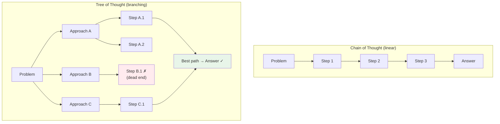

# 08.04 — Tree of Thought (ToT)

> **One sentence:** Tree of Thought explores multiple reasoning paths simultaneously, evaluates each branch, and backtracks when stuck — like how a chess player considers several moves ahead before choosing the best one.

---

## CoT vs. ToT



---

## How Tree of Thought Works

```python
from openai import OpenAI
import json

client = OpenAI()

def tree_of_thought(problem: str, breadth: int = 3, depth: int = 3) -> str:
    """
    Tree of Thought reasoning.
    
    1. Generate multiple approaches (breadth)
    2. Evaluate each approach
    3. Expand the most promising ones (depth)
    4. Backtrack from dead ends
    """
    
    # Step 1: Generate initial approaches
    approaches = generate_thoughts(problem, n=breadth)
    
    # Step 2: Evaluate and score each approach
    scored = [(evaluate_thought(problem, a), a) for a in approaches]
    scored.sort(reverse=True)  # Best first
    
    print(f"Initial approaches (scored):")
    for score, approach in scored:
        print(f"  [{score:.1f}] {approach[:60]}...")
    
    # Step 3: Expand the best approaches
    best_path = None
    best_score = -1
    
    for score, approach in scored[:2]:  # Explore top 2
        if score < 3:  # Skip low-scoring approaches
            continue
        
        # Go deeper on this path
        result = expand_path(problem, approach, depth=depth - 1)
        
        if result["score"] > best_score:
            best_score = result["score"]
            best_path = result
    
    return best_path["answer"] if best_path else "Could not find a solution."

def generate_thoughts(problem: str, n: int = 3) -> list[str]:
    """Generate n different approaches to a problem."""
    response = client.chat.completions.create(
        model="gpt-4o",
        messages=[{
            "role": "user",
            "content": f"""Given this problem, generate {n} different approaches to solve it.
For each approach, write one paragraph explaining the strategy.
Separate approaches with '---'.

Problem: {problem}"""
        }],
        temperature=0.9  # High diversity
    )
    return response.choices[0].message.content.split("---")

def evaluate_thought(problem: str, thought: str) -> float:
    """Score a reasoning step on a 1-10 scale."""
    response = client.chat.completions.create(
        model="gpt-4o",
        messages=[{
            "role": "user",
            "content": f"""Rate this approach to the problem on a scale of 1-10.
Consider: correctness, completeness, efficiency.
Return ONLY a number.

Problem: {problem}
Approach: {thought}"""
        }],
        temperature=0
    )
    try:
        return float(response.choices[0].message.content.strip())
    except ValueError:
        return 5.0

def expand_path(problem: str, approach: str, depth: int) -> dict:
    """Continue a reasoning path to completion."""
    response = client.chat.completions.create(
        model="gpt-4o",
        messages=[{
            "role": "user",
            "content": f"""Continue this approach to solve the problem completely.
Show your work step by step.

Problem: {problem}
Approach so far: {approach}"""
        }],
        temperature=0.3
    )
    
    answer = response.choices[0].message.content
    score = evaluate_thought(problem, answer)
    
    return {"answer": answer, "score": score, "approach": approach}

# Example usage
result = tree_of_thought(
    "You have 8 coins. One is lighter than the rest. "
    "Using a balance scale, find the lighter coin in the minimum number of weighings."
)
print(result)
```

---

## When to Use ToT vs. CoT

| Technique | Best For | Cost | Accuracy Gain |
|-----------|----------|------|--------------|
| **Zero-shot** | Simple tasks | 1x | Baseline |
| **CoT** | Multi-step, clear path | 1-2x | +20-40% |
| **Self-Consistency** | When CoT might err | 5-10x | +5-10% over CoT |
| **Tree of Thought** | Complex, multiple valid approaches | 10-50x | +10-20% over CoT |

---

## Key Takeaways

1. **ToT explores multiple paths** — doesn't commit to one approach
2. **Self-evaluation** lets the model assess and prune bad branches
3. **Backtracking** prevents wasting effort on dead-end approaches
4. **Very expensive** — 10-50x more API calls than simple CoT
5. **Best for complex, open-ended problems** where the solution path isn't obvious

---

## 💼 FAANG Interview Questions

1. *"Compare Chain of Thought, Self-Consistency, and Tree of Thought."*
2. *"When is Tree of Thought worth the 10x cost increase?"*
3. *"Design a system that dynamically chooses between CoT and ToT based on problem difficulty."*
