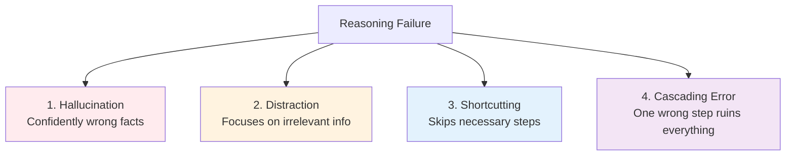
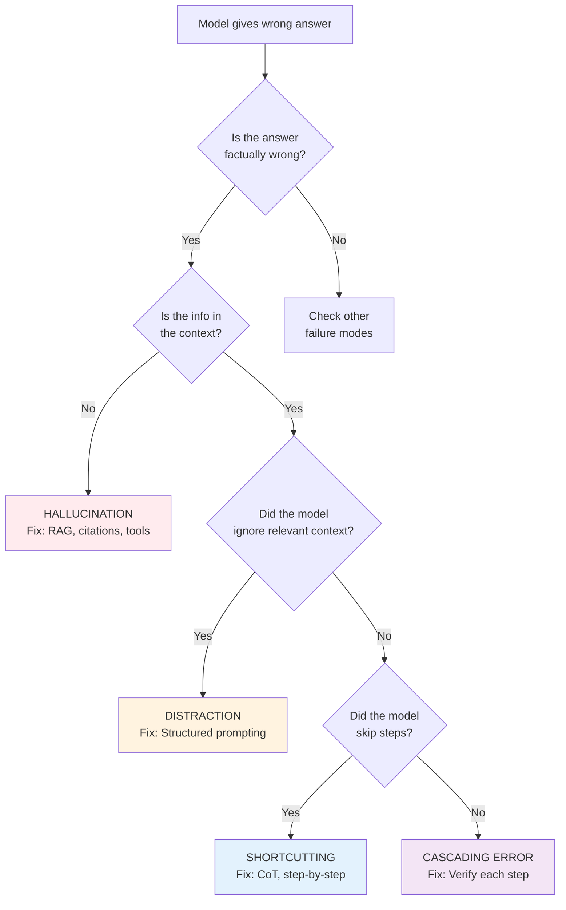

# 08.05 — Diagnose Four Reasoning Failures

> **One sentence:** LLMs fail at reasoning in predictable ways — learning to recognize these failure modes lets you choose the right fix every time.

---

## The Four Failure Modes



---

## Failure 1: Hallucination

```python
# Symptom: Model states false information confidently
# Example: "The Eiffel Tower is 1,063 feet tall" (it's 984 feet)

# Fixes:
hallucination_fixes = {
    "RAG": "Ground the model in retrieved documents",
    "Citations": "Require the model to cite sources",
    "Temperature=0": "Reduce randomness for factual queries",
    "Verification": "Use a second model call to fact-check",
    "Tool use": "Let the model look up facts instead of recalling",
}

def fact_checked_answer(question: str) -> dict:
    """Generate answer, then verify it."""
    # Generate
    answer = client.chat.completions.create(
        model="gpt-4o",
        messages=[{"role": "user", "content": question}],
        temperature=0
    ).choices[0].message.content
    
    # Verify
    check = client.chat.completions.create(
        model="gpt-4o",
        messages=[{"role": "user", "content": f"""
        Fact-check this answer. List any claims that might be incorrect.
        If all claims are correct, say "VERIFIED".
        
        Question: {question}
        Answer: {answer}
        """}],
        temperature=0
    ).choices[0].message.content
    
    return {"answer": answer, "verification": check, "verified": "VERIFIED" in check}
```

## Failure 2: Distraction

```python
# Symptom: Model focuses on irrelevant information in the prompt
# Example: "John has 5 apples. The sky is blue. Mary gives him 3 oranges.
#           How many apples does John have?"
# Wrong: "8" (confused apples and oranges)
# Right: "5" (the oranges are irrelevant to apple count)

# Fix: Structured prompting
def focused_reasoning(question: str) -> str:
    return client.chat.completions.create(
        model="gpt-4o",
        messages=[{"role": "user", "content": f"""
        {question}
        
        Before answering:
        1. Identify what the question is actually asking
        2. List ONLY the relevant information
        3. Ignore any irrelevant details
        4. Solve using only the relevant information
        """}],
        temperature=0
    ).choices[0].message.content
```

## Failure 3: Shortcutting

```python
# Symptom: Model skips intermediate steps and guesses
# Example: "What is 23 × 47 × 13?" → "14,053" (skipped showing work, wrong)

# Fix: Force step-by-step with explicit intermediate outputs
def no_shortcut_math(problem: str) -> str:
    return client.chat.completions.create(
        model="gpt-4o",
        messages=[{"role": "user", "content": f"""
        {problem}
        
        You MUST show every single intermediate calculation.
        Do NOT skip steps or estimate.
        After each step, verify it before proceeding.
        Format: Step N: [calculation] = [result] ✓
        """}],
        temperature=0
    ).choices[0].message.content
```

## Failure 4: Cascading Error

```python
# Symptom: One wrong step early on makes everything after it wrong
# Example:
# "Step 1: 23 × 47 = 1,071 ← WRONG (should be 1,081)
#  Step 2: 1,071 + 100 = 1,171 ← "correct" math but wrong number
#  Step 3: 1,171 ÷ 3 = 390.33 ← wrong because step 1 was wrong"

# Fix: Verification after each step
def verified_chain(problem: str) -> str:
    return client.chat.completions.create(
        model="gpt-4o",
        messages=[{"role": "user", "content": f"""
        {problem}
        
        After EACH step:
        1. State the result
        2. Verify it using a different method
        3. If verification fails, redo the step
        4. Only proceed when the step is verified
        """}],
        temperature=0
    ).choices[0].message.content
```

---

## Diagnostic Decision Tree



---

## Key Takeaways

1. **Hallucination** → Ground with data (RAG) or tools
2. **Distraction** → Structure the prompt to focus on relevant info
3. **Shortcutting** → Force step-by-step reasoning (CoT)
4. **Cascading errors** → Verify each step before proceeding
5. **Always diagnose FIRST** — the fix depends on the failure mode

---

## 💼 FAANG Interview Questions

1. *"Your chatbot confidently tells a customer the wrong refund policy. What type of failure is this and how do you fix it?"*
2. *"An LLM-powered math tutor gets the right approach but wrong final answer. Diagnose this."*
3. *"How would you build a system that automatically detects which type of reasoning failure occurred?"*
