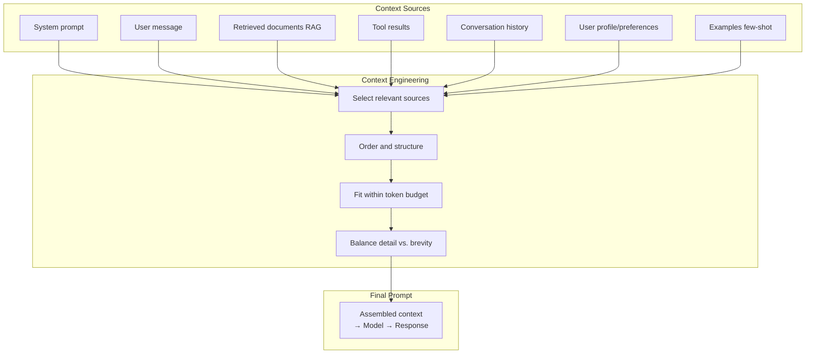

# 09.01 — Context Engineering

> **One sentence:** Context engineering is the art of assembling the perfect prompt — choosing what information to include, how to structure it, and what to leave out, all within the model's limited context window.

---

## What Is Context Engineering?

```
Prompt engineering:  "How should I phrase my question?"
Context engineering: "What information should the model have when it answers?"

Prompt engineering is about WORDING.
Context engineering is about INFORMATION ASSEMBLY.
```



---

## The Context Window Budget

```python
def plan_context_budget(
    model: str = "gpt-4o",
    max_output_tokens: int = 1000,
) -> dict:
    """Plan how to allocate the context window."""
    
    # Model context limits
    context_limits = {
        "gpt-4o": 128_000,
        "gpt-4o-mini": 128_000,
        "claude-3.5-sonnet": 200_000,
        "llama-3.1-70b": 128_000,
    }
    
    total = context_limits[model]
    available_input = total - max_output_tokens
    
    # Allocate the budget
    budget = {
        "system_prompt":      int(available_input * 0.10),   # 10%
        "few_shot_examples":  int(available_input * 0.15),   # 15%
        "retrieved_context":  int(available_input * 0.40),   # 40% — biggest chunk
        "conversation_history": int(available_input * 0.20), # 20%
        "user_message":       int(available_input * 0.10),   # 10%
        "tool_results":       int(available_input * 0.05),   # 5%
    }
    
    print(f"Model: {model} ({total:,} token window)")
    print(f"Reserved for output: {max_output_tokens:,} tokens")
    print(f"Available for input: {available_input:,} tokens")
    print(f"\nBudget allocation:")
    for component, tokens in budget.items():
        print(f"  {component:25s}: {tokens:>8,} tokens ({tokens/available_input*100:.0f}%)")
    
    return budget

plan_context_budget()
```

---

## Strategy 1: Smart Conversation History

```python
def manage_conversation_history(
    messages: list[dict],
    max_tokens: int = 20_000,
    strategy: str = "sliding_window"
) -> list[dict]:
    """Keep conversation history within token budget."""
    
    if strategy == "sliding_window":
        # Keep the most recent messages
        while estimate_tokens(messages) > max_tokens and len(messages) > 2:
            messages.pop(1)  # Remove oldest (keep system prompt at [0])
    
    elif strategy == "summarize":
        # Summarize old messages, keep recent ones
        if estimate_tokens(messages) > max_tokens:
            old_messages = messages[1:-5]  # All except system and last 5
            recent_messages = messages[-5:]
            
            summary = summarize_conversation(old_messages)
            
            messages = [
                messages[0],  # System prompt
                {"role": "system", "content": f"Previous conversation summary: {summary}"},
                *recent_messages
            ]
    
    elif strategy == "selective":
        # Keep messages that are relevant to the current query
        current_query = messages[-1]["content"]
        relevant = select_relevant_messages(messages[1:-1], current_query)
        messages = [messages[0]] + relevant + [messages[-1]]
    
    return messages

def summarize_conversation(messages: list[dict]) -> str:
    """Summarize older conversation turns."""
    conversation = "\n".join(f"{m['role']}: {m['content']}" for m in messages)
    
    response = client.chat.completions.create(
        model="gpt-4o-mini",  # Use cheap model for summarization
        messages=[{
            "role": "user",
            "content": f"Summarize this conversation in 3-5 bullet points, "
                       f"preserving key facts and decisions:\n\n{conversation}"
        }],
        max_tokens=200
    )
    return response.choices[0].message.content
```

---

## Strategy 2: Context Injection Patterns

```python
# Pattern 1: Retrieved Context (RAG)
def build_rag_context(query: str, retrieved_docs: list[dict]) -> str:
    """Structure retrieved documents for the prompt."""
    context = "## Relevant Documents\n\n"
    
    for i, doc in enumerate(retrieved_docs):
        context += f"### Document {i+1}: {doc['title']}\n"
        context += f"Relevance: {doc['score']:.2f}\n"
        context += f"{doc['text']}\n\n"
    
    return context

# Pattern 2: Structured User Profile
def build_user_context(user: dict) -> str:
    """Include relevant user information."""
    return f"""## User Context
- Name: {user['name']}
- Plan: {user['plan']} (since {user['since']})
- Previous issues: {', '.join(user['previous_issues'][-3:])}
- Preferred language: {user['language']}
"""

# Pattern 3: Dynamic System Prompt
def build_system_prompt(task_type: str, user: dict) -> str:
    """Customize system prompt based on context."""
    base = "You are a helpful customer support agent for TechCorp."
    
    additions = {
        "billing": "\nYou can process refunds up to $100 without approval.",
        "technical": "\nAlways ask for the user's OS and app version first.",
        "account": "\nNever reveal security questions or full account numbers.",
    }
    
    return base + additions.get(task_type, "")

# Assemble everything
def assemble_context(user_message: str, user: dict, task_type: str) -> list[dict]:
    """Full context assembly pipeline."""
    # 1. System prompt (customized)
    system = build_system_prompt(task_type, user)
    
    # 2. Retrieved docs
    docs = retrieve_relevant_docs(user_message, top_k=3)
    rag_context = build_rag_context(user_message, docs)
    
    # 3. User profile
    user_context = build_user_context(user)
    
    # 4. Assemble
    return [
        {"role": "system", "content": f"{system}\n\n{user_context}\n\n{rag_context}"},
        {"role": "user", "content": user_message}
    ]
```

---

## Strategy 3: Context Prioritization

```python
def prioritize_context(
    available_context: list[dict],
    token_budget: int,
    query: str
) -> list[dict]:
    """
    When you have MORE context than fits, prioritize intelligently.
    
    Priority order:
    1. System prompt (always include)
    2. User's current message (always include)
    3. Most relevant retrieved documents
    4. Recent conversation turns
    5. User profile
    6. Few-shot examples
    """
    # Score each context piece by relevance
    scored_context = []
    for ctx in available_context:
        relevance = compute_relevance(ctx["content"], query)
        freshness = ctx.get("timestamp", 0)  # Recent = higher
        importance = ctx.get("priority", 5)    # 1-10 scale
        
        score = 0.5 * relevance + 0.3 * freshness + 0.2 * importance
        scored_context.append((score, ctx))
    
    # Sort by score (highest first)
    scored_context.sort(key=lambda x: x[0], reverse=True)
    
    # Greedily add until budget is full
    selected = []
    tokens_used = 0
    
    for score, ctx in scored_context:
        ctx_tokens = estimate_tokens(ctx["content"])
        if tokens_used + ctx_tokens <= token_budget:
            selected.append(ctx)
            tokens_used += ctx_tokens
    
    return selected
```

---

## Common Mistakes

| Mistake | Problem | Fix |
|---------|---------|-----|
| **Too much context** | Relevant info gets "lost in the middle" | Prioritize, put important info first and last |
| **Too little context** | Model hallucinates to fill gaps | Retrieve more, add background info |
| **Stale context** | Old conversation turns confuse current query | Summarize old turns, use sliding window |
| **Wrong format** | Model misinterprets unstructured data | Use clear headers, markdown, XML tags |
| **Redundant context** | Wastes tokens on duplicate info | Deduplicate before injecting |

---

## Key Takeaways

1. **Context engineering > prompt engineering** — what info you include matters more than how you phrase it
2. **Budget your context window** — allocate tokens deliberately
3. **Summarize old conversations** — don't waste tokens on stale history
4. **Prioritize by relevance** — when you have too much, score and select
5. **Structure matters** — use headers, sections, XML tags for clarity

---

## 💼 FAANG Interview Questions

1. *"You have 128K tokens. Your user's conversation history is 200K tokens. What do you do?"*
2. *"Design a context assembly pipeline for a customer support chatbot."*
3. *"Research shows LLMs struggle with info in the 'middle' of long contexts. How do you address this?"*
